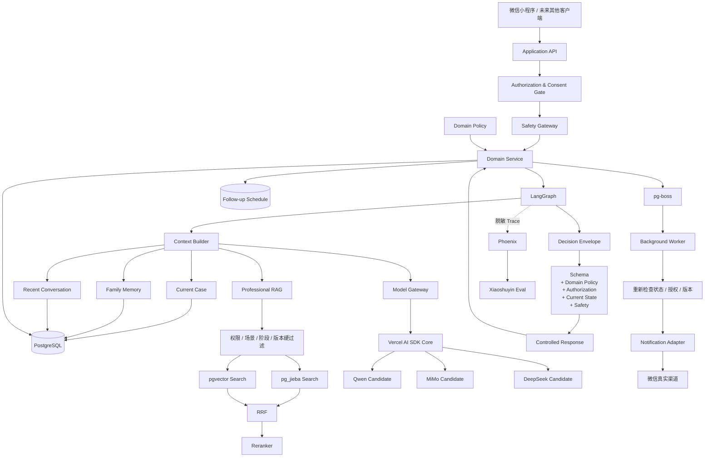
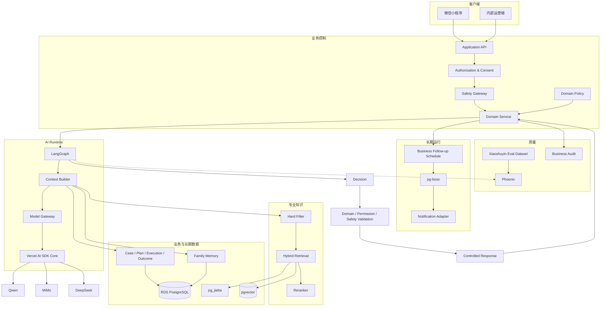

# 小树荫总体技术架构

> 文档性质：**覆盖 V1—V5 与暂定终局的总体技术架构**
>
> 版本：v1.1  
> 更新日期：2026-10-27
>
> 上位约束：
> - [01-project-definition.md](01-project-definition.md)
> - [03-product-vision-roadmap.md](03-product-vision-roadmap.md)
>
> V1 产品范围以 [04-v1-product-requirements.md](04-v1-product-requirements.md) 为唯一事实源。  
> V1 的具体表、接口、事务、部署和测试由 [06-v1-technical-design.md](06-v1-technical-design.md) 承接。
>
> **本文回答的是：小树荫从 V1 开始应该建立什么长期技术地基。它不要求今天提前实现 V2—V5。**

---

## 1. 架构目标

小树荫不是普通聊天机器人。

技术上要支撑的是：

> **一个长期存在的问题个案系统，由确定性业务规则和数据约束控制边界，由 AI 在边界内负责理解、推理和自然交流。**

长期核心循环：

```text
发现问题
→ 判断问题
→ 目标
→ 方案
→ 执行
→ 跟踪
→ 复盘
→ 调整
→ 维护
→ 结果
→ 更新家庭长期档案
```

因此架构必须同时解决：

- 长期 Case；
- 多年家庭数据；
- 来源和事实边界；
- 专业规则；
- 专业知识；
- AI 编排；
- 模型可替换；
- 权限与授权；
- 长期任务；
- 通知真实性；
- 安全；
- 结果；
- 评估与可观测。

---

## 2. 最终技术选型总表

| 能力 | 当前推荐 | 费用性质 |
|---|---|---|
| 开发语言 | **TypeScript / Node.js** | 🟢 免费开源 |
| HTTP 服务 | **Fastify** | 🟢 免费开源 |
| 家庭端 | **原生微信小程序** | 平台规则决定 |
| 内部运营端 | **React + Vite** | 🟢 免费开源 |
| AI 工作流编排 | **LangGraph JS** | 🟢 免费开源 |
| LangGraph 持久化 | **PostgreSQL Checkpointer（生产使用官方 PostgreSQL saver；不作为业务事实源）** | 基础设施内 |
| 模型调用运行层 | **Vercel AI SDK Core** | 🟢 免费开源 |
| 模型业务路由 | **自研轻量 Model Gateway** | 🟢 自研 |
| 核心业务数据库 | **阿里云 RDS PostgreSQL** | 🔵 云资源付费 |
| 向量检索 | **pgvector** | 🟢 免费开源 |
| 中文全文检索 | **pg_jieba + 专业词典** | 🟢 免费开源 |
| 长期家庭记忆 | **自研 Family Memory Layer** | 🟢 自研；模型调用付费 |
| 身份/用途/授权 | **Authorization & Consent Gate** | 🟢 自研 |
| 专业规则 | **TypeScript Domain Policy Layer** | 🟢 自研 |
| 专业 RAG | **Hybrid RAG：pg_jieba + pgvector + RRF + Reranker** | 基础软件免费 |
| Embedding 基线 | **text-embedding-v4 / 1024维** | 🔵 按量付费 |
| Reranker 基线 | **qwen3-rerank** | 🔵 按量付费 |
| 主模型 | **不锁死供应商，由 Xiaoshuyin Eval 决定任务路由** | 🔵 按量付费 |
| 当前候选池 | **Qwen / MiMo / DeepSeek 国内正式 API** | 🔵 按量付费 |
| Structured Output | **JSON Schema + Zod** | 🟢 技术免费 |
| 长期回访计划 | **PostgreSQL 业务 Schedule** | 基础设施内 |
| 异步任务 | **pg-boss** | 🟢 免费开源 |
| 外部通知 | **Notification Adapter + 微信真实渠道** | 按渠道 |
| AI Trace / Eval | **Arize Phoenix Self-hosted** | 🟢 自托管核心能力免费 |
| Safety | **确定性规则 + 上下文风险判断 + Safety State** | 规则免费；模型调用付费 |
| V1 语音输入 | **不交付；V1 只做文字交互** | — |
| V4 实时语音 | **国内可生产 Realtime 模型服务，届时按产品需求和 Eval 锁定** | 🔵 按量付费 |

“免费”只表示无许可证费用，不代表服务器为零成本。

---

## 3. 一句话架构

```text
Authorization
= 谁可以用哪些数据

Domain Policy
= 专业上允许做什么

LangGraph
= 当前 AI 流程怎么走

PostgreSQL
= 业务事实

Family Memory
= 这个家庭长期发生过什么、什么对它有效

RAG
= 专业知识

Model Gateway + AI SDK
= 用哪个模型、怎么调用

pg-boss
= 后台任务什么时候执行

Notification Adapter
= 如何真实触达

Phoenix
= AI 运行质量
```

---

## 4. 总体逻辑架构



---

## 5. 长期稳定的技术边界

未来具体模型、框架、数据库版本可以变化，但以下业务边界不应轻易推翻：

```text
Account
Person
Family
Case
Participant
Statement
Observation
Fact
Hypothesis
Goal
Plan
Execution
Review
Outcome
Consent
Authorization
Domain Policy
Risk
Referral
```

真正应该长期保护的是：

> **领域模型、数据来源、权限、专业规则、执行结果和评测资产。**

不是某个模型名称。

---

## 6. PostgreSQL：唯一业务事实源

PostgreSQL 保存：

- 家庭；
- 人；
- 账号；
- Case；
- 参与关系；
- 原始陈述；
- 观察；
- 已确认事实；
- AI 假设；
- 目标；
- 方案及版本；
- 任务；
- 执行；
- 反馈；
- 复盘；
- 结果；
- 风险；
- 转介；
- Consent；
- 权限；
- 长期档案；
- Follow-up Schedule；
- 业务审计。

原则：

> **LLM 不是数据库。**

> **LangGraph 也不是业务事实源。**

LangGraph checkpoint 只保存：

> AI 工作流运行状态。

Phoenix 只保存：

> AI 可观测信息。

pg-boss 只保存：

> 待执行/已执行任务。

---

## 7. LangGraph 与业务状态的边界

LangGraph 负责：

- 当前 AI 咨询任务；
- 节点；
- 分支；
- interrupt；
- resume；
- checkpoint；
- 工具编排；
- Decision / Response 执行顺序。

PostgreSQL Domain Tables 负责：

- 当前 Case 真实阶段；
- 当前方案；
- 当前权限；
- 当前安全状态；
- 当前结果；
- 当前长期档案。

建议逻辑分区：

```text
app.*
    业务事实

langgraph.*
    checkpoint / workflow state
```

恢复旧 LangGraph thread 时：

> 必须重新读取最新 Case、Consent、Safety 和 Policy。

V1 生产持久化使用：

> **LangGraph 官方 PostgreSQL Checkpointer。**

Checkpoint 与业务表可以位于同一 PostgreSQL 实例，但必须逻辑隔离；Checkpoint 只保存可恢复的 AI workflow state。Case / Plan / Consent / Safety / Scene Node 等正式状态仍以 Domain Tables 为准。

不能让旧 checkpoint 恢复已经撤销的权限或过期业务事实。

---

## 8. Domain Policy Layer

专业规则不能全部交给 RAG 或模型。

建立：

# TypeScript Domain Policy Layer

每个正式场景拥有 Scene Specification。Scene 不是只有 assessment / goal / plan；**Problem Formulation 与 Intervention 是一等业务概念**。V1 Digital Use 的最低结构为：

```text
scenes/
  digital-use/
    evidence
    eligibility
    exclusions
    assessment
    formulation
    goals
    interventions/
      family-alliance
      target-list
      communication
      phone-use-contract
      execution-support
    plan
    follow-up
    review
    maintenance
    closure
    safety
```

其中：

- Common Core 定义可复用的 Case / Formulation / Goal / Plan / Task / Execution / Follow-up / Review / Maintenance / Closure 能力；
- Scene Specification 定义“这个具体问题如何判断、用什么干预、如何走完自己的专业流程”；
- V1 Digital Use Scene 的 A1001—A5002 原流程由 04 定义，05 不重新改写其节点顺序和业务含义；
- Intervention 不是 RAG 文本标签，也不是模型自由生成的策略名称，而是可版本化、可审核、可测试的 Scene 专业资产；
- RAG 提供解释和知识依据，不能替代 Intervention / Domain Policy 的正式规则。

Domain Policy 回答：

> **现在允许做什么。**

例如：

```text
缺少必要睡眠信息
→ 不允许正式进入某类方案

当前 Safety Hold
→ 禁止普通计划继续推进

未达到维护条件
→ 不允许结案为稳定改善
```

RAG 不承担这些守门职责。

---

## 9. Authorization & Consent

权限必须发生在：

> Context Builder 和 RAG 检索之前。

每次访问至少判断：

```text
actor
product
family
case
resource
action
purpose
current consent
visibility
```

错误架构：

```text
先给模型整个家庭资料
→ 再用 Prompt 要求它保密
```

正确架构：

```text
先过滤允许的数据
→ 再进入模型上下文
```

### 9.1 Purpose-Bound Derived Context

对于：

> “可以帮助 AI 优化共同计划，但不能告诉家长原话或来源”

这类授权，建立用途受限派生上下文。

派生记录继承：

- source；
- purpose；
- allowed audience；
- allowed use；
- forbidden use；
- validity；
- consent version。

脱敏不能替代授权。

---

## 10. Family Memory Layer

Family Memory 不是模型 Session Memory。

它是自己的长期领域能力。

### 10.1 三层结构

#### 原始证据

- 原始对话；
- 用户输入；
- 反馈；
- 评估。

#### 结构化业务记录

- Statement；
- Observation；
- Fact；
- Hypothesis；
- Plan；
- Execution；
- Outcome。

#### 派生记忆

- 阶段总结；
- 关键事件；
- 有效方法；
- 失败模式；
- 长期模式。

### 10.2 派生记忆必须可追溯

建立：

> **memory_source_links**

每条派生记忆都能回到：

- 原始消息；
- 结构化记录；
- 当前版本。

源数据更正、删除、撤回授权或失效时：

```text
invalidate
→ 后台重建
→ 重新 embedding
```

禁止：

> 摘要不断总结摘要，最终无法回到原始证据。

### 10.3 事实/授权变化必须传播到正在生效的业务对象

Memory 失效不是传播的终点。

Goal、Plan 和必要 Task 必须保留它们依赖的：

- evidence / assertion version；
- consent purpose / version；
- policy version；
- package version。

当来源被更正、删除、授权撤回或专业规则失效时：

```text
识别受影响对象
→ 标记 NEEDS_REVIEW / INVALIDATED
→ 按影响阻止继续执行和未来提醒
→ 重新验证
→ 由有权主体确认新版本后恢复
```

历史版本仍作为“当时发生过什么”的证据保留，但：

> **历史可追溯 ≠ 继续允许执行。**

不依赖该来源的 Plan / Task 不应被无差别暂停。

---

## 11. Professional RAG

V1 直接使用轻量 Hybrid RAG：

```text
PostgreSQL
+
pg_jieba
+
专业词典
+
pgvector
+
text-embedding-v4 / 1024
+
RRF
+
qwen3-rerank
```

这不是提前建设大型知识平台。

### 11.1 检索顺序

```text
Authorization Filter
↓
Published Status
↓
Scenario
↓
Stage
↓
Age / Scope
↓
Version
↓
Keyword + Vector Retrieval
↓
RRF
↓
Rerank
↓
Professional Context
```

硬条件必须：

> **检索前过滤。**

### 11.2 小规模优先正确性

V1 知识量较小时可：

> 过滤后精确向量检索。

规模上升后再根据真实查询计划启用：

- HNSW；
- iterative scan；
- 其他索引优化。

不提前引入独立向量数据库。

---

## 12. Context Builder

Context Builder 每次调用只拼装：

```text
System Policy

+

Current Purpose / Consent

+

Current LangGraph Task

+

Current Case

+

Current Domain Policy

+

Relevant Structured Facts

+

Relevant Family Memory

+

Recent Conversation

+

Relevant Professional RAG

+

Allowed Tools
```

目标：

> **多年历史存在，但上下文不会无限增长。**

---

## 13. Model Gateway + Vercel AI SDK

业务代码不直接调用某个模型 ID。

业务只调用能力角色：

```text
consultation_high_impact

consultation_normal

background_extract

memory_extract

risk_review

rag_query
```

Model Gateway 决定：

- provider；
- model；
- region；
- budget；
- timeout；
- retry；
- structured output；
- fallback policy。

Vercel AI SDK Core 负责：

- provider adapter；
- streaming；
- Tool Calling；
- Structured Output；
- 模型调用协议；
- 调用层错误。

关系：

```text
LangGraph
= 工作流

Model Gateway
= 业务模型路由

AI SDK Core
= 模型调用运行层
```

---

## 14. 模型策略：不锁死千问

总体架构不再预先认定：

> “Qwen 一定是最终最佳模型。”

当前国内生产候选池至少包含：

- Qwen；
- MiMo；
- DeepSeek。

具体 model ID 和任务映射必须通过：

# Xiaoshuyin Eval

决定。

### 14.1 评测任务分层

至少分：

#### 高影响复杂任务

- 当前主要问题判断；
- 正式方案；
- 重大调整；
- 复杂证据冲突；
- 模糊高风险复核。

#### 正常咨询

- 自然追问；
- 普通解释；
- 执行障碍讨论；
- 一般复盘。

#### 后台轻量任务

- 信息提取；
- Memory Extraction；
- 摘要；
- Query Rewrite；
- 标签。

完全允许最终结果是：

```text
高影响：
模型 A

日常咨询：
模型 B

后台提取：
模型 C
```

而不是一家供应商包打天下。

### 14.2 线上自动 fallback 的原则

未经：

- 相同 Eval；
- 数据处理审核；
- 行为一致性验证；

的第二供应商：

> 不能因为第一模型报错就自动接收真实家庭上下文。

### 14.3 AI 执行预算

架构在实现前先定义**可修订的执行预算**，而不是等压测结束后把实测值当目标。

每个 task role 至少配置：

- 最大模型调用次数；
- 最大 retry 次数；
- 单次及整条链路 timeout budget；
- 最大输入/输出 token；
- 是否允许 RAG / Rerank；
- 是否允许第二模型复核；
- 可观测的估算成本上限。

普通低风险回合优先：

> 一次主生成 + 必要检索。

只有风险、高影响或证据冲突才升级额外复核。

正式 p95、单位家庭成本和供应商 SLA 由真实原型与试点数据冻结；在此之前不写假精确数字。

---

## 15. Decision → Validate → Response

AI 执行采用两阶段协议。

### 15.1 Decision Envelope

先产生短小结构化结果，例如：

```json
{
  "risk_level": "normal",
  "candidate_action": "continue_assessment",
  "missing_evidence": ["sleep_impact"],
  "response_policy": "ask_one_question"
}
```

然后依次验证：

```text
JSON Schema / Zod
↓
Authorization
↓
Domain Policy
↓
Current Case State
↓
Safety
```

### 15.2 Response Generation

通过后再生成用户自然语言。

普通低风险内容可以：

> 受控流式。

高风险或高影响内容可以：

> 完整生成 → 检查 → 再释放。

这样兼顾：

- 安全；
- 交互速度；
- 自然体验。

### 15.3 Response Release Contract

Decision 合法不能自动证明随后自由生成的 Response 合法。

所有用户可见输出必须经过统一的 Release Contract。

至少区分：

1. **STREAM_SAFE**：普通低风险解释/追问，只允许当前 Decision 指定的意图和内容类别；
2. **BUFFERED_REVIEW**：方案、敏感披露、高影响建议、安全内容等必须完整生成并完成必要检查后再释放；
3. **BLOCKED**：权限、Safety、Policy 或版本变化后停止释放。

流式通道必须绑定：

- run_id；
- case/context revision；
- consent version；
- policy/package version。

流式过程中发生以下任一变化：

- 撤回授权；
- 切换主要 Case；
- Safety 状态变化；
- 关键事实被更正；
- Policy/Package 被停用；

必须主动中断旧 stream，后续内容不得继续发送，并向客户端返回真实终态（例如 STALE / INTERRUPTED）。

对可流式内容仍需按输出单元检查：

- 不得夹带未允许的行动建议；
- 不得披露当前 audience 无权获知的来源或事实；
- 不得把候选判断表达为已确认事实。

不能只靠 Prompt 约束 Response。

---

## 16. Tool Calling 与 Domain Commands

模型只能访问受控 Tool。

例如：

```text
get_case_context
get_authorized_memory
retrieve_professional_knowledge
record_statement
propose_fact
record_assessment
propose_goal
propose_plan
record_execution
record_review
schedule_followup
request_case_transition
escalate_risk
```

不提供：

```text
force_confirm_fact
force_close_case
clear_safety_status
grant_consent
```

真正修改高影响业务状态的是：

# Domain Commands

例如：

```text
ConfirmFact
ActivatePlan
TransitionCase
CompleteReview
CloseCase
```

Domain Command 在提交前检查：

- 权限；
- Consent；
- 证据；
- 当前版本；
- Domain Policy；
- Safety；
- 必要用户确认。

---

## 17. 事务、幂等与并发

核心原则：

> **一次业务动作必须要么整体成功，要么整体失败。**

例如启用计划：

```text
保存 Plan Version
+
Activate Plan
+
创建 Follow-up Schedule
+
产生必要异步事件
```

应该处于同一业务事务或可靠 Outbox 边界。

所有高影响命令需要：

- object version；
- idempotency key；
- unique constraint；
- optimistic locking。

异步任务按至少一次执行设计：

> 重复执行不能导致重复业务结果。

---

## 18. 长期 Follow-up 与 pg-boss

### 18.1 长期计划是业务数据

```text
case_followup_schedule
```

回答：

> 哪个 Case 在什么时候应该做什么跟踪。

它是业务真相。

### 18.2 pg-boss 是执行层

pg-boss 负责：

- 到期执行；
- retry；
- 后台 Memory Extraction；
- Derived Memory rebuild；
- 异步 Eval；
- 通知任务。

原则：

> **Schedule 属于业务；Queue 属于执行。**

不自己维护一套完整 SKIP LOCKED / lease / fencing 队列框架。

---

## 19. Notification Adapter

任务执行成功：

> 不等于用户收到提醒。

通知链路必须区分：

```text
scheduled
eligible_to_send
blocked
send_requested
provider_accepted
delivery_unknown
delivery_confirmed
user_returned
feedback_received
```

如果渠道不提供送达/已读能力：

> 保持 UNKNOWN。

Notification Adapter 让业务不绑定微信某一个具体消息机制。

实际上线时根据当前项目账号真实能力决定：

- 模板；
- 授权；
- 额度；
- 发送能力。

不在总体架构中硬编码某一代微信规则。

### 19.1 Dispatch Gate 与外部副作用

每一次业务通知都必须有稳定的：

- notification_intent_id；
- attempt_id；
- recipient；
- schedule_revision；
- channel；
- purpose。

真正外呼前统一通过 Dispatch Gate 检查：

- 当前 Consent；
- 当前 Case / Plan / Schedule；
- Safety 状态；
- 用户时区和安静时段；
- 当前联系频率；
- 渠道真实可用资格；
- 是否已有反馈；
- 是否存在同一业务意图的在途/UNKNOWN 尝试。

第三方通知调用不是 exactly-once。

如果出现：

> 平台可能已经接受，但本地没有可靠结果

必须进入：

> **OUTCOME_UNKNOWN**

此时不得把它当失败自动重发。

只有：

- 明确证明尚未发送；或
- 供应商支持并已验证可查询/幂等的请求标识；

才允许自动重试。

pg-boss 的 job retry 不能绕过这个业务副作用状态机。

---

## 20. Safety Architecture

Safety 不是一个 Prompt。

至少包含：

```text
确定性规则
+
当前 Safety State
+
上下文风险判断
+
必要高级模型复核
+
已审核静态支持内容
```

Safety 检查贯穿：

- 新输入；
- 反馈；
- 方案；
- 重大调整；
- 复盘；
- 恢复。

### 20.1 Safety State

一旦进入高风险状态：

> 普通模型下一次说 normal 不能自动解除。

解除由：

> 已审核 Safety Policy + 有权流程

决定。

---

## 21. Phoenix 与 Evaluation

采用：

# Arize Phoenix Self-hosted

负责：

- LLM Trace；
- Tool Trace；
- LangGraph Trace；
- RAG Trace；
- latency；
- token；
- model/provider/version；
- dataset；
- experiment；
- eval。

Phoenix 不保存第二份家庭档案。

常规 Trace 尽量只保存：

- 脱敏 Case ID；
- model version；
- prompt/policy version；
- knowledge IDs；
- tool names；
- latency；
- token；
- structured result；
- evaluation result。

完整家庭正文留在业务数据域。

### 21.1 Data Copy Inventory

任何可能持久保存用户数据或其派生内容的系统都必须进入统一副本清单，至少包括：

- PostgreSQL 业务表；
- LangGraph checkpoint / history / pending writes；
- pg-boss job payload；
- embeddings / derived memory；
- Phoenix 可识别 Trace / Eval 样本；
- 导出文件；
- 私有对象存储；
- 临时模型上下文 / cache；
- 已批准供应商可能保留的请求副本。

每一类必须定义：

- 用途；
- 主体/Case 到副本的映射；
- 访问权限；
- 日常生命周期；
- 纠错/撤回传播；
- 删除方式；
- 备份恢复后的处理；
- 删除完成证据。

LangGraph checkpoint 是持久数据副本，不得笼统视为“易失缓存”。

删除清单本身必须存放在**不会随业务数据库旧恢复点一起回退**的可靠位置，并只保存重放删除所需的最小内部标识。

如果恢复时无法取得完整、最新的删除清单：

> 恢复环境保持隔离，不得开放真实服务。

---

## 22. Xiaoshuyin Eval Dataset

这是模型和 Prompt 真正的长期技术资产。

至少覆盖：

- 信息不足；
- 无需干预；
- 非数字使用主问题；
- 家长和孩子冲突陈述；
- 不知道/拒答；
- 不合理家长目标；
- 专业规则缺项；
- 跨成员隐私；
- 风险；
- 转介；
- 未改善；
- 恶化；
- 长期记忆；
- 并发；
- 重复任务；
- 通知未知；
- 模型失败。

模型、Prompt、RAG、规则变化前：

> 必须跑回归。

公开 Benchmark 不能替代：

> 小树荫自己的咨询任务 Eval。

### 22.1 Eval 放行规则

Eval 必须有版本化测试集、预期结果、实际结果、评审责任人和批准范围。

以下属于**硬阻断项**，不能被平均质量分抵消：

- 跨家庭越权或泄露；
- 未授权跨成员泄露；
- AI 自行确认事实/授权/结案；
- 错误解除 Safety Hold；
- 使用已停用/不适用专业内容形成高影响建议；
- 明确危险建议或虚构外部衔接；
- 关键状态转换违反 Domain Policy。

其他自然度、完整性、成本和延迟指标：

> 在标准测试集形成稳定基线后再冻结量表和阈值，不能先拍脑袋制造精确通过率。

模型、Prompt、RAG、Policy 或 Package 发生实质变化时：

> 对应批准结果失效并重新回归。

---

## 23. 可观测性和业务审计分开

Phoenix 回答：

> AI 当时怎么运行。

Business Audit 回答：

> 谁以什么权限改变了什么业务事实。

业务审计至少记录：

- actor；
- purpose；
- command；
- resource；
- version；
- result；
- timestamp。

不能让 AI Trace 替代正式业务审计。

---

## 24. 部署原则

V1 推荐：

> **模块化单体 + API / Worker 两类进程 + RDS PostgreSQL。**

不提前引入：

- 微服务；
- Kubernetes；
- Redis；
- 独立 MQ；
- 独立向量数据库；
- 图数据库；
- 多 Agent 平台。

原因：

> 当前没有真实负载证明需要这些组件。

部署区域优先选择：

> 中国大陆可正式提供服务且数据处理条件满足要求的区域。

具体 ECS/RDS 规格、备份能力、网络和价格属于 06 与实施阶段。

---

## 25. V1—V5 演进

### V1

建设长期地基，并完整实现第一个正式 Scene：

- Common Case / Problem Formulation / Goal / Plan / Task / Execution / Follow-up / Review / Maintenance / Closure；
- Authorization / Consent；
- Domain Policy；
- **Digital Use Scene Specification 与一等 Intervention 资产**；
- Family Memory；
- Hybrid RAG；
- LangGraph；
- Model Gateway；
- AI SDK；
- pg-boss；
- Notification；
- Safety；
- Phoenix；
- Eval。

V1 的“完成”不是通用平台搭好，而是 04 定义的 Digital Use A1001—A5002 能在上述底座上真实闭环。

### V2

增加：

> 新的儿童青少年专业场景。

主要新增：

- 新 Scene 的 evidence / eligibility / assessment / formulation；
- 新 Scene 的 Intervention 资产；
- goal / plan / follow-up / review / maintenance / closure 专业规则；
- 专业知识；
- Domain Policy；
- Eval cases。

Common Core 与 V1 已验证的底层能力原则上复用，不因为增加新 Scene 重建平台。

### V3

增强：

- 完整家庭成员体系；
- Shared / Private Space；
- 复杂 Consent；
- 多问题管理；
- 多视角协作。

V1 已经存在基础身份、来源和授权边界。

### V4a

增加：

- Similar Case；
- longitudinal features；
- trend analysis；
- risk model；
- prediction evaluation。

只有积累足够真实 Outcome 数据后才做。

### V4b

增加：

- Realtime Voice；
- multi-speaker；
- live tool calling；
- live safety；
- mediation state。

### V5

不同年龄/产品可以共享：

- Runtime；
- Model Gateway；
- Memory infrastructure；
- RAG infrastructure；
- Safety framework；
- Eval infrastructure。

但：

> 技术共享不代表个人数据自动共享。

---

## 26. 什么情况下才引入更重组件

### 独立向量数据库

只有当：

> pgvector 经真实优化后仍然成为明确瓶颈

才评估。

### Redis

只有真实缓存/限流需求证明 PostgreSQL / 应用内方案不足时引入。

### 独立 MQ

只有 pg-boss / PostgreSQL 任务负载持续影响主业务数据库，并且优化仍无法解决时评估。

### 微服务

只有领域真正稳定、团队拥有独立责任、部署耦合已经造成持续问题时拆分。

### Kubernetes

只有多个独立服务和扩缩容已经带来明确运维收益时评估。

### 图数据库 / Graph Memory

只有 V3/V4 的真实多关系长期查询证明关系模型 + pgvector 不足时评估。

原则：

> **真实瓶颈先于新组件。**

---

## 27. 技术替换原则

未来可能替换：

- 模型；
- Model SDK；
- Observability；
- Queue；
- 向量检索技术；
- 云厂商。

但替换时必须保持：

- Domain API；
- 权限语义；
- Case 数据；
- Memory provenance；
- Professional Policy；
- Outcome；
- Audit；
- Eval。

因此真正的“未来兼容”不是：

> 今天把未来所有组件建好。

而是：

> **今天不把业务核心绑死在任何供应商或框架上。**

---

## 28. V1 与总体架构的边界

05 定义：

> 长期正确的地基。

06 决定：

> V1 当前到底实现哪些表、API、Graph、Job 和部署。

因此：

- 05 可以定义 V4 会有 Realtime；
- 06 不应该因此实现 Realtime。
- 05 可以定义 Similar Case 的未来数据边界；
- 06 不应该因此建设案例推荐。
- 05 定义可替换模型架构；
- 06 只接入 V1 实际通过评测的模型。

---

## 29. 最终架构全景



---

## 30. 最终结论

小树荫最终不是：

> **一个大模型 + Prompt + 聊天框。**

而是：

> **一个以 Case 为中心、以 PostgreSQL 为业务事实源、以 Domain Policy 和 Authorization 约束边界、以 Family Memory 和 RAG 提供长期上下文、以 LangGraph 编排 AI 流程、以 Model Gateway + AI SDK 保持模型可替换、以 pg-boss 持续运行、以 Phoenix 和自有 Eval 控制质量的长期 AI 咨询系统。**

当前模型厂商不是长期地基。

真正长期不可丢的资产是：

> **家庭长期数据  
> + Case 历史  
> + 来源与授权  
> + 专业方法  
> + Domain Policy  
> + 执行与 Outcome  
> + Safety Rules  
> + Xiaoshuyin Eval Dataset。**
