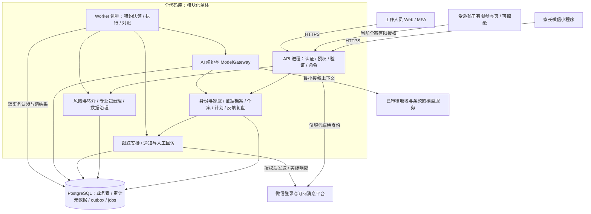
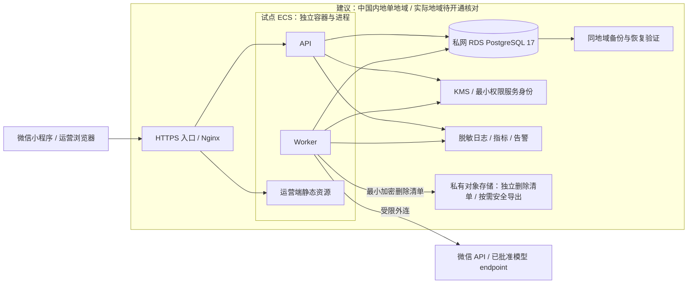
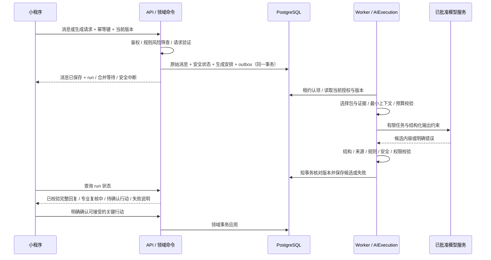
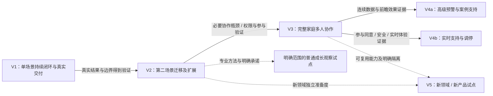

# 小树荫总体技术架构

> 文档性质：覆盖 V1—V5 与暂定终局的唯一规范技术架构。
>
> 版本：v1.1；更新日期：2026-10-24；状态：已同步用户校正的架构基线，尚未实施、部署或完成真实服务验收。
>
> 上位约束：[项目定义](01-project-definition.md)、[产品全景与演进路线](03-product-vision-roadmap.md)。[V1 PRD](04-v1-product-requirements.md) 是唯一 V1 需求事实源；[V1 技术设计](06-v1-technical-design.md) 将本架构落实为表、接口、事务与用例。[技术前瞻](02-technology-outlook.md) 提供可行性讨论，不构成选型、效果或账户可用性的证明。
>
> 用户明确的产品要求见04第0节；本文的技术选型、规格及预算由设计者负责推荐，不再要求用户选择数据库等技术型号。建议不表示采购授权或资源已可用。V2—V5为演进边界，不构成V1开发清单；本次已同步按需孩子账号、AI主导交付及多年档案生命周期。

## 1. 要建成的系统与必须保持的约束

小树荫的核心运行单位是持续存在的“问题个案”。对话、结构化观察、方案、任务、联系尝试与复盘，围绕个案形成可追溯的长期服务过程。模型提供语言理解与候选建议，应用服务掌握事实确认、权限、状态推进与外部动作。

V1面向国内中文家庭，服务定位不将港澳台一概排除；主题为未满18岁孩子的数字使用支持，不设未经依据的统一最低年龄。主端为用户已说明存在的微信小程序“小树英助手”；家长主账号先用，孩子可受邀以自己账号有限参与、拒绝或退出。后台只是内部维护工具。小范围验证的开放额度按质量、负载与费用配置，不写固定家庭数、统一反馈天数或逐方案真人审批。普通方案按已审核规则校验后由家长确认；多年档案不随结案或一年到期清除。

架构必须长期保持以下不变量：

1. 一个账号、一个人和一个家庭是三个对象；付款人、家庭创建者或家长身份均不自动获得所有成员的私人数据。
2. 一个家庭最多一个当前主要个案；候选问题、暂停个案、历史个案可以同时存在，安全中断不受普通优先顺序限制。
3. 原始陈述、转述、设备记录、感受、解释、AI 假设与已确认信息分开保存。未知、尚未收集、拒答不能折叠成“否”。
4. 普通首次及实质调整方案经规则、来源、适用与安全校验，再由家长确认。只有明确规则要求且有真实条件的异常才人工复核；AI不自行确认、解除风险、关闭个案或声称外部衔接。
5. 每次专业判断与生成都能追到专业包、规则、模型配置及输入证据版本；摘要不能替代来源。
6. 业务写入可事务提交，异步执行按至少一次设计；外部消息不能保证恰好一次，API 成功不等于送达、阅读或改善。
7. 无授权不联系；授权撤回、个案暂停或方案结束后，普通提醒必须在发送前再次被拦截。
8. 结果未知、退出、失访、未改善、恶化与转介各有记录，不能通过删除分母提高成功率。
9. 新场景、新参与方式、新模型与新产品必须分别证明专业、隐私、安全和交付能力，不能继承一张笼统的“已验证”标签。

系统首先保证“不丢进度、不越权、不把猜测变事实、不伪造触达与结果”。高并发、预测、实时音视频和大规模检索按真实瓶颈引入。

## 2. 技术基线与主要架构决定

### 2.1 推荐支持线

| 层 | 本轮推荐 | 选择依据与锁定条件 |
|---|---|---|
| 语言与服务端运行时 | TypeScript、Node.js 24 LTS | 前后端共享类型约定，使用受支持运行时；锁版时核对最新安全补丁、容器基础镜像和依赖兼容 |
| HTTP 服务 | Fastify 5 | 路由、插件隔离、JSON Schema 验证与响应序列化足够；确切补丁及插件组合通过兼容测试后锁定 |
| 数据与持久任务 | PostgreSQL 17 | 关系约束、事务、JSONB 与任务认领共用一个可靠存储；使用云服务实际支持的安全补丁 |
| 家庭端 | 原生小程序 TS / WXML / WXSS | 符合微信能力边界；先实现文字、状态页、确认、反馈与回访入口 |
| 运营端 | React + Vite | 静态构建的内部工作台，无公开 SEO 或服务端渲染要求；实施时锁版本 |
| 应用托管 | 中国内地阿里云 ECS 容器 | 长驻 Worker 易于解释和运维，避免把数周任务依赖于一次 HTTP 请求 |
| 托管数据库与密钥 | RDS PostgreSQL、KMS | 使用托管备份与密钥轮换；实例系列、可用区、权限和恢复能力必须实测 |
| 模型 | 优先评估境内区域通义千问企业 API | 不是指定某个已可用 model_id；以本项目离线评测、企业条款和实际账户资源共同锁定 |
| 独立删除清单与安全导出 | V1 启用最小私有对象存储，保存独立于业务库恢复点的加密删除清单 | 安全导出按实际请求启用；不预建附件或音频平台；所有对象纳入访问、过期、删除与备份清单 |

官方当前列 Node.js 24 为 LTS；Fastify 5 的迁移说明要求 Node.js 20+，其 LTS 政策跟随受支持的 Node LTS，但页面支持表未完整枚举本建议组合。因此这里不是“Node 24 + 任意 Fastify 5 插件均已通过验证”的声明。[Node 发布线](https://nodejs.org/en/about/previous-releases)、[Fastify 5 迁移说明](https://fastify.dev/docs/latest/Guides/Migration-Guide-V5/)、[Fastify LTS](https://fastify.dev/docs/latest/Reference/LTS/)。PostgreSQL 17 仍在官方支持期内，官方建议跟进对应主版本的当前修复版本；17 是保守支持线，不是“最新主版本”。[PostgreSQL 支持政策](https://www.postgresql.org/support/versioning/)。

### 2.2 ADR 决策账本

下表覆盖本轮 12 项主要选择，12 项均为建议采用，尚无用户批准或生产验证结论；每项明确记录替代方案与不选理由。“本期不采用”针对技术方案，不是删除历史资产或否定未来需求。

| ADR | 决定 | 主要替代方案与本期不选理由 | 改变决定所需证据 |
|---|---|---|---|
| A01 | 模块化单体，同库 API / Worker 两进程 | 微服务会先引入网络一致性、身份传播与独立值守成本，当前没有团队或负载证据支撑 | 见 §15 的域拆分门槛 |
| A02 | PG 事务 + outbox + PG 任务队列 | 进程定时器重启丢任务；直接“写库后发消息”存在提交缝隙；先上消息中间件增加维护面 | 队列对业务库造成经测量的持续压力 |
| A03 | 显式个案状态、类型化命令和受控场景包 | 通用低代码流程引擎、自治 Agent 都扩大动态执行范围，不能替代专业规则 | 多个已上线场景出现可复现的流程维护瓶颈 |
| A04 | 结构化专业包与 PG 文本 / 关键词检索 | 大型 RAG、向量库和知识图谱不能自动保证专业正确性；当前可审签资料规模有限 | 检索质量与规模达到 §15 门槛 |
| A05 | AI 产生候选，服务端校验；关键动作由用户或有权人员确认 | 模型直接写库或自行决定下一阶段难以限制错误影响 | 不放开这一原则；只扩充经过评测的允许命令 |
| A06 | 持久异步 AI 运行，整条回复通过校验后显示 | token 即到即显会在校验前暴露有害内容；长 HTTP 连接也不能承担长期个案状态 | 将来分段安全校验、取消和流式语义均经验证后再改 |
| A07 | 薄 ModelGateway，只接实际使用的供应商 | 多模型编排平台和自动跨供应商回落增加地域、条款与输出不一致风险 | 第二供应商通过独立评测与数据处理审核 |
| A08 | 账号 / 人 / 家庭分离，资源与用途共同授权 | 一个 openid 等于一个家庭会阻断 V3；全家共享一段上下文会泄露私人信息 | 身份边界长期保留，权限随真实参与方式扩展 |
| A09 | 中国内地单地域优先，跨地域能力后置 | 多活、全球边缘执行增加数据流与恢复复杂度；不能假定境外默认合规 | 恢复目标、地域要求与真实规模共同证明必要 |
| A10 | 外部通知分离授权、意图、尝试、回执与反馈 | 一个 sent 布尔值无法区分未授权、失败、结果不明与已读 | 不放开真实性边界；新渠道增加相应证据类型 |
| A11 | 原始证据与版本化派生档案并存，保留删除链路 | 只存摘要无法纠错；全量事件溯源会增加重建与隐私删除成本 | 先采用关系状态 + 关键事件记录，不建设全量 event sourcing |
| A12 | 共享能力可复用，产品数据默认隔离 | V5 把所有人生阶段档案合并为“超级画像”会跨越用途与参与关系 | 逐次明确授权的最小资料转移，或真正匿名聚合的验证 |

## 3. 整体逻辑架构

图中的盒子是代码边界，不是各自部署的微服务。API 与 Worker 共享领域代码和数据协议；API 不做长推理与长回访循环。Worker 也不能绕过领域命令直接更改个案状态。

模块之间同步调用公开的应用命令或查询；需要同一事务的业务动作由应用层组合，传递同一事务上下文。异步只在事务边界之后发生，事件携带对象 ID、版本、用途和必要元数据，不广播完整家庭正文。一个模块的只读投影不能成为另一个模块的写入后门。

## 4. 推荐部署拓扑与现实边界

首批邀请试点允许 API 与 Worker 位于同一 ECS，以两个进程分别限并发和重启；这存在单机故障点。数据库推荐可支持日志备份与恢复的 RDS 系列，优先评估高可用规格。单机应用不是高可用承诺，数据库有副本也不代表应用已无中断。若试点可接受的恢复窗口与实际预算不能兼容，先降低或延后服务承诺，不能用图代替资源。

测试、预发布、生产使用不同数据库、密钥、微信环境和模型配置；测试不使用复制的真实家庭全文。生产数据库不暴露公网，运营端访问应用 API，人员排障经受控入口，日常人员不持有无限制数据库凭证。容器镜像使用不可变摘要，运行账号非 root；数据库迁移身份与运行身份分开。

模型服务的“接入地域”“数据存储地域”“推理部署范围”分别登记；不能看到北京 endpoint 就自行推断所有处理条件。当前百炼文档区分这些概念，并建议生产使用业务空间专属域名；实际 host、workspace、模型和服务范围在开通及评测后写入发布配置，禁止复制一个示例域名作为生产事实。[百炼地域与接入说明](https://help.aliyun.com/zh/model-studio/regions)。

域名、ICP备案或其他适用手续、小程序主体与服务类目、隐私指引、消息模板、企业 API 及数据处理协议均没有在本轮取得实证。架构可用作建设依据，不能据此宣称具备上线资格。

## 5. 模块边界与唯一写入所有权

| 模块 | 拥有的数据与唯一写入口 | 允许读取或请求的边界 |
|---|---|---|
| IdentityAccess 身份与授权 | 账号、登录关联、会话、工作人员身份引用、授权记录与策略版本 | 家庭成员由 Household 写；角色和任意 family_id 不能由客户端自报生效 |
| Household 家庭与人物 | person、family、成员关系、人物与账号关联；V1 可以有未登录人物 | 无权把“家长创建的孩子记录”自动变成孩子自述或已认证身份 |
| EvidenceArchive 证据与档案 | 原始消息、观察、来源、确认、纠错、冲突组、摘要与有效时间 | AI 提交候选；确认和撤销走本模块命令；其他模块引用 evidence_id |
| Case 个案与阶段 | 候选问题、个案、主线指针、status / phase、关闭与重开记录 | 风险、方案、复盘只能请求带前提条件的状态转换 |
| Plan 行动与计划 | 目标、方案版本、规则校验、条件性人工复核、家长确认、行动责任及任务 | 不修改事实；激活通过组合事务请求Case与FollowUp |
| Review 反馈、复盘与结果 | 反馈原始记录、阶段观察、复盘版本、结果判定与依据 | 不因任务完成或模型高评分直接写稳定改善；调整产生新计划候选 |
| SafetyReferral 安全与转介 | 风险事件、复核记录、安全支持内容引用、转介各阶段及证据 | 可优先要求 Case 进入 SAFETY_HOLD；解除必须有审核权限与依据 |
| ProfessionalContent 专业治理 | 场景包、条目、审核签署、发布状态、依赖、停用及影响清单 | AI 无发布权；线上只读已允许的版本；运营不能直接改已发布正文 |
| AIExecution AI 执行 | ai_run、受控输入引用、模型配置、校验结果、候选输出、用量 | 无业务事实及阶段的直接写权；只调用允许的领域命令 |
| FollowUp 持续跟踪 | 跟踪承诺、反馈节点、复盘节点、安排版本、撤销与补偿记录 | 将通知意图提交 Notification；不把队列执行成功当联系成功 |
| NotificationOps 通知与回访 | 通知意图、渠道许可快照、发送尝试、外部响应、回执证据、人工回访工单 | 不自行诊断失访；无授权不派发；人工记录保留工作人员身份 |
| Governance 数据治理与可观测 | 删除请求及清单、导出工单、访问审计、指标投影与发布记录 | 按数据目录调用各模块删除命令；分析只读，不能反写业务状态 |

outbox、jobs、幂等记录、租约与死信属于共享基础设施协议，写入必须经统一设施接口。它们可以与业务更新共用事务，但不得拥有“直接修复所有业务表”的权限。消息是否已投递与业务动作是否已应用分别记账。

V1 的文件边界以模块目录和公开接口约束即可，不先生成 12 个独立包、12 套数据库或远程 RPC。跨模块报告用经授权的查询投影；新模块只因新责任而出现，不能为了所有名词提前建服务。

## 6. 核心领域与证据模型

### 6.1 稳定对象

| 对象 | 关键语义与约束 |
|---|---|
| Product / ServiceScope | 数据所属产品、受众、专业与地域范围；V1 固定一个产品配置，仍保留稳定 product_id |
| Account / Person / Family | 登录主体 / 被描述的人 / 关系容器；人物可没有账号，账号与人物关联应可确认、撤销和审计 |
| Membership / CaseParticipant | 家庭关系与个案参与关系分开；参与某个个案不等于访问全部家庭历史 |
| Concern / Case | 候选关注项与正式个案分开；候选超范围不意味着被删，适用范围有结论与理由 |
| Evidence / Assertion | 原始来源与结构化陈述；来源、作者、被描述人、发生时间、录入时间、用途和确认方式可追踪 |
| Goal / PlanVersion / ActionTask | 共同目标、不可覆盖的方案版本、校验记录及家长确认；可有孩子本人或家长转述证据，两者不混同 |
| Checkpoint / Feedback / Review | 约定节点、收到的反馈与复盘分开；节点到期没有反馈时，反馈值仍是未知 |
| LongitudinalArchiveEntry | 家庭／个人的多年关键档案：事件、关系变化、问题、历版方法、效果与来源；不依赖个案仍开放，关闭不清除；摘要是可重建投影而非唯一档案 |
| OutcomeObservation | 与功能、目标、冲突及不利变化相关的观察；自报、他报、记录与专业复核分层 |
| RiskEvent / Referral | 风险事件与普通进展独立；建议、接受、实际联系与衔接分别有证据 |
| PackageVersion / AIRun | 使用哪一版方法与哪一次受控生成；不能用最新包静默改写旧记录 |
| FollowUpCommitment / NotificationAttempt | 可履约的持续跟踪承诺与具体联系尝试；授权和外部结果分别记录 |
| AuditEvent / DeletionRequest | 谁以何种用途读写或申请删除；元数据不含完整敏感正文 |

家庭相关对象带 product_id、family_id；个人私密对象还带 owner_person_id、space 和用途范围。外键约束需要同时保证对象属于同一产品和家庭，不能只校验 ID 存在。权限过滤必须在查询和模型上下文构建前发生。

“主要个案唯一”由家庭当前主线记录与数据库唯一性约束实现，事务中锁住家庭主线后切换；不能只靠前端隐藏按钮。V3 的多问题工作台延续这一约束。允许围绕同一主要目标安排睡眠、家长示范、家庭协商等多个行动，不把它误解成一次只能做一件事。

### 6.2 来源、认知状态和时间

每项重要陈述至少表达：来源类别、原始引用、说话者或记录者、被描述的人、内容层次、认知状态、时间和用途。来源类别包括本人陈述、家长转述、其他成员转述、设备或人工记录、AI 推断、专业审核；“设备记录”本身仍需记录取得方式和可核验程度。

内容层次区分行为事件、主观感受、个人解释、专业假设和行动决定。确认只说明“由谁在何时确认了什么”：家长确认自己的转述，不会把来源升级成孩子直接确认；两人都确认某个说法也不等于客观测量。

回答使用 `value_status=KNOWN / UNKNOWN / NOT_COLLECTED / DECLINED / NOT_APPLICABLE` 等明确状态，具体值与状态分列。冲突陈述各自保留，通过 conflict_group 关联，新的纠错版本标记替代关系，不覆盖原话。重要信息保存发生时间、记录时间、有效区间、最近确认时间；旧观察过期后允许重新询问。

长期摘要是可重建的派生视图，保存来源集合、生成版本、用途与授权版本。任何来源被纠正、撤回、删除或授权变化，相关摘要先失效，再按可用来源重建；不能继续使用一段没有来源的“性格画像”。不要求 V1 建知识图谱或双时态数据库，关系表与明确字段足以实现这些语义。

## 7. 状态、事务与并发控制

### 7.1 领域状态按职责正交分开

| 维度 | 统一值 | 解释 |
|---|---|---|
| 个案 status | OPEN / WAITING / PAUSED / LOST_CONTACT / SAFETY_HOLD / CLOSED | 表达当前服务状态，不能只用 phase 推导 |
| 个案 phase | INTAKE / ASSESSMENT / GOALS / PLANNING / EXECUTION / REVIEW / MAINTENANCE | 表达业务阶段；暂停时保留原 phase |
| WAITING reason | INFORMATION / PARTICIPATION / PROFESSIONAL_REVIEW / CONTACT_CHANNEL | 缺信息、缺必要参与、等待审核、缺可履约联系渠道分别处理 |
| 关闭 closure_reason | STABLE_IMPROVEMENT / NO_INTERVENTION_NEEDED / USER_WITHDREW / OUT_OF_SCOPE / EXTERNAL_HANDOFF_COMPLETE | 关闭原因不自动生成改善结果 |
| 结果 outcome | IMPROVED / NO_CHANGE / WORSENED / UNKNOWN | 与个案状态和关闭原因独立，并注明观察窗口与来源 |
| 转介 referral | PROPOSED / ACCEPTED / CONTACTED / CONNECTED / DECLINED / UNREACHABLE | “建议了”与“实际衔接了”严格分开 |
| 风险事件 | OPEN / UNDER_REVIEW / RESOLVED | 独立于普通状态；RESOLVED 不是模型决定，也不当然代表个案已改善 |

主要问题切换时，未闭合的原个案进入 `PAUSED(reason=PRIORITY_CHANGED)`，保留阶段、版本与未完成事项；新主线与旧主线的切换同一事务提交。重新进入记录恢复原因；稳定关闭后复发按新一轮个案关联原个案，历史结论不被覆盖。

SAFETY_HOLD 优先于普通进度。发现风险后，停用普通生成、挂起普通提醒并显示审签过的支持信息；风险事件、个案状态和任务撤销在一个组合事务中落库。普通请求不能把它改回 OPEN，安全解除需要对应授权、复核记录与恢复安排。

LOST_CONTACT不由消息失败或过了若干天触发；需连续两个约定节点无反馈及至少一次真实授权尝试，由有权人员核对。没有联系条件时保留缺失／未知，不捏造失访原因。维护及结案核对约定证据和家长确认，异常按规则处理；本轮结束不删除多年档案。

### 7.2 写命令的统一契约

关键写入包含 Idempotency-Key、If-Match 对象版本和明确动作。幂等键在账号、产品、操作范围内唯一；重复键同请求返回原结果，不同请求返回冲突。过期客户端不能靠重试覆盖更新；版本冲突返回 409 / 412 与可刷新状态，不自行拼接一份新事实。

一次计划激活事务包含：校验权限、个案及知识包可用性→核对规则校验与家长确认版本→若review_policy明确要求人工则核对实际复核→激活方案→更新阶段和反馈／提醒方式→生成当前安排节点→写outbox。任一步失败回滚。可选择USER_INITIATED主动返回或有真实许可的AUTHORIZED_REMINDERS；拒绝可选通知不阻止普通方案执行，不能把主动返回统计为主动触达。

反馈或复盘时间在已发布规则允许的小幅窗口内变化，可由家长确认单独重排；没有规则窗口则走实质调整校验。实质变化有新版本、理由和再次确认，只有明确需人工的异常进入真实复核。旧版仅在仍适用、安全且用户愿意时继续，不能静默改写。

`case.version`、`context_revision`、`schedule_revision` 分开：前者保护关键个案业务写入，context_revision 标记影响 AI 输入的消息、证据或授权变化，schedule_revision 只在跟踪安排及前提实质变化时递增。新增普通聊天可使旧生成上下文过期，但不会自动取消全部有效提醒；关闭、暂停、计划变更和授权撤回则必须更新相应安排。

任务系统允许重复认领，但业务处理使用稳定事件 ID、对象版本和数据库唯一约束保证一次应用。反馈提交、复盘创建、计划激活与主线切换都需要各自的业务幂等约束，不能只在 HTTP 层缓存成功响应。

不在数据库事务中等待模型或微信网络响应。先持久化意图并提交，再外呼，再用短事务写结果。对模型结果再次检查个案、计划、包和授权版本；生成期间发生变化时将旧结果标为过期，不应用到新状态。

## 8. 身份、权限、用途与私人数据

### 8.1 V1 最小身份与权限

微信登录 code 在服务端换身份，绑定本小程序命名空间内的 openid；不把 openid 当跨产品、跨小程序的通用人 ID，也不假定每次都有 unionid。服务端下发自己的短期登录态，会话可撤销，凭据只存摘要。appSecret、session_key、模型 Key 和数据库凭证均不进入小程序或运营前端。微信官方明确要求 session_key 不应下发，临时 code 一次使用。[微信登录注意事项](https://developers.weixin.qq.com/miniprogram/dev/framework/open-ability/login)。

工作人员使用独立身份和MFA，按职责、分派、用途与时限访问，默认无权浏览全量正文。V1另支持孩子经家长邀请绑定本人微信的有限个案身份：只读本人提交及明确共享的计划片段，不读家长原话或其他历史。邀请、接受、拒绝、过期和撤回都是真实状态，拒绝不自动阻断家长可执行路径。

授权不能等价于一个用户总开关。至少分开：提供当前个案服务、模型处理、普通提醒、单独授权的人工回访、未来跨成员共享、独立研究或案例复用。撤回某个用途后立即停止对应的新处理，并执行派生内容失效；与当前服务无关的用途不得作为接受支持的强制条件。

孩子提交前清楚显示共享对象，家长不能把自己的转述升级为孩子直接确认。V1不开放完整私人长对话，但基本访问隔离不可后置；风险内容先检查，可能涉及家人伤害时不自动向其广播。首次使用进行必要的简明告知与确认；儿童和敏感资料按适用要求处理，不建设普遍的“18岁人工核验”流程。

### 8.2 防止横向越权

应用层对每次查询、写入、文件获取和上下文构建校验 `actor + product + resource + action + purpose + current grant`。客户端提供的 product_id / family_id 是待验证参数。运营筛选器、导出、后台批处理和 Worker 都必须走同一策略，不允许“内部任务默认全库可读”。

对按家庭隔离的敏感表，推荐 RLS 作为数据库第二道边界，V1 先实施明确的产品与家庭隔离策略。事务内设置经服务端授权的上下文，连接复用不能遗留上一家庭信息；缺上下文应拒绝。工作人员按个案分派产生受限访问上下文，不给浏览器使用数据库管理账号。数据库超级用户、BYPASSRLS 和通常的表所有者可以绕过 RLS，因此运行角色必须与迁移 / 表所有者分开；RLS 不能替代应用用途授权。[PostgreSQL 17 行安全](https://www.postgresql.org/docs/17/ddl-rowsecurity.html)。

### 8.3 V3 的私人空间与安全例外

V3 才引入独立成员账号、共享确认、可撤销用途授权与私密空间界面。原则从 V1 就成立：私密数据不能因为“不透露原话”而未经授权影响另一人的定制建议。上下文先按目标受众和用途过滤，再检索与摘要；不给模型一份全家庭资料后仅靠提示词要求保密。

私人内容进入共同空间时生成独立的共享材料，记录本人授权的内容、对象、用途和版本。源材料撤回后，共享副本及由它生成的建议需要重新判断有效性；已经被另一人看过的内容不能承诺可物理收回。家庭关系解除、监护关系变化、孩子成年和账号归属争议都要触发访问复核，不自动合并或移交旧私密记录。

特殊安全处置采用预先审核的规则、最小必要披露、明确人员和事后审计；不能由模型自行认定“为了家庭好”而扩大共享。没有现实支持资源时，界面说明当前可提供的安全信息与服务边界，不声称真人 24 小时值守。

## 9. 专业知识、规则与内容治理

### 9.1 场景包是专业资产与运行契约

V1 用审签的结构化专业包承载数字使用场景，包含：适用人群与排除条件、必要信息及 unknown 处理、功能基线、可行目标、行动模板、家庭协商选项、反馈问题、复盘与维护规则、风险中断、转介边界、对外文案、来源与复审日期。

内容分为完整场景、辅助工具、一般教育内容与安全支持信息；只有完整场景承诺个案闭环。角色扮演、沟通练习和情绪调节可以是计划中的工具，不能自动变成完整服务场景。拒绝家庭合约形式时，可提供普通行动计划；不因此判定用户不配合。

专业包采用声明式字段、固定规则类型和受控分支，不能上传任意 JavaScript、SQL 或用户自定义可执行 JSON Schema。Fastify 将验证与序列化 schema 视为应用代码，动态执行不可信 schema 存在安全风险；运行 schema 必须由受审代码构建并锁版。[Fastify 验证与序列化](https://fastify.dev/docs/latest/Reference/Validation-and-Serialization/)。

### 9.2 发布与变更流程

包版本遵循 `DRAFT → IN_REVIEW → PUBLISHED`；不通过返回修订，已发布版本不可原地编辑。RETIRED 表示不再给新个案选择，SUSPENDED 表示有安全或质量依据而立即停止使用。状态改变记录负责人、审核者、内容指纹、依据和影响范围，不能把“历史材料已整理”写成“专业审核通过”。

V1 默认至少由具备相应专业能力的负责人审签，建议内容编写与发布审核分人；高影响规则若只有单人审核，需按 PRD 落实额外复核安排与显式风险接受。人员尚未落实时，包可以完成技术校验但不能 published。批量整理历史资料时保留逐项台账：已审核、等待条件、明确不采用、尚未审核；原总数必须与各状态之和一致，未知不转成弃用。

个案启动固定 package_version；方案与复盘继续记录该引用及必要条目。普通升级不悄悄重跑历史判断。紧急停用立即阻止新生成，枚举受影响的在途运行、计划和个案，转入复核；新的继续方案需记录迁移理由和必要确认。系统规则、风险规则与专业包分别版本化，安全规则可以紧急收紧，但不能伪造用户已同意新的行动。

### 9.3 检索与专业解释

V1 先按场景、阶段、年龄组、适用条件与内容类型筛选，再使用 PG 的文本 / 关键词匹配。中文命中依靠审签标签、同义词和关键词表，不假设 PG 内置已解决中文语义分词。未命中时使用受审的澄清或等待路径，不召回另一家庭的聊天作为“专业答案”。

模型引用的条目 ID 必须在本次允许集合内，并保留依据与适用条件。引用存在只能证明用了某条内容，不能证明解释正确、适合这个家庭或干预有效；这些分别由自动约束、专业抽检与真实结果验证。

## 10. 受控 AI 执行

### 10.1 一次生成的完整路径

客户端关闭页面后，运行仍有持久记录；回来查询同一 run，不重新创建一份方案。AI 处理中、校验失败、模型不可用、结果过期和等待专业复核分别展示，不能统一伪装成“建议已完成”。V1 不承诺 token 级流式，也不让未经完整校验的半段回复进入界面。

生成并发限制不能限制接收新的风险信息。每次获授权的新消息及反馈都先持久保存、立即作规则安全检查，再决定是否需要模型；已有 run 时提升上下文版本、阻止旧候选应用并合并待生成输入。普通候选按最新上下文串行生成，安全信号立即中断普通服务，不等模型返回；供应商请求不能确认已取消时保留状态与费用不确定性。

普通追问、知识解释、首次方案及实质调整在已发布规则内自动校验；通过后方案交家长确认，不逐份等待真人签批。规则明确要求人工的异常才创建有真实承接的复核，结果绑定同一版本；无承接条件说明限制或支持去向，不伪造有人审核。

### 10.2 上下文边界

服务端为每次生成指定一个目的，例如缺失信息追问、解释已审核条目、生成行动候选、总结执行障碍或形成复盘候选。输入包括当前状态、允许操作、已确认资料、带来源的必要陈述、相关历史方案和本次允许专业条目；没有必要的姓名、精确地址、联系方式和第三人细节不发给模型。

上下文构建顺序是权限与用途过滤 → 时间与有效性过滤 → 结构化选取 → 必要文本检索 → 大小裁剪。原文中的“忽略规则”“调用工具”等都当家庭文本处理，不是系统指令。V1 不让模型自行浏览网络、读取任意 URL、执行代码或发送通知。

持久运行引用输入对象 ID 与版本，必要的调试快照加密、限权并跟随删除政策；日志不记录整段 prompt、完整消息、凭据或模型推理链。为复现保存配置与可授权取得的证据引用，不把“可追溯”解释成可以无限保存敏感全文。

### 10.3 候选协议与应用限制

模型输出至少区分用户回复、候选陈述及来源、缺失条件、建议行动、专业依据、不确定说明和风险信号。允许动作是一张小的白名单，例如提议追问、提议目标、提议计划、提议复盘；不是任意 SQL、任意状态或任意工具调用。

校验依次进行：JSON 与长度 / 枚举校验 → 来源引用有效性 → 事实与转述类别保持 → 当前阶段和必需条件 → 专业适用范围 → 内容安全 → 目标受众和用途 → 当前对象版本。结构合法不等于内容真实，不能因用了 JSON Schema 就省略领域校验。百炼的 JSON Object 与 JSON Schema 模式及支持模型不同，实际 model_id 需要验证所需模式；供应商结构约束只是第一层。[百炼结构化输出](https://help.aliyun.com/zh/model-studio/qwen-structured-output)。

用户消息可作为原始陈述直接保存，抽取后的结构化事实需有确认政策。专业结论、计划激活、安全解除、外部衔接与结案不能因模型给出高置信度自动完成。建议不可用时返回受审的澄清或人工复核路径，不编造一份看似完整的替代方案。

### 10.4 模型故障、评测与升级

ModelGateway 只规范本项目需要的调用、超时、取消、用量与错误分类，不建设通用供应商市场。每个 run 固定 provider、region / scope、model_id、模型参数、prompt_version、schema_version、package_version、policy_version 与代码发布版本。优先选择可固定的模型快照；若供应商只提供滚动别名，明确记录这一局限并做漂移监测，不能宣称完全可复现。

模型超时可能已经产生费用；重试必须留在同一 run 的尝试记录内，不能重复应用结果。普通瞬时错误有限重试，格式失败可做一次受控修正；越权、危险内容或缺乏专业依据直接停止自动生成。每个家庭、全局并发、单次 token、每日费用和连续失败均有预算或熔断，触发后明确显示不可用并进入已具备资源的复核队列。

上线前评测集覆盖正常路径、来源冲突、未知与拒答、必要参与不足、家长目标不当、未改善与恶化、风险表达、提示注入、跨家庭泄露、过期计划和重复提交。专业人员盲审可行性与边界；测试集与调参集分开，按年龄与场景报告分层结果。已知严重安全或越权失败未解决时不得进入真实试点；有限测试中零失败也不能证明真实风险召回率为 100%。

模型、prompt、规则或专业包升级先离线回归，再有限灰度；单次只改可归因的一组配置。灰度监测质量、失败、复核负担、费用和不利结果，异常时关闭新生成并回退上个已验证组合。未通过相同评测与数据条款审核的第二模型不能作为自动备用。

## 11. 持续跟踪、任务与真实外部通知

### 11.1 跟踪安排是业务数据

方案校验并由家长确认后，FollowUp建立有版本的反馈与复盘节点，记录目的、内容、时间、时区、计划版本及提醒方式。节奏按问题、阶段、家庭负担和约定，不统一强制反馈或维护天数。

反馈安排、主动返回及离站提醒是三件事。站内节点不等于可离站联系，一次许可不代表全部未来节点。家长可拒绝可选提醒仍使用计划；没有许可时显示USER_INITIATED，实际许可成立的节点才记AUTHORIZED_REMINDERS。只有实质依赖约定联系且无替代的步骤才等待渠道。

普通主动联系按方案约定跨渠道合并；设计者推荐默认每日最多1次，21:00—08:00（Asia/Shanghai）安静，家长可调整时段。发送前按当前频率及资格预留，不用换渠道绕过上限。安全信息另按受审规则，不伪装普通催办；节点专业时间与允许发送时间分开。

方案修订、暂停、关闭、授权撤回与主要问题切换都会递增安排版本，并撤销旧安排下未派发任务；已派发外部消息无法收回，但落结果时必须记明其属于旧版本。发送前再次读当前授权、状态、安排版本、节点是否已有反馈、额度与静默窗口，不能只相信创建任务时的快照。

### 11.2 PG 任务队列与 outbox

API 事务同时写领域状态与 outbox；Worker 短事务用 `FOR UPDATE SKIP LOCKED` 分批认领到期记录，设置 lease_owner、lease_expires_at、attempt 与 fencing token，提交后执行外部动作。官方明确 SKIP LOCKED 适合多个消费者访问队列类表，但会跳过锁住的行，不能用于要求完整一致视图的一般业务读取。[PostgreSQL 17 SELECT](https://www.postgresql.org/docs/17/sql-select.html)。

任务采用 READY / RUNNING / RETRY_WAIT / SUCCEEDED / CANCELLED / DEAD 等执行状态，RUNNING 必须带租约，完成结果只在租约 token 仍有效时提交。租约过期可回收，重复事件按业务键去重。长任务要续租并设置最大运行时间；Worker 意外退出后新进程可继续，不依赖内存定时器或用户会话。

重试使用有上限的退避与抖动，按错误类型决定；永久参数、撤销授权、模板不适用不进入无限重试。达到上限进入死信并告警，人工重放需确认前提仍成立，不能一键把过去数周所有提醒补发。对账任务持续查漏：已生效计划是否有当前安排、到期节点是否生成任务、outbox 是否积压、租约是否过期、外部未明尝试是否待处理。

任务成功只表示任务按本类合同结束。例如“创建人工工单”成功不能记成联系成功；“写发送意图”成功不能记成微信已发送。

### 11.3 通知的五层真实状态

| 层 | 保存什么 | 禁止推断 |
|---|---|---|
| 授权与渠道条件 | 对应用户、模板、用途的授权观察，撤回、封禁、可用资格与额度确定性 | accept 回调不等于长期无限许可；未知额度不当成可用 |
| 通知意图 | 为哪个节点、按哪一安排版本提醒谁，为什么被安排、抑制、等待或取消 | 意图已建不等于尝试过联系 |
| 外部发送尝试 | 每次 dispatch 的时间、身份、请求摘要、渠道、响应或超时 | 网络超时不等于明确失败，也不等于成功 |
| 平台与用户证据 | 平台接受、拒绝、结果未知，以及真实可得的送达 / 阅读回执 | 平台 accepted 不等于 delivered / read；无回执就保持 UNKNOWN |
| 业务反馈 | 用户是否实际回来、提交了什么、是否需要复盘 | 点击消息不等于执行，回来不等于改善 |

发送尝试推荐至少区分 CREATED、DISPATCHING、PROVIDER_ACCEPTED、REJECTED、RETRYABLE_FAILURE、OUTCOME_UNKNOWN。送达 / 阅读是独立证据字段，只有渠道真的提供、且验签与关联均有效时才升级；V1 不假定微信提供完整送达和已读回执。

微信订阅请求返回 accept、reject、ban、filter 等模板级结果，应如实保存；非长期订阅的发送次数受用户取得的许可限制。必须在实际用户操作中请求订阅，不能后台凭空替用户授权。具体模板类型、服务类目与长期资格由本项目主体控制台证据决定。[微信订阅请求](https://developers.weixin.qq.com/miniprogram/dev/api/open-api/subscribe-message/wx.requestSubscribeMessage.html)、[官方接入指引](https://developers.weixin.qq.com/miniprogram/dev/wxcloudservice/wxcloudrun/src/scene/deploy/subscribe)。发送接口的成功响应只作为发送 API 成功的证据，不升级为用户阅读或服务完成。[微信发送接口](https://developers.weixin.qq.com/miniprogram/dev/server/API/mp-message-management/subscribe-message/api_sendmessage.html)。

### 11.4 幂等边界与“结果未知”

通知业务键至少包括 product、recipient、checkpoint、schedule_revision、channel 与提醒类型；一个意图只保留一个当前派发决策。平台与人工在同一账号范围内锁定跨渠道联系账本，短事务完成额度检查、频率预留和创建尝试；未知结果的预留不能立即返还以便重复发送。窗口内总量包含已派发且结果不明的尝试，避免超时触发额外轰炸。

最后授权检查与尝试转入 DISPATCHING 使用同一授权临界区；撤回取消尚未进入该临界区的普通发送。已发出的请求、已被平台接受或已进入不可确认是否发出的外呼不能由数据库撤回，必须保留“已开始发送 / 无法确认取消”的事实并禁止盲重试，不能向用户显示已成功取消在途消息。网络调用仍在短事务提交之后执行。

调用外部平台后、结果提交前进程崩溃，是不可消除的歧义窗口。若平台没有可查的请求 ID 或幂等键，租约过期后不能盲目重发：把未完成 DISPATCHING 归入 OUTCOME_UNKNOWN，优先查询平台记录；无法查证则等待人工决定或转到有单独授权的回访路径。不得为了“任务全部成功”把它改成失败重试或已送达。

对明确未发送的瞬时故障，仍需重读授权与安排后才能有限重试。平台去重能力只按已验证接口使用，不把自定义 Idempotency-Key 发出去就声称平台支持幂等。

### 11.5 人工回访与失访

真人联系只在实际提供且取得相应用途同意时启用，记录负责人、约定、实际尝试、回应和下一步；不预设真人排班或统一两服务日审核承诺。内部后台支持知识维护、质量抽查、反馈与权利请求；空队列不当成真实接单。

拒绝订阅、额度耗尽、账号模板不可用与结果未知分开。无许可可在小程序说明依靠主动返回，不自动切短信、电话或私人微信。真人替代需单独同意及实际承接；失访由Case核对，不能用渠道故障直接推断。

## 12. 数据保留、删除、备份与案例使用

### 12.1 多年档案与分层生命周期

持续家庭与个人档案是核心产品资产，支持两年、五年及更久后回溯。结构化关键记录、历史方案、执行、复盘与有效／无效做法带来源、日期、确认及版本，不随个案关闭或一年到期自动清除。旧判断仍须核对现状；模型上下文按权限和当前目的选取，不载入所有历史。

| 类别 | 当前规则 | 控制 |
|---|---|---|
| 必要家庭／个人长期档案 | 持续服务目的和有效依据下长期保存，支持多年回溯 | 关闭、暂停和未登录不触发统一一年清除；用户可查、更正、导出及删除 |
| 原始对话与关键证据 | 与长期档案分开，V1不设结案一年自动清空 | 原文清理不误删获准长期档案；整案删除不通过转存逃避 |
| 临时模型副本 | 仅留核查实际必需范围 | 限权、随来源撤回删除；不能以调试为由重复囤积全文 |
| 访问及安全操作记录 | 推荐1年，不含完整对话 | 记录谁何时访问／变更；相关网络日志不少于六个月，其他法定记录单独履责 |
| 主动删除请求 | 核验范围后7天完成应用在线清除 | 立即停相关新使用；逐项清单、失败和回执；7天不是聊天自动保存时间 |
| 恢复备份 | 滚动50天 | 最近50天恢复点可包含更早的仍存档案；最后含删除数据副本最迟在线清除后50天过期 |
| 供应商请求与响应 | 依真实条款及配置，尚未验证 | 分别核实用途、保留、删除、地域和子处理；不训练不等于不留存 |

TLS、数据库及对象存储加密和KMS保护正文；高敏感字段按用途加密和索引，访问授权仍需独立检查。导出限时限权，不用公开永久链接。

只删原聊天保留档案时，先展示具体范围并由用户选择；整案或账号删除涵盖原文、派生、档案副本、索引、模型缓存、导出和任务。逐项记录已清除、等待、依法保留及失败，核对执行前后总数；未知不当已删除。

持续服务用途与依据需要维护。撤回、目的终止、停止服务或确无必要的资料依法处置；不以长期未登录或固定90天复核计时器自动清空家庭历史。必要长期保存不等于脱离目的及用户权利无条件持有一切。

[个人信息保护法](https://www.cac.gov.cn/2021-08/20/c_1631050028355286.htm)、[网络安全法](https://www.cac.gov.cn/2025-12/29/c_1768735112911946.htm)分别约束必要用途、儿童敏感资料、删除与相关网络日志；上线文本与实际处理需对应核实。[百炼隐私说明](https://help.aliyun.com/zh/model-studio/privacy-notice)和[服务协议](https://terms.alicdn.com/legal-agreement/terms/common_platform_service/20230728213935489/20230728213935489.html)不自动证明本项目已满足要求。

### 12.2 备份与恢复

推荐开启每日备份与日志备份，目标恢复点 RPO 不超过 1 小时、目标恢复时间 RTO 不超过 4 小时；这两项是待资源和演练验证的试点目标，尚未达到。RDS 不同系列的日志备份能力不同，不能购买实例后默认已有时间点恢复。[RDS PostgreSQL 备份](https://help.aliyun.com/zh/rds/apsaradb-rds-for-postgresql/back-up-an-apsaradb-rds-for-postgresql-instance)。

恢复流程为：隔离恢复到新实例 → 禁用所有外发与模型任务 → 核对恢复点、缺失窗口与业务计数 → 重放独立删除清单 → 使恢复出的旧会话失效、冻结旧敏感处理及联系授权 → 对账外部未知尝试并复核当前专业包和安全停用配置 → 人工批准以受限模式开放登录及权利请求 → 按个案重新核验授权、分派、计划及未来节点后恢复对应服务。没有独立且可证明为最新的授权记录时，不能仅凭备份中的旧同意恢复处理；V1 采用重新确认，不另建复杂跨库授权日志系统。

缺失窗口内可能已发送而本库没有结果的外部任务，全部保持抑制并归为待核实；已开始但未落结果的尝试记 OUTCOME_UNKNOWN。即使恢复记录仍是 READY，也不能证明事故前未发送。只有取得平台有效回执等明确证据，才补记实际结果；无法查证不重放，后续联系须基于重新确认后的新安排和当前授权。旧模型任务取消应用，新请求重新核对资料与预算，不使用恢复出的预留余额继续调用。当前安全停用清单需从经审查的最新发布配置核对，不能因恢复旧库而启用曾被停用的专业包。

RTO 目标衡量恢复到数据已核对的受限服务；逐户重新确认所需时间另行报告，不包装成 4 小时内全部个案已全面恢复。恢复说明应标明实际恢复点、可能缺失窗口和待补记录，不能把 RPO 目标说成绝不丢失任何期间提交。

删除清单需具备不同于普通业务恢复点的恢复路径，至少覆盖50天最长备份窗口，且只含重放所需的最小内部标识、请求与完成事件，不含家庭正文。V1 以私有对象存储保存加密清单，独立于被恢复的业务数据库做持久化与权限控制；在线清除完成前必须确认相应清单已经可靠写入，失败就保持删除任务未完成并告警。KMS 密钥、数据库备份、清单、应用配置和恢复权限一起演练；“有备份文件”不能代替恢复验收。

### 12.3 结果分析与案例复用

V1 只做支撑交付与验证所需的指标投影，不建数据湖、训练库或跨家庭案例推荐。指标按进入、适用、启动、执行、复盘和维护的人数分别有分母，同时保留拒绝、退出、失访、未知和转介；报告改善来源与窗口，人工投入单独计。

指标不能成为拒绝删除的理由。清除前可在已告知且允许的统计目的内保存不含家庭／个人链接的批次汇总，注明截止点、删除影响与不可再评价数；不能把去掉姓名的逐案明细自动称为匿名。小批次汇总的对外披露另审再识别风险。无法合法保留最小汇总时，明确报表不可完整核对并停止相应比率比较，不通过静默减少原分母美化结果。

后续研究、案例教学、相似案例和训练用途分别审核。去掉姓名或改为随机 ID 仍可能被重新识别，不能自动称为匿名。个案对另一家庭的输出不能暴露来源家庭身份或可推断的细节；优先发布经过专业审核的一般化知识，真实个案复用另有授权、审核和撤回路径。

## 13. 可观测性、运维与故障策略

### 13.1 可以观察什么

统一 trace_id 关联 request、actor 的伪名标识、product、case、run、job、notification_intent、attempt 与 release。日志只记录错误码、状态、时长、大小、版本和必要 ID；正文、完整 prompt、手机号、会话密钥和 access_token 不进常规日志。需要检查原文时使用限时授权的业务后台并审计。

核心看板同时显示：

- 服务：API 错误与延迟、数据库连接及锁等待、Worker 心跳、最老任务年龄、租约回收、死信、outbox 积压。
- AI：排队与运行时间、格式 / 规则 / 安全拒绝、过期结果、供应商错误、用量与费用、人工复核比例、发布版本。
- 跟踪：到期节点、生成安排、可履约渠道比例、被抑制提醒、平台接受 / 拒绝 / 未知、人工实际联系、收到反馈及缺失原因。
- 安全与治理：风险未分派、等待复核、越权拒绝、敏感原文访问、删除超期、备份演练与恢复对账异常。
- 业务：方案确认、执行障碍、复盘调整、各 outcome 与 closure_reason、维护与复发；不只显示聊天活跃。

应用 /live 表示进程存活，/ready 表示可接受本类工作；模型故障不应让已保存资料查询一起不可用。告警必须有可联系的责任人与处置手册，不能把建了告警规则当作有人值守。

### 13.2 试点工程目标

下列是待负载测试和演练确认的建议目标，均不是当前测量值或疗效门槛。

| 目标 | 建议起点 | 超限后的动作 |
|---|---|---|
| 普通已认证 API | p95 ≤ 1 秒，不含外部模型运行 | 查慢查询、连接及索引；必要时暂停新增邀请 |
| AI 普通任务 | p95 在 120 秒内形成完整可用或明确失败状态 | 降并发 / 缩上下文 / 限流；不无限显示“处理中” |
| 正常节点调度 | 非静默且前提成立时，p95 在约定窗口后 15 分钟内形成联系决策 | 告警和人工核查；联系决策不代表外部送达 |
| 业务可靠性 | 正常运行及进程重启后不丢已提交记录；重复应用为零；灾难恢复按实际 RPO 说明缺失窗口 | 任一违例按阻断事件处理，不用整体平均率掩盖 |
| 恢复 | RPO ≤ 1 小时、RTO ≤ 4 小时 | 未通过恢复演练不宣称达到目标 |
| 删除 | 应用在线清除 ≤ 7 天，备份滚动保留50天 | 有失败或例外就保留未完成状态并人工处理 |

V1起步全局2个AI并发、1个普通通知派发者，按实测调整。设计者建议小范围验证按每月1,500元技术目标规划：云、数据库、存储与备份800元，模型500元，余量200元；不含开发和额外真人服务。这是规划额度，不是云报价或实测承载保证，也不是采购授权。模型月预算闸门建议500元，80%预警，触顶停止新调用；按已核验价格、最大token及含重试调用量做原子保守预留，未知费用不按零释放并暂停新调用。供应商延迟计费、在途请求和价格变化仍可能超预估。实施者负责规格、报价和成本测算，不将数据库与预算拆成用户必须选择的问题。[模型官方价格](https://help.aliyun.com/zh/model-studio/model-pricing)。

### 13.3 主要故障与降级

| 故障 | 系统行为 | 不能发生的“假恢复” |
|---|---|---|
| PG 不可用或事务失败 | 写入失败可重试；客户端显示未保存，保持原请求幂等键 | 内存假存成功或丢失用户提交 |
| Worker 重启 / 任务租约过期 | 有效租约重新认领，按事件与对象版本去重 | 重新生成全部计划、重复提醒 |
| 模型 429 / 5xx / 超时 | 同一 run 有限重试，达到上限明确失败或待人工 | 换未审核供应商、编造答案、无限产生费用 |
| 输出有风险或校验失败 | 不展现普通候选，进入受审安全信息或复核路径 | 只删除危险句子后放行未经重新验证的方案 |
| 专业包紧急停用 | 阻止新运行，列受影响对象并复核 | 仍给旧计划自动生成调整，或静默改成新版 |
| 发送结果未知 | 冻结该尝试的自动重发，查证或人工处置 | 超时当未发送而反复外呼 |
| 授权 / 家庭关系变化 | 失效上下文与任务，发送及展示前重检 | 缓存授权继续使用旧私密摘要 |
| 人工资源不足 | 排队状态和承诺降级，暂停新增试点 | 无人接单仍显示“专业人员正在处理” |
| 删除失败 / 恢复出旧数据 | 阻断继续使用，重试并告警，重放删除清单 | 隐藏失败并宣布删除完成 |

安全事故响应先关相应能力开关、隔离受影响发布或数据访问，再保存最小必要调查证据、核对影响范围并按实际责任流程处理。不能为了回滚方便无限保留敏感正文。生产运维有发布、备份、恢复、密钥轮换、模型熔断、渠道停用和包停用的明确操作权限。

## 14. V1—V5 的模块落点与真实依赖

### 14.1 能力覆盖账本

下表完整列出本轮需要承载的 18 类跨版本能力：8 类 V1 建设、8 类有条件后置、2 类外部资源待验证；合计 18，未审阅 0。后置不代表拒绝，外部待验证项不得伪装为已建设；具体需求仍由各阶段 PRD 决定。

| # | 能力 | 首次形态与状态 | 主要模块 / 依赖 | 何时增强 |
|---|---|---|---|---|
| 1 | 总入口、适用范围、最小分诊 | V1 建设 | Case、EvidenceArchive、ProfessionalContent、SafetyReferral | V2 按真实场景扩展，非本场景可等待或退出 |
| 2 | 数字使用完整行动闭环 | V1 建设 | Case、Plan、Review、AIExecution | 新方法需专业包评测，不能只换 Prompt |
| 3 | 多年连续档案、来源与纠错 | V1建设 | Household、EvidenceArchive、Governance | 多年可回溯，关闭不清空；来源与访问依据持续有效 |
| 4 | 孩子按需轻量账号、线下参与与家长行动 | V1建设 | IdentityAccess、Household、Plan、EvidenceArchive | 孩子可拒绝／退出；V3增强完整多人私人空间，不补造历史确认 |
| 5 | 持久节点、通知与人工工单记录 | V1 建设 | FollowUp、NotificationOps、PG jobs / outbox | 渠道必须先具备资格和资源，架构不担保履约 |
| 6 | 暂停、切换、维护、复发重开与结果 | V1建设 | Case、Review、FollowUp | 周期按问题及家庭约定，不统一规定天数；不等于高级预测 |
| 7 | 风险中断、权限、删除与审计控制 | V1 建设 | SafetyReferral、IdentityAccess、Governance | 各版本增加参与者和数据前先扩对应控制 |
| 8 | 专业包治理、效果与服务成本记录 | V1 建设 | ProfessionalContent、Review、Governance | V2 起按场景、方法与人工介入分层统计 |
| 9 | 知识方法审核责任与条件性人工支持 | V1外部待验证 | ProfessionalContent、SafetyReferral；真实负责人 | 知识先审核；普通方案不逐份真人审批，新增真人服务须独立具备资源 |
| 10 | 微信主体、模板、发送权限与可用额度 | V1 外部待验证 | IdentityAccess、NotificationOps；平台资格 | 每个新模板或渠道独立实证，不默认长期资格 |
| 11 | 第二成熟场景及后续迁移 | V2 有条件后置 | 复用全部闭环模块，增加审签包、指标和边界 | 先证明结构不同场景可迁移，不要求无限扩场景后再协作 |
| 12 | 常规成长观察的独立探索 | V2 后有条件后置 | EvidenceArchive、FollowUp、Review、专业内容 | 有明确用户承诺、专业观察方法、授权和运营容量即可评估 |
| 13 | 完整家庭成员体系、共同与私人空间 | V3有条件后置 | IdentityAccess、Household、用途授权与共享确认 | V1孩子有限参与先做，完整跨人授权、撤回及私密体系通过后增强 |
| 14 | 家庭多问题工作台及多方协商 | V3 有条件后置 | Case、Plan、Review、共享确认记录 | 继续保持一个当前主要目标，不变成并行无边界服务 |
| 15 | 高级趋势、案例匹配与预警 | V4a 有条件后置 | 专用分析投影、评测与风险建议；必要时检索组件 | 连续数据质量、基线对照、误报成本与前瞻验证满足条件 |
| 16 | 实时文字 / 语音、多方支持与调停 | V4b 有条件后置 | 独立会话控制、实时连接、音频与安全退出 | 参与者同意、实时专业边界、延迟和故障测试；不依赖预测先成功 |
| 17 | 新年龄、新领域或多品牌产品 | V5 有条件后置 | 产品隔离部署、独立专业包、政策与最小共享代码 | 新领域需求、方法、隐私、安全和交付分别通过；不依赖全部 V4 |
| 18 | 专业服务网络、研究与可持续商业化增强 | 各阶段按需要后置 | 现有边界外按明确业务新增 | 服务交付、授权、责任与需求证据先于机构平台、支付或训练系统 |

### 14.2 阶段依赖图

V4a 与 V4b 可独立推进，风险识别与安全中断从 V1 就存在；“预警后置”不是安全后置。V5 需要实际所用底层能力足够稳定，但不把 V4 两条线全部毕业作为硬条件。常规成长观察通过规则、观察与定期反馈提供有限价值，不以预测成功率包装。

### 14.3 后期能力的专有约束

V2 的默认变化应是新增专业包、适用范围、指标与经过测试的有限规则类型，复用个案和跟踪。若每增加一个场景都改大量互不相关的模块，先调查专业边界是否混乱，不能立即决定上流程引擎。

V1已有孩子针对当前问题的有限参与，V3扩完整家庭成员体系、私密空间、共同确认与长期协作。保留邀请真实性、退出、关系争议与年龄变化处理；家长转述关联后来本人账号时仍保留原作者和时间，本人可补充、否认或纠正，不批量升级成事实。

V4a 先用结构化规则和可解释统计建立基线，再讨论预测模型。区分离线回顾命中与前瞻真实预警；评价提前量、误报、漏报、不利影响、家庭负担与退出，不能只追逐 AUC。训练 / 评估数据按家庭和时间隔离，防止同一家庭信息泄露到验证集。预警是需核实的建议，不自动改事实或向所有家人推送。

V4b 若引入语音，新增音频生命周期、实时身份与同意、说话者归属不确定、打断与取消、断网恢复、旁观者和安全退出。未经全部参与者所需同意不加入或留存现场；不能后台持续监听家庭。实时支持的“呼叫 AI”与真人应急响应分开说明。若采用流式，必须端到端保留取消、背压、分段验证与可恢复协议，不能使用 V1 的整条回复合同却宣称实时流。

V5 每个产品有独立服务范围、专业负责人、内容发布、权限政策、模型配置、运营承诺和删除周期。品牌是否共享是产品决定，不能据此共享私密数据。技术上优先复用包和经过测试的协议，只有出现实际跨产品业务才建设中心服务。

## 15. 何时才引入新组件

阈值是建议的“触发架构评审”条件，不是到数后自动采购，也不是已经测得的系统容量。评审必须提交可复现压测或生产观察、当前方案优化结果、成本、负责人、隐私影响与回退方案。

| 组件 | 建议评审触发证据 | 进入前条件 / 退路 |
|---|---|---|
| 更多 API / Worker 实例 | 观察 7 天，现有合理配置与限并发后仍持续达不到 §13 目标，或公开服务要求移除单机故障点 | 先无状态扩容并共享 PG 租约；按流量回退实例，不改业务合同 |
| 独立消息队列 | 任务认领 / 扫描占数据库 CPU 或 I/O 超过 20%，持续 7 天且索引、清理和分批无法解决，或任务延迟连续超目标 | 保留 outbox 与业务幂等；按任务类型迁移，PG 可接回，未知发送不重放 |
| Redis | 缓存或限流需求有测量依据，优化 SQL 后相关请求 p95 仍超目标且读压力主导 | 仅存可重建缓存或明确短期计数；权威许可、任务和事实仍在 PG |
| PG 只读副本 / 分析存储 | 分析查询占主库资源超过 20% 且持续影响写事务目标，优化后仍存在 | 投影可重建、用途过滤、删除传播；接受复制延迟，不能读旧状态决定发送 |
| PG 向量扩展 | 审签检索材料达到约 5,000 个片段，且至少 200 条分层标注查询上关键词基线 Recall@5 低于 90%，错误确与语义召回有关 | 先在同库比较混合检索；安全与适用条件仍硬过滤；可切回关键词路径 |
| 独立向量库 | 同库向量检索经索引与负载隔离仍破坏主库目标，且质量收益已证实 | 逐条来源 / 权限 / 删除可传播；重建与回退演练，不能复制全家庭私密库 |
| 通用工作流引擎 | 至少 3 个已运营场景出现相同的长事务补偿需求，现有类型化命令重复维护造成持续错误或显著交付阻塞 | 先抽取最小受控规则；引擎不能执行用户代码或替代领域写入权 |
| 独立微服务 | 领域已稳定、存在独立负责人，连续两个月每月至少 2 次因耦合发布而阻塞，或某领域负载达到其他领域约 10 倍且进程隔离不足 | 先切只读或外部适配边界；契约与回放测试、独立值守、补偿和回退齐备 |
| Kubernetes | 已有多个需独立扩缩容的服务，手工或简单编排的故障 / 运维投入有持续计量，且有能值守的运维能力 | 优先评估托管或更简单的部署方式；没有团队能力就不引入 |
| 预测模型 / 特征系统 | 专业上明确预测对象、提前量、干预价值，质量可用的连续数据与前瞻评估计划均成立 | 样本量与可接受误报由专业验证方案确定，不能用一个拍定人数替代；先保留规则基线 |
| 实时通信 / 音频存储 | V4b 受控试点证明即时支持比异步有增益，参与同意与现场安全协议完备，目标延迟和断线用例通过 | 实时通道与核心个案隔离；可退回异步，音频有独立保留与删除政策 |
| 新产品独立数据库 / 云账号 | 不同主体、地域、权限、合同或专业风险要求形成实际边界；无需等待流量变大 | 默认独立数据与密钥，最小授权迁移；共享代码不共享凭据 |

片段数、查询数和指标只是架构评审起点，不是宣告检索或专业效果已充分验证。若小规模结构化检索已满足需求，即使资料继续增加也可继续使用；资源监控没有越线时不因路线图到 V4 就自动部署所有组件。

## 16. 演进、迁移与退路

### 16.1 API、事件、专业与数据版本分开

移动端可能长时间未更新，API 需要兼容已发布的小程序版本；不能假定前后端可同时切换。请求和响应 schema、领域对象 revision、事件 schema_version、专业包版本、模型配置版本和数据库迁移编号分别维护。兼容期按实际客户端使用情况决定，在旧客户端无法安全继续时显示明确升级或等待信息。

数据库采用 expand → backfill → compare → switch → contract：先增可选字段与新索引，旧新代码可共存；回填逐批有总量与状态账本；比对无丢失及权限变化；切读写路径；确认兼容窗口和恢复路径后再移除旧字段。生产破坏性迁移另行审阅准确目标、备份与回退，不在本轮文档授权范围内。

新 Worker 必须识别旧任务协议；无法理解的任务隔离到等待处理，不当成功消费。迁移前暂停相关派发、排空可安全完成任务，保留外部未知尝试；切换后只恢复仍有效的安排。新旧消费者即使短暂并存也受同一业务幂等和租约约束，不能靠“旧系统关了”证明不会重复发送。

### 16.2 迁移覆盖与核对

每次批量迁移记录原始总数、已通过、条件等待、明确不迁移及其证据、尚未审阅 / 未知；前后总数分别核对。未审阅不为零时，不能把最终状态压成“成功 / 不需要”两类；没有明确依据的项目保留原状。来源、确认者、版本与时间不得在迁移时丢失。

V3 导入本人关系时，V1 家长转述保留为历史转述。V5 资料转移默认新产品为空：由本人选择一组必要且可授权转移的资料，展示来源和用途，生成转移清单并在目标产品重新确认。不能把家长账号下的孩子档案自动变成孩子成年后的个人档案，也不能因为两产品账号手机号相同就合并。

跨产品需要共享的一般专业知识可通过审签包发布，共享匿名结果必须经过再识别风险审核。原始家庭资料、私密谈话、模型上下文和风控标记不进入全产品通用搜索库。不同主体或处理目的默认独立数据库与密钥；中心身份服务也只共享必要身份链接，不扩大资料访问。

### 16.3 回滚的边界

应用回滚使用上一已验证镜像和配置，只在 schema 向后兼容时执行；不能靠旧程序忽略新授权规则。模型回退固定到上个已验证组合，正在生成的旧 run 检查版本后决定是否取消。专业包停用保留受影响列表，回退不能绕过安全复核。

数据回退优先前向修复或按对象补偿，避免用整库旧备份覆盖期间的真实反馈、撤回和删除。确需恢复时依 §12 隔离、对账并先阻止外发。不可撤回的外部消息、已被用户看到的资料和已经产生的供应商处理不能由数据库回滚“抹掉”，必须在事实记录中保留。

## 17. 真实服务上线与阶段升级的证据门槛

架构验收、工程验证、专业审核、平台账户证明和真实家庭结果是五种不同证据，不互相代替。以下门槛未通过时允许继续合成数据开发，不进入对应真实服务能力。

| 门槛 | 必须有的可核验证据 | 未通过时的默认动作 |
|---|---|---|
| 需求与规则 | 唯一 PRD 的需求覆盖到技术设计、状态、权限与用例；风险和出口完整 | 修订文档与方案，不用模型补齐缺口 |
| 工程可靠性 | 重复请求、并发主线、任务崩溃、未知发送、包停用、授权撤回、越权与恢复删除用例通过 | 关闭受影响能力或停止真实试点 |
| 专业能力 | 已落实知识和规则审核、适用与风险边界及抽查；异常人工仅在规则需要且实际具备时启用 | 未审核内容不发布，普通方案不一律等真人；超范围说明现实支持去向 |
| 模型与数据处理 | 实际企业账号、model_id 评测、数据地域 / 推理范围 / 留存 / 删除条款及预算证明 | 仅合成数据；不上传家庭敏感资料 |
| 平台与部署 | 主体及适用手续、真实小程序登录、模板与许可、发送结果、私网配置、备份恢复实证 | 不宣称可触达或可上线 |
| 人工与运营 | 内部维护责任、权利请求、质量与成本管理；若提供真人联系再核实人员、时段与同意 | 不展示不存在的专家服务，系统质量或承载不足时缩小开放 |
| 实际交付 | 真实家长确认、至少一轮约定反馈与复盘、调整或明确出口，记录全部进入者 | 修正当前场景，不能凭 Demo 升级版本 |
| 阶段扩展 | 按 §14 的专业、隐私、数据与效果条件形成评审记录 | 保留候选，不自动增加产品范围 |

首批验证应包括从真实授权到结果回读的全链路：消息许可 → 确认计划 → 安排节点 → 实际联系尝试 → 用户反馈 → 复盘调整 → 维护或明确出口。HTTP 200、模拟通知、单元测试通过或一个成功个案均不是完整交付与普遍有效性的证明。专业人员辅助的结果必须标注辅助强度，不能报告为 AI 独立完成。

## 18. 推荐决定与实施资源台账

技术方案和预算由设计者承担推荐责任，不再交用户选择数据库等型号。六组外部资源仍需实施证据：0组完全通过、6组待核实，其中微信小程序存在已有用户说明，具体接口资格未核验；未识别0，不能把部分信息当整组通过。

| 项 | 当前决定／已知信息 | 实施者核实和不成立时动作 |
|---|---|---|
| C01 云 | 中国内地阿里云ECS、RDS PG、KMS及最小私有对象存储 | 第1组，核实规格、50天备份、报价及恢复能力，超预算重新优化规格或明确能力 |
| C02 模型 | 境内通义千问优先评测，具体model_id质量验证后锁定 | 第2组，核实企业账户、地域、存储推理范围、保留删除、价格及限额，不满足则不用真实敏感数据 |
| C03 微信 | 用户已说明已有“小树英助手” | 第3组部分信息已知；核实AppID、类目、发布状态、登录及模板，不再追问是否已有主体 |
| C04 知识与安全 | 知识先检查，普通方案规则校验后家长确认，异常按需 | 第4组，落实知识审核责任和现实资源；没有真人条件不承诺咨询或逐方案审批 |
| C05 内部维护 | 最简管理后台、独立身份及MFA、按目的访问 | 第5组，核实实际维护责任及权限；真人回访若提供另核实，不把固定排班当普通AI服务前提 |
| C06 数据与手续 | 多年必要档案；主动删除在线7天、备份50天；安全操作记录推荐1年 | 第6组，核实条款、告知、儿童及敏感处理、权利请求与平台手续，不以文档代替验收 |
| C07 技术与预算 | Node24 LTS／Fastify5／PG17，模块化单体；技术目标1,500元/月，模型建议500元/月 | 实施者锁补丁和插件、比较实际报价及测算，不需用户选择技术型号，不代表已购买或费用保证 |
| C08 后期隔离 | V5产品按独立目的、数据和密钥，共享成熟代码与知识 | 进入新领域时再实核专业与责任条件，未经许可不自动迁移私密资料 |

用户明确的产品范围已在04，不重复作为技术问卷。本轮仍仅交付文档，真实资源、工程验证及家庭结果保持未验证。

## 19. 官方技术依据与本轮核对范围

本轮核对日期为 2026-10-23。以下只列官方主源；它们证明平台或软件的文档能力及限制，不证明本项目账户已经拥有相同配置。Fastify、PostgreSQL 与微信接口同时通过 Context7 的官方文档索引核对；微信部分页面直接抓取不可用，不据此推断平台不可用，实际主体能力仍需控制台与真机验证。

| 官方来源 | 本文采用的事实与边界 |
|---|---|
| [Node.js 发布线](https://nodejs.org/en/about/previous-releases) | 选择受支持 LTS，锁版时再查安全补丁与生命周期 |
| [Fastify 5 迁移](https://fastify.dev/docs/latest/Guides/Migration-Guide-V5/)、[LTS 政策](https://fastify.dev/docs/latest/Reference/LTS/) | Node 支持要求与生命周期；不把最低版本要求当成确切组合测试 |
| [Fastify 验证与序列化](https://fastify.dev/docs/latest/Reference/Validation-and-Serialization/) | 完整 schema、响应边界及不可信 schema 不可作为动态配置执行 |
| [PG 支持政策](https://www.postgresql.org/support/versioning/) | 17 仍受支持，应跟进修复版本 |
| [PG17 SELECT / 锁](https://www.postgresql.org/docs/17/sql-select.html)、[行安全](https://www.postgresql.org/docs/17/ddl-rowsecurity.html) | 队列认领用途与 RLS 绕过边界 |
| [微信登录](https://developers.weixin.qq.com/miniprogram/dev/framework/open-ability/login) | 服务端处理身份与密钥，不向前端下发 session_key |
| [微信订阅请求](https://developers.weixin.qq.com/miniprogram/dev/api/open-api/subscribe-message/wx.requestSubscribeMessage.html)、[接入指引](https://developers.weixin.qq.com/miniprogram/dev/wxcloudservice/wxcloudrun/src/scene/deploy/subscribe)、[发送接口](https://developers.weixin.qq.com/miniprogram/dev/server/API/mp-message-management/subscribe-message/api_sendmessage.html) | 许可、实际发送与用户行为分开，模板和长期资格须本项目核验 |
| [百炼地域与 endpoint](https://help.aliyun.com/zh/model-studio/regions)、[结构化输出](https://help.aliyun.com/zh/model-studio/qwen-structured-output) | 地域 / 推理范围分别选择，输出模式按具体模型能力核验 |
| [百炼隐私说明](https://help.aliyun.com/zh/model-studio/privacy-notice)、[服务协议](https://terms.alicdn.com/legal-agreement/terms/common_platform_service/20230728213935489/20230728213935489.html) | 不训练不等于零留存；实际条款与删除能力必须审查 |
| [RDS PostgreSQL 备份](https://help.aliyun.com/zh/rds/apsaradb-rds-for-postgresql/back-up-an-apsaradb-rds-for-postgresql-instance) | 系列、日志备份、恢复与过期策略需实际配置和演练 |

架构的稳定部分是领域、证据、授权、专业治理与持续交付合同。框架补丁、模型、云规格及新增组件可以在这些合同下替换；每次替换都必须留下选择依据、验证结果和可执行的退路。
