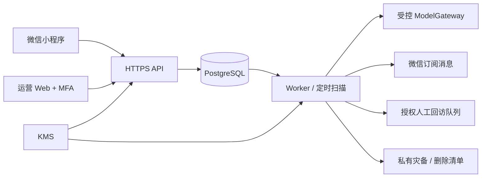
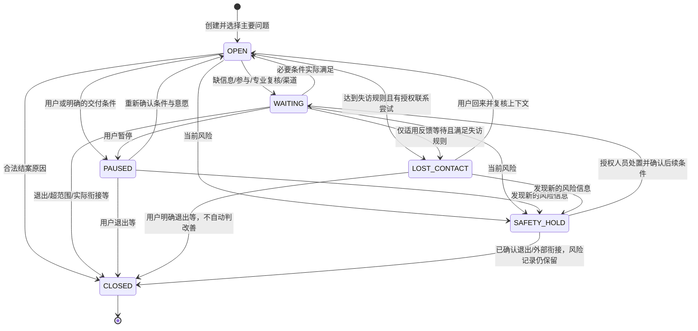

# 小树荫 V1 技术设计

> 版本：v1.1
>
> 更新日期：2026-10-24
>
> 状态：已同步2026-10-24用户校正的可评审设计；普通AI交付、孩子按需参与及多年档案已纳入。技术和预算由设计者推荐；没有实现、资源采购或真实服务验收。
>
> 唯一需求依据：[04-v1-product-requirements.md](04-v1-product-requirements.md)。总体框架：[05-system-architecture.md](05-system-architecture.md)。本文件只细化 V1，不另立需求、不提前实现 V2—V5。

## 1. 实现目标与边界

交付家长通过既有微信小程序“小树英助手”发起未满18岁孩子的数字使用问题，完成理解、目标、计划、执行、反馈、复盘、维护和出口；必要资料多年连续保存。孩子可受邀以本人微信有限参与并可拒绝／退出。国内家庭为主，不设统一最低年龄或港澳台一概排除；内容按年龄发展适配。最简管理后台维护知识、反馈、质量和权利请求；普通方案不逐份真人审批。

V1不提供完整家庭私人长对话与复杂共享平台，但实现孩子针对当前个案的轻量邀请、本人表态和反馈。预测、支付、语音、实时调停及向量平台仍后置；不设置固定家庭总数和统一反馈天数。实际平台、地域与现实支持能力据实显示。

### 1.1 本轮技术选择

| 项目 | V1 设计决定 | 约束 |
|---|---|---|
| 用户端 | 原生微信小程序，TypeScript／WXML／WXSS | 不在客户端放 AppSecret、模型 Key 或数据库凭证 |
| 运营端 | React + Vite，TypeScript | 独立 staff 身份、MFA 和个案分派 |
| 服务端 | Node.js 24 LTS + Fastify 5 | 实施时锁确切补丁与插件组合，执行兼容测试 |
| 数据库 | PostgreSQL 17，SQL 迁移与参数化查询 | 产品、家庭、个案范围约束；运行账号不是 owner |
| 运行形态 | 模块化单体，同库中的 API 与 Worker 两种进程 | 无微服务、Redis、Kubernetes 或通用流程引擎 |
| 模型 | 经评测锁定的境内企业模型配置，首选评估通义千问 | 账户、接入地域、推理范围、留存及数据条款逐项核实 |
| 知识 | 版本化审签专业包，结构化条目及 PG 文本检索 | 草稿、旧模板和未核实阈值不得被当正式规则 |
| 调度 | PG 持久任务 + 事务 outbox + 租约 Worker | 至少一次执行；外部发送结果不明时不盲重试 |
| 基础设施 | 推荐中国内地云，容器服务、托管 PG、KMS、私有对象存储 | 对象存储只用于必要安全导出、灾备和独立删除清单 |

选择与理由详见 05 的 ADR。本文件所有性能数字是需要验证的工程目标，不是测量结果。地域、模型 ID 和平台模板不填写虚构账号值；它们是受控配置及上线前验收项。

## 2. 代码与部署组织

建议未来代码目录如下，本轮只定义布局，不创建代码或安装依赖：

```text
apps/miniprogram/       用户端
apps/operations/        内部知识、质量、反馈和权利管理 Web
apps/server/            API、Worker 入口
packages/contracts/     JSON Schema、枚举、错误码、生成的接口类型
packages/domain/        个案、计划、随访、授权等业务规则
packages/integrations/  实际使用的微信及模型适配器
packages/content/       专业包格式及校验器，不存生产私人数据
db/migrations/          可审查 SQL 迁移
tests/                  领域、集成、端到端与 AI 评测
```

一个仓库、一个发布版本，API 与 Worker 使用同一构建产物的不同启动命令。API 可先单实例，Worker 可先单实例；任何副本增加均不得破坏幂等、租约和授权。数据库采用托管备份，应用本地磁盘不作为持久数据源。



API 提供已审核的静态安全说明不依赖模型。模型故障不阻止暂停、撤回授权、查看既有计划和提交资料请求；这些操作均不调用生成模型。

## 3. 领域不变量

1. `account` 是登录主体，`person` 是被描述的人，`family` 是关系与服务范围；V1 不以三者相等建模。
2. 同一产品、同一家庭最多一个当前主要未结个案。候选问题不自动升级为个案，也不因未处理被删除。
3. 非主要个案不能继续普通执行与提醒；切换主问题必须原子地暂停旧案并启用新案。
4. 原始消息、报告事实、转述、设备记录和 AI 假设分开；确认人和来源不可由模型伪造。
5. 用户可修正陈述，修正追加版本并失效相关派生摘要，不静默覆写历史。
6. 普通首次及实质调整先完成规则、来源、适用和安全校验，再由家长确认；只有规则明确要求且实际可承接的异常需人工，AI及运营不能代确认。
7. 目标、任务负担、责任人、激励及风险等变化产生新方案并重新校验确认，按需异常复核；普通时间微调仍校验规则、频率和许可。
8. 计划固定引用专业包、评估及目标版本；不能因知识更新使既有方案无痕改变。
9. 风险中断、授权撤回、暂停、关闭和删除在 API 与发送时再次校验；入队不意味着可以一直执行。
10. 转介状态、结案原因与生活结果独立；失访不赋值为成功或失败。
11. 家长转述与孩子受邀直接提交保留不同来源；孩子只见本人及明确共享内容，可以拒绝或退出。成长和关系变化不自动清空档案，也不自动转移私人记录。
12. 加入未来家庭组、年龄增长或注册新产品不自动授予旧资料访问权。

## 4. 个案状态、阶段与结果

### 4.1 权威状态

| 维度 | 枚举 | 说明 |
|---|---|---|
| `status` | `OPEN / WAITING / PAUSED / LOST_CONTACT / SAFETY_HOLD / CLOSED` | 生命周期；不得用聊天会话结束替代 |
| `phase` | `INTAKE / ASSESSMENT / GOALS / PLANNING / EXECUTION / REVIEW / MAINTENANCE` | 当前业务阶段，暂停仍保留 |
| `waiting_reason` | `INFORMATION / PARTICIPATION / PROFESSIONAL_REVIEW / CONTACT_CHANNEL` | 仅 `WAITING` 有值 |
| `pause_reason` | `USER_REQUEST / PRIORITY_CHANGED / OPERATIONAL_CAPACITY` | 暂停原因；不伪装为完成 |
| `closure_reason` | `STABLE_IMPROVEMENT / NO_INTERVENTION_NEEDED / USER_WITHDREW / OUT_OF_SCOPE / EXTERNAL_HANDOFF_COMPLETE` | 仅关闭时有值 |
| `outcome` | `IMPROVED / NO_CHANGE / WORSENED / UNKNOWN` | 需要来源和观察窗口，不能从结案原因推断 |
| `referral_status` | `PROPOSED / ACCEPTED / CONTACTED / CONNECTED / DECLINED / UNREACHABLE` | `CONNECTED` 也不等于已改善 |
| `risk_status` | `OPEN / UNDER_REVIEW / RESOLVED` | 风险事件独立保存、审计，模型不可解除 |

### 4.2 状态图



`CLOSED` 个案不原地改为未结。复发创建 `previous_case_id` 关联的新个案，继承内容需重新确认时效；原结案和结果证据保留。旧案有未解除风险时，不通过新建个案绕过安全控制。

阶段推进检查当前主要案、必要信息和参与、知识及安全条件。执行需家长确认的有效方案与反馈安排，不要求可选订阅授权才能开始；USER_INITIATED与有许可节点的AUTHORIZED_REMINDERS分别保存，不能混同主动跟踪兑现。只有实质依赖约定联系的步骤才WAITING / CONTACT_CHANNEL。

## 5. 数据设计

所有业务主键使用不可枚举 UUID；时间用 `timestamptz` 存 UTC，同时保留用户时区。V1 默认 `Asia/Shanghai`，业务日与静默时段按该时区计算。计量值保存单位、窗口、来源和缺失原因；未知值使用 `NULL + missing_reason`，不能保存为 0。

### 5.1 核心表与责任

下列是逻辑表契约，SQL 迁移实现时可在不改变含义的前提下合并低频内部记录；不得删除审计、来源或状态约束来减少表数。

| 表 | 关键字段 | 主要约束／写入责任 |
|---|---|---|
| `accounts` | `id, principal_kind, identity_provider, external_subject_hash, status` | PARENT／CHILD_PARTICIPANT／STAFF由服务端校验；provider+subject唯一，不能客户端自报角色 |
| `pilot_batches` | `id, opening_mode, admission_limit, intake_open, config_version, reason_ref` | 邀请／灰度／开放可配置，数量上限可空；质量、预算及负载约束仍有效，不写固定人数 |
| `pilot_enrollments` | `batch_id, family_id, invitation_hash, disposition, reason_ref, admitted_at` | 去重及原总数可对账，等待、明确拒绝和未知分开；额度若配置则事务检查 |
| `sessions` | `account_id, token_hash, expires_at, revoked_at, auth_time` | 仅存令牌哈希；staff 记录 MFA 状态与时间 |
| `persons` | `id, product_id, age_declaration_json, age_review_at, data_subject_status` | 年龄有时点来源供方法适配，不锁最低年龄、不默认要证件或完整生日 |
| `families` | `id, product_id, owner_account_id, timezone, version, archive_policy_version, archive_purpose_status` | 一位家长主账号，可关联有限孩子账号；长期档案用途不随单案结束自动终止；变更不自动共享旧私密资料 |
| `family_members` | `family_id, person_id, account_id, relationship, reported_by_account_id` | account可空；绑定孩子账号需邀请及双方确认，不以关系代替访问许可 |
| `consent_records` | `subject_id, actor_id, purpose, scope, evidence_ref, version, granted_at, revoked_at` | 不同目的分别记录；撤回追加事件 |
| `contact_channels` | `account_id, channel_type, encrypted_destination, authorization_id, capability_state, verified_at` | 不能靠估计次数证明平台还有发送资格 |
| `cases` | `product_id, family_id, subject_person_id, scenario_key, status, phase, version, context_revision, schedule_revision, is_primary, previous_case_id, blockers_json, archive_purpose_review_at` | 主要个案唯一；状态与原因匹配；全部必要阻塞条件有责任方、节点与解除证据 |
| `case_events` | `case_id, event_type, from_version, to_version, actor_id, reason_ref, occurred_at` | 关键状态变化只追加；不以安全审计元数据代替业务历史 |
| `issue_candidates` | `family_id, discovered_in_case_id, description_enc, source_ref, priority, disposition` | `RECORDED / DEFERRED / PROMOTED / RESOLVED_ELSEWHERE`；处理依据必填 |
| `case_participants` | `case_id, person_id, account_id, invitation_id, participation_mode, state, granted_scopes, consent_ref, source_ref` | DIRECT_INVITED／PARENT_RELAY／OFFLINE分开；有限范围、拒绝及撤回不自动封家长可行路径 |
| `assessment_versions` | `case_id, version_no, package_id, answers_json_enc, missing_json, confirmed_by, confirmed_at` | 版本只追加；原回答可查 |
| `evidence_assertions` | `case_id, subject_id, kind, statement_enc, source_message_ids, observation_window, confirmation, validity, supersedes_id` | 来源属于同一授权范围；假设不得升格事实 |
| `dialogue_messages` | `case_id, author_kind, body_enc, client_message_id, created_at` | 相同作者与 client_message_id 唯一；不存模型内部思维 |
| `case_summaries` | `case_id, context_revision, summary_enc, source_ids, generated_by_run_id, validity` | 可重建；来源失效则失效，不能当事实源 |
| `scenario_packages` | `scenario_key, semantic_version, content_hash, state, reviewer_id, published_at, scope_json` | `DRAFT / IN_REVIEW / PUBLISHED / SUSPENDED / RETIRED`；发布内容不可原地修改 |
| `goal_versions` | `case_id, version_no, baseline_refs, target_json_enc, participant_sources, confirmed_at` | 无共同确认不得伪造；实际仅家长确认须明确显示 |
| `plan_versions` | `case_id, version_no, package_id, goal_version_id, content_hash, state, validation_id, review_policy, professional_review_id, parent_confirmed_at` | review_policy默认RULE_VALIDATION；明确HUMAN_REVIEW_REQUIRED才需真实人工记录，已启用不可原地改 |
| `tasks` | `plan_version_id, owner_person_id, action_enc, cadence_json, feasibility_note_enc, state` | 责任人存在且承担方式有依据；状态为 `PENDING / IN_PROGRESS / PARTIAL / COMPLETED / NOT_EXECUTED / PAUSED / CANCELLED`，逾期是独立时间属性 |
| `checkins` | `case_id, plan_version_id, due_node_id, submitted_by, answers_enc, outcome_observation` | 同一提交键幂等；可追加更正，不覆盖历史 |
| `case_reviews` | `case_id, plan_version_id, baseline_refs, checkin_refs, findings_enc, next_action, reviewer_source` | 调整、维持或重新分诊有可追溯依据 |
| `followup_nodes` | `case_id, plan_version_id, due_at, node_type, schedule_revision, tracking_mode, channel_readiness, state` | 每节点据实记录主动返回／许可提醒，不能把一次许可扩为全周期 |
| `risk_events` | `case_id, source_ref, signal_code, status, assigned_reviewer, disposition_enc` | 风险不是诊断；解除需责任人和理由 |
| `support_resource_versions` | `resource_id, version, region, service_scope, hours, source_url, verified_by, verified_at, expires_at` | 公共信息与真实合作身份分开，过期不能自动推荐 |
| `referrals` | `case_id, resource_version_id, status, subject_permission_id, evidence_enc` | 资源已核实；不凭点击更新为 CONNECTED |
| `case_outcomes` | `case_id, window_start, window_end, result, evidence_refs, missing_reason` | 覆盖全部进入者；结果与关闭原因独立 |
| `professional_reviews` | `case_id, target_type, target_version, decision, reviewer_id, rationale_enc` | `PENDING / APPROVED / CHANGES_REQUIRED / REJECTED`；授权与版本检查 |
| `work_items` | `type, case_id, linked_entity_id, assignee_id, due_at, state, completion_evidence_ref` | 回访、风险与资料请求待办；完成不能只写“已处理” |
| `ai_runs` | `case_id, kind, input_revision, model_config_version, package_id, status, expires_at, call_attempts, result_enc, usage_json` | 一个个案最多一个 QUEUED/RUNNING；输出经校验才可应用；调用次数和预算不会因 Worker 重启归零 |
| `model_config_versions` | `id, provider, model_id, endpoint_scope, storage_region, inference_scope, price_version, prompt_version, schema_version, policy_version, state` | 真实账户与地域核实后启用；不含明文凭证；模型别名漂移限制如实说明 |
| `model_budget_entries` | `run_id, attempt_id, period_month, reserved_amount, actual_amount, cost_state, price_version` | 月额度必检；日额度仅配置才检查；预留、对账、未知及释放分开，未知费用不按零 |
| `jobs` | `type, aggregate_id, revision, dedupe_key, state, available_at, lease_until, lease_token, attempts` | dedupe_key 唯一；过期租约可回收，租约令牌防迟到完成 |
| `outbox_events` | `event_id, event_type, aggregate_id, revision, payload_ref, published_at` | 与领域变更同事务；不放完整私人正文 |
| `notifications` | `followup_node_id, channel_id, consent_version, intent_state, suppression_reason, schedule_revision` | 通知意图独立于发送尝试与送达，不能用一个 sent 布尔值 |
| `notification_attempts` | `notification_id, contact_attempt_id, provider_request_ref, attempt_state, delivery_state, response_code, evidence_json` | API 接受、是否送达及是否阅读分别保留证据；外呼结果不明不转换为已接受 |
| `contact_attempts` | `account_id, node_id, channel_type, reserved_at, attempted_at, state, evidence_ref` | 跨渠道统一频率账本；`RESERVED / ATTEMPTED / UNKNOWN / RELEASED`，队列分派不算已尝试 |
| `idempotency_records` | `actor_id, route, idempotency_key, request_hash, response_status, response_ref, expires_at` | actor + route + key 唯一；相同 key 不同内容报错 |
| `staff_assignments` | `staff_id, case_id, purposes, expires_at, granted_by` | 默认无个案正文访问；按目的与期限授权 |
| `service_work_logs` | `case_id, staff_id, work_type, minutes, related_entity_id` | 真实人工投入；未知不补 0，用于成本而非疗效 |
| `pilot_feedback` | `batch_id, family_id, question_version, response_enc, response_status, source_ref, answered_at` | 自愿体验反馈与付费意愿；拒答／未问／未知分开，无收费或研究训练用途 |
| `pilot_report_snapshots` | `batch_id, as_of, scope_version, screening_totals, case_state_totals, outcome_totals, deletion_impact_totals, completeness` | 最小批次汇总不带家庭／个人链接；只按获准统计目的保存，不能自动宣称匿名或对外公开 |
| `data_requests` | `account_id, type, scope, status, deadline, completion_evidence_ref` | 更正、导出、删除与撤回分别有状态 |
| `participation_invites` | `case_id, target_person_id, token_hash, inviter_id, expires_at, state, accepted_account_id, decline_source` | 推荐48小时有效且单次，INVITED／PENDING_BINDING／ACCEPTED／DECLINED／REVOKED／EXPIRED；未回复不是拒绝 |
| `participation_shared_items` | `case_id, source_ref, version, audience_account_id, purpose, approved_by, payload_enc, revoked_at` | 只分享明确范围的计划片段或本人提交，不透传家长全文；风险先筛查 |
| `plan_validations` | `plan_id, content_hash, input_revision, package_version, rule_version, result, checked_at` | 系统校验不冒充专业签名；结果过期不批准新版本 |
| `longitudinal_archive_entries` | `family_id, person_id, event_at, entry_kind, content_enc, source_refs, evidence_kind, confirmation, supersedes_id, purpose_scope, visibility_scope, validity` | 多年关键档案，不以个案关闭设TTL；来源、时间、纠错及可见范围保留，摘要可重建 |
| `audit_events` | `actor_id, purpose, action, resource_type, resource_id, result, request_id, occurred_at` | 不含完整对话／Key／原始联系方式；审计元数据保留策略独立 |

平台订阅返回只支持当前意愿证据时，记录原始结果与时间，不建立自称权威的“剩余次数”。只有平台实际允许且发送校验通过才尝试发送，耗尽后进入渠道处理。

### 5.2 关键数据库约束示例

以下示例说明迁移必须表达的约束，不是已经执行的生产 SQL：

```sql
CREATE UNIQUE INDEX one_primary_case_per_family
ON cases (product_id, family_id)
WHERE is_primary AND status <> 'CLOSED';

ALTER TABLE cases ADD CONSTRAINT case_lifecycle_reason_check CHECK (
  (status = 'WAITING') = (waiting_reason IS NOT NULL)
  AND (status = 'CLOSED') = (closure_reason IS NOT NULL)
  AND (status <> 'CLOSED' OR is_primary = false)
);

CREATE UNIQUE INDEX one_active_ai_run_per_case
ON ai_runs (case_id)
WHERE status IN ('QUEUED', 'RUNNING');

CREATE UNIQUE INDEX unique_plan_revision
ON plan_versions (case_id, version_no);

CREATE UNIQUE INDEX unique_command
ON idempotency_records (actor_id, route, idempotency_key);

CREATE UNIQUE INDEX unique_due_node
ON followup_nodes (case_id, schedule_revision, node_type, due_at);

CREATE UNIQUE INDEX unique_job_effect
ON jobs (dedupe_key);
```

`family_id`、`case_id`、`product_id` 组合外键确保关联确实处于同一范围，不能只凭对象 UUID 存在就允许引用。逻辑删除字段不代替真实删除履约；删除范围按 §13 处理。

### 5.3 索引与扩展

V1 明确需要：`cases(family_id, created_at)`、`dialogue_messages(case_id, created_at,id)`、`evidence_assertions(case_id,validity)`、`checkins(case_id,due_node_id)`、`jobs(state,available_at,lease_until)`、`notifications(followup_node_id,intent_state)`、`work_items(assignee_id,state,due_at)` 与 `audit_events(resource_id,occurred_at)`。按实际查询计划核实，不为假想分析给所有字段建索引。

知识条目采用范围过滤后的精确条目 ID、标签和 PG 文本／关键词检索。V1 不启用向量扩展，跨家庭案例不进入个人模型上下文。

## 6. API 契约

### 6.1 通用协议

- HTTPS JSON API 前缀 `/api/v1`；服务器生成 `request_id` 并贯穿审计、模型与任务。
- 用户令牌为随机不透明 bearer，服务端仅存哈希，建议有效期 7 天；撤回、退出、风控可立即使会话失效。staff 独立会话建议 8 小时，敏感操作重新验证 MFA。
- 有副作用的命令要求 `Idempotency-Key`，建议保存重放响应 7 天。领域唯一约束在记录过期后仍有效，避免同一节点被重复执行。
- 修改既有个案或计划要求 `If-Match`，缺少返回 428；版本不匹配返回 412，客户端刷新后让用户重看，不自动覆盖。
- 上述版本前置条件适用于确认、切换、替换等状态命令。追加新消息及事实反馈不因旧页面版本而拒收：保留其所指计划／上下文版本、立即安全检查，过期反馈作为历史补充。不能在发现新风险前先因 412 要求用户重填。
- 错误结构：`{code,message,request_id,retryable,details}`。不返回完整提示词、数据库错误、私人原文或供应商凭证。
- 字符串按 Unicode 字符数校验；正文单次建议上限 4,000 字，超限允许保存明确的草稿但不悄悄截断。API 体上限建议 64 KB。列表默认 20，最大 100，使用游标。

### 6.2 接口清单

| 方法与路径 | 用途／权限 | 关键契约 |
|---|---|---|
| `POST /auth/wechat` | 登录 | 提交一次性 code；服务器换身份，拒绝客户端自报 openid |
| `POST /invitations/verify` | 申请者 | 校验邀请哈希、到期与名额，不能绕过实际准入审批 |
| `POST /staff/enrollments/{id}/admit` | 验证期有权维护者 | 若采用人工准入，锁当前开放配置检查实际限额；不预设人数或真人排班 |
| `POST /auth/logout` | 当前账号 | 撤销当前会话；不自动撤销服务授权 |
| `GET /me` | 当前账号 | 返回能力、授权摘要与用户角色，不返回 secret |
| `POST /families` | 家长主账号 | 创建最小家庭与人物；不要求全家注册，不锁未经依据的最低年龄 |
| `PATCH /families/{id}/members/{personId}` | 家庭 owner | 更新关系／年龄范围；敏感授权不能被普通 PATCH 绕过 |
| `POST /consents` | 明确授权的本人／按规则核验主体 | 按 purpose 和 scope 创建不可变版本 |
| `POST /consents/{id}/revoke` | 合法授权主体 | 同事务取消相关后续用途并发清理事件 |
| `POST /contact-channels` | 当前账号 | 绑定获单独授权的联系路径；平台返回状态原样分类 |
| `POST /cases` | 家庭 owner | 选择/描述问题，创建主要个案；冲突返回 409 |
| `GET /cases/{id}` | 家庭 owner 或有目的分派的 staff | 阶段、下一步、计划、结果与等待原因 |
| `POST /cases/{id}/messages` | 当前个案访问者 | 始终先保存原话并立即规则安全检查；返回 message_id、safety_state 和生成安排，不因已有 run 拒收新风险信息 |
| `GET /ai-runs/{id}` | 原个案授权主体 | RUNNING／失败／已校验结果；未经校验结果不返回 |
| `POST /ai-runs/{id}/cancel` | 发起者 | 取消应用与呈现，不能承诺供应商已停止计费 |
| `POST /cases/{id}/assessments` | 家庭 owner | 结构化回答、来源和未知原因；不把拒答变成否 |
| `POST /cases/{id}/assertions/{assertionId}/correct` | 有权更正者 | 新版本、原因与来源；使受影响摘要和待审方案失效 |
| `POST /cases/{id}/goals` | 家庭 owner | 保存确认目标版本，区分本人确认与家人转述 |
| `POST /cases/{id}/plans/propose` | 家长请求 | 候选经系统规则校验后待家长确认，仅review_policy明确要求时建立真实异常复核 |
| `POST /plans/{id}/confirm` | 家长本人 | 检查准确哈希的规则校验、必要参与及安全；只在review_policy要求人工时校验复核，提醒许可不强制 |
| `POST /cases/{id}/checkins` | 家长或获准孩子 | 计划／节点、真实作者及可见范围，安全先检查；孩子仅可提交自己的反馈 |
| `POST /cases/{id}/reviews` | 家庭 owner 发起 | 生成阶段复盘候选；改变方案走新版本复核 |
| `POST /cases/{id}/schedule` | 家庭 owner | 改下一节点；按频率、静默、渠道及 schedule_revision 校验 |
| `POST /cases/{id}/pause` | 家庭 owner | 暂停并取消普通提醒，保留阶段和记录 |
| `POST /cases/{id}/resume` | 家庭 owner | 重核专业包、风险、计划、参与、授权与渠道 |
| `POST /cases/{id}/switch-primary` | 家庭 owner | 原子暂停旧案并转候选新案，安全限制不能绕过 |
| `POST /cases/{id}/close` | 家庭 owner 提出／按原因需专业确认 | 分开保存结案原因、结果、观察期与证据 |
| `POST /cases/{id}/recurrences` | 家庭 owner | 建关联原案的新案，不修改原 CLOSED 记录 |
| `POST /cases/{id}/referrals` | 家庭 owner 或获分派 staff | 保存资源版本、授权、真实进展；不能自动 CONNECTED |
| `POST /data-requests` | 当前资料权利主体 | 更正／导出／删除；返回时限、范围与真实处理状态 |
| `GET /data-requests/{id}` | 请求者／分派人员 | 完成证据、例外范围和预计到期 |
| `GET /data-requests/{id}/download` | 当前仍有权限的请求者 | 24 小时有效的私有导出；核验身份，不返回公开永久链接 |
| `GET /staff/work-items` | staff | 只看分派及角色允许队列 |
| `POST /staff/professional-reviews/{id}/decide` | 专业复核角色 | 明确版本、意见和理由；本人不能以运营点击代替复核 |
| `POST /staff/work-items/{id}/complete` | 分派人员 | 需要联系／处理证据，不能只改状态 |
| `POST /staff/risk-events/{id}/resolve` | 获授权专业角色 | 处置、理由、后续条件；不能由 AI 调用 |
| `POST /staff/cases/{id}/mark-lost-contact` | 分派运营 | 检查两个节点及真实授权联系尝试，人工确认并保留证据 |
| `POST /staff/scenario-packages/{id}/publish` | 专业内容审核角色 | 校验签名、范围、评测与回滚；禁止原地改已发布版本 |

`GET /cases/{id}` 返回权限范围内的结构化信息；不同 staff 角色有不同投影，不能用隐藏前端按钮代替服务端过滤。平台或模型回调只能更新相关外部状态，不可替用户确认计划。

配套读取及工作人员命令也属于本次实现范围，避免只有写入接口却无法完成页面任务：

| 方法与路径 | 合同 |
|---|---|
| `GET /service-info`、`GET /support` | 未登录也可读的当前服务范围、时段及已审签通用支持卡；不返回任何家庭资料 |
| `GET /families/current`、`GET /cases` | 当前有权家庭及分页个案；候选问题和当前主要案由同范围读模型提供 |
| `GET /cases/{id}/messages`、`GET /cases/{id}/records` | 按游标读取授权对话／结构化档案、来源、纠错及版本历史 |
| `GET /plans/{id}`、`GET /cases/{id}/followups` | 准确版本的方案／任务、反馈、复盘、维护和安排；最新状态带可执行动作 |
| `POST /cases/{id}/issues`、`POST /cases/{id}/participants` | 候选问题及线下／转述来源；本人参与走专用邀请绑定，不代确认 |
| `POST /cases/{id}/triage-decisions` | 家长确认问题理解／无需干预等候选；需专业依据的结论先通过相应复核 |
| `POST /cases/{id}/maintenance` | 家长确认专业允许的维护条件、窗口和节点；不自动判稳定改善 |
| `POST /ai-runs/{id}/retry` | 只重试终态失败的同一业务目的，引用原消息，不重复保存输入；新 run 仍受预算和版本检查 |
| `GET /consents`、`GET /contact-channels`、`GET /data-requests` | 当前主体的授权版本、渠道真实能力及权利请求状态 |
| `POST /staff/auth/start`、`GET /staff/auth/callback`、`POST /staff/auth/logout` | 接入核实过的独立身份与 MFA 流程；不开放自助员工注册，不信任客户端自报角色 |
| `GET /staff/work-items/{id}`、`POST /staff/work-items/{id}/assign` | 按职责分派／领取，记录责任人、期限与容量；分派不等于联系已发生 |
| `POST /staff/work-items/{id}/contact-attempts` | 开始及追加实际授权联系结果，走统一频率临界区；普通 complete 不能绕过 |
| `POST /staff/work-logs` | 记录实际服务角色、动作与分钟；与批次／个案关联，未知保持未知 |
| `GET /staff/scenario-packages`、`POST /staff/scenario-packages` | 读取授权内容库，创建带来源和适用范围的草稿版本 |
| `PATCH /staff/scenario-packages/{id}`、`POST /staff/scenario-packages/{id}/submit` | 只修改草稿；提交固定哈希待专业审核，不能通过 PATCH 自行发布 |
| `POST /staff/scenario-packages/{id}/review`、`POST /staff/scenario-packages/{id}/suspend` | 有权限审核后发布；紧急停用列受影响个案与后续处置，不静默替换 |
| `GET /staff/support-resources`、`POST /staff/support-resources`、`POST /staff/support-resources/{id}/verify` | 维护版本及核验依据，未经核验不对用户发布联系方式或合作身份 |
| `POST /staff/data-requests/{id}/decide`、`GET /staff/audit-events` | 核验权利请求及例外、分项处理与回执；审计检索独立授权且不含全文 |
| `GET /staff/pilot-batches`、`PATCH /staff/pilot-batches/{id}`、`GET /staff/pilot-batches/{id}/report` | 受限负责人控制释放名额、实际排班和暂停入口；报表分母对账，改上限留显式变更 |

孩子参与专用接口同属V1：

| 方法与路径 | 合同 |
|---|---|
| `POST /cases/{id}/participation-invites` | 家长生成当前问题的有限邀请；随机令牌只存哈希，推荐48小时到期，说明可见范围及可拒绝 |
| `GET /participation-invites/{token}` | 登录前仅通用参与说明和令牌有效性，不展示姓名、原话或个案敏感资料 |
| `POST /participation-invites/{token}/accept` | 孩子微信登录及必要确认后待绑定；锁邀请防重复使用，不由客户端自报身份 |
| `POST /participations/{id}/confirm-binding` | 家长确认实际加入账号与邀请人物相符；误传邀请未确认前不开放共享资料 |
| `POST /participations/{id}/decline`、`POST /participations/{id}/withdraw` | 记录直接拒绝／撤回，撤销未来读取和新使用；家长转述拒绝需不同来源；未打开不是拒绝 |
| `GET /participations/{id}`、`POST /participations/{id}/responses` | 孩子只读本人及明确共享材料，提交本问题意见、任务表态或反馈；先校验安全与可见范围 |
| `GET /families/{id}/archive` | 按有权人物和用途检索多年关键档案；不能只查OPEN案，不能跨家庭或越过孩子共享范围 |

### 6.3 页面到接口与权限的覆盖

下表逐项承接 PRD 的 14个用户页面和6个工作人员页面，合计20项，不用页面合并来删去任务。GET 投影均要执行当前授权检查；表中路径统一省略 `/api/v1`。

| 页面 | 读取／命令入口 | 状态与权限验证重点 |
|---|---|---|
| U01 邀请与入口 | `/service-info`、`/invitations/verify`、`/auth/wechat`、`/me` | 登录成功不等于已准入；失效、候补与满额有具体状态 |
| U02 说明与授权 | `/service-info`、`/consents`、`/consents/{id}/revoke` | 必要／可选目的分开；撤回后新处理受控 |
| U03 家庭资料 | `/families`、`/families/current`、`/families/{id}/members/{personId}` | 年龄声明及本人授权，不把家庭关系当访问许可 |
| U04 个案总览 | `/cases`、`/cases/{id}`、`/cases/{id}/issues`、`/cases/{id}/switch-primary` | 六种状态、全部阻塞项、下一步与事务性切换 |
| U05 了解交流 | `/cases/{id}/messages`、`/cases/{id}/assessments`、`/ai-runs/{id}`、其 cancel／retry | 追加风险输入不被生成锁或旧页面版本阻挡；未校验内容不展示 |
| U06 理解与目标 | `/cases/{id}/records`、其 assertions 纠错、goals、participants、triage-decisions | 来源／未知／协商拒绝分别呈现；不代确认成员意见 |
| U07 方案与版本 | plans/propose、plans get／confirm | 规则校验后确认；仅明确异常才人工，不显示默认专家审批 |
| U08 任务与反馈 | `/plans/{id}`、`/cases/{id}/followups`、`/cases/{id}/checkins` | 真实任务状态、部分完成、旧计划反馈及新风险 |
| U09 复盘调整 | `/cases/{id}/records`、其 reviews、plans/propose、`/plans/{id}/confirm` | 基线与保护条件；新版本审核前不替换 |
| U10 维护历史 | `/cases/{id}/records`、其 maintenance、close、recurrences | 维护未到期／未知、关闭只读、复发关联新案 |
| U11 提醒设置 | contact-channels、consents／revoke、case schedule | 当前节点许可和主动返回分开，拒绝可选提醒仍可使用 |
| U12 资料权利 | `/cases/{id}/records`、`/data-requests`、其详情／download | 具体范围、部分完成、过期下载和无权资料过滤 |
| U13 安全支持 | `/support`、`/cases/{id}`、`/cases/{id}/referrals` | 已审签静态支持、核实资源、实际转介阶段 |
| U14 孩子参与 | participation-invites、participations详情／responses／withdraw | 当前问题有限授权、双方绑定、可拒绝／退出，不读家长原话，风险先检查 |
| W01 登录队列 | `/staff/auth/*`、`/staff/work-items`、其详情／assign | 独立身份及 MFA，默认只见职责所需元数据 |
| W02 个案工作 | `/cases/{id}`、其 records、`/staff/work-logs`、`/staff/work-items/{id}/contact-attempts` | 分派＋目的＋时限，实际工时和联系证据 |
| W03 内容维护与抽查 | scenario-packages及条件性professional-reviews | 知识先审，普通方案自动校验；只有异常需要真实复核 |
| W04 安全转介 | 风险 work-items、risk-events resolve、support-resources、case referrals | 风险解除角色、核验时效和真实衔接依据 |
| W05 权利审计 | `/data-requests/{id}`、`/staff/data-requests/{id}/decide`、`/staff/audit-events` | 核验身份、分项履约、例外和访问审计；超期告警 |
| W06 试点容量 | `/staff/pilot-batches*`、enrollments admit、work-logs | 本批去重上限／并发容量分开，全部去向和未知成本 |

每页均验收初次加载、无数据、服务端拒绝、断网、无权限及冲突恢复；安全挂起、等待、暂停、失访和关闭按可用动作控制。客户端不把失败的写入乐观渲染成最终成功；本地敏感草稿有短期保存与清理提示，登出清除，不长期缓存家庭正文。

### 6.4 关键输入与响应数据合同

所有请求和响应使用服务端静态 JSON Schema，并生成共享接口类型；禁止把用户或专业包中的任意 schema 动态编译为代码。响应白名单过滤字段，未知字段拒绝或明确兼容，不把模型自由 JSON 直接作为领域记录。

| 合同 | 必须表达的字段与不变量 |
|---|---|
| 年龄声明 | `age_years / age_band, as_of, source, uncertainty`，供方法适配；未知不猜确定值，不锁产品最低年龄。首次儿童／敏感资料作必要确认，不建设普遍的18岁人工核验流程 |
| 评估回答 | `field_key, value, unit, observation_start/end, value_status, source_kind, source_ref`；`KNOWN` 才有确定值，`UNKNOWN / NOT_COLLECTED / DECLINED` 不隐含否或零。必需项由固定包版本约束 |
| 陈述确认／纠错 | `assertion_id, source_refs, confirmation_actor, supersedes_id, correction_reason`；关联同范围原始消息，纠错失效依赖摘要，保留历史来源身份 |
| 目标 | `baseline_refs, observable_target, observation_window, protective_conditions, parent_actions, participation_evidence, confirmed_by`；不能以转述填孩子直接签署 |
| 计划 | `plan_version, content_hash, package_version, assessment_version, goal_version, validation_id, review_policy, tasks, followups, stop_conditions`；家长确认绑定同一hash，只有HUMAN_REVIEW_REQUIRED才要求人工签批 |
| 反馈 | `client_submission_id, plan_version, node_id, task_observations, barriers, changes, source_refs, concerns`；未执行仍可有效反馈，新担忧即时筛查 |
| 复盘结果 | `baseline_refs, checkin_refs, outcome, window, protective_observations, uncertainty, proposed_next_action, evaluator`；不从任务完成率直接赋改善 |
| 个案投影 | `status, phase, reasons, all_blockers, case_version, context_revision, current_plan, schedule_revision, allowed_actions`；操作列表来自当前策略，前端隐藏不代替后端校验 |
| 分页及错误 | 游标固定排序字段与作用范围；错误只含可安全展示的字段键、错误码、request_id 和重试条件，不回显别人的输入 |

### 6.5 可观察错误

| 错误码 | 场景 | 用户行为 |
|---|---|---|
| `VALIDATION_FAILED` / 400 | 缺字段、越界、未知枚举 | 定位到输入，保留已输入内容 |
| `AUTH_REQUIRED` / 401 | 过期／撤销令牌 | 重新登录后回到原业务位置 |
| `ACCESS_DENIED` / 403 | 无家庭／用途权限 | 不暴露该资料是否存在 |
| `CASE_ALREADY_PRIMARY` / 409 | 新建违反单主要个案 | 查看当前案或显式切换 |
| `IDEMPOTENCY_CONFLICT` / 409 | 同 key 内容不同 | 停止自动重试并刷新命令 |
| `STALE_VERSION` / 412 | 状态或方案已变化 | 展示更新，重新确认 |
| `PRECONDITION_REQUIRED` / 428 | 缺 If-Match | 客户端重新取版本 |
| `CONTACT_NOT_READY` / 409 | 实质依赖约定联系的当前动作缺渠道 | 可转主动返回；普通方案不因拒绝可选提醒而被禁止 |
| `PROFESSIONAL_REVIEW_REQUIRED` / 409 | 明确规则要求的异常需实际复核，普通方案不使用此阻塞 | 显示真实条件和去向，不伪称有人接单 |
| `SAFETY_HOLD` / 409 | 当前安全中断 | 显示审核过的支持路径，保留退出／资料操作 |
| `AI_UNAVAILABLE` / 503 | 超时、拒绝或模型故障 | 明确未生成，允许稍后再试或请求人工支持 |
| `RATE_LIMITED` / 429 | 超过账号／系统限额 | 显示可重试时间；安全静态信息仍可访问 |

## 7. 关键事务与并发

### 7.1 家长确认并启用计划

同一事务：鉴权及用途→锁主要案和候选→检查If-Match、内容hash、输入修订及已发布知识包→核对系统规则校验有效→必要参与和安全条件→若规则明确HUMAN_REVIEW_REQUIRED再核对真实复核→家长确认→旧版SUPERSEDED／新ACTIVE→反馈节点与提醒方式、安排版本→领域事件和outbox。

状态仍为DRAFT／PENDING_PROFESSIONAL_REVIEW／CHANGES_REQUIRED／AWAITING_PARENT_CONFIRMATION／ACTIVE／SUPERSEDED／WITHDRAWN。普通方案通过plan_validations后直接AWAITING_PARENT_CONFIRMATION；只有人工规则的异常进入PENDING_PROFESSIONAL_REVIEW及对应等待，无人承接不伪造审核中。

实质调整有新版本和重新校验确认。草案期间旧版仅在仍适用、安全且家长愿意时继续，否则暂停相关任务；不因每次草案自动停所有执行。生成不等于启用，任何失败不留半激活状态。主动返回和真实许可提醒分开，不以可选通知作为普通激活条件。

### 7.2 接收反馈与复盘

节点 ID 与客户端提交键幂等。反馈保存原始回答及来源，标记对应节点已反馈，写上下文修订与复盘待办。晚到反馈可保存为历史补充，但不自动覆盖新计划或回溯修改结案。重复任务执行只产生一条相同业务副作用。

复盘可维持、降负担、调整、重新分诊、维护或转介。维持不造重复方案，实质变化有新版本和规则校验／家长确认，必要异常按实际分支复核。反馈、复盘及维护周期按问题、阶段和家庭约定，不强制全体统一天数。

### 7.3 暂停、撤回、关闭与主问题切换

锁个案 → 校验操作者及版本 → 记录状态、原因和阶段 → 作废未发送普通通知与节点 → 更新 `schedule_revision` → 写审计与取消事件。切换时锁同一家庭及相关个案，防两个并发请求各自成为主要案。`SAFETY_HOLD` 不因切换而消失。

`case.version` 控制业务命令的并发，`context_revision` 控制模型输入及摘要新鲜度，`schedule_revision` 控制提醒。普通聊天追加不能无意取消全部提醒；已失效的模型结果不能套用到新计划。

### 7.4 可控开放与孩子参与事务

开放配置可为邀请、灰度或开放；admission_limit可空，不预设固定家庭总数。设置限额时锁配置版本，按批次去重计数，原子检查不能并发超限；未配置限额仍受实际系统、预算及质量开关控制。家庭数、进入者与复发轮次分别记，不能用退出／重开美化口径。

孩子接受邀请时锁令牌、核对到期／单次使用／目标人物／必要确认，绑定本人登录；家长确认实际账号后才开放有限共享材料，误传不得直接读家庭资料。拒绝、未回复、家长转述和本人表态来源分开。撤回提升权限及上下文版本，停止该参与者未来读取和新使用，保留依法可处理的最小事件，不把家长独立可行路径一并关闭。

邀请不创建完整家庭私密聊天；本人提交按明确共享范围形成材料。风险信息先检查，涉及家人潜在伤害时不自动进入给该家人的普通读模型或生成上下文。

多项必要阻塞仍用blockers_json保留，waiting_reason仅主要投影；恢复检查全部真正必要条件，不把可选提醒缺失误作阻塞。

## 8. 模型执行与输出校验

### 8.1 交互语义

V1 是消息级异步回复：POST 接收后返回 run_id，前端显示“正在整理信息”，按 2 秒起步、最长 5 秒间隔查询状态；离开页面后可恢复。后端完整生成候选并完成检查后整条展示，不向用户伪装 token 流式输出，也不把校验过程中的文字提前当答案。

一个个案同时最多一个生成任务，但保存新消息与反馈不受这一生成锁阻挡。保存事务提升 `context_revision` 并立即规则安全检查；命中风险时同事务转安全挂起、抑制普通任务及提醒。已有 run 的旧候选不再应用；服务端记录待生成的最新修订及未覆盖消息，合并安排，不为每条追加制造并行模型请求。原 run 已终止／过期后，且授权、状态、包和预算仍允许，才建立下一条 run。已排队但未调用的旧 run 可直接记 STALE；已在外部运行的请求尝试取消，但不能宣称供应商已停止处理或计费。

返回结构至少包含 `message_id, persisted=true, context_revision, safety_state, generation_state, active_run_id, pending_revision`。`generation_state` 区分已排队、等待旧运行结束、无需生成、被安全规则阻止及模型不可用，不能保存消息后谎称新回复已开始。`persisted=true` 只能在数据库提交成功后返回；安全信息入口与静态支持卡不依赖模型预算，数据库故障则明确未保存并保留草稿。过量及恶意请求仍受边界验证和滥用防护，不能把普通 AI 并发额度用来拒收已授权风险反馈。

专业人员修改计划、用户更正资料或撤回授权同样提升相关上下文版本；迟到结果记 `STALE`，不应用。包括排队在内的单个普通 run 最长建议 120 秒，调用及同 run 额外尝试共用 30 秒供应商预算；到期写明确失败或过期状态，不无限显示处理中。等待最新资料的合并请求保留自己的提交时间；负载不足以在窗口内处理时明确告知排队失败，不无限延长等待。

### 8.2 运行过程

```text
验证请求、准备规则安全判定
  → 同事务保存用户消息、上下文修订及安全状态
  → 若允许生成，创建运行或合并待生成修订
  → 按产品/家庭/个案/用途授权取资料
  → 选取专业包及固定模型配置
  → 最小上下文构造（来源、时间、未知、冲突）
  → 模型生成候选
  → JSON Schema 校验
  → 依据、范围、权限、状态与安全检查
  → 如需专业复核则创建待办
  → 可展示结果提交数据库
  → 客户端读取真实状态
```

模型负责候选信息，不拥有直接数据库写入工具、任意网页访问、消息发送或安全解除权限。用户文本和旧资料中的命令都作为数据处理，不能覆盖系统流程与授权规则。

### 8.3 候选协议

```json
{
  "schema_version": "v1",
  "reply_kind": "CLARIFY",
  "reply_text": "面向用户的候选回复",
  "used_knowledge_ids": ["数字使用包中的已发布条目ID"],
  "source_message_ids": ["本次授权个案中的消息ID"],
  "proposed_assertions": [],
  "missing_field_keys": ["sleep_impact"],
  "proposed_next_action": "ASK_INFORMATION",
  "risk_signals": []
}
```

示例仅说明字段，不是生产内容或正式专业包。`reply_kind` 只允许 `CLARIFY / EXPLAIN / PLAN_CANDIDATE / REVIEW_CANDIDATE / SUPPORT_BOUNDARY`；行动白名单由当前阶段决定。不得在自由文本中夹带绕过确认的执行指令。普通共情不要求外部引用，专业判断、限制和建议必须能追溯到适用的已发布条目或已确认信息。

状态为 `QUEUED / RUNNING / VALIDATED / APPLIED / FAILED / CANCELLED / STALE`。`VALIDATED`表示技术及规则校验通过，不表示专业疗效成立；普通方案仍需家长确认，只有明确要求人工的异常另需实际复核。

### 8.4 失败边界

| 模型情况 | 处理 |
|---|---|
| JSON 不合法或未知字段 | 最多一次同任务格式修复；仍错记 FAILED，不拼凑默认事实 |
| 无来源、越范围、诊断或不当惩罚 | 拒绝应用，记录规则码，转适当澄清或人工待办 |
| 用户或模型提示注入 | 不执行被注入的工具／角色指令，保留审计与安全标记 |
| 超时、429、网络失败 | 调用总预算建议 30 秒；最多一次有界重试，不能突破总预算 |
| 拒绝、空输出 | 分别记录，不伪造回复；提供已审核的服务边界说明 |
| 风险信号或安全无法排除 | 停止普通方案，按风险规则进入等待复核或安全中断 |
| 结果迟到、用户取消、授权撤回 | 不展示／应用；保留最小运行状态与费用证据 |

单次超时预算、最大输出长度和调用次数是可版本化配置。记录供应商报告的 token、请求号与实际费用；拿不到费用时保存未知，不估成 0。

普通生成起步并发为全局 2 个，且每个个案至多 1 个；普通通知派发者先设 1 个。并发额度通过数据库租约／受控运行槽核对，API 和 Worker 增副本不能把总额度乘倍。规则安全检查和资料权利操作使用独立资源，不因模型队列满而关闭。

## 9. 专业包与审核

一个 V1 数字使用包至少包含：适用与排除、所需信息及未知处理、功能影响评估、目标协商、家长可行动项、可选家庭计划、任务可行性、反馈问题、复盘选项、维护与复发、安全规则及已核实资源的引用。

内容格式包括 `package_id / version / scope / age_bands / required_fields / stage_rules / knowledge_items / plan_constraints / safety_rules / resource_refs / reviewer / hash`。来源与审签证据必须真实；未经审查的旧小时数、心理标签、惩罚示范和“不复发”保证不能直接发布。

发布前运行结构检查、路径覆盖、代表性案例、拒答／冲突／高风险反例，以及专业人员复核。技术测试通过不能代替专业审签。普通运营角色不可发布专业包；小团队人员可兼任岗位，但操作身份、责任和实际审核记录不能合并成空白签名。

知识修订创建新版本。非安全更新不静默重写活动方案；安全撤回则阻断相关新建议，并为受影响个案创建人工复核，明确告知需要调整。回滚只允许回到仍可安全使用的版本，不能为了恢复服务启用已撤销规则。

## 10. 持久任务、主动提醒与人工回访

### 10.1 PG 任务领取

```sql
WITH picked AS (
  SELECT id FROM jobs
  WHERE state = 'READY' AND available_at <= now()
  ORDER BY available_at, id
  FOR UPDATE SKIP LOCKED
  LIMIT 20
)
UPDATE jobs j
SET state = 'RUNNING', lease_until = now() + interval '60 seconds',
    lease_token = gen_random_uuid(), attempts = attempts + 1
FROM picked WHERE j.id = picked.id
RETURNING j.*;
```

领取事务提交后才调用外部接口，不能持数据库锁等待模型或微信。建议每 20 秒续租；完成写入校验当前 lease_token。`RUNNING` 租约过期可回收；普通内部作业总计最多执行 3 次，两次重试退避 30 秒、2 分钟。模型运行的调用次数和 30 秒预算持久记录于 ai_run，格式修复与网络重试共用最多一次额外调用，不因重新领取作业而重置。非法参数、权限撤回和外部结果不明不按普通网络错误自动重试。达到上限进入 `DEAD` 并建立可追踪运营待办。

outbox 与领域变更同事务写入，按事件 ID 幂等派发为 jobs；独立扫描器每分钟恢复漏派事件。任务负载存引用，不放私人对话全文。

### 10.2 发送时的最终检查

按顺序检查：个案仍主要且允许跟踪 → 风险／暂停／关闭未阻止普通消息 → 节点与 `schedule_revision` 有效 → 未收到该节点反馈 → 联系目的授权有效 → 渠道及平台许可满足 → 不在静默时段 → 未超过滚动频率 → 生成最少字段通知 → 发送。

普通主动联系按方案频率跨渠道合并，推荐默认每日最多1次，21:00—08:00安静；家长可调整时段。真实频率策略版本参与发送检查，不能换渠道绕过上限。通知不含孩子姓名、具体困扰或心理标签，风险支持不偷用普通用途。

频率检查与联系预留在锁定该账号的短事务内完成，平台发送与人工开始联系共用 `contact_attempts`。已预留未释放、已尝试和结果不明的记录保守占用频率，只有确认未发出／未实际尝试才释放。不会仅靠两个 Worker 同时读取“还有一次额度”来判定可发送。人工队列被领取不算实际联系，点击开始联系时仍校验授权、静默和频率。

发送器在同一授权临界区将尝试记为 `DISPATCHING` 后才进入外部调用。撤回取消所有尚未进入该临界区的普通发送；已发出或已被平台接受的消息无法由数据库撤回，界面保留“已开始发送／无法确认取消”及禁止再次重试的事实，不能改成已成功取消。

### 10.3 真实通知状态

通知按三条正交状态记录：

| 维度 | 状态 | 可得出的结论 |
|---|---|---|
| `intent_state` | `SCHEDULED / WAITING_PERMISSION / READY / SUPPRESSED / CANCELLED / MANUAL_REQUIRED / DISPATCH_REQUESTED` | 是否应执行当前节点的联系意图，不表示已发送 |
| `attempt_state` | `CREATED / DISPATCHING / PROVIDER_ACCEPTED / REJECTED / RETRYABLE_FAILURE / OUTCOME_UNKNOWN` | 一次外呼是否已开始、是否获明确受理或拒绝 |
| `delivery_state` | `UNKNOWN / DELIVERED / READ` | 仅在渠道提供可验回执时升级；V1 默认 UNKNOWN |

微信 API 明确成功只记 `PROVIDER_ACCEPTED + delivery_state=UNKNOWN`。若外呼后崩溃或超时，不知平台是否受理，则记 `OUTCOME_UNKNOWN + delivery_state=UNKNOWN`；这与“确定受理但不知道是否送达”不同。未知派发继续占用联系频率，不归还估算额度盲重发。可查询的供应商请求记录先核实；无法查证则等待人工决定，保留未知。

用户反馈是业务反馈证据，不伪造为平台送达／已读回执。人工工单也独立区分待分派、已领取、实际尝试、触达未知、用户回应和已完成。外呼未知不直接触发另一个渠道重发；须先核对风险、许可、频率、先前可能的联系和实际必要性。

无许可、拒绝、禁用、模板不合法或额度耗尽，按明确原因进入 `WAITING_PERMISSION` 或 `MANUAL_REQUIRED`。只有存在单独人工回访授权且目的、时段匹配才建立可执行联系任务；否则标明渠道不可用并请用户在下次打开时选择。入队、分派和真正联系分别记录。

### 10.4 失访与恢复

连续两个约定反馈节点未反馈，且至少一次实际进行过获得授权的联系尝试后，才可进入 `LOST_CONTACT`。节点重排、平台发送失败、没有联系许可、人员未处理待办均不足以判失访。失访停止无限催促，结果记 UNKNOWN。

用户回来先核对现状、计划时效、安全和方法适用，再恢复，不从旧进度自动继续。内部维护不默认承诺真人时段或统一审核答复期限；确有真人服务才展示真实约定。没有联系能力的普通方案可依主动返回，不显示虚构回访。

## 11. 安全中断与专业转介

风险来自用户陈述、规则和模型辅助信号，任何一层的失败都不能默认为无风险。高风险或规则规定的重大信号立即进入 `SAFETY_HOLD`、停止普通计划推进和自动建议，展示已审核的静态安全支持信息并登记风险事件。信息不足且无法确认适用范围时进入专业复核等待。

工作人员只能在被分派且用途授权允许的范围内查看。处置记录包含依据、采取的行动、相关资源、联系是否实际发生、用户选择和后续条件。解除由明确权限人员执行，AI 不能自判解除。

资源目录包含服务区域、服务范围、可用时段、核实人、核实日期与失效点。目录未核实、过期或服务不可用时如实显示，不写虚构电话或合作单位。转介以 `PROPOSED` 起步，点击或同意只到对应状态，需证据才到 `CONTACTED/CONNECTED`；与生活改善独立。

若可能涉及家人造成伤害，默认禁止向该家庭其他人自动广播；具体授权、必要披露和支持方法须在专业规则中审签。运营待办不等于紧急救援承诺。

## 12. 身份、权限与用途控制

微信 code 只由服务端换取身份，AppSecret 保存在受控秘密存储，响应不回传 session_key。登录身份不代表敏感资料处理、人工联系或专业交接已获同意；授权目的独立。

年龄声明有时点和来源，检查方法适配、儿童资料必要确认及关系变化；不锁统一最低年龄，不设置全体18岁人工核验。成长不自动清空历史或变更可见范围；后续本人独立服务按当时用途与依据处理。

家长只访问有权及明确共享内容。孩子请求须同时核验有效本人账号绑定、case_participants状态、当前个案、具体granted_scopes、purpose及共享对象版本；只返回本人记录和participation_shared_items，不直接给全量GET /cases或家长对话。撤回、退出及误绑定立即停止新读取和上下文使用。staff仍按角色、分派、目的和期限取最小正文，不能以管理员身份浏览一切。

PG RLS 作为第二层隔离：运行角色非 owner、无 `BYPASSRLS`，敏感表启用并验证强制策略。每次连接池事务使用 `SET LOCAL` 设置由服务端身份解析得到的产品／家庭／个案／staff 上下文，提交后清除；不得采用客户端传入的可信 family_id。跨家庭扫描仅处理任务元数据，实际读正文重新进入受限上下文。后台恢复与迁移角色不用于在线请求。

敏感正文使用 KMS 管理的信封加密与成熟加密库；数据库磁盘与备份加密、TLS 传输。日志不记录原文、联系方式、微信 code、access_token、模型 Key、Cookie 或完整模型请求。秘密轮换、密钥权限和解密失败必须有可执行运维流程。

## 13. 多年档案、纠错及删除履约

### 13.1 来源、版本和多年回溯

longitudinal_archive_entries承载必要家庭／个人关键事件、关系、历史问题、历版方法、执行复盘及有效无效经验。引用原始消息、确认记录、计划和评估版本，保留发生时间、记录时间、来源类别、主体、确认状态及supersedes关系。case_summaries只是可重建读模型，不是唯一档案。

个案CLOSED、暂停、失访、未登录以及满一年均不触发档案TTL；查询不能只过滤OPEN案。按人物、时间、问题、任务及来源检索必要历史，当前用途和可见范围先过滤，旧判断带日期及不确定性，重新使用先核对现状，不把多年旧解释当现在事实。

纠错追加新版本，失效依赖摘要及未启用候选；已执行方案形成复盘，不无痕重写。本人直接提交与转述始终不同。原文被删除则链接标已删除，不伪称还能回看全文，也不偷偷保留完整副本。

### 13.2 分层保存及导出

| retention_class | 对象／期限规则 | 实现约束 |
|---|---|---|
| LONG_TERM_ARCHIVE | 必要家庭及个人档案长期持续保存 | 持续服务用途和依据有效；不因单案结案或一年到期自动清除，支持两年／五年后回溯 |
| ORIGINAL_DIALOGUE | 原始聊天单独管理，V1不设结案一年统一清空 | 后续压缩／清理先明确范围和用户选择；不能误删获准档案，也不能在整案删除时逃入档案 |
| TRANSIENT_AI | 调试及临时请求上下文仅核查必需范围 | 加密、限权、随来源撤回删除；供应商副本依实际条款，不假定零留存 |
| SECURITY_LOG | 访问与安全操作元数据推荐1年 | 不含完整对话，相关网络日志不少于六个月，其他依法需更久的记录单独登记 |
| RECOVERY_COPY | 恢复备份滚动50天 | 不当历史档案库；恢复重放独立删除清单，最后含删除数据副本最迟在线清除后50天过期 |

长期档案用途、访问依据及服务是否持续需维护；撤回相应用途、服务终止或确无必要时依法清除。不会只因沉默、单案关闭或固定90天时钟而自动销毁全部家庭历史；“长期”也不表示脱离用户权利无条件永久持有一切。

资料导出含当前主体有权取得的来源、关键档案、历史方案、反馈和结果，不含其他人无权资料或内部模型思维。推荐私有加密导出24小时失效，下载再验当前权限；家长不能通过导出绕过孩子的共享范围。

### 13.3 主动删除、范围与恢复

用户主动申请并核验范围后7天内完成应用在线清除；7天不是原始对话自动保存期限。立即停止受影响新处理、生成及普通发送。请求区分单条原话、整理条目、个案和账号／家庭范围，逐项核对原文、衍生摘要、长期档案副本、索引、模型上下文、导出及实际可删除供应商副本。

只删原聊天保留整理档案必须展示并由用户明确选择；整案或账号删除不能通过转存档案避开。删除受阻、供应商能力未知及有实际依据的例外如实记录，不把申请已建当完成。

独立加密删除清单只含最小内部ID、范围、请求及履约事件，至少覆盖50天备份窗口，不只保存在业务旧库。清单可靠写入是在线清除完成的前提；失败保持未完成并告警。恢复先重放清单、旧会话失效、重检当前权限与停用规则，未知外呼不重放。

回执分别写在线完成、最后含删除数据备份的最迟过期时间、供应商结果及例外。在线清除用满7天时，最后旧备份可能在该清除点后最多50天自然过期，不谎称申请当天起50天必定全链路已清除。备份不能用于已撤回目的的新业务。

## 14. 可观测、成本与故障

| 观察项 | V1 必须能回答 | 告警／处理 |
|---|---|---|
| 业务完整性 | 哪些家庭处于等待、暂停、失访、风险或转介 | 必要条件缺失时停止错误推进 |
| 专业队列 | 哪个版本待审、由谁负责、是否超出实际容量 | 超量停止新试点，不用 AI 自动批准 |
| 回访 | 到期、入队、平台接受、未知、人工实际尝试 | 死信／未处理超过建议时限进入负责人待办 |
| 模型 | 成功、校验拒绝、超时、空输出、拒绝、过期结果 | 按错误类型降级，不伪造回答 |
| 资料与权限 | 越权尝试、更正、撤回、删除履约 | 不利访问立即隔离并审计 |
| 成本 | 模型 token、供应商费用、人工分钟数、活跃家庭 | 未知成本单独列示，不能推成 0 |
| 数据可靠性 | 作业延迟、连接耗尽、备份和恢复演练 | 数据库故障时禁用副作用，保留客户端草稿 |

事件指标从事实表及不可变事件聚合，包含所有进入者、观察窗口与缺失数据；不把平台发送成功率当回访率，不把任务完成率当家庭改善率。不得将私人正文发送到通用分析平台。

整案或账号清除前，在允许的统计范围内幂等生成批次汇总和删除影响，不为保留分母而留下私人正文或隐性逐案副本。可评价证据消失的进入者在对应统计口径中归 UNKNOWN，仍计原进入总数；每份报告固定截止点和口径版本。无法保留最小汇总则标 `completeness=INCOMPLETE_DUE_TO_DELETION`，显示真实影响并停发相关可比率，不补造被删行。小样本公开展示须另审再识别风险。

### 14.1 预算与真实费用账本

设计者推荐小规模验证每月1,500元技术目标：基础云资源、数据库与备份800元，模型500元，余量200元；不含开发及额外真人服务。它是规划分配，不是报价、实际支出、采购授权或容量保证。实施者比较实际规格、50天备份成本和模型单价，不要求用户选择数据库和技术型号。

模型月度闸门建议500元，80%预警，触顶停止新调用。按已核验价格、最大输入输出及最多一次额外调用保守预留，在同一短事务核对月额度与run；若额外配置日额度才同时校验，不继承旧的固定日限额。未知价格或最大输出不放行真实调用。

真实用量及费用回读后对账，确认未调用可释放；超时、用量丢失或计费不明记COST_UNKNOWN，继续占额度并暂停新调用直到核实。估算必须带价格版本，不能称已结算；恢复后先对账缺失窗口，不用旧余额直接放行。供应商延迟计费、价格变更及在途请求仍可能超预估，应用闸门不保证供应商账单绝对封顶。

实际人工角色、分钟及渠道费用单列，未知不补零。按全部进入者、启动及复盘者统计成本，不只看成功家庭。规则安全信息、查看已有计划、事实反馈及资料权利不因模型预算耗尽关闭。

### 14.2 故障隔离

模型不可用时仍可查看既有计划、提交反馈和资料请求；新生成失败明确显示。微信不可用保留未知／失败并按授权回访；数据库不可用不显示“已保存”。Worker 故障任务持久保留，恢复后重新检查有效性与时段，不能补发大量过期提醒。

## 15. 发布、迁移、备份与回退

开发、测试与生产分别隔离，开发和 CI 使用明确标记的构造案例，不复制真实家庭资料。密钥不进入仓库或文档。生产资料处理前核实：平台主体与类目、隐私配置、请求域名、订阅模板、模型服务地域和推理范围、留存／删除条款、专业与运营责任、部署域名及实际运行要求。

迁移先备份并验证目标库身份，使用 expand-contract：先增加兼容字段／表及约束，再发布可兼容 API 和 Worker；审查索引与回填对锁的影响。大回填分批、可恢复、核对总数，缺失不转换为删除。生产迁移、部署与数据更改属于后续独立执行，本轮未执行。

应用回退只回到支持当前 schema 与事件版本的上一镜像。活动专业包固定版本；安全撤销不随应用回退重新生效。旧 Worker 不认识的新作业类型进入不可执行待办，不丢弃。

建议试点灾备目标：RPO 不超过 1 小时、RTO 不超过 4 小时，实际取决于所购托管备份能力与演练结果。每日检查备份，恢复按以下顺序执行：

1. 恢复到隔离实例，保持模型、微信和普通人工联系派发关闭，核对准确恢复点和缺失窗口。
2. 重放独立加密删除清单并验证资料未复活；清单写入成功是在线删除完成的前提，写失败时删除任务仍未完成并告警。
3. 撤销恢复出的全部旧会话。没有独立、当前且可证的授权事实时，把旧敏感处理和联系授权标为待重新确认；工作人员身份、MFA 和个案分派由当前负责人重新核验。不得只依旧备份恢复旧权限。
4. 隔离所有可能在缺失窗口已执行的旧外部任务，即使备份仍显示 READY。已 DISPATCHING 且缺结果记 OUTCOME_UNKNOWN；无有效平台记录不重发，不把未知改成失败。模型旧 run 取消应用、预算先对账。
5. 从当前经审查的发布配置重核专业包安全停用、模型配置和权限政策，不因恢复旧业务库复活已停用内容。核对主线唯一、业务计数、outbox、幂等和删除结果。
6. 人工批准后开放受限登录、恢复说明及权利请求；家长重新确认必要授权，人员复核计划、风险、渠道与未来安排后，递增安排版本，逐案恢复有效服务。过去的提醒不补发。

RTO 在此定义为恢复到经过核对的受限服务；逐案重新授权和补齐期间记录另报耗时。用户会看到实际恢复点和可能缺失记录的说明。未演练达标不能对外承诺目标，不能把“有备份”解释成恢复后所有人立即正常使用。

## 16. 非功能验收目标

| 指标 | 建议验收目标 | 条件与限制 |
|---|---|---|
| 普通读取／非模型写入 | 20 并发请求下 P95 ≤ 1 秒 | 受控测试集与网络边界明确，尚未测量 |
| 模型候选 | 已接收状态目标 ≤ 1 秒；含排队 p95 ≤ 120 秒形成完整结果或明确失败；单 run 外呼总预算 30 秒 | 全局并发先 2，每案最多 1；失败提供真实状态，不以超时生成假成功 |
| 普通调度 | 到期后 5 分钟内扫描／安排；前提成立且非静默时 p95 在约定窗口后 15 分钟内形成联系决策 | 派发者先 1；不等于送达，受静默、频率及授权控制 |
| 数据保存 | 提交成功后可读回同一版本 | 断网、重复提交和中途崩溃用集成测试验证 |
| 越权 | 负向矩阵不得暴露越权正文 | 不仅测 UI，需要 API 与 RLS 两层 |
| 计划与提醒 | 重复执行不重复启用计划或生成同一业务通知 | 外部未知状态单独处理 |
| 删除 | 主动申请在线7天、恢复备份50天、安全操作元数据推荐1年 | 与长期档案分层；供应商和例外据实核验，7天不是聊天到期 |

开放范围由质量、负载、费用和实际能力配置；没有固定家庭总数的产品限制。压测中的20并发请求是工程测试场景，不是用户配额或效果充分性。

## 17. 验证用例与上线门槛

### 17.1 领域与集成用例

| 测试组 | 必须覆盖的行为 |
|---|---|
| T01 身份授权 | 微信code重放、伪造openid、会话撤销、staff MFA、跨家庭ID、儿童必要确认及年龄方法适配 |
| T02 资料来源 | 未收集／拒答／不知道区分；转述不变本人确认；冲突并存；更正失效摘要 |
| T03 分诊 | 正常无需干预、信息不足、缺参与、非手机主问题、当前风险各走独立出口 |
| T04 计划 | 普通方案自动规则校验后待家长确认；明确人工规则的异常才阻塞；旧版、输入变化及并发只保留一个ACTIVE |
| T05 任务反馈 | 重复提交、部分完成、无执行、迟到反馈、未知值不变成 0、方案更换后的旧反馈 |
| T06 复盘生命周期 | 维持／调整／重新分诊／维护；暂停撤销提醒；退出保留真实结果；复发新案关联旧案 |
| T07 持久调度 | Worker 提交前后崩溃、租约失效、重复 outbox、旧 schedule_revision、午夜与静默窗口 |
| T08 通知 | 许可拒绝／撤回／耗尽，模板错误，成功但无送达回执，发送超时，人工入队但未联系 |
| T09 失访 | 两个节点未反馈但无授权联系尝试不得判失访；发送失败不得判失访；回来重新核对 |
| T10 模型 | 空输出、拒绝、无来源、幻觉规则、格式失败、注入、取消、运行时追加消息、过期上下文结果、120 秒到期与总调用预算不因重启重置 |
| T11 安全转介 | 运行中／预算耗尽／模型故障时新风险仍即时检查并中断；AI 不能解除；家人不自动收到敏感广播；无资源不得伪造已衔接 |
| T12 数据权利 | 撤回同步取消用途，导出越权过滤，正文与摘要删除，独立清单写失败不得宣称删除完成，恢复后旧同意不复活 |
| T13 专业治理 | 未发布包不能服务，安全撤回阻断活动建议，旧版本复核不批准新方案 |
| T14 完整统计 | 所有进入者与退出／失访均出现，转介不等于改善，人工投入与费用未知单列；删除不静默缩分母，不能合法保留汇总时明确不完整 |
| T15 运维恢复 | 部分迁移兼容、回退镜像、数据库身份核对、旧会话失效、旧 READY 外呼不重放、当前包停用不复活、预算未知关闸、无原文日志 |
| T16 开放配置 | 邀请／灰度开关、临时限额末位并发、未配置人数上限、重复与复发计数；系统／预算开关仍生效 |
| T17 资料与页面 | 有权限的资料导出、无权限字段排除、过期下载、任务全部状态、多个等待条件及恢复检查 |
| T18 联系与预算临界区 | 跨渠道争抢当前策略最后一次、人工领取非联系、撤回并发、外呼未知不盲重发、月预算原子预留及未知关闸 |
| T19 孩子参与 | 邀请误传、到期／重复接受、家长确认绑定、跨案ID、最小投影、本人／转述分离、拒绝／忽略／撤回、风险不自动共享 |
| T20 多年档案 | 控制测试时钟模拟两年／五年后检索，关闭和一年不清空，旧观察不当当前事实；原文清理和整案删除范围、共享权限及备份50天分层 |

### 17.2 AI 与专业验收

评测使用专业人员审查的案例和期望边界，覆盖不同年龄、家长单方叙述、反复失败、拒绝协商、跨设备、用途差异、普通情绪与需要专业分流的情况。构造案例须标识为测试，不进入真实效果统计。

规则分支和禁止行为必须全覆盖；任何关键安全遗漏、越权或虚构转介均阻止进入真实服务。普通表达质量与模型选择采用记录完整的比较评测，不编造通过率或统一医学阈值。工程测试、专业审签、供应商账户证据与真实家庭结果是四种不同验收，不能相互替代。

### 17.3 分阶段交付

1. 域模型、状态、身份、资料来源与权限先通过集成验证。
2. 已审核数字使用包与受控 AI 候选跑通，不接真实家庭。
3. 计划复核确认、任务、反馈、复盘、通知与暂停闭环完成。
4. 有限孩子参与、知识抽查、风险边界、资料权利、多年回溯及恢复演练达标；真人能力只验实际启用范围。
5. 取得实际平台、模型条款、知识质量及必要工程证据，按04小范围验证；不把未提供的真人服务作为普通使用前提。

这是一份设计交付顺序，不是已经执行的开发清单；不存在仅因文档齐全就宣布可上线的状态。

### 17.4 V1 需求到技术及验收的完整映射

以下逐条承接唯一 PRD 的 40 项需求。覆盖表示本文件给出了实现与待执行验证路径，不表示代码、专业包或真实服务已经通过。映射总数 40，无遗漏，无以“以后再做”替代本版需求。

| 需求 | 实现落点、主要对象／接口 | 重点验证 |
|---|---|---|
| V1-R01 | IdentityAccess与开放配置；pilot_batches／enrollments；service-info、invitations及可选staff admit，§6／7.4 | T01、T16；真实登录、开放状态和必要确认，不固定家庭数 |
| V1-R02 | Household、有限孩子身份、participation_invites／case_participants，§5／6／7.4／12 | T01、T02、T19；按龄方法、本人绑定、拒绝和来源 |
| V1-R03 | EvidenceArchive；dialogue_messages、evidence_assertions 的来源／时间／确认链，§5／6.4 | T02；手录设备、转述、假设与冲突并存 |
| V1-R04 | assessments、assertions correct、case_summaries 失效传播，§6／13.1 | T02、T17；关键确认及未知／拒答区别 |
| V1-R05 | 固定专业包 required_fields / stage_rules＋assessment_versions，§8／9 | T03、T13；用途、功能、作息和安全的适用判断 |
| V1-R06 | Case 分诊、triage-decisions、等待及合法结案出口，§4／6 | T03、T06；无需干预、超范围、未知与安全分离 |
| V1-R07 | 唯一主要案索引、issue_candidates、switch-primary 事务，§5.2／7.3 | T06、T16；并发单主线、旧提醒抑制和原案保留 |
| V1-R08 | blockers_json、必要参与及按需异常；可选提醒不作普通阻塞，§4／7.4 | T03、T17、T19；未回复、拒绝、转述和真正必要条件 |
| V1-R09 | goal_versions、goals 命令、来源和保护条件合同，§6.4／7.1 | T02、T04；家长责任、准确确认及不合理目标 |
| V1-R10 | 评估可行性、任务约束及专业候选校验，§6.4／8／9 | T03、T04；无资源、主观量尺与降低难度 |
| V1-R11 | 参与邀请、明确共享材料、家长行动及本人反馈，§5／6／7.4 | T02、T04、T19；孩子自愿、最小范围与家长可行路径 |
| V1-R12 | 可选计划形式及 plan_constraints；不强制合同字段，§7.1／9 | T03、T04、T13；拒签可继续，无未经审签惩罚 |
| V1-R13 | plan_validations、review_policy、准确hash及confirm事务，§7.1 | T04、T13；普通自动校验不等真人；异常才实际复核 |
| V1-R14 | tasks 多状态、当前计划投影和 checkins，§5／6.4／7.2 | T05、T17；部分、未执行和逾期分开 |
| V1-R15 | followup_nodes、家庭约定时间、schedule_revision及扫描，§7／10 | T06、T07；不同节奏、改期、不自动造结论 |
| V1-R16 | tracking_mode、每节点真实许可及主动返回，§7.1／10 | T08、T18；拒绝可选通知仍可执行，站内不充触达 |
| V1-R17 | 按方案频率、推荐每日一次、跨渠道账本与静默，§10.2 | T07、T08、T18；动态上限、撤回、在途及未知 |
| V1-R18 | 条件性真人工单／contact-attempts；无服务不展示，§10.3／10.4 | T08、T09、T18；队列非接单，授权及真实尝试 |
| V1-R19 | checkins 版本化提交与安全筛查，§6.4／7.2／8.1 | T05、T11；未执行、来源、旧版和风险反馈 |
| V1-R20 | case_reviews、case_outcomes、观察窗口及保护条件，§7.2／14 | T05、T06、T14；恶化及缺证据保持真实 |
| V1-R21 | 新方案规则校验和家长确认，异常按需；旧版适用性，§7.1／7.2 | T04、T06、T13；新草案不静默替换或盲停全部行动 |
| V1-R22 | 按案maintenance／close／recurrences及多年档案，§4／7／13 | T06、T09、T20；关闭不清空、复发新案、周期按约 |
| V1-R23 | pause／resume、mark-lost-contact 受控命令，§4／7.3／10.4 | T06、T09；两节点＋实际授权尝试，退出不记失访 |
| V1-R24 | 即时规则检查、risk_events、安全挂起和静态 support，§8.1／11 | T10、T11；AI 运行中和预算耗尽仍接收风险 |
| V1-R25 | 专业角色 risk-events resolve、分派及恢复复核，§11／12 | T01、T11；AI／运营越权解除被拒绝 |
| V1-R26 | support_resource_versions、referrals 与真实证据，§5／11 | T11、T13；未核实资源禁用、联系不等于衔接 |
| V1-R27 | ai_runs、ModelGateway、候选协议和多层校验，§8 | T10、T11；整条校验、故障、过期输出及新增输入 |
| V1-R28 | §6.3的20页接口及全局状态、有限孩子投影 | T01、T17、T19；无数据、失败、无权、冲突和读屏 |
| V1-R29 | longitudinal_archive_entries及来源／版本链，§5／6／13.1 | T02、T17、T20；两年五年受控回溯、关闭不清空、旧判断复核 |
| V1-R30 | scenario_packages 发布合同、审签、停用影响清单，§9 | T13、T15；草稿不可用、安全停用不随恢复复活 |
| V1-R31 | 独立 staff 身份＋MFA＋assignments＋审计＋RLS，§6／12 | T01、T12、T15；负向角色矩阵及无敏感日志 |
| V1-R32 | W01—W06最简知识、反馈、权利、开放和费用后台，§6.3／7.4 | T08、T16、T17；实际人工才分派，无虚构值班 |
| V1-R33 | 目的化 consent_records、上下文过滤与撤回事件，§8.2／12／13 | T01、T02、T12；跨家庭、用途及撤回后新调用 |
| V1-R34 | data_requests、assertion 纠错、派生依赖、私有导出，§13.1／13.2 | T02、T12、T17；字段权限、过期链接与争议 |
| V1-R35 | retention_class、范围化删除、独立清单及恢复，§13／15 | T12、T15、T20；长期档案分层、在线7天、备份50天、元数据推荐1年 |
| V1-R36 | If-Match、幂等键、唯一约束、短事务及版本检查，§5.2／6.1／7 | T04—T07、T16、T18；双端旧版、重复和中途崩溃 |
| V1-R37 | enrollments、六状态、四结果及独立转介投影，§4／14；W06 report | T14、T16；原总数对账、缺失／退出／恶化保留 |
| V1-R38 | service_work_logs、模型预算及费用账本、真实访谈记录，§5／14.1 | T14、T18；人工贡献、未知费用及应用闸门 |
| V1-R39 | 可配置开放、真实自然闭环及全部结果评审，§7.4／17.2 | T14、T16、T20；不按统一人数或周期宣告效果成立 |
| V1-R40 | §17.2—17.3、§18及04第12节实际放行证据 | T01—T20＋真实知识／平台／数据条款／家庭交付，未核实不通过 |

实现阶段在上述每一行追加实际证据链接、结果、负责人和日期；未运行用例保留未验证。需求变更同步相应合同和用例，而不是新增一份不一致的 PRD。

## 18. 设计者决定与实施核实

用户已明确：国内家庭、不锁最低年龄的未满18岁服务主题、家长主账号及自愿孩子参与、微信小程序“小树英助手”、必要资料多年保存。以上已在04及本文件，不重复向用户确认。

设计者负责推荐并核算：Node24／Fastify5／PG17模块化单体、境内云和模型、最简管理后台及每月1,500元技术规划，模型月闸门建议500元。具体补丁、资源和实际成本需实施验证，推荐不构成采购授权。

实施核实实际AppID、类目、发布及模板资格、云模型账户、数据地域保留删除条款、知识规则质量、权限和恢复。小程序存在来自用户说明，不当作所有接口已核验。仅在需要账号持有人完成具体操作时请其配合，不再把技术型号与抽象岗位问卷交给用户。

## 19. 官方技术依据

- [Node.js 发布支持线](https://nodejs.org/en/about/previous-releases)：采用支持中的 LTS 主线，实施时锁补丁。
- [Fastify 5 迁移说明](https://fastify.dev/docs/latest/Guides/Migration-Guide-V5/)：Node.js 最低要求和完整 JSON Schema；Node24 与插件组合仍需实际兼容验证。
- [PostgreSQL 版本支持](https://www.postgresql.org/support/versioning/)、[PG17 SELECT／SKIP LOCKED](https://www.postgresql.org/docs/17/sql-select.html)：队列领取与普通一致性查询分开。
- [PG17 行级安全](https://www.postgresql.org/docs/17/ddl-rowsecurity.html)：owner、superuser 和 BYPASSRLS 的边界必须实测。
- [微信订阅授权](https://developers.weixin.qq.com/miniprogram/dev/api/open-api/subscribe-message/wx.requestSubscribeMessage.html)、[订阅消息发送](https://developers.weixin.qq.com/miniprogram/dev/server/API/mp-message-management/subscribe-message/api_sendmessage.html)：用户授权和发送 API 的成功不被解释为无限许可或真实阅读。
- 模型供应商的地域、数据条款与当前接入文档由 05 列出并按实际账户再次核实；本文件不写过时固定 endpoint 或假定“不会训练”等于“不会留存”。

补充政策依据：[个人信息保护法](https://www.cac.gov.cn/2021-08/20/c_1631050028355286.htm)、[网络安全法](https://www.cac.gov.cn/2025-12/29/c_1768735112911946.htm)。多年必要档案与用户删除权并存，安全日志与业务资料生命周期分开。
