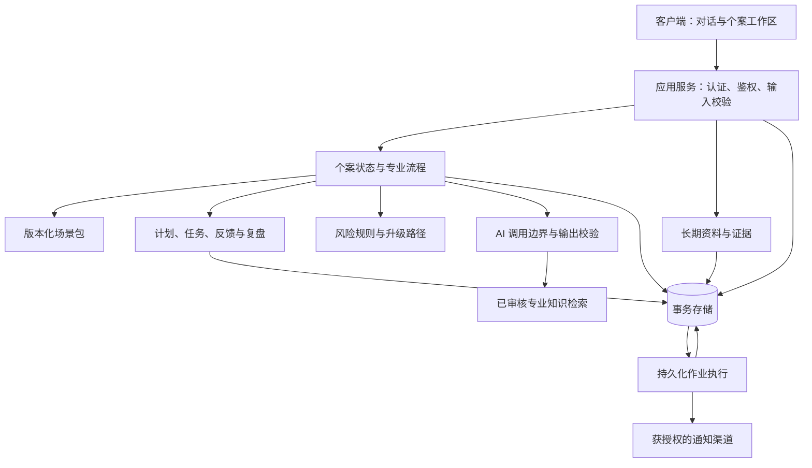

# 小树荫 V2 技术文档：可复用的多场景服务机制

> 文档版本：v1.0  
> 对应产品阶段：V2  
> 日期：2026-10-23  
> 状态：建议技术设计，未实施、未部署、未通过运行验证。表名、接口和状态均为逻辑契约，不代表仓库中已经存在对应实现。

## 1. 依据、约束与实施前提

本设计实现 [V2 需求文档](07-v2-product-requirements.md)，遵循 [项目定义](01-project-definition.md)、[技术前瞻](02-technology-outlook.md) 与 [产品路线图](03-product-vision-roadmap.md)。后续演进见 [V3 技术文档](10-v3-technical-design.md) 和 [V3 需求文档](09-v3-product-requirements.md)。

当前仓库只有三份上位规划，没有应用代码、数据库结构、依赖清单、运行环境或 V1 验收材料。因此：

1. 本文定义需要满足的契约，不编造已有技术栈或运行结果。
2. 实施时先盘点 V1，再把以下逻辑对象映射到已有实现；已有能力满足契约时直接复用。
3. 不因为本文出现某个名称，就重建已有模块、迁移数据库或更换供应商。
4. 专业判断阈值、风险处置文本和适用条件必须来自审核后的专业资产，不能由工程人员或模型补造。

## 2. 技术目标与架构选择

技术目标是：新增场景主要增加经审核的专业内容与流程定义，共用长期档案、个案、计划、执行、跟踪、安全和结果机制。

若 V1 尚无实现，本文建议以**模块化单体服务、关系型事务存储、持久化后台作业**作为起点。模块化单体指业务模块边界清楚、先部署为一个应用；持久化作业指提醒与复盘安排写入可靠存储，服务重启后仍可恢复。

| 选择 | 适用性与取舍 | 本文建议 |
|---|---|---|
| 每个场景独立聊天产品 | 起步直接，但档案、任务和结果分散，跨场景需要重复建设 | 不采用 |
| 共用业务服务与版本化场景包 | 能复用一致性和长期服务能力，仍需明确场景契约及测试 | 默认方案，最终映射以 V1 盘点为准 |
| 提前拆分多服务、建设通用流程平台 | 增加运维和协同成本，目前没有已证实的规模需要 | 本阶段不引入 |

框架、数据库产品、模型、消息渠道和部署平台尚未选定。沿用已验证的 V1 选择优先；数据库必须支持事务与并发约束，作业执行必须可恢复、可重试、可审计。本文不新增任何运行依赖或环境变量要求。

专业知识索引是可重建的检索副本，不能代替事实、授权和业务状态的主存储。

## 3. 模块职责与场景契约

| 模块 | 负责 | 不负责 |
|---|---|---|
| 入口与分诊 | 场景可用性、候选方向、缺失信息和分诊理由 | 用一个标签直接替代专业评估 |
| 个案与流程 | 当前状态、主要问题、转换条件、恢复点 | 让模型直接修改状态或自行结束个案 |
| 资料与证据 | 陈述、确认、时效、纠正和来源追溯 | 把全部聊天永久当作已确认事实 |
| 场景内容 | 适用性、判断流程、知识、任务模板、复盘和结果规则 | 在每个场景中重复实现用户、提醒和权限系统 |
| 计划与执行 | 版本、任务、反馈、复盘和结果 | 用任务完成率推断问题已经解决 |
| 提醒作业 | 调度、发送尝试、回执、重试、取消和触达记录 | 把渠道受理记为用户已读 |
| 安全与运营 | 风险路径、最小必要审核、异常与发布控制 | 默认赋予后台人员全部家庭资料访问权 |

一个场景包至少包含：

| 字段或资产 | 契约 |
|---|---|
| `scenario_key`、`release_id` | 稳定场景标识与不可变的已审核版本 |
| 适用范围 | 服务对象、适用条件、不适用条件和必要前置条件 |
| 专业流程 | 有标识的步骤、必需证据、允许转换、缺失条件与退出路径 |
| 知识条目 | 来源、位置、适用条件、审核状态、审核人和版本 |
| 计划与任务模板 | 输入约束、责任角色、执行条件、反馈字段及障碍处理 |
| 跟踪与复盘规则 | 可配置周期、触发条件、可调整项、调整所需证据 |
| 结果规则 | 基线指标、观察窗口、稳定改善与无法判断的记录方式 |
| 安全规则 | 风险触发、普通流程中断、专业支持路径与恢复条件 |
| 验收资料 | 正常、信息不足、矛盾、风险、失败和重复请求用例 |

共用平台负责执行这些契约。知识检索负责找到依据，不能单独承担“条件是否满足”的状态转换。

场景包先用版本化结构文件或受控内容存储实现，不要求先建设可视化流程编辑器。条件应使用受约束的规则字段或明确的应用代码，不能执行内容作者提交的任意脚本。

## 4. 数据模型

以下是逻辑实体，允许按 V1 的既有结构合理合并，不能省略关键语义。

| 实体 | 核心字段与约束 |
|---|---|
| `Account` | 登录身份；与人物、家庭分离，不默认一个账号等于全家 |
| `Family` / `Person` | 家庭范围、人物标识、关系与发展阶段；人物可以没有登录账号 |
| `Case` | 家庭、创建者、主体人物、当前场景版本、状态、目标、当前计划、并发版本与起止时间 |
| `CaseSceneHistory` | 个案使用过的场景版本、切换原因、证据、时间和确认者 |
| `Assertion` | 主体、陈述内容、事实/感受/解释/假设类型、来源、发生与记录时间、确认状态、有效期及被哪条记录修正 |
| `Assessment` | 步骤回答、所需条件、依据记录、缺失项、专业流程版本与风险检查结果 |
| `PlanVersion` / `Task` | 不可变计划版本、目标与基线、任务、责任人物、反馈安排、激活状态和调整原因 |
| `Feedback` / `Review` | 关联任务与计划、真实执行、障碍、变化、复盘结论和下一步；缺失值显式保存 |
| `FollowUpSchedule` | 个案与计划版本、节点类型、约定时间、时区、频率、暂停与取消状态 |
| `NotificationAttempt` | 调度节点、幂等键、渠道、尝试次数、受理与送达证据、回执时间及错误类别 |
| `Outcome` | 结束原因、效果分类、指标与证据、观察窗口、未知原因、复发关联周期 |
| `ScenarioRelease` | 专业包版本、审核记录、状态、适用范围、内容校验值与发布记录 |
| `AuditEvent` / `DataRequest` | 关键操作的主体、对象、动作、时间、请求关联；导出与删除的处理状态 |

### 4.1 不可破坏的数据规则

- 业务读取与写入都校验家庭范围及账号授权，不能仅依赖前端传入的 `family_id`。
- 关键事实必须有来源；家长转述孩子的话标记为转述，不能标记为孩子本人已确认。
- “已确认”指特定主体在某时确认，不能使有争议的内容变成永久客观真相。
- 未回答、不适用、无法判断与数值零分开保存；缺失数据不进入成功计数。
- 修正记录关联旧记录及原因；不静默抹掉旧计划、旧判断和原结果。历史保留同时受经审核的数据保留与删除规则约束。
- 计划、反馈和结果必须关联当时的场景与专业版本，防止内容升级后失去解释依据。
- 每个家庭至多一个正在集中推进的主要个案；数据库约束或同等强度的事务控制维护这一点。私人陈述和待处理线索不等于新增活跃主要个案。

## 5. 状态机与写入一致性

主状态：`intake` → `plan_pending` → `active` → `review_due` → `observing` → `closed`。允许依据复盘返回了解或计划阶段；`paused` 与 `referral` 是有原因和恢复条件的分支。不是所有个案都必须进入 `observing`，退出与不适用也可以结束。

状态转换必须同时检查：当前状态、调用者权限、所需证据、场景版本、风险结果、用户确认及 `expected_version`。模型只能建议转换，服务端执行校验与提交。

激活新计划应在一个事务中完成：

1. 校验当前个案与计划版本。
2. 保存用户确认和调整依据。
3. 把旧计划设为被替代，激活新计划。
4. 取消或替换旧版未完成任务和普通提醒，保留历史。
5. 写入新任务、跟踪节点与待执行作业。
6. 增加个案版本并记录审计事件。

事务失败则整体失败；不能出现“前端显示新计划，后台仍按旧计划催促”。安全中断、暂停和结案也必须同步更新相关作业。

## 6. AI 请求、检索与输出边界

一次 AI 交互按以下顺序执行：

1. 认证并校验当前个案访问权，读取最新状态与并发版本。
2. 对输入进行安全检查；需要优先处置时进入经审核的安全路径。
3. 读取当前步骤需要的资料；带上来源、时效、确认状态及明确的未知项。
4. 仅检索已审核、适用于当前场景和版本的知识；缺来源时保留“依据不足”。
5. 向模型提供允许执行的动作、缺失条件和输出结构。
6. 校验输出类型、引用、风险与事实边界；不合格输出不得直接写入事实、计划或结果。
7. 将有效建议展示为待确认内容；需要用户确认或规则判断的动作由业务服务处理。

自然表达可以灵活，必需条件不能被提示词绕过。用户输入、检索文本和模型回复都不能改变系统权限或专业审核状态。

AI 调用记录保存模型标识、提示模板版本、场景版本、引用标识、耗时、用量和错误类别。日志默认不包含完整敏感原文；为质量调查查看原文需要单独授权和审计。

若采用流式对话，流中仅传递允许展示的文本或进度事件；结构化动作须在完整校验后提交。中断流不能把半份计划当作已生效，安全检查覆盖发送过程。模型超时、拒绝、检索无结果或结构无效时明确返回可恢复状态，不生成伪成功记录。

## 7. 建议接口契约

以下路径是实施时对齐的接口草案，不是可立即调用的现有 API。认证主体由服务端会话取得，不能接受客户端声明自己属于某家庭。

| 方法与路径 | 职责 | 关键约束 |
|---|---|---|
| `GET /api/scenarios` | 返回当前可用场景与适用说明 | 不返回未审核内部规则或伪装已发布场景 |
| `POST /api/cases` | 创建了解中的个案 | 校验人物与家庭范围，使用请求幂等键 |
| `POST /api/cases/{id}/messages` | 当前阶段自然交互 | 限制输入、关联会话、保留中断恢复点 |
| `POST /api/cases/{id}/assertions/{assertion_id}/confirm` | 确认或纠正具体陈述 | 提交确认者与预期版本，不跨家庭引用 |
| `POST /api/cases/{id}/scene-transitions` | 确认场景变更 | 必须有理由、依据和原计划处置 |
| `POST /api/cases/{id}/plans` | 生成待确认计划版本 | 不直接激活；保留引用和有效性检查 |
| `POST /api/cases/{id}/plans/{plan_id}/activate` | 确认并激活计划 | 幂等、版本校验、任务与作业事务一致 |
| `POST /api/cases/{id}/feedback` | 写入执行反馈 | 明确对应任务、周期、时间和未知项 |
| `POST /api/cases/{id}/reviews` | 保存复盘与调整建议 | 不把建议自动记为新计划已执行 |
| `POST /api/cases/{id}/pause`、`/resume`、`/close` | 生命周期操作 | 明确原因、证据、恢复规则和通知处置 |
| `GET /api/cases/{id}/timeline` | 返回有权限的状态与版本历史 | 分页、时间顺序、保留来源语义 |
| `POST /api/me/data-requests` | 申请导出或删除 | 记录请求和处理状态，不能仅回复成功而不执行 |

写接口验证对象归属、字段类型、长度、枚举、引用、时间和当前版本。并发冲突返回 `409` 与刷新提示；输入不满足业务前提返回明确的校验错误；越权响应不泄露他人的个案是否存在。对模型或渠道失败的错误，应区分请求是否已经持久化，避免用户重试时重复写入。

## 8. 主动跟踪与消息可靠性

### 8.1 持久化调度

约定时间连同时区保存，服务端使用统一时间基准执行。后台执行者通过带租约的作业领取或等效机制避免多个进程同时处理；租约到期后可重新领取。不能依赖单个进程内的计时器长期记住下周的复盘。

调度与发送分离：在业务事务里写入待发送事件，再由后台读取提交渠道。这样业务保存后即使进程退出，也能继续处理。

建议幂等键由跟踪节点、有效计划版本、目标账号、渠道和提醒轮次组成。调用渠道超时后，先查询供应商受理记录或按其幂等能力核实；无法核实时记录发送结果未知，不能盲目重发造成重复打扰。

### 8.2 发送前重检

每次真正发送前重新检查：

- 个案仍有效，未结案或暂停普通服务；
- 任务、节点和计划版本仍适用，用户尚未完成对应反馈；
- 用户仍有权限、渠道授权仍有效；
- 当前允许触达，未超出约定频率、轮次和安静时间；
- 正文不包含具体问题、孩子隐私或敏感对话。

安全相关联系走独立审核规则，不得简单重用普通催促任务。

### 8.3 回执与失败

分别保存 `scheduled`、`submitted`、`delivered`、`viewed`、`failed`、`cancelled`、`unknown`；渠道缺少送达或已读证据时停留在已受理或未知。

只对可恢复且已确认未受理的失败进行有上限的退避重试；无效授权、退订和错误地址停止重试。达到上限进入异常队列并保留站内待办。发布验收必须包含真实外部发送与用户返回反馈，不能只用模拟发送器证明触达成立。

## 9. 场景发布、知识版本与存量兼容

场景版本流程：草稿 → 专业审核 → 内部测试 → 受控试点 → 发布；可转为暂停或退役。已发布版本不可原地修改，修订产生新版本。

新个案绑定获准发布的版本，存量个案继续绑定原版本。内容调整需要先做差异与影响分析，再决定维持、经确认升级或安全中止。不能因为检索索引刷新就悄悄改变存量个案的判断条件。

对存在安全缺陷的版本，可以立即阻止新进入并暂停受影响普通动作，标记待复核、通知有权限人员并保存证据。回滚业务代码不等于专业内容已经安全恢复，两个版本分别验证。

新增场景准入必须覆盖完整专业包、流程条件、风险路径、计划模板、结果口径、自动化用例及真实试点方案。这里只需要轻量审核工具和记录，不提前建设大型专家平台。

## 10. 数据保护、运营与可观测性

- 传输与存储保护、密钥保管和访问控制按选定运行环境实现；供应商密钥仅在服务端使用。
- V2 对家庭资料实行当前账号的显式授权隔离。即使只有一位家长登录，也不把记录标记为全家已经同意共享，给 V3 保留真实权限来源。
- 控制进入模型和通知渠道的数据范围，记录处理方与用途；不默认允许外部服务将家庭资料用于训练。
- 运营账号区分内容维护、质量汇总与授权个案支持。读取原文必须有具体权限、目的、范围、期限和审计。
- 删除流程覆盖主存储、检索索引、缓存、导出副本和后台作业；保留例外须有依据。删除不是简单隐藏界面。备份到期规则与恢复后的删除重放一并纳入设计。
- 观测个案转换失败、模型错误、知识缺失、作业积压、重复发送、回执状态和跨场景回归；普通日志不含敏感内容。
- 业务效果单独记录；技术请求成功、提醒受理与模型回复流畅都不能证明家庭已经改善。

## 11. V1 到 V2 的实施与迁移

推荐顺序：

1. **盘点**：确认 V1 源码、对象、状态、专业版本、提醒渠道、真实验收和部署环境。
2. **映射**：将现有手机流程映射到共用契约，不先做大规模重构；盘点不兼容字段与行为。
3. **准备**：审核厌学专业包，建立手机回归基线与场景版本管理。
4. **实现**：补齐真实缺口，先完成内部全流程，再开放受控试点。
5. **验证**：核对存量历史、计划、反馈、提醒、权限、恢复和统计口径。
6. **扩展**：验证厌学真实效果后，按需求文档的同一门槛选择下一场景。

如需数据库变更，先备份并演练恢复；采用兼容新增、分批映射、逐项核对的方式。迁移台账必须记录通过、等待条件、明确拒绝和未审核，迁移前后均满足“原总数 = 全部状态数量之和”。未映射记录保留原所有者和访问边界；不能因为未进入新表就删除或算作无效。

专业与业务历史必须带回原时间、来源和未知状态。不能给旧记录补造审核人、确认事实、场景版本或成功结果。不可确定时标记来源未知并限制其自动使用。

发生异常时停止新场景进入、暂停相关作业并保留已写反馈；优先回退开关和兼容代码。不能直接恢复旧备份覆盖切换后产生的有效记录，确需恢复时先制定增量保全与核对方案。

## 12. 需求追踪与验证计划

本表为实施后的验证计划，当前无执行结果。

| 需求 | 主要实现位置 | 必需验证 |
|---|---|---|
| V2-F01 | 入口、场景目录、个案创建 | 两种入口、未发布场景拦截、重复创建 |
| V2-F02 | 分诊、评估、陈述证据 | 缺条件、矛盾、假设不自动变事实 |
| V2-F03 | 长期资料、引用和时效 | 跨场景复用、过期确认、纠正传播 |
| V2-F04 | 厌学场景包与共用流程 | 需求文档第 7 节全覆盖，专业审核单独签认 |
| V2-F05 | 计划、任务、事务 | 并发激活、重复请求、版本历史和失败回滚 |
| V2-F06 | 持久化调度、通知尝试 | 重启恢复、计划替换、暂停、真实发送与回执未知 |
| V2-F07 | 反馈、复盘、场景切换 | 不同失败原因、旧计划保留、重新分诊 |
| V2-F08 | 结果、观察与关联周期 | 失访、退出、转介、稳定观察和复发分别统计 |
| V2-F09 | 专业内容审核与发布 | 未审核拦截、暂停、版本绑定和安全撤回 |
| V2-F10 | 鉴权、风险与数据边界 | 跨家庭拒绝、风险中断、最小权限和敏感日志检查 |
| V2-F11 | 恢复、资料纠正与数据请求 | 中断恢复、导出实际产物、删除传播及失败反馈 |
| V2-F12 | 场景准入与质量汇总 | 新增场景复用同一机制，不重复建设孤岛 |

在目标环境中执行最小单元与集成测试、手机与厌学端到端流程、作业故障注入、迁移与恢复演练。真实专业效果由独立试点证据验收，不能用上述工程测试替代。

## 13. 发布门槛与尚未确定的实施参数

发布前应形成：需求验收记录、专业审核记录、技术测试报告、手机回归证据、通知真实链路证据、数据核对结果、恢复演练记录与试点观察方案。阻断项未关闭或关键项未审核时不发布。

| 参数或决策 | 决策责任与要求 |
|---|---|
| V1 实际架构与数据映射 | 研发提供盘点结果，再确认需要修改的最小范围 |
| 首发客户端、认证、模型与渠道 | 产品和研发根据 V1 与真实可用授权选择，不以本文虚构现成接入 |
| 厌学流程与具体规则 | 专业负责人提供审核资产，实施者不能自行补阈值 |
| 响应、调度延迟、容量、备份与恢复目标 | 研发与产品在目标环境实测后冻结验收值 |
| 数据处理、保留与未成年人信息规则 | 负责数据与服务规则的人员审核后发布 |

本文完成技术设计的职责边界；这些参数必须在相应实施或真实数据试点之前作出明确决定，不能长期以默认值悄悄运行。
