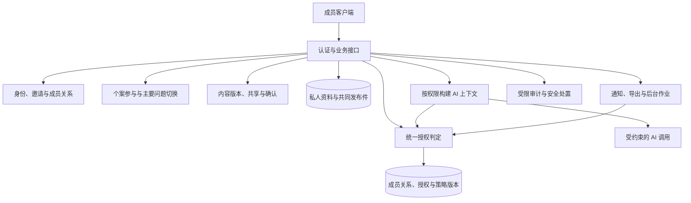

# 小树荫 V3 技术文档：身份、授权与家庭协作

> 文档版本：v1.0  
> 对应产品阶段：V3  
> 日期：2026-10-23  
> 状态：建议技术设计。未实施、未迁移真实数据、未验证运行效果；本文中的实体、接口与算法均为设计契约。

## 1. 依据与设计边界

本设计对应 [V3 需求文档](09-v3-product-requirements.md)，继承 [V2 技术文档](08-v2-technical-design.md) 的专业场景、长期档案、计划版本、持久化跟踪和结果机制。产品约束来自 [项目定义](01-project-definition.md)、[技术前瞻](02-technology-outlook.md) 与 [产品路线图](03-product-vision-roadmap.md)。前序需求见 [V2 需求文档](07-v2-product-requirements.md)。

当前仓库没有账号体系、数据库、应用服务、权限实现或真实运行数据。实施前必须盘点 V2，验证其毕业条件，并把本文逻辑对象映射到现有实现；不因拟定名称重建已满足要求的模块。

V3 不改为多个彼此隔离的家庭成员产品，也不提前拆分微服务。继续以清晰业务模块和事务存储为默认方向，新增统一授权边界。若既有架构不同，应证明同等的权限、一致性与恢复能力，而不是为遵循形式更换技术栈。

## 2. 关键技术决策与取舍

| 决策 | 解决的问题与取舍 |
|---|---|
| 账号、人物、家庭关系和个案参与分离 | 同一个人物不必有账号；同一家庭成员不必参与所有问题。多一层关系校验，换取真实边界 |
| 角色能力与资料读取授权分开 | 协调者可以邀请，但不能因此读私人资料。实施更严格，避免把家长或付费者视为全能管理员 |
| 版本化内容与明确接收者授权 | 共享范围可追溯，新成员不会自动获得全部旧资料；需要额外确认流程 |
| 原私人资料与共享发布件分开 | 用户准确预览要公开的内容，原会话不整体公开；需要维护来源与派生关系 |
| 统一鉴权覆盖数据库出口、检索、AI、导出、缓存与作业 | 减少旁路泄露；新增出口必须先接入同一策略 |
| 一个家庭主要问题指针与事务切换 | 防止并发出现多个主要问题；切换前需校验两个个案的操作权限 |

不采用“家庭成员默认读取全家资料”，也不采用“把全部私人内容交给模型后提示它不要泄露”。前者违反产品边界，后者无法通过输入权限保证隔离。V3 只在当前调用者有权使用的资料内生成内容。

## 3. 模块与信任边界

客户端不能声明自己拥有某角色；模型不能授予权限；通知执行者不能仅凭“作业已创建”继续使用已撤销资料。服务账号只承担被分配的操作，普通批处理不能绕过内容授权读取全量家庭数据。

## 4. 身份、成员关系与邀请

### 4.1 身份模型

| 实体 | 关键字段与规则 |
|---|---|
| `Account` | 登录身份、认证状态、会话；不存放全家共用口令 |
| `Person` | 真实服务对象的人物记录；可暂未关联任何账号 |
| `AccountPersonBinding` | 账号与人物的绑定证据、核验状态、核验方式和确认时间 |
| `Family` | 家庭标识、协调职责、当前主要个案指针与并发版本 |
| `FamilyMembership` | 家庭、账号、关联人物、功能角色、加入与退出时间、成员状态 |
| `CaseParticipation` | 个案、账号、参与角色、参与状态、范围与时间 |
| `Invitation` | 发起人、目标范围、接收者约束、过期时间、一次性凭证校验值、状态和审计关联 |

资料中的“妈妈”“爸爸”“孩子”是关系描述，不直接转换为读写权限。同一个人物被多个旧记录描述时，先保留候选关联，核验后再绑定；不得按姓名或模型相似度自动合并。

### 4.2 邀请流程

邀请状态为待接受、已接受、已拒绝、已过期和已撤销。凭证应不可预测、仅保存校验值、限定用途和有效期，避免在日志和通知中暴露原凭证。

接受邀请时校验已认证接收者、邀请目标、有效状态、关系核验与必要同意。使用原子状态更新保证并发接受只生效一次。家庭邀请仅建立家庭关系；个案参与需独立明确确认，即使在同一页面完成也必须保留两份不同决定。

成员退出后，成员关系和参与状态失效，相关授权与作业同步取消或失效。协调职责移交只改变功能角色，不转移私人资料所有权。若离开者负责当前主要个案，应先按有权参与者确认的规则暂停与移交；无人可接续时保留记录并暂停，不能把资料自动交给剩余成员。

## 5. 内容与授权数据模型

| 实体 | 关键语义 |
|---|---|
| `ContentObject` / `ContentVersion` | 稳定对象、不可变版本、作者、所有者、家庭与个案范围、内容类型和敏感等级 |
| `SharePublication` | 从原材料形成的独立待共享或已发布版本，记录发布者、用途及批准状态 |
| `AccessGrant` | 精确到内容版本与接收账号的动作授权、发起者、用途、有效期、状态及撤回时间 |
| `ConsentRecord` | 同意人、动作、内容版本、接收者、展示文本版本、决定与时间；不是一条永久的“全家同意” |
| `DataDependency` | 派生内容版本对来源版本的依赖，用于权限传播、撤权与删除核对；来源链本身受限 |
| `PerspectiveRecord` | 发言者、被描述者、原陈述、事实/感受/解释/假设类别、时间及确认与异议状态 |
| `PlanApproval` | 计划版本、必要参与者、本人决定、时间与有效状态 |
| `TaskAssignment` | 计划版本、责任账号或人物、任务接受状态、可见范围与反馈来源 |
| `PrimaryCaseChange` | 旧与新主要个案、理由、确认者、计划及提醒处置和家庭版本 |
| `SafetyReview` / `AuditEvent` | 受限安全处置与关键访问记录，不能作为所有运营人员均可读取的普通日志 |

内容作用域至少区分：

- `private`：原所有者可用的私人资料；他人需要另行批准的发布件，不能直接放开原会话。
- `case_shared`：具体个案中的共同材料，接收者仍以该版本的明确授权为准。
- `family_shared`：家庭共同材料，接收者同样明确；成员加入不自动扩展历史授权。
- `safety_restricted`：经审核的最小必要安全处置资料，使用独立授权流程。

这些是使用域标签，不能代替 `AccessGrant`。V2 原始记录缺少共享证据时按原所有者私人范围导入，而不是按它属于某家庭就全员开放。

## 6. 统一授权判定

授权判定输入为：已认证调用者、操作、目标内容版本、家庭和个案上下文、当前成员关系与授权版本。

按顺序判定：

1. 调用者已认证，账号与会话仍有效。
2. 目标对象归属与请求上下文一致，引用链没有跨家庭偷换。
3. 对共同内容，调用者仍是有效家庭成员；个案内容还需有效个案参与关系。
4. 私人所有者依据所有权读取；其他读取、修改、发布、导出等动作分别检查对应权限，读取权不等于转授权或再发布权。
5. 授权绑定当前内容版本、接收者、动作和用途，未过期或撤销。
6. 所需来源依赖没有失效，安全限制和删除状态允许当前动作。
7. 默认拒绝，并对需要审计的操作记录最少必要信息。

| 主体 | 私人原文 | 共同发布件 | 管理邀请 | 替他人同意计划 |
|---|---|---|---|---|
| 原所有者 | 在资料保留与本人权限范围内读取 | 按发布与授权规则操作 | 另需协调能力 | 不允许 |
| 家庭协调者 | 仅凭角色不允许 | 仅明确获授权版本 | 在协调范围内允许 | 不允许 |
| 有效个案参与者 | 他人私人原文不允许 | 仅明确获授权版本 | 另需协调能力 | 不允许 |
| 家庭中非个案参与者 | 不允许读取他人私人原文 | 不允许读取该个案材料 | 另需协调能力 | 不允许 |
| 普通运营账号 | 默认不允许 | 默认不允许 | 按支持职责单独授权 | 不允许 |
| 安全处置人员 | 仅审核流程准许的最少字段 | 按限定流程授权 | 不是安全角色的默认能力 | 不允许 |

服务端所有接口、检索过滤器、下载与后台作业复用相同判定。前端隐藏按钮仅改善体验，不能承担权限安全。

列表、计数、搜索摘要、分页总数、时间线、引用标题和报错也只基于可访问集合。对象不存在与无权访问的响应应避免泄露存在性。跨家庭拒绝之外，还必须测试同家庭内的私人隔离。

## 7. 共享发布、撤权与派生内容

### 7.1 发布事务

1. 在本人权限上下文内生成草稿，记录受限来源关系。
2. 用户预览准确文本、选择接收者和用途；涉及多个私人所有者时分别取得必要发布同意。
3. 提交具体内容版本、接收者列表和 `expected_version`；服务端重新校验发布权、参与状态与同意有效性。
4. 同一事务创建不可变发布件、授权、同意记录、依赖关系和待通知事件。
5. 成功后返回发布标识；事务失败时不得显示已经共享。

更改文本、扩大接收者或调整用途产生新版本或新授权决定。新增成员不自动获得旧版本，即便接收者选择界面原先写过“当前所有参与者”，也应保存当时实际账号快照。

原私人材料可以成为经本人批准的独立发布件来源。批准的是具体可见文本，不是让接收者拥有原会话的读取权；原会话更新不自动更新发布件。引用只能返回调用者有权读取的目标，不能暴露受限来源标题或原文。

### 7.2 撤权传播

撤权事务标记授权失效、提高相关策略版本、写入审计与失效事件，并取消待处理的相关发送或导出。随后根据 `DataDependency` 检查派生总结、计划草稿、搜索副本和缓存：没有独立合法使用依据时设为不可再用，重新授权或重生成后才能恢复。

不能只靠异步清理完成撤权。新请求读取主授权状态；即使派生副本尚未物理清理，只要其授权或来源依赖已撤销，就必须拒绝使用。相关索引清理失败应报警并重试，不得把失败显示为全部清理完成。

成员退出按同样路径撤销家庭或个案范围的访问。已展示或已下载内容不能技术性收回，产品说明与审计应保留这一事实；不将撤权描述成删除了所有外部副本。

### 7.3 缓存与长请求

缓存键至少包含账号、家庭、个案、内容版本和授权策略版本；不能只按 `family_id` 缓存一份供所有成员使用的上下文。命中缓存后仍检查当前授权。

长时间生成、流式输出与导出作业在读取、产物生成及后续输出时重检权限。撤权事件中止相关在途输出；流式发送的每一批内容都需检查最新授权，不把撤权后的新内容继续发送。已经发送的部分不可收回，竞态与在途取消需专门测试。

后台通知使用中性正文；发送前再校验成员、个案、授权与任务状态，不能把敏感正文提前永久封装在作业里。导出产物受访问控制，下载时重检权限，撤权后旧下载凭证不得继续授权访问。

## 8. AI 上下文与多视角处理

构造上下文时先确定“为谁、在哪个空间、为哪个问题服务”，再按权限检索。使用私人空间时，只能使用本人可用的私人内容和已获授权共同材料；为其他成员生成建议时，不能混入第一人的未授权私人内容。

检索必须在候选获取阶段限制权限，并在返回或引用前再次校验；不能先全家庭召回再要求模型自行删除隐私。向量、关键词索引、长期总结和摘要都带可追溯的内容版本与授权范围，不能只给原始聊天设置权限。

模型得到多方陈述时，每条包含可公开来源、时间、类型和确认状态。系统允许冲突并存，不能取平均、按身份排序就生成“最终事实”。事实确认、计划批准和状态转换仍由业务服务执行。

模型返回的总结和计划带来源依赖。私人内容衍生出的草稿保持私人，经过第 7 节预览与发布后才能供其他人使用。声称“不引用原话”不能代替授权，因为改写也可能泄露相同信息。

AI 与检索失效时沿用 V2 的明确失败与恢复机制；不能生成假共识、假反馈或假完成。

## 9. 共同计划与任务协作

计划版本确定后，根据经审核的场景规则生成必要确认者列表。`PlanApproval` 绑定具体计划版本，状态区分待回应、同意、不同意、撤回和过期。

激活共同计划时在事务中校验：

- 计划版本仍最新，当前主要个案与状态正确；
- 所有必要参与者仍有效且拥有所需内容权限；
- 必要确认已经由本人完成；
- 任务由有权责任人接受，不含替未参与人物作出的承诺；
- 风险与专业流程条件满足。

缺少必要确认时保持待确认，或重新形成仅适用于已确认成员的新计划版本。不能把“没有反对”“家长代点”或“邀请已送达”当作同意。

改变任务、目标或必要参与者会产生新计划版本并重新收集所需确认。旧确认保留用于追溯，不迁移成对新文本的同意。新计划激活、旧任务处置和新提醒调度继续遵循 V2 的事务一致性。

任务反馈区分本人报告、他人转述和可核验记录。非本人提交不能写成责任人本人已确认；指标汇总保留这些来源差异。

## 10. 多问题管理与并发控制

家庭维护至多一个 `primary_case_id`，个案另外保存生命周期状态与效果分类。待处理、暂停、观察、历史和复发通过查询形成工作台，不能用一个状态字段混淆所有语义。

切换主要问题时提交家庭 `expected_version`、旧与新个案、原因和计划处置方案。服务端在一个事务内：

1. 校验操作人对受影响个案都有必要协调与操作权限，且必要参与者已经确认。
2. 锁定家庭当前主要问题指针，验证版本与旧值。
3. 暂停或结束原主要个案的集中推进，取消不适用任务和作业，保留约定观察。
4. 校验新个案进入条件，更新唯一主要指针与相关状态。
5. 保存切换记录、确认记录与新作业，提高家庭版本。

并发冲突只允许一个提交成功，另一个返回刷新并重新确认；不能静默覆盖。协调角色缺少某个案读取或操作权时，不返回该个案细节，应引导有权参与者处理。私人草稿不自动占用或改变家庭主要指针。

安全处置可优先暂停普通主要个案，但不自动改变私人授权。恢复需要重新校验风险状态、计划版本和参与者条件。

## 11. 建议接口契约

以下接口为草案，路径和字段在实施时与 V2 对齐。所有写操作验证输入、对象归属、权限、幂等键和当前版本，不接受客户端自报身份或角色。

| 方法与路径 | 职责与关键约束 |
|---|---|
| `POST /api/families/{id}/invitations` | 创建有限范围邀请，调用者需具备协调能力 |
| `POST /api/invitations/{id}/accept`、`/decline`、`/revoke` | 一次性状态转换，校验接收者、有效期与关系要求 |
| `POST /api/cases/{id}/participations` | 明确加入个案，不以加入家庭代替 |
| `POST /api/cases/{id}/participations/{participation_id}/leave` | 退出并撤销权限、通知及必要计划确认 |
| `POST /api/families/{id}/memberships/{membership_id}/leave` | 本人退出或获授权移除；不可转移私人资料所有权 |
| `POST /api/share-drafts` | 在当前权限内形成待预览发布件 |
| `POST /api/share-drafts/{id}/publish` | 提交准确版本、接收者与同意，事务创建授权 |
| `POST /api/access-grants/{id}/revoke` | 校验撤回权限，触发依赖失效、作业取消与审计 |
| `POST /api/cases/{id}/perspectives` | 保存来源明确的观察或感受，不默认公开 |
| `POST /api/plans/{id}/approvals` | 本人对具体版本表态，不允许伪造他人决定 |
| `POST /api/tasks/{id}/accept`、`/feedback` | 任务确认与真实反馈，明确本人或转述来源 |
| `POST /api/families/{id}/primary-case-changes` | 原子切换主要个案，需相关权限与并发版本 |
| `GET /api/families/{id}/cases` | 仅返回可见个案，计数与分页也按权限过滤 |
| `GET /api/me/access-grants` | 查看本人发出或收到的授权，不列出他人私人授权 |
| `POST /api/me/data-requests` | 申请受控导出或删除，结果产物与处理状态可核验 |

错误消息应说明调用者可以采取的下一步，但不泄露无权对象。并发冲突、邀请过期、必要确认缺失、授权撤销和外部服务失败分别处理，不能一律返回成功或只写日志。

## 12. 安全例外、运营与审计

安全处置与普通共同空间分开。系统可以标记风险和暂停普通服务，但是否披露、披露给谁、披露哪些字段，必须遵循已审核的安全政策与明确授权依据。模型不能自行将另一人的私人谈话发给家长或家庭协调者。

安全访问流程记录处置目的、依据、责任人、接收者、范围、时限与实际动作；默认最少必要，事后复核。与风险有利益冲突的成员不能仅凭亲属身份成为自动接收者。没有正式审核与可执行支持能力时，不能开放“自动突破隐私”的快捷功能。

普通日志只保留必要标识、错误类别、策略版本和请求关联。支持人员查询原文需要限定个案、目的与期限并留下访问记录。审计日志也包含敏感关系，必须限制查询，不能进入公开分析面板。

效果汇总使用获得授权的最小数据，低样本或可识别组合不能直接展示给其他家庭成员或不相关运营人员。匿名化或去标识处理不能被当成自动允许任意用途。

## 13. V2 到 V3 的安全迁移

迁移前先确认生产环境与数据库身份、授权范围、备份、恢复方案和目标记录集合。本文只定义迁移要求，不授权执行真实迁移。

按对象建立逐项台账：通过可映射、等待条件、确认拒绝迁移、未审核。原总数必须等于这些状态之和；“拒绝迁移”必须有正面依据并保留原记录，不等于允许删除。“未审核”不等于无效。

迁移步骤：

1. 建立兼容的新身份、关系和授权结构，保留原标识与原所有者。
2. 将旧人物记录保持为人物资料，不自动创建账号或伪造其同意。
3. 原私人记录继续仅原所有者可用；没有共享证据不创建家庭共享授权。
4. 明确保留旧主要个案、计划、任务、反馈和调度；新成员需另外接受邀请与个案参与。
5. 对来源、所有者、家庭归属或授权不明的记录隔离并等待核对，不公开、不删除、不补造证据。无法确定归属时也不能保留一条可能越权的旧访问路径，应由受限恢复流程处理。
6. 用户有明确需求时，按预览和授权流程逐项发布适合共享的历史材料。
7. 核对数量、关系、内容校验值、权限、计划状态、作业和查询结果，演练退出与撤权。

只有实际执行批次的未审核数量为零、台账可对账，才执行该批迁移；等待条件的对象保持保全并明确不进入本批。每批执行后再次对账，未解决项目保持具体状态，不能把整个迁移简化标为成功。

回滚优先禁用新协作入口与作业，保持新产生数据可追溯。不能恢复为“全家默认可见”，也不能恢复旧备份覆盖切换后的有效资料。备份恢复后先重放撤权、成员退出与删除标记，再开放访问。

## 14. 需求追踪与验证计划

本节是未来实施的验证计划，当前没有已通过测试的声明。

| 需求 | 实现边界 | 必需验证 |
|---|---|---|
| V3-F01 | 账号、人物与核验绑定 | 无账号人物、同名、重复绑定和错误关系纠正 |
| V3-F02 | 邀请与成员状态 | 拒绝、过期、撤销、错误接收者和并发接受 |
| V3-F03 | 家庭关系与个案参与 | 加家庭未加个案、退出个案、跨家庭引用 |
| V3-F04 | 统一授权与所有读取出口 | 同家庭私人隔离、列表计数、检索、引用、附件、导出与 AI |
| V3-F05 | 发布件、版本、授权与依赖 | 取消预览、改版、加人、撤权后缓存命中和在途输出 |
| V3-F06 | 多视角与确认来源 | 矛盾并存、不按身份判真、未知不变零 |
| V3-F07 | 计划批准与激活事务 | 必要确认缺失、反对、撤回、成员退出和旧版批准失效 |
| V3-F08 | 任务责任与反馈 | 本人接受、他人转述、无账号人物与越权代确认 |
| V3-F09 | 问题工作台与主要指针 | 并发切换、唯一主要问题、不可见个案不泄露 |
| V3-F10 | 生命周期与关联周期 | 暂停、切换、结案、复发与旧提醒取消 |
| V3-F11 | 每人触达授权与发送重检 | 退订、退出、撤权、已排队通知与中性正文 |
| V3-F12 | 安全受限流程 | 普通流程中断、最少披露、无权人员不能扩大访问 |
| V3-F13 | 迁移与数据请求 | 旧私人资料、新成员历史、未知归属、删除传播和恢复重放 |
| V3-F14 | 访问审计与最小支持后台 | 授权链可追溯、日志脱敏、支持权限过期与审计隔离 |

权限测试应使用至少两个不同家庭和同一家庭中的多个账号，逐个覆盖允许与拒绝的组合。需要特别验证：API 直调、对象标识替换、过期凭证、旧版本链接、搜索提示、导出下载、缓存、重试作业和模型提示注入。

并发与故障验证包含：同时接受邀请、发布时退出、确认时修改计划、切换主要问题、撤权时生成或发送、事务中断与恢复。测试不能只证明前端按钮消失。

真实家庭试点另行验证边界理解、参与负担、任务可执行性和问题改善。权限测试通过只证明工程行为满足用例，不证明协作一定提升真实效果。

## 15. 发布门槛与实施顺序

建议先建立身份和统一授权，再建设共享与撤权，随后加入计划确认、任务协作和多问题工作台，最后进行迁移与受控试点。每一步沿用 V2 专业闭环，不先把私人内容放入一个全家共用模型上下文。

发布前必须完成全部 V3 P0 验收、专业与数据规则审核、端到端权限测试、迁移对账、备份恢复及撤权重放演练、V2 回归。未关闭的权限泄露或数据归属问题阻断相应功能开放。

需要在实施前明确的参数包括：既有认证与数据库能力、未成年人身份与同意流程、专业场景必要参与者、安全例外与支持时限、数据保留与删除期限、授权失效与长请求取消的实测表现、容量和恢复目标。分别由产品、专业、数据规则与研发负责人作出可追溯决定，不能把缺失参数当成已有能力。

V3 的技术完成标准是上述机制在目标环境中有可复核证据；V3 的产品毕业标准仍以需求文档中的真实家庭结果为准。
