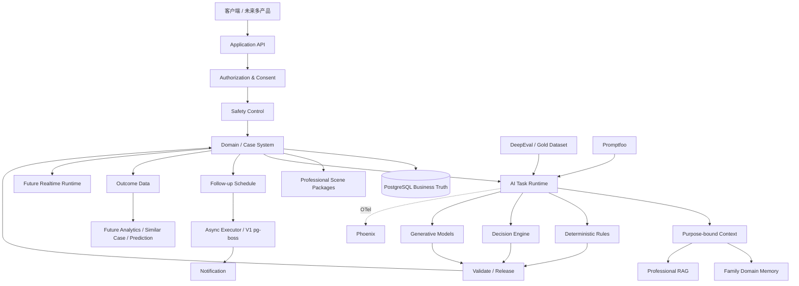

# 小树荫总体技术架构

> 文档性质：**覆盖 V1—V5 与暂定终局的总体技术架构**
>
> 版本：v2.0 — 终局反推架构正式版
>
> 更新日期：2026-11-03
>
> 上位产品事实源：[总产品需求.md](总产品需求.md)
>
> V1 产品范围：[V1产品需求.md](V1产品需求.md)
>
> V1 具体实现：[V1技术设计.md](V1技术设计.md)
>
> **本文先从终局产品反推长期骨架，再规定 V1 只实现其中当前需要的一部分。本文不要求提前开发 V2—V5。**

---

## 1. 架构结论

小树荫最终不是“一个大模型 + Prompt + 聊天框”，也不是一个自由自治 Agent。

它是：

> **一个长期家庭问题解决系统：以家庭、人、Case、专业方法、执行和 Outcome 为中心；确定性业务规则控制边界；AI 在边界内负责语言理解、有界判断、复杂推理和自然交流。**

长期产品必须支撑：

- 一个家庭连续使用多年；
- 多个家庭成员拥有不同身份、来源、隐私和授权；
- 一个家庭长期存在多个问题，但一个阶段聚焦一个主要问题；
- 手机、厌学等专业 Scene 持续增加；
- 方案之后持续执行、主动跟踪、复盘和调整；
- 真实 Outcome 从第一天开始积累；
- 后期基于家庭历史和大量历史案例做趋势分析、类似案例和风险预警；
- 后期存在独立的实时多人/语音支持能力；
- 未来可以扩展到不同年龄阶段和不同产品，但不自动共享未经授权的数据。

因此长期地基不是某个模型、Agent 框架或云厂商，而是：

> **领域模型 + 数据来源与时间 + 权限与用途 + 专业资产 + 执行与 Outcome + Safety + 评测资产。**

---

## 2. 架构设计原则

1. **先业务系统，后 AI。** Case、Plan、Consent、Safety、Outcome 等业务事实不能由模型内存承载。
2. **先确定性，后概率。** 能由代码和显式规则判断的事情，不交给模型猜。
3. **判断和生成分开。** 固定答案空间的判断与开放式推理/表达使用不同能力。
4. **长期产品先定边界，V1 不提前造未来功能。**
5. **专业场景是可版本化资产，不把手机规则写死成全产品。**
6. **长期家庭资料是领域数据，不等于聊天记录，也不等于通用 Agent Memory。**
7. **Outcome 数据与专业知识库是两种不同资产。**
8. **外部组件可替换，业务语义不可被框架绑死。**
9. **成熟基础设施优先，自研只保留真正属于小树荫的业务能力。**
10. **任何进入生产的模型、规则、Prompt、知识和决策阈值都必须可版本化、可评测、可回滚。**

---

## 3. 长期稳定的领域边界

长期稳定对象至少包括：

```text
Account
Person
Family
FamilyMembership
Case
CaseParticipant
Statement
Observation
Fact
Hypothesis
ProblemFormulation
Goal
Intervention
Plan
Task
Execution
Feedback
Review
Outcome
Consent
Authorization
ScenePackage
ProfessionalKnowledge
Risk
SafetyState
Referral
FollowupSchedule
AuditEvent
```

这些对象的语义优先于任何技术框架。

### 3.1 Account、Person、Family 必须分开

一个账号不等于一个人，一个人不等于一个家庭。

V1 可以主要由一个家长使用，但数据模型从第一天就不能假设：

> 一个账号 = 整个家庭。

这样 V3 才能自然扩展到爸爸、妈妈、孩子和其他重要成员。

### 3.2 事实、陈述和假设必须分开

系统必须长期保留：

- 谁说的；
- 什么时候说的；
- 是亲历还是转述；
- 是否确认；
- 是否存在冲突；
- 后来有没有更正；
- 当前是否仍有效。

旧信息不能自动永久成为当前事实。

### 3.3 Case 是长期问题对象，不是一次聊天

聊天只是交互方式。

真正的业务主线是：

```text
Case
→ Problem Formulation
→ Goal
→ Intervention / Plan
→ Execution
→ Follow-up
→ Review
→ Outcome
→ Maintenance / Closure / Recurrence
```

---

## 4. 总体架构分层

长期架构分为七个主要能力域：

1. **家庭与 Case 领域核心**
2. **Professional Scene Package**
3. **AI Capability Layer**
4. **Knowledge / RAG 与长期资料检索**
5. **Durable Service Orchestration**
6. **Safety / Authorization / Data Rights**
7. **Outcome / Analytics / ML 与质量工程**

Realtime Runtime 作为后期独立运行能力，与上述核心共享数据、授权、专业规则和 Safety，但不要求 V1 提前实现。

---

## 5. PostgreSQL：业务事实源

核心业务数据统一保存在 PostgreSQL。

保存：

- Account / Person / Family / Membership；
- Case / Participant；
- Statement / Observation / Fact / Hypothesis；
- Problem Formulation；
- Goal / Intervention / Plan；
- Task / Execution / Feedback / Review；
- Outcome / Closure / Recurrence；
- Consent / Authorization；
- Risk / Safety / Referral；
- Professional asset version；
- Follow-up Schedule；
- Audit / Outbox；
- 长期家庭档案和派生索引的来源关系。

原则：

> **LLM 不是数据库。Decision Model 不是数据库。任务队列不是数据库。Observability 也不是数据库。**

### 5.1 当前状态 + 历史变化

不采用“所有东西都 Event Sourcing”的重型设计。

采用：

> **当前业务对象 + 不可丢失的版本/历史 + Audit/Domain Event。**

正式 Formulation、Plan、Contract、Professional Asset 等不可静默原地覆盖。

---

## 6. Professional Scene Package：专业场景是第一等资产

手机只是第一个 Scene，不是系统本身。

长期每个完整专业场景以版本化 Scene Package 承载，例如：

```text
digital-use
school-refusal
parent-child-conflict
...
```

Scene Package 至少可以包含：

- eligibility / exclusions；
- assessment；
- evidence requirements；
- Problem Formulation rules；
- node / flow manifest；
- intervention definitions；
- plan constraints；
- follow-up / review rules；
- scene-specific Safety；
- professional knowledge references；
- acceptance / eval cases。

### 6.1 规则执行器与专业内容分开

长期原则：

> **规则执行器是代码，专业规则和专业内容是可版本化资产。**

不能把未来所有场景的专业结论散落在业务代码和 Prompt 中。

V1 的 Digital Use Node Manifest 是第一个 Scene Package 的正式机器化投影。

---

## 7. AI Capability Layer：不以 Agent Framework 为中心

AI 能力长期分三类。

### 7.1 Deterministic Decision

适用于：

- 权限；
- Consent；
- Case/Phase 状态转换；
- Scene Node 可达性；
- Plan/Contract 是否已确认；
- Safety Hold 是否存在；
- 版本是否过期；
- Domain Command 是否允许。

实现：TypeScript Domain / Policy。

### 7.2 Bounded Probabilistic Decision

适用于答案空间预先确定、但需要理解自然语言或复杂上下文的判断，例如：

- YES / NO；
- 多分类；
- 风险等级；
- 信息是否缺失；
- 输入属于哪个意图；
- 输出是否违反某条 Release Rule；
- 某条 Memory 是否值得进入候选派生记录。

长期抽象名称：

> **Decision Engine**

当前候选可以包括：

- Jev / System One 类决策模型；
- 经评测的小型分类模型；
- 必要时使用生成模型的 Structured Output。

**Jev 不是长期强绑定依赖。** 截至 2026-11，Jev 1.14 可进入中文小树荫 Eval 和 Shadow Decision；只有真实中文数据证明某个任务达到门槛后，才接管该生产任务。

### 7.3 Open-ended Reasoning / Generation

适用于：

- Problem Formulation 草案；
- 复杂方案推理；
- 个性化解释；
- 角色扮演；
- Review 总结；
- 自然对话。

由经过 Xiaoshuyin Eval 的生成模型承担。

模型供应商和型号不是长期地基。

---

## 8. AI Runtime 与模型调用

### 8.1 不把 LangGraph 设为长期地基

长期架构只定义：

> **AI Task Runtime**

业务系统发起明确的 AI Task，AI Task 返回候选结果，再经过 Domain / Authorization / Safety / Release Validation。

V1 不需要为了“Agent 完整”引入第二套工作流状态机。

LangGraph、WorkflowAgent 或未来其他 Agent Framework 可以在某个确实需要复杂 AI workflow 的局部任务中使用，但不得拥有 Case、Scene、Consent、Safety、Plan 或 Outcome 的业务控制权。

### 8.2 Model Capability Registry

业务代码不直接散落具体模型 ID。

通过轻量的任务注册表定义：

```text
task role
→ provider
→ pinned model id
→ region
→ timeout
→ token budget
→ structured-output capability
→ eval version
→ fallback policy
```

V1 不自研通用 Model Gateway 产品。

当前模型调用优先使用成熟 SDK / provider adapter；只有出现真实的跨供应商路由、预算、限流和治理瓶颈后，再引入成熟 Gateway 或独立服务。

### 8.3 当前 V1 调用层

截至 2026-11，V1 推荐：

- TypeScript；
- Vercel AI SDK 7 作为模型调用与结构化输出、工具和 telemetry 基础；
- 阿里云百炼或其他经数据条款验证的国内正式 API 作为模型供应入口；
- 具体 Qwen / DeepSeek / Kimi / GLM / MiniMax / MiMo 等只进入候选池，由 Eval 选任务，不提前锁死。

---

## 9. Decision → Validate → Response

AI 不能一步直接产生最终业务动作。

统一协议：

```text
Current Domain State
→ Purpose-bound Context
→ AI Task
→ Candidate Decision / Draft
→ Schema Validation
→ Authorization
→ Domain Policy
→ Scene Policy
→ Safety
→ Response Release
→ Domain Command
→ PostgreSQL
```

### 9.1 Decision Envelope

有界的结构化判断优先返回短小 Decision Envelope，而不是让模型自由描述后再猜它是什么意思。

### 9.2 Response Release Contract

“Decision 合法”不等于“自然语言一定合法”。

所有用户可见输出必须按影响级别：

- STREAM_SAFE；
- BUFFERED_REVIEW；
- BLOCKED。

高影响建议、敏感披露、安全内容等必须完整生成后再检查。

---

## 10. 长期家庭资料：领域数据，不是通用 AI Memory

长期 Memory 分三层：

1. 原始证据；
2. 结构化业务记录；
3. 可重建的派生长期理解。

每条派生内容必须能回到：

- 原始来源；
- source version；
- actor；
- purpose；
- consent；
- 生成/规则版本。

来源更正、删除、撤回授权或失效时：

```text
invalidate
→ 标记依赖对象
→ 重建必要派生内容
→ 更新检索索引
```

禁止“摘要不断总结摘要，最终无法回到证据”。

未来 Graph Memory / Graphiti 等只能作为派生读索引候选，不能成为业务事实源。

---

## 11. Professional Knowledge / RAG

专业知识回答：

> **专业上为什么、怎么做。**

家庭长期资料回答：

> **这个家庭过去发生过什么。**

两者必须分开。

V1 继续采用小规模优先正确性的 Hybrid RAG：

- PostgreSQL；
- pg_jieba；
- pgvector；
- keyword + vector；
- RRF；
- reranker；
- hard filter：场景、阶段、年龄/发展适配、版本、权限、状态。

当前 embedding / reranker 型号属于可替换实现，不属于长期架构。

只有真实规模和性能证明 PostgreSQL 检索成为瓶颈后，才评估独立搜索/向量系统。

---

## 12. Durable Service Orchestration：长期服务不是一次请求

小树荫的核心服务可能持续数周、数月甚至更久。

长期必须有独立能力表达：

- 某日回来；
- 某事件发生后继续；
- 等用户反馈；
- 等外部结果；
- 暂停；
- 恢复；
- 重试；
- 取消；
- 版本变化后失效。

长期抽象名称：

> **Durable Service Orchestration**

### 12.1 V1 实现

V1 使用：

- PostgreSQL Follow-up Schedule 作为业务真相；
- Outbox；
- pg-boss 作为异步执行器；
- Notification Adapter。

### 12.2 后期演进

当真实业务出现大量跨系统、跨月/跨年的复杂工作流，且 pg-boss + Domain Schedule 已成为明确瓶颈时，再评估 Temporal 等成熟 Durable Workflow 平台。

Temporal 是未来候选，不是 V1 前置依赖。

---

## 13. Authorization / Consent / Privacy

Authorization 是独立长期能力，不附着在 UI 或 Prompt 上。

必须支持长期演进到：

- 账号、人、家庭关系；
- Case Participant；
- Shared / Private；
- purpose；
- consent version；
- source visibility；
- derived-context permission；
- withdrawal；
- safety exception 的明确边界。

V1 用 TypeScript 确定性 Policy 即可。

V3 如果关系/用途规则复杂到内部实现难以审计，可评估 Cerbos / OPA 类成熟 Policy Engine；不为假想复杂度提前引入。

---

## 14. Safety Architecture

Safety 是业务控制平面，不是一个 Prompt。

长期至少包括：

```text
确定性 Safety Rule
+ Safety State
+ 领域风险判断
+ 通用 AI Guardrail
+ 必要高级模型复核
+ 已批准支持内容 / Referral
```

原则：

- Safety Hold 高于普通 Case 流程；
- 普通模型下一次说“normal”不能自动解除；
- 通用内容安全服务不能替代儿童/家庭领域 Safety；
- 高风险状态、解除条件、支持资源和 Referral 必须可审计。

V1 可评估 Alibaba Cloud AI Guardrails 作为通用 PII、注入、越狱和内容风险的辅助层，但不把它当领域 Safety 的唯一判断器。

---

## 15. Outcome / Analytics / ML Data Plane

这是终局必须从第一天考虑、但 V1 不提前建设大型平台的一层。

### 15.1 为什么必须独立

Professional RAG 保存“专业知识”。

Outcome Data 保存：

> **什么家庭、什么问题、为什么这样判断、用了什么方法、执行得怎样、如何调整、最后发生什么结果。**

两者用途完全不同。

### 15.2 V1 必须正确采集

至少可形成：

```text
家庭/个人当时状态
→ Problem Formulation
→ Intervention / Plan
→ 实际执行
→ Feedback
→ 调整
→ Outcome
```

必须保留时间、版本、来源和 UNKNOWN。

### 15.3 V4 才启用高级能力

在数据量、质量、授权和效果证据成立后，可建立：

- longitudinal features；
- similar case；
- trend analysis；
- risk model；
- intervention effectiveness analysis；
- prediction evaluation。

这部分未来允许使用 Python / 数据分析 / ML 生态。

**V1 不因此增加 Python 服务。**

---

## 16. Realtime Runtime：V4b 独立能力边界

实时多人/语音调停与普通长期 Case 服务是两种不同运行模式。

长期预留：

> **Realtime Runtime**

未来可能包括：

- realtime audio；
- ASR/TTS；
- multi-speaker；
- live context；
- live Safety；
- mediation state；
- low-latency tool use。

它与核心系统共享：

- Family / Person / Case；
- Authorization；
- Scene Package；
- Safety；
- Memory；
- Audit。

但不要求使用与普通 API 相同的运行框架。

V1 不实现 Realtime Runtime。

---

## 17. Quality Engineering：质量是架构的一部分

质量体系分四层。

### 17.1 Deterministic Tests

覆盖：

- Domain invariant；
- Authorization；
- Scene routing；
- Safety state；
- idempotency；
- concurrency；
- data-right propagation。

### 17.2 AI Regression / Eval

DeepEval 作为 AI 测试 Harness，覆盖：

- 单轮/多轮；
- RAG；
- Safety；
- component eval；
- end-to-end；
- LLM judge；
- Jev/System One judge。

Jev 先用于 Eval 和 Shadow Decision，再根据中文金标结果决定是否进入生产决策。

### 17.3 Red Team

Promptfoo 进入发布前安全测试，重点覆盖：

- prompt injection；
- RAG poisoning；
- memory poisoning；
- PII leak；
- BOLA/BFLA / access-control bypass；
- excessive agency；
- jailbreak。

### 17.4 Observability

Phoenix Self-hosted + OpenTelemetry 用于：

- trace；
- model/provider/version；
- retrieval；
- task；
- latency/cost；
- eval result；
- experiment。

业务 Audit 与 AI Trace 分开。

默认不把完整家庭敏感正文长期复制到 Observability。

---

## 18. 当前技术选型与长期抽象

| 能力 | 长期架构抽象 | V1 当前推荐 |
|---|---|---|
| 核心业务 | Domain System | TypeScript / Node.js + Fastify |
| 业务事实 | Operational Store | 阿里云 RDS PostgreSQL |
| 专业场景 | Scene Package | Digital Use Package + Full Node Manifest |
| AI 任务 | AI Task Runtime | 普通 TS application service |
| 模型调用 | Model Runtime | Vercel AI SDK 7 |
| 模型选择 | Model Capability Registry | 显式 task→pinned model 映射 |
| 有界判断 | Decision Engine | 规则优先；Jev/分类模型进入 Eval/Shadow |
| 生成推理 | Generative Model | 经 Xiaoshuyin Eval 的国内正式 API |
| 专业检索 | Retrieval Layer | pg_jieba + pgvector + RRF + reranker |
| 长期资料 | Family Domain Memory | PostgreSQL + provenance + derived index |
| 长期任务 | Durable Service Orchestration | PostgreSQL Schedule + pg-boss |
| 通知 | Notification | Adapter + 微信真实能力 |
| 通用 AI 防护 | AI Guardrail | 评估 Alibaba AI Guardrails |
| AI 回归 | AI Eval Harness | DeepEval + 金标数据 |
| 安全攻击测试 | Red Team | Promptfoo |
| AI 可观测 | Observability | Phoenix Self-hosted + OpenTelemetry |
| 未来复杂长流程 | Durable Workflow Platform | 真实瓶颈后评估 Temporal |
| 未来实时 | Realtime Runtime | V4b 再选 |
| 未来分析/预测 | Analytics / ML Plane | V1 只采集正确 Outcome |

---

## 19. V1—V5 如何沿同一架构演进

### V1

实现：

- 核心 Domain；
- 基础 Account / Person / Family / Participant；
- 一个 primary Case；
- Statement / Fact / Hypothesis；
- Digital Use Scene Package；
- Problem Formulation → Goal → Plan → Execution → Follow-up → Review → Outcome；
- 基础 Authorization / Consent；
- Family Domain Memory；
- Professional RAG；
- AI Task Runtime；
- Safety；
- Follow-up Schedule + pg-boss；
- Notification；
- Eval / Red Team / Observability；
- 从第一天正确记录 Outcome。

不实现：

- 完整多人私密空间；
- 第二完整 Scene；
- Similar Case；
- Prediction；
- Temporal；
- Realtime；
- 大型数据平台。

### V2

主要增加新的 Scene Package。

Common Core 不重建。

### V3

增强：

- 完整 Family Membership；
- Shared / Private Space；
- 复杂 purpose/consent；
- 多视角；
- 多问题管理；
- 必要时升级 Authorization Engine。

### V4a

启用 Outcome / Analytics / ML Plane 的高级能力：

- Similar Case；
- longitudinal features；
- trend / risk model；
- prediction evaluation。

### V4b

增加独立 Realtime Runtime：

- 实时语音；
- 多人参与；
- live Safety；
- mediation。

### V5

不同产品/年龄阶段可以共享：

- Domain patterns；
- long-term data infrastructure；
- AI runtime；
- quality infrastructure；
- safety framework；
- professional asset governance。

但专业内容、权限和数据用途必须按新领域重新建立。

---

## 20. 不提前引入的重组件

以下组件只在真实瓶颈出现后评估：

- 独立向量数据库；
- OpenSearch/Elasticsearch；
- Redis；
- 独立 MQ；
- Temporal；
- 微服务；
- Kubernetes；
- 图数据库；
- 通用 Graph Memory；
- 外部 Policy Engine；
- 自研通用 Model Gateway。

原则：

> **终局要预留能力边界，不等于今天先把所有未来组件装上。**

---

## 21. 技术替换原则

未来允许替换：

- LLM；
- Decision Model；
- AI SDK；
- Gateway；
- Queue；
- Search；
- Embedding；
- Reranker；
- Observability；
- Workflow Engine；
- 云厂商。

替换时必须保持：

- Domain API；
- Case 语义；
- source/provenance；
- Authorization / Consent；
- Scene Package；
- Professional Policy；
- Outcome；
- Safety State；
- Audit；
- Eval Dataset。

---

## 22. 总体架构全景



---

## 23. 最终结论

小树荫的长期技术地基应当是：

> **以家庭、人、Case 和 Outcome 为核心的数据与领域系统；以版本化 Professional Scene Package 承载不断增加的专业场景；以确定性规则、Decision Engine 和 Generative Model 分工完成 AI；以长期任务、权限、安全、质量和数据治理保证真实持续服务；在真实数据成熟后再扩展类似案例、预测与实时支持。**

V1 的责任不是提前建完这张图。

V1 的责任是：

> **在这张长期地图上，把第一个 Digital Use 纵向切片真实做通，并把未来真正需要的数据和边界从第一天做对。**
