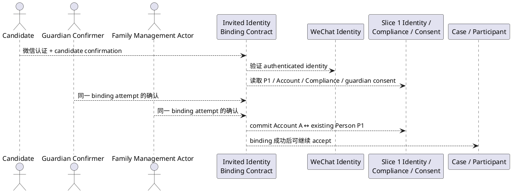
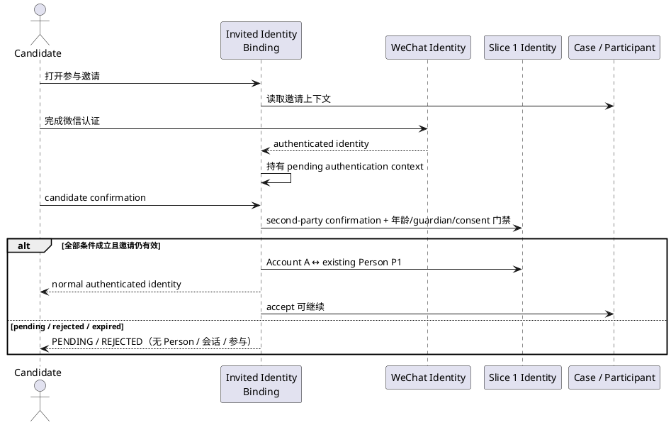

# Feature Specification: 受邀既有 Person 的微信身份绑定合同（Invited Identity Binding Contract）

**Feature Directory**: `specs/005-invited-identity-binding-contract`
**Created**: 2026-11-06
**Status**: Contract closeout — Owner 6 项裁定已冻结；authoritative Docs 已按最小范围写回
**V1 Phase**: Phase 1 前置身份合同（跨 Slice；**不是 implementation slice**）
**Docs baseline**: `Docs/V1产品需求.md` v3.4、`Docs/V1技术设计.md` v3.9（2026-11-06）；base main = `438b76120b10c2738f8176f437e15269622ad1b7`
**Stage**: Contract / Specify / Clarify closeout only。**禁止进入 Plan / Checklist / Tasks / Analyze / Implement / Converge。**

> 本文件是「受邀既有 Person 微信身份绑定」的窄合同，不是第二套 Identity Core。只定义 V1 新增的 identity seam：invitation-aware identity bootstrap、家庭证明的双确认绑定、年龄矩阵、no-P2、失败语义与授权边界。既有 Account↔Person 1:1、Person→Account 0..1、Family membership、guardian 基线、consent-first、RLS、participant 生命周期与既有授权规则由上游文档直接约束，本文不重复。
>
> `Docs/**` 修改已在本轮完成；合并前必须由人工审核并添加 `approved-docs-change` label。Agent 不自行添加该 label。

---

## Upstream Traceability

| Upstream ID / Section | Source | 本合同的投影关系 |
|---|---|---|
| §1.2 / §1.5 | `Docs/V1产品需求.md` | 孩子按需参与；邀请不是身份证明；Account↔Person 1:1、0..1；guardian 独立于 membership |
| §17 / §17.1 | `Docs/V1产品需求.md` | 长期档案；attempt 留痕；既有 Person 与历史不因失败/撤回删除 |
| §18 / §18.3 | `Docs/V1产品需求.md` | binding 确认 ≠ Consent；binding 不授予 Family/Case/Participant/Visibility/Purpose/Consent |
| §19A.2 | `Docs/V1产品需求.md` | 四类年龄；consent-first；UNKNOWN 不按成人放行 |
| V1-C20 / V1-C21 | `Docs/V1产品需求.md` §24 | 对象基本边界；跨成员按真实用途授权；binding 是独立身份事实 |
| V1-C39 | `Docs/V1产品需求.md` §24 | 服务端保存年龄段/监护/同意；guardian consent ≠ binding confirmation |
| V1-C44 | `Docs/V1产品需求.md` §24 | **受邀既有 Person 首次微信身份绑定** invariant |
| U11 | `Docs/V1产品需求.md` §23 / `Docs/V1技术设计.md` §28.11 | 孩子轻量参与；拒绝、撤回、过期、越权、绑定失败 |
| §5 不变量 1 / 4 / 5 / 17 / 27 / 29 | `Docs/V1技术设计.md` | 对象分开；转述不升级；未知不补值；并发不重复；UNDER_14 无同意 BLOCK；binding 前不建 Person/会话/参与 |
| §7.1 / §7.7A | `Docs/V1技术设计.md` | binding 只改变 Person→Account；`guardian_person_id` 是 guardian relationship 唯一基线；`verified_source` 不是 guardian proof |
| §9 / §9.1 | `Docs/V1技术设计.md` | 统一 `authorize()`；binding 不授 family access；pending context 非家庭作用域读取 |
| §10 / §28.1 / §28.8 | `Docs/V1技术设计.md` | invitation-aware bootstrap；普通登录不变；Case C accept 前置 |
| §37.2 / §40 | `Docs/V1技术设计.md` | 真实失败状态；Authorization / RLS / Consent / 未成年人门禁上线证据 |

**Blocking rule**: 本合同不新增任何未被 V1-C44 覆盖的产品语义；无法追溯到上表的扩展一律不得实现。

---

# 1. 组件定位

## 1.1 核心职责

本组件负责**在一个真实 Case 参与邀请上下文中，把一次已认证的微信身份绑定到一个已经合法存在、且当前没有 Account 的受邀 Person P1**，实现「不创建第二个 Person」的首次身份建立。

## 1.2 核心输入

1. **Invitation context**：参与邀请、目标 Family、目标 Person P1、邀请生命周期状态。
2. **Existing Person P1**：已按 V1 合法建立且 `Account = NULL`；含当前 Compliance Profile。
3. **Authenticated WeChat identity**：candidate 完成真实微信认证后的身份结果。
4. **Candidate confirmation**：candidate 对绑定到本次受邀既有 Person 的明确 affirmative 行为。
5. **Second-party confirmation**：由年龄矩阵指定的独立确认主体对同一 binding attempt 的明确 affirmative 行为。
6. **Target Family / Case context**：确认邀请目标、确认权来源与后续独立授权边界。

## 1.3 核心输出

1. **Binding decision**：`PENDING` / `COMMITTED` / `REJECTED`（仅业务状态）。
2. **Account A ↔ Person P1 binding**：仅在全部条件成立时产生；保持既有 1:1 / 0..1 基数。
3. **Normal authenticated identity**：binding 成功后获得与 P1 一致的普通已认证身份，accept 可继续。
4. **No-P2 guarantee**：binding 前不产生 P2；失败后不留下 P2、half binding、普通会话或部分参与能力。
5. **Audit record**：可追溯的 attempt 结果与确认事实（不含 secret / 私密细节）。

## 1.4 职责边界

本组件**不负责**：修改普通 `/api/v1/auth/wechat` 语义；创建 Person P1；创建 membership、guardian、Case / Participant / Visibility / Purpose / Consent grant；创建 Case、Participant、Evidence、Plan、Task、Notification、AI；跨 Family 查找 / 合并 / 迁移 / 复用；成人通用关联；unlink；定义 token / crypto / TTL / timer / DB 状态 / endpoint path（属 Plan 或 API design）。

---

# 2. 领域术语

**Invited Identity Binding**
: 在真实参与邀请上下文中，把已认证微信身份绑定到已合法存在的受邀 Person P1 的独立身份能力；不是普通登录，也不是通用身份关联平台。

**Case C**
: 邀请目标 Person 已合法存在，但当前没有任何 Account 绑定的情形；本合同唯一目标情形。

**Candidate**
: 完成真实微信认证、请求绑定到 P1 的主体；binding 成立前不是 P1，也不是正式 Person。

**Pending authentication context**
: 微信认证完成、binding 未成立时持有的临时认证结果；MUST NOT 是正式 Person，MUST NOT 产生普通业务会话。

**Binding attempt**
: 一次 candidate confirmation 与 second-party confirmation 共同指向的同一绑定请求。

**Second-party confirmer**
: 独立于 candidate、完成自身认证的确认者；身份由年龄矩阵与 P1 当前 `guardian_person_id` 决定。

**Guardian relationship（本合同）**
: P1 当前 Compliance Profile 上的 `guardian_person_id`；不是 Family membership 角色，也不是 `verified_source` 字段。

**No-P2 invariant**
: binding 成立前不得为 candidate 创建任何 Person；成功时只创建 / 复用 Account A 并绑定既有 P1。

**Invitation possession**
: 持有或转发邀请 token 的事实；只证明拿到过某次邀请，不证明当前 Account 就是 target Person。

---

# 3. 角色与边界

## 3.1 核心角色

- **Candidate**：完成微信认证、查看参与说明、作出 candidate confirmation。
- **Guardian confirmer**：UNDER_14，或 MINOR_14_17 且存在 `guardian_person_id` 时，由该 guardian 的已认证 Account 确认。
- **Family management actor**：MINOR_14_17 且无 `guardian_person_id` 时，由目标 Family 的 V1 已认证管理主体确认。
- **Inviter / Case manager**：创建参与邀请；不得单独完成身份绑定。
- **System**：执行确定性门禁、记录 attempt、拒绝非法路径；AI 不得代替任何确认。

## 3.2 外部系统

- **WeChat identity provider**：提供真实微信认证结果；不设计 code2session 实现。
- **Slice 1 Identity / Compliance / Consent**：提供 Person、Account、membership、Compliance Profile、guardian reference、guardian consent、`authorize()`、RLS、幂等、审计。
- **Slice 2 Case / Slice 4 Participant**：提供 Case 上下文、Case 管理 actor、参与邀请与资源；不改变其冻结语义。

## 3.3 交互上下文



> 只表达合同交互，不表达内部模块、数据库、缓存或 endpoint 设计。

---

# 4. DFX 约束

## 4.1 安全性

1. **Fail-closed**：必需事实缺失、冲突、未知或不可验证时，binding MUST 失败或保持 PENDING，MUST NOT 放行。
2. **双确认不可替代**：token、nickname、membership、profile similarity、guardian guess、manager assertion、单方确认均 MUST NOT 构成 identity proof。
3. **独立认证**：second-party MUST 来自独立认证上下文；不得由 candidate 会话代持或由 AI 代确认。
4. **最小权限**：binding 只建立 Account A ↔ Person P1，不产生任何授权事实。

## 4.2 可靠性

1. **无部分状态**：conflict / timeout / cancellation / 任一写入失败时，MUST NOT 留下 P2、half binding、ordinary session 或 partial participant capability。
2. **并发收敛**：同一 Person 的并发 binding MUST 收敛为至多一个 binding。
3. **幂等**：同一 attempt 重复提交 MUST 返回同一业务结果。
4. **真实状态**：不得把 UNKNOWN / DECLINED / CONFLICT / timeout / PENDING 写成成功。

## 4.3 隐私与最小泄露

1. 响应 MUST NOT 泄露 target Person / Family / Case / guardian / age / consent / compliance 私密细节。
2. 确认界面只展示完成确认所严格必要的信息。
3. 失败响应 MUST NOT 成为 Person / Case / Family 枚举 oracle。
4. `wechat_openid` 等身份凭据 MUST NOT 出现在业务响应或日志明文中。

## 4.4 可审计性

1. 成功 binding MUST 可追溯：谁确认、何时、针对哪个 attempt、绑定到哪个既有 Person。
2. 失败 / 拒绝 / PENDING 的 attempt MUST 留下真实结果。
3. 审计 MUST 复用既有 `business_audit_events` 语义；不得新建第二套审计框架。

## 4.5 兼容性

1. 普通 `/api/v1/auth/wechat` MUST 保持既有行为。
2. Slice 1 的 1:1 / 0..1、consent-first、Family isolation、guardian 独立于 membership MUST 不变。
3. 本合同 MUST 是 additive capability；不得以 `mode=invite` 改变普通登录。

---

# 5. 核心能力

## 5.1 邀请感知的身份引导（Invitation-aware identity bootstrap）

### 5.1.1 业务规则

1. **Case C 唯一入口**：P1 已合法存在且 `Account = NULL` 时，MUST 只走本能力，MUST NOT 走普通首次登录。
   a. 验收条件：[Case C 走普通登录] → [创建 Account / Person 前阻断；P2 = 0]。
2. **Pending context**：微信认证后只在 pending authentication context 持有；MUST NOT 是 Person、普通会话或 active participation。
3. **Commit 后才成为普通身份**：只有 COMMITTED 后 candidate 才获得与 P1 一致的普通身份，accept 才可继续。

### 5.1.2 交互流程



### 5.1.3 异常场景

1. **邀请不存在 / 已过期 / 不属于目标 Family** → fail closed；不进入双确认；不创建身份事实；不泄露 target 是否存在。
2. **P1 不存在** → MUST NOT 由邀请流程创建 Person；UNDER_14 必须先按 consent-first 合法建立 P1。
3. **P1 已有其他 Account / Account 已绑定其他 Person** → 拒绝；不得替换或 rebind。
4. **Case C 误用普通登录** → 创建 P2 前阻断；不产生 ordinary session。

## 5.2 家庭证明的双确认绑定（Family-attested two-party binding）

### 5.2.1 业务规则

1. **同一 attempt + 四要素**：两方确认 MUST 指向同一 binding attempt，并共同绑定 target Person P1、authenticated WeChat identity、invitation context。
2. **两方均须明确确认**：candidate 与 second-party 的 confirmation MUST 是两个独立事实；任一方缺失 MUST NOT commit。
3. **独立认证 + 单项不构成证明**：second-party MUST 独立认证；token、nickname、membership、profile similarity、guardian guess、manager assertion、单方确认 MUST NOT 单独完成 binding。
4. **Exactly once**：全部条件成立且两方确认一致时，MUST exactly once 提交 Account A ↔ P1，不产生第二个绑定。
5. **AI 不参与**：AI / 模型 / 自动化任务 MUST NOT 代替任何确认。

### 5.2.2 交互流程

```text
candidate confirmation（B1 / P1 / WeChat A / invite I1）
+ second-party confirmation（B1 / P1 / WeChat A / invite I1）
→ 四要素一致 + 独立认证
→ P1 / Account / Compliance / guardian / consent 门禁
→ commit Account A ↔ P1（exactly once）→ COMMITTED
```

### 5.2.3 异常场景

1. **交叉 attempt / target / 微信身份** → 拒绝；不得拼接两次确认。
2. **确认主体资格失效** → 拒绝。
3. **重复提交** → 返回同一业务结果；不产生重复 Account / Person / binding。
4. **并发两个 candidate 绑定同一 P1** → 至多一个成功；其余真实冲突；无 P2。

## 5.3 年龄与确认主体矩阵（Age matrix & confirmer）

### 5.3.1 业务规则

最终冻结矩阵：

Owner 裁定 BLK-01（MINOR_14_17）：

```text
P1.age_band = MINOR_14_17

if P1.person_compliance_profiles.guardian_person_id exists:
    second-party confirmer MUST be that guardian

else:
    second-party confirmer MAY be the target Family's V1 management actor
```

```text
UNDER_14:
candidate WeChat authentication
+ candidate explicit confirmation
+ current guardian_person_id
+ authenticated guardian confirmation
+ current valid guardian consent
+ applicable Compliance gates
→ binding may proceed
```

```text
MINOR_14_17:
candidate WeChat authentication
+ candidate explicit confirmation
+
    if guardian_person_id exists:
        authenticated guardian confirmation
    else:
        target Family V1 management actor confirmation
+ applicable Compliance gates
→ binding may proceed
```

```text
ADULT:
NOT SUPPORTED by this invited-child identity-binding feature
```

```text
UNKNOWN:
BLOCK
```

Owner 裁定 BLK-06：

```text
guardian relationship for this contract
=
current guardian_person_id on P1's Compliance Profile

authenticated Account
→ Account's Person
=
P1.person_compliance_profiles.guardian_person_id
```

`verified_source` MUST NOT 被描述成独立的 guardian identity-proof 字段；当前 `person_compliance_profiles.verified_source` 不等于 guardian relationship verification source。不得利用它发明新的 guardian verification subsystem。

1. **UNDER_14 六项缺一不可**；`guardian_person_id` MUST 存在，confirmer MUST 是该 guardian，MUST NOT fallback 到 Family manager。
2. **MINOR_14_17 有 guardian**：confirmer MUST 是该 guardian，MUST NOT 以 manager 替代。
3. **MINOR_14_17 无 guardian**：confirmer MAY 是目标 Family 的 V1 management actor；MUST NOT 自动套用 UNDER_14 guardian-consent 规则。
4. **ADULT NOT SUPPORTED**；**UNKNOWN BLOCK**；不得按成人或未成年人任一类放行。
5. **动态重估**：attempt 期间 age_band / guardian / consent 变化 MUST 重新评估，不得沿用旧结论。
6. **不得建通用 guardian policy**：MUST NOT 新建 guardian relationship、guardian consent 或新 Consent 类型。

### 5.3.2 交互流程

读取 P1 `age_band` 与 Compliance Profile → UNDER_14 校验 guardian + consent + guardian 确认；MINOR_14_17 按 guardian 是否存在选择 guardian 或 Family manager；ADULT / UNKNOWN 终止。

### 5.3.3 异常场景

1. **age_band 缺失 / 冲突 / 不可确定** → fail closed。
2. **UNDER_14 consent 无效 / 撤回 / 过期** → 阻断 binding 与受影响参与；既有 Person / 历史不删除。
3. **guardian 存在但未确认** → PENDING；不得自动通过；不得以 manager 替代。

## 5.4 绑定生命周期与邀请有效性（Binding lifecycle）

### 5.4.1 业务规则

Owner 裁定 BLK-03：

> 在同一个仍有效的 invitation + binding attempt 内，如果只完成了一方 confirmation：→ remain PENDING。允许另一方随后完成确认。
>
> 只有以下情况转为 terminal：invitation expires、binding attempt expires、candidate cancels、authorized confirmer rejects/cancels、invitation otherwise becomes terminal。
>
> 不得因为「暂时缺第二确认」立即制造永久失败。
>
> 具体 TTL / timer / DB 状态属后续 Plan。

Owner 裁定 BLK-05：

> candidate confirmation 与 second-party confirmation：MUST belong to the same binding attempt AND MUST both complete while its invitation / binding attempt is still valid。
>
> 如果 invitation 已：expired、declined、cancelled、withdrawn/invalidated where applicable、otherwise terminal
> 则：MUST NOT complete the old binding、MUST NOT revive the old invitation。
>
> 未来若仍需要参与：new invitation → new binding attempt。

1. **PENDING 可恢复**：同一有效 invitation + attempt 内只完成一方确认时，MUST remain PENDING；不得立即永久失败。
2. **Terminal 条件封闭**：只有上式列举情形才转 terminal；不得自动 commit。
3. **两方确认均在有效期内**：任一确认发生在 invitation 终态之后时，binding MUST NOT commit。
4. **终态不可复活**：终态后 MUST NOT complete old binding / revive old invitation。
5. **失败终态不可重放**：已失败 attempt 重放 MUST NOT 成功。

### 5.4.2 交互流程

```text
candidate confirmation → PENDING
→ second-party confirmation（邀请仍有效）→ 条件成立 → COMMITTED
OR → invitation / attempt terminal → REJECTED / EXPIRED
→ new invitation → new binding attempt
```

### 5.4.3 异常场景

1. **邀请在两次确认之间过期** → 不 commit、不复活；真实 EXPIRED。
2. **candidate 取消 / 授权确认者拒绝或取消** → terminal；CANCELLED / REJECTED。
3. **TTL 到期** → terminal；不自动通过；具体 TTL 属 Plan。

## 5.5 独立身份事实与授权边界（Independent identity fact）

### 5.5.1 业务规则

Owner 裁定 BLK-04：

> 成功建立 Account A ↔ Person P1 后，这是独立 identity fact。
>
> 以下行为：participation decline、participation withdraw、Case close、guardian consent revoke、other downstream authorization revoke
> MUST NOT 自动解除 Account↔Person binding。
>
> Consent revoke / Compliance change：→ block affected downstream processing → block affected participation capability；但 identity binding remains。
>
> 除非未来有独立 account/person identity unlinking contract。本 Slice 不设计 unlink。

1. **Binding 是独立事实**：只建立 Account A ↔ P1；MUST NOT 与 membership、guardian、Consent、Case / Participant permission 合并。
2. **下游变化不自动解绑**：participation decline / withdraw、Case close、guardian consent revoke、other downstream authorization revoke MUST NOT 自动解除 binding。
3. **Consent / Compliance 变化阻断下游**：MUST block affected downstream processing / participation capability；binding remains。
4. **不设计 unlink**：本 Slice MUST NOT 设计 account/person identity unlinking。
5. **Binding 不授予访问权**：MUST NOT 创建 membership、guardian、Case / Participant permission、Visibility、Purpose、Consent。
6. **独立授权**：binding 成功后访问 Case / Participant / Visibility / Purpose / Consent 时，MUST 仍按各自独立授权判定。
7. **确认 ≠ Consent**：identity-binding confirmation MUST NOT 等价于 Consent；guardian confirmation MUST NOT 等价于 guardian consent。

### 5.5.2 交互流程

```text
binding COMMITTED → 独立身份事实
→ 后续 decline / withdraw / Case close / consent revoke
→ binding 保留
→ 受影响下游处理 / 参与能力按独立 Authorization / Consent / Compliance gate 阻断
```

### 5.5.3 异常场景

1. **下游授权被撤销** → 阻断对应能力；不解绑；对应访问被拒绝。
2. **guardian consent 撤回** → 阻断受影响下游处理与参与能力；binding 保留。

## 5.6 多家庭边界（Multi-Family boundary）

### 5.6.1 业务规则

Owner 裁定 BLK-02：

> V1 invited identity binding
> only supports P1 belonging to exactly the target Family

理由：schema-level Person↔Family 多对多继续保留；V1 明确不提供 multi-Family product capability；Account↔Person 是全局身份关系；当前不能由某一个 Family 的确认者影响一个跨多个 Family 的 Person identity。

1. **仅支持唯一目标 Family**；P1 当前存在多个 membership 或不属于目标 Family 时 MUST BLOCK。
2. **不得借本 Feature 建多家庭能力**：MUST NOT 建立 multi-family switching、cross-family identity linking、family merge、shared identity management。
3. **Schema 多对多不变**：Person↔Family 多对多 MUST 继续保留；V1 不因此提供产品能力。
4. 上述能力属未来独立 Feature。

### 5.6.2 交互流程

读取 P1 当前 membership → membership 数 = 1 且等于目标 Family → 继续；否则 BLOCK。

### 5.6.3 异常场景

1. **P1 属于多个 Family** → BLOCK；不选择任一 Family 作为确认权来源。
2. **P1 不属于目标 Family** → BLOCK。

## 5.7 普通登录不变（Ordinary login unchanged）

### 5.7.1 业务规则

1. 普通 `POST /api/v1/auth/wechat` MUST 保持既有语义：new openid → Account + Person；existing openid → reuse。
2. MUST NOT 通过 `mode=invite`、隐藏参数或任何开关改变普通登录。
3. Case C MUST NOT 使用普通登录 bootstrap。
4. Slice 1 普通登录合同、客户端预期与既有验证 MUST NOT 被改写；reconciliation 只能是 additive note。

### 5.7.2 交互流程

```text
new openid → 普通登录 → Account + Person
existing openid → 普通登录 → reuse
invited existing Person P1（Account = none）→ invitation-aware binding（不是普通登录）
```

### 5.7.3 异常场景

1. **普通登录被用于 Case C** → 阻断；不创建 P2。
2. **普通登录回归失败** → 视为合同破坏，不得合并。

---

# 6. 数据约束

## 6.1 Binding attempt

1. **Target Person**：必须是已合法存在的 P1，且 `Account = NULL`（或已绑定当前 candidate）。
2. **WeChat identity**：必须是 candidate 本次真实认证结果。
3. **Invitation context**：必须指向仍有效的 invitation；终态 invitation MUST NOT 产生新 commit。
4. **Attempt 唯一性**：同一 target Person + WeChat identity + invitation context 的同一 attempt MUST 只能产生一个结果。
5. **Confirmation 同一性**：两方确认的 target Person、微信身份、invitation context、attempt 标识 MUST 完全一致。

## 6.2 Person / Account binding

1. **Account ↔ Person = 1:1**；**Person → Account = 0..1**。
2. **No-P2**：attempt 任何阶段 MUST NOT 产生 Person 增量。
3. **No rebind / replacement**：P1 已绑定其他 Account 或 Account A 已绑定其他 Person 时 MUST 拒绝。
4. **Independent fact**：binding MUST NOT 自动创建 membership、guardian、consent 或其他授权事实。

## 6.3 Age / guardian / consent

1. **Age 必填**：`age_band` 必须为 `ADULT` / `MINOR_14_17` / `UNDER_14` / `UNKNOWN` 之一；UNKNOWN 不得补值。
2. **Guardian 引用**：UNDER_14 的 second-party MUST 等于当前 `guardian_person_id`；MINOR_14_17 有 guardian 时同样 MUST 等于该 guardian。
3. **Consent 有效性**：UNDER_14 的 guardian consent MUST 为 current valid；撤回 / 过期即阻断 binding 与受影响参与。
4. **`verified_source` 边界**：MUST NOT 用作 guardian identity proof 或 guardian relationship verification source。

## 6.4 Failure residue

1. 失败 attempt MUST NOT 留下 binding、Person、普通会话、membership、guardian、active participation。
2. 审计事实不得被静默删除。
3. 既有合法 Person / consent / 历史 MUST NOT 因 binding 失败或 consent 撤回而被删除。

---

# 7. EARS Requirements

> 只保留「受邀既有 Person identity binding」新增或改变的要求。既有 1:1 / 0..1、membership、guardian 基线、consent-first、RLS、participant 生命周期与既有授权规则由上游直接约束，不在此重复。

## 7.1 合同身份与普通登录

- **IB-001（Ubiquitous）**：系统 MUST 把 invitation-aware identity bootstrap 与普通微信登录视为两个不同能力；普通 `POST /api/v1/auth/wechat` MUST 保持既有行为。
  - **验收**：new openid → Account + Person；existing → reuse；无 `mode=invite` 或隐藏开关。
- **IB-002（Event-Driven）**：当 target Person P1 已合法存在且 `Account = NULL` 时，系统 MUST 只通过 invitation-aware capability 建立身份，MUST NOT 走普通首次登录。
  - **验收**：Case C 若走普通登录，在创建任何 Account / Person 前阻断；P2 = 0。
- **IB-003（Unwanted Behaviour）**：如果仅有 invite token possession、或任一必需事实未知 / 冲突 / 过期 / 不可验证，则系统 MUST fail closed；token MUST NOT 构成 identity proof。
  - **验收**：仅 token + 有效微信登录、无正确双确认 → 拒绝；UNKNOWN / CONFLICT / EXPIRED → 非成功。

## 7.2 双确认身份证明

- **IB-004（Event-Driven）**：当 candidate 完成真实微信认证时，系统 MUST 只在 pending authentication context 中持有认证结果；该上下文 MUST NOT 是正式 Person。
  - **验收**：binding 成立前 Person 增量 = 0。
- **IB-005（Event-Driven）**：当两方分别确认时，系统 MUST 记录 candidate confirmation 与 second-party confirmation，并使二者绑定同一 target Person、authenticated WeChat identity、invitation context 与 binding attempt。
  - **验收**：两方确认四要素一致；交叉 attempt / target / 微信身份 → 拒绝。
- **IB-006（Ubiquitous）**：second-party MUST 独立完成自身认证；token、nickname、membership、profile similarity、guardian guess、manager assertion、单方确认、candidate 会话代持或 AI 输出 MUST NOT 构成 identity proof。
  - **验收**：无独立认证或仅单项证明 → 拒绝。
- **IB-007（Event-Driven）**：当全部条件成立且两方确认一致时，系统 MUST exactly once 提交 Account A ↔ P1，不产生第二个绑定。
  - **验收**：binding 数 0 → 1。

## 7.3 年龄矩阵与确认主体

- **IB-008（State-Driven）**：在 P1 为 UNDER_14 时，系统 MUST 同时要求 candidate WeChat authentication、candidate explicit confirmation、current `guardian_person_id`、authenticated guardian confirmation、current valid guardian consent、applicable Compliance gates。
  - **验收**：六项缺一 → 失败或 PENDING。
- **IB-009（Ubiquitous）**：UNDER_14 的 second-party MUST 是 P1 当前 `guardian_person_id` 对应的已认证 Account / Person；MUST NOT fallback 到 Family manager；MUST NOT 仅凭客户端声明。
  - **验收**：非 guardian 确认 → 拒绝。
- **IB-010（State-Driven）**：在 P1 为 MINOR_14_17 且 `guardian_person_id` 存在时，second-party MUST 是该 guardian；如果不存在，second-party MAY 是目标 Family 的 V1 management actor；系统 MUST NOT 自动套用 UNDER_14 guardian-consent 规则。
  - **验收**：有 guardian 而 manager 确认 → 拒绝；无 guardian 时 manager 可确认；guardian / consent 数不变。
- **IB-011（State-Driven）**：在 P1 为 ADULT 时，系统 MUST 判定 NOT SUPPORTED 并阻断本能力。
  - **验收**：ADULT → 拒绝；无 Account / Person 变更。
- **IB-012（State-Driven）**：在 P1 的 `age_band` 为 UNKNOWN 时，系统 MUST BLOCK，MUST NOT 按 ADULT 或未成年人任一分类放行。
  - **验收**：UNKNOWN → 拒绝。
- **IB-013（Event-Driven）**：当 attempt 期间 `age_band`、guardian 引用或 consent 状态变化时，系统 MUST 重新评估门禁，MUST NOT 沿用旧结论。
  - **验收**：变化后不再满足 → 失败或 PENDING。
- **IB-014（Unwanted Behaviour）**：本能力 MUST NOT 新建或修改 guardian relationship、guardian consent 或通用 guardian policy。
  - **验收**：binding 前后 guardian / consent 数量不变。

## 7.4 Guardian 语义

- **IB-015（Ubiquitous）**：guardian relationship MUST 等于 P1 当前 Compliance Profile 上的 `guardian_person_id`；second-party guardian confirmation 的 actor MUST 满足 authenticated Account → Account's Person = 该 `guardian_person_id`。
  - **验收**：不满足等式 → 拒绝。
- **IB-016（Ubiquitous）**：`verified_source` MUST NOT 被描述成独立的 guardian identity-proof 字段；当前 `person_compliance_profiles.verified_source` 不等于 guardian relationship verification source；系统 MUST NOT 利用它发明新的 guardian verification subsystem。
  - **验收**：合同与实现均不以 `verified_source` 作为 guardian 身份证明。
- **IB-017（Ubiquitous）**：guardian relationship ≠ Family membership；guardian consent ≠ identity-binding confirmation；identity-binding confirmation ≠ Consent grant。
  - **验收**：三个事实在数据与响应中保持独立；binding 不新增 consent record。

## 7.5 No-P2 不变量

- **IB-018（Unwanted Behaviour）**：在 binding 成立前，系统 MUST NOT 为 candidate 创建 Person P2。
  - **验收**：binding 前 `persons` 增量 = 0。
- **IB-019（Unwanted Behaviour）**：在 binding 成立前，系统 MUST NOT 签发 ordinary authenticated business session，MUST NOT 创建 active participation、Family membership、guardian relationship 或 Case permission。
  - **验收**：上述对象增量均为 0。
- **IB-020（Event-Driven）**：当 binding 成功时，系统 MUST 只创建或复用恰好一个 Account A 并绑定既有 P1；Person 数 MUST 不变；MUST NOT 采用先建 P2 再 merge / rename / delete。
  - **验收**：Account +1 或 0；binding +1；Person 0 增量；无 merge 操作。
- **IB-021（Event-Driven）**：当两个 candidate 并发绑定同一 P1 时，系统 MUST 至多提交一个 binding；其余 MUST 拒绝；MUST NOT 产生 P2。
  - **验收**：binding 数 = 1；Person 数不变。

## 7.6 Binding 生命周期与邀请有效性

- **IB-022（State-Driven）**：在同一个仍有效的 invitation + attempt 内只完成一方 confirmation 时，系统 MUST remain PENDING，并允许另一方随后完成；MUST NOT 立即制造永久失败。
  - **验收**：一方确认 + 邀请有效 → PENDING；不 commit。
- **IB-023（Event-Driven）**：当 invitation expires、binding attempt expires、candidate cancels、authorized confirmer rejects/cancels 或 invitation otherwise terminal 时，系统 MUST 转 terminal，MUST NOT 自动通过。
  - **验收**：任一条件 → terminal；不 commit。
- **IB-024（Event-Driven）**：两方 confirmation MUST both complete while invitation / attempt is still valid；invitation 已 expired、declined、cancelled、withdrawn/invalidated 或 otherwise terminal 时，系统 MUST NOT complete old binding，MUST NOT revive old invitation。
  - **验收**：终态后提交旧 attempt → 拒绝；不复活。
- **IB-025（Event-Driven）**：当未来仍需要参与时，系统 MUST 使用 new invitation → new binding attempt，MUST NOT 复用旧 attempt。
  - **验收**：终态后重新发起产生新 invitation / 新 attempt。
- **IB-026（Event-Driven）**：同一 attempt 重复提交 MUST 返回同一业务结果；已失败终态 MUST NOT 被重放为成功。
  - **验收**：幂等计数不变；失败重放仍失败。

## 7.7 独立身份事实

- **IB-027（Ubiquitous）**：成功 binding 后，Account A ↔ Person P1 是独立 identity fact；participation decline、participation withdraw、Case close、guardian consent revoke、other downstream authorization revoke MUST NOT 自动解除 binding。
  - **验收**：上述任一事件后 binding 仍存在。
- **IB-028（Event-Driven）**：当 Consent revoke 或 Compliance change 发生时，系统 MUST block affected downstream processing 与 affected participation capability，但 identity binding MUST remain；本 Slice MUST NOT 设计 unlink。
  - **验收**：下游阻断；binding 保留；无 unlink 能力。

## 7.8 授权边界与多家庭

- **IB-029（Ubiquitous）**：binding MUST 只建立 Account A ↔ P1；MUST NOT 创建 Family membership、guardian relationship、Case / Participant permission、Visibility、Purpose 或 Consent；之后访问 MUST 仍按独立授权判定。
  - **验收**：唯一新增关系为 Account-Person binding；上述对象增量为 0；仅凭 binding 不放行访问。
- **IB-030（Unwanted Behaviour）**：如果 P1 当前存在多个 Family membership，或 P1 不属于目标 Family，则系统 MUST BLOCK。
  - **验收**：binding 拒绝；不泄露其他 Family 信息。
- **IB-031（Unwanted Behaviour）**：本 Feature MUST NOT 建立 multi-family switching、cross-family identity linking、family merge 或 shared identity management；schema-level Person↔Family 多对多 MUST 继续保留。
  - **验收**：产品入口不存在；数据库基数仍合法。

## 7.9 失败语义与审计

- **IB-032（Unwanted Behaviour）**：如果 Account A 已绑定其他 Person，或 P1 已绑定其他 Account，或 invite 被转发且缺少正确双方 confirmation，则系统 MUST reject；MUST NOT rebind / 替换，MUST NOT 产生 active participation 或 P1 decline event。
  - **验收**：binding / participation / decline 均 0 增量；错误真实。
- **IB-033（Unwanted Behaviour）**：如果发生 conflict、timeout 或 cancellation，则系统 MUST NOT 留下 P2、half binding、ordinary session 或 partial participant capability；系统 MUST 返回真实状态，MUST NOT 把失败 / PENDING / CONFLICT / timeout 写成成功。
  - **验收**：四类残留均为 0；状态枚举与真实结果一致。
- **IB-034（Unwanted Behaviour）**：binding 成功或失败时系统 MUST 记录可审计结果但 MUST NOT 记录 secret / 过度私密细节；失败响应 MUST NOT 成为 Person / Case / Family 枚举 oracle，也 MUST NOT 泄露 guardian / age / consent / compliance 细节。
  - **验收**：审计存在且不含 secret；探测响应不区分敏感存在性。

## 7.10 Out of Scope 约束

- **IB-035（Unwanted Behaviour）**：系统 MUST NOT 提供跨 Family Person search、Person discovery / fuzzy matching、nickname / phone / ID-card / KYC / face verification 匹配。
  - **验收**：不存在上述入口或匹配路径。
- **IB-036（Unwanted Behaviour）**：系统 MUST NOT 提供 Family merge、Person merge、Account merge、arbitrary existing-Person linking 或 adult general-purpose linking。
  - **验收**：不存在 merge / 通用 linking 能力。
- **IB-037（Unwanted Behaviour）**：系统 MUST NOT 由邀请流程创建 Person，也 MUST NOT 把 invite 倒置为「invite → create Person → collect data → consent later」。
  - **验收**：邀请流程 Person 增量 = 0；UNDER_14 必须先有合法 P1 与有效 consent。
- **IB-038（Unwanted Behaviour）**：本 Feature MUST NOT 引入 V2–V5 capabilities，MUST NOT 被实现为通用身份平台。
  - **验收**：能力边界仅限 V1 invited child + existing Person + no Account。

---

# 8. Edge, Failure, and Unknown States

- **P1 不存在**：MUST NOT 由邀请流程创建 Person；UNDER_14 MUST 先按 consent-first 合法建立 P1。
- **P1 已存在但 Account ≠ none**：若是当前 candidate → 视为既有 binding 满足前置；否则 MUST 拒绝。
- **Account 已绑定其他 Person**：MUST 拒绝，不得 rebind。
- **P1 属于多个 Family**：MUST BLOCK（BLK-02）。
- **Invite 被转发 / 冒认 / 重放**：token possession 不是 identity proof；缺少正确双确认 MUST 拒绝。
- **两方 confirmation 不一致**：四要素任一不一致即 MUST 拒绝。
- **Second-party confirmation missing**：PENDING；邀请仍有效时允许随后完成（BLK-03）。
- **Invitation terminal before both confirmations**：MUST NOT complete old binding / revive old invitation；new invitation → new attempt（BLK-05）。
- **UNDER_14 consent invalid / withdrawn / expired**：binding 与受影响参与 MUST 阻断；既有 Person / 历史不删除。
- **Binding 后 participation decline / withdraw / Case close / consent revoke**：binding 保留；受影响下游处理 / 参与能力阻断；不自动 unlink（BLK-04）。
- **ADULT / UNKNOWN**：ADULT NOT SUPPORTED；UNKNOWN MUST BLOCK。
- **Confirming party 无独立认证身份**：MUST fail closed。
- **并发两个 candidate 绑定同一 P1**：至多一个成功；另一个拒绝；无 P2。
- **数据库 / 事务失败**：整个 binding MUST fail；不得部分成功；不得伪造 COMMITTED。
- **AI / 模型参与**：AI MUST NOT 代替任何确认，也不得把模型判断当成 identity proof。

---

## Scope

### In Scope

1. Case C（既有 Person P1、Account = none）的首次微信身份绑定产品语义。
2. invitation-aware identity bootstrap：邀请上下文、pending authentication context、双确认、binding 成功后的普通身份。
3. 第二方确认主体与最终年龄矩阵：UNDER_14、MINOR_14_17、ADULT、UNKNOWN。
4. no-P2：binding 前不建 Person、不签发普通会话、不产生活跃参与。
5. binding 生命周期：PENDING 可恢复、terminal 条件封闭、邀请终态不可复活。
6. binding 作为独立身份事实：下游参与 / 同意 / 授权变化不自动解绑。
7. 多家庭边界：P1 必须仅属于目标 Family，否则 BLOCK。
8. 授权边界：binding 不等于 membership / guardian / Case / Participant / Visibility / Purpose / Consent。
9. 普通登录不变。
10. 失败语义、Slice 1 additive reconciliation 与 Slice 4 OQ-6 解除条件。

### Out of Scope

- 业务实现、migration、runtime code、tests、schema、RLS policy、endpoint path、token / crypto / TTL / timer / transaction 设计。
- 修改 `specs/004-case-participant-core/**`、`apps/**`、`packages/**`、`db/**`、`tests/**`。
- 修改普通 `/api/v1/auth/wechat` 行为。
- 创建 Person P1、Family、membership、guardian、Case、Participant、Assessment、Formulation、Scene、Evidence、Plan、Task、Notification、AI。
- 跨 Family search / discovery / fuzzy matching / nickname / phone / ID-card / KYC / face verification。
- Family merge、Person merge、Account merge、arbitrary existing-Person linking、adult general-purpose linking、unlink。
- V2–V5 capabilities。

### Non-Goals

- 不做通用 Person identity linking platform。
- 不因「未来成人也需要」扩大 V1 范围。
- 不发明新 guardian policy、Family role、Case role 或 Consent 类型。
- 不允许 token 单独绑定、manager 单独确认、先建 P2 再 merge。
- 不优化性能 / 容量 / 成本；只要求确定性正确、可验证门禁与真实失败状态。

---

## Acceptance Scenarios

1. **UNDER_14 happy path** — **Given** 合法 UNDER_14 P1（Account = none）、当前 `guardian_person_id`、current valid guardian consent、目标 Family 邀请，**When** candidate 认证并确认、该 guardian 独立确认同一 attempt，**Then** 只建立一个 Account A ↔ P1 binding；Person 数不变；binding 前无普通会话 / active participation。**Upstream**: §19A.2、V1-C39、V1-C44、§7.7A、§10、U11
2. **UNDER_14 missing guardian confirmation** — **Given** guardian 未确认，**When** candidate 单独确认，**Then** binding 不成立且 PENDING；邀请仍有效时允许 guardian 随后确认；无 P2。**Upstream**: V1-C44、BLK-03
3. **UNDER_14 consent invalid / withdrawn** — **Given** consent 失效或撤回，**When** 发起 binding，**Then** binding 与受影响参与被阻断；既有 Person / 历史不删除。**Upstream**: V1-C39、V1-C44
4. **MINOR_14_17 with guardian** — **Given** `guardian_person_id` 存在，**When** candidate 确认、该 guardian 确认，**Then** 只建立一个 binding；不自动要求 guardian consent；不新建 guardian。**Upstream**: §19A.2、V1-C44
5. **MINOR_14_17 without guardian** — **Given** `guardian_person_id` 不存在，**When** candidate 确认、目标 Family 管理主体确认，**Then** 只建立一个 binding；不以 guardian consent 为前置。**Upstream**: §19A.2、V1-C44、U11
6. **ADULT not supported / UNKNOWN blocked** — **Given** ADULT 或 UNKNOWN Case C，**When** 尝试 binding，**Then** ADULT NOT SUPPORTED、UNKNOWN BLOCK；无 Account / Person 变更。**Upstream**: §19A.2、V1-C03、V1-C44
7. **No P2 / no session / no participation before binding** — **Given** 认证完成但未完成双确认，**When** 检查状态，**Then** 只有 pending authentication context；Person / session / active participation / membership 增量 = 0。**Upstream**: §5 不变量 1 / 17、V1-C44
8. **Forwarded invite rejected** — **Given** Person B 持有发给 A 的 token 与自身有效登录，**When** B 尝试 binding，**Then** 因缺少 A 的 confirmation 与正确第二方确认被拒绝；无 active participation；无 A 的 decline event。**Upstream**: U11、§37.2、V1-C21、V1-C44
9. **Multi-Family P1 blocked** — **Given** P1 有多个 Family membership，**When** 对目标 Family 发起 binding，**Then** BLOCK；不选择任一 Family 作为确认权来源。**Upstream**: §1.5、V1-C44、BLK-02
10. **PENDING then second confirmation** — **Given** candidate 已确认且邀请 / attempt 仍有效，**When** second-party 随后确认，**Then** binding MAY COMMIT；不产生第二个 Person / binding。**Upstream**: V1-C44、BLK-03
11. **Invitation terminal before both confirmations** — **Given** invitation 已终态，**When** 提交旧 attempt，**Then** 不 commit、不复活；未来参与必须 new invitation → new attempt。**Upstream**: V1-C44、BLK-05
12. **Binding survives downstream changes** — **Given** binding 已成功，**When** decline / withdraw / Case close / consent revoke / downstream authorization revoke，**Then** binding 保留；受影响能力按独立 gate 阻断；不自动 unlink。**Upstream**: V1-C44、BLK-04
13. **Binding grants no authorization** — **Given** binding 成功，**When** 检查授权，**Then** 唯一新增事实是 Account↔Person；无 membership / guardian / Case / Participant / Visibility / Purpose / Consent 新增；后续访问仍独立授权。**Upstream**: §1.5、§9、V1-C20、V1-C21、V1-C44
14. **Ordinary login regression / cardinality preserved** — **Given** 普通 new / existing openid，**When** 调用既有 `/api/v1/auth/wechat`，**Then** new → Account + Person、existing → reuse；1:1 / 0..1 不变；无 `mode=invite`。**Upstream**: §28.1、V1-C44

---

## Acceptance Evidence

| Acceptance item | Verification type | Required evidence |
|---|---|---|
| 合同身份 / 普通登录（IB-001—IB-003、IB-038） | document + contract review | 两条路径边界清楚；普通登录回归合同不改；无 `mode=invite` |
| 双确认身份证明（IB-004—IB-007） | contract matrix | 四要素一致性；单项伪证明逐项拒绝；独立认证 |
| 年龄矩阵（IB-008—IB-014） | contract matrix | UNDER_14 / MINOR_14_17（有/无 guardian）/ ADULT / UNKNOWN 逐行可判定 |
| Guardian 语义（IB-015—IB-017） | contract review | `guardian_person_id` 等式；`verified_source` 不作为 proof；三个不等号成立 |
| No-P2（IB-018—IB-021） | contract review | binding 前 / 失败后 / 并发后状态表；Person 增量 = 0 |
| Binding 生命周期（IB-022—IB-026） | contract matrix | PENDING 可恢复；terminal 条件封闭；邀请终态不可复活 |
| 独立事实 / 授权 / 多家庭（IB-027—IB-031） | contract review | 下游变化后 binding 保留；无授权新增；多 membership BLOCK；schema 多对多保留 |
| 失败语义与审计（IB-032—IB-034） | contract matrix | conflict / timeout / cancellation 无残留；审计不含 secret；无枚举 oracle |
| Out of Scope（IB-035—IB-037） | document review | 排除项与 V2–V5 边界声明 |
| Slice 1 / Slice 4 governance | document + command | additive note；Slice 4 changed = 0；下方六项逐条状态 |
| Validation | command output | `validate-governance.mjs`、`run-governance-tests.mjs`、`check-docs-guard.mjs` 输出 |

---

# 9. Slice 4 OQ-6 Unblock Conditions

Slice 4 OQ-6 MAY 被标记为 `RESOLVED`，仅当以下六项全部满足：

| # | 解除条件 | 本合同状态 | 机械判定方式 |
|---|---|---|---|
| 1 | invitation-aware identity bootstrap 已写入权威 Docs | **YES（V1-C44 / §10 / §28.1）** | `V1产品需求.md` 有 V1-C44；`V1技术设计.md` §10 / §28.1 有正式流程 |
| 2 | identity proof / confirmation actors 已明确 | **YES（BLK-01 / BLK-06）** | 四类年龄的确认主体与权限来源逐条可查；无待定分支 |
| 3 | UNDER_14 / 14–17 门禁已明确 | **YES（BLK-01 / BLK-06）** | §19A.2 / §7.7A / §10 有完整矩阵；无未决分支 |
| 4 | ordinary `/auth/wechat` 不再被错误调用于 Case C | **YES（§28.1 / §10 / V1-C44）** | 普通登录不变；Case C 只走 invitation-aware capability |
| 5 | no-P2 invariant 已冻结 | **YES（V1-C44 / §5 不变量 29 / §10）** | binding 前不建 Person / 普通会话 / active participation |
| 6 | failure semantics 已冻结 | **YES（BLK-02—BLK-05 / V1-C44）** | PENDING / terminal / 邀请终态 / 多 Family / 下游变化均有确定语义 |

```text
Slice 4 OQ-6: CAN UNBLOCK after this contract is merged with approved-docs-change review
Reason: 六项条件均已写入权威 Docs 与本文；仍需人工 review 与 merged main 复核
```

解除后约束：

1. Slice 4 MUST 重新读取当时 final merged `main`，MUST NOT 依赖本文件或旧 SHA。
2. OQ-6 解除 ≠ Implement ready；仍受 Slice 1 / Slice 2 依赖门禁约束。
3. Slice 4 Plan MAY 设计 binding token / transaction / DB constraint，但 MUST NOT 重新定义 identity proof 产品语义。

---

# 10. Document Modification List（本轮已执行）

| 文件 | 修改范围 |
|---|---|
| `Docs/V1产品需求.md` | 文档头 v3.4；§1.2、§1.5、§17.1、§18.3、§19A.2、U11、V1-C20 / C21 / C39；新增 V1-C44 |
| `Docs/V1技术设计.md` | 文档头 v3.9；§5 不变量 29、§7.1、§7.7A、§9、§9.1、§10、§28.1、§28.8、§28.11 U11、§37.2、§38 Phase 1、§39、§40 Authorization / Compliance / Platform |
| `specs/001-family-identity-core/spec.md` | additive cross-reference；不改 FR-001—FR-017 |
| `specs/001-family-identity-core/contracts/identity-family-api.openapi.yaml` | `/api/v1/auth/wechat` description 增加边界说明；不新增 endpoint |
| `specs/001-family-identity-core/contracts/authorization-and-rls.md` | additive 边界说明；不改 SQL / RLS policy |
| `specs/001-family-identity-core/plan.md` | cross-reference note；不改设计决策 |

明确未修改：`Docs/总产品需求.md`、`Docs/总体技术架构.md`、`apps/**`、`packages/**`、`db/**`、`tests/**`、`specs/004-case-participant-core/**`。

---

# 11. Validation Plan

```bash
node .specify/scripts/validate-governance.mjs
node .specify/scripts/tests/run-governance-tests.mjs
node .specify/scripts/check-docs-guard.mjs --base 438b76120b10c2738f8176f437e15269622ad1b7 --head HEAD
```

期望：

```text
Runtime code changed = 0
Migration changed = 0
Tests changed = 0
Slice 4 changed = 0
Higher-level Docs changed = 0（总产品需求 / 总体技术架构）
Docs changed = Docs/V1产品需求.md、Docs/V1技术设计.md（需人工 approved-docs-change）
Spec artifact = specs/005-invited-identity-binding-contract/spec.md
```

---

# 12. Final Status

```text
CONTRACT CLOSEOUT: COMPLETE
OWNER ADJUDICATIONS: BLK-01 — BLK-06 RESOLVED
AUTHORITATIVE DOCS: AMENDED (V1产品需求 v3.4 / V1技术设计 v3.9)
ORDINARY LOGIN: UNCHANGED
NO-P2 INVARIANT: FROZEN
AGE MATRIX: FROZEN
BINDING LIFECYCLE: PENDING RECOVERABLE / TERMINAL CLOSED
BINDING AS INDEPENDENT FACT: FROZEN
MULTI-FAMILY: BLOCK
SLICE 1 RECONCILIATION: MINIMAL ADDITIVE
SLICE 4 FILES: UNCHANGED
Slice 4 OQ-6: CAN UNBLOCK AFTER approved-docs-change REVIEW + MERGED MAIN RECHECK
IMPLEMENTATION: NOT AUTHORIZED
```