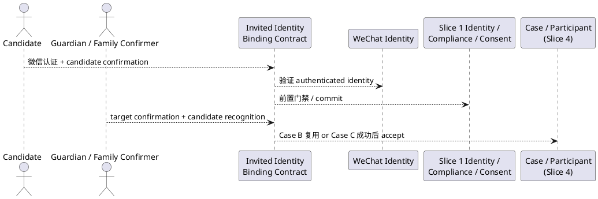

# Feature Specification: 受邀既有 Person 的微信身份绑定合同（Invited Identity Binding Contract）

**Feature Directory**: `specs/005-invited-identity-binding-contract`
**Created**: 2026-11-06（contract remediation round 1）
**V1 Phase**: Phase 1 前置身份合同（跨 Slice；**不是 implementation slice**）
**Docs baseline**: `Docs/V1产品需求.md` v3.5、`Docs/V1技术设计.md` v3.10
**Stage**: Contract / Specify / Clarify only。**禁止进入 Plan / Implement。**

> 本合同只定义 V1 新增的 identity seam：invitation-aware identity bootstrap、家庭证明的双确认（candidate recognition）、年龄矩阵、no-P2、失败语义、生命周期分离与授权边界。既有 Account↔Person 1:1、Person→Account 0..1、Family membership、guardian 基线、consent-first、RLS 与 participant 生命周期由上游直接约束，本文不重复。
>
> 本轮只修复合同语义，不新增产品能力，也不宣称达到实名 / KYC 强度。

---

## Upstream Traceability

| Upstream ID / Section | Source | 本合同的投影关系 |
|---|---|---|
| §1.2 / §1.5 | `Docs/V1产品需求.md` | 孩子按需参与；邀请不是身份证明；Account↔Person 1:1、0..1；guardian 独立于 membership |
| §17.1 / §18.3 | `Docs/V1产品需求.md` | attempt 留痕；attempt 终态 ≠ 邀请终态；binding 确认 ≠ Consent；binding 不授予任何业务授权 |
| §19A.2 | `Docs/V1产品需求.md` | 四类年龄；consent-first；UNKNOWN 不按成人放行；最终年龄与确认主体矩阵 |
| V1-C20 / V1-C21 / V1-C39 / V1-C44 | `Docs/V1产品需求.md` §24 | 对象边界；跨成员按用途授权；服务端保存年龄/监护/同意；受邀身份绑定 invariant |
| U11 | `Docs/V1产品需求.md` §23 / `Docs/V1技术设计.md` §28.11 | 孩子轻量参与；拒绝、撤回、过期、越权、绑定失败 |
| §5 不变量 1 / 4 / 5 / 17 / 27 / 29 | `Docs/V1技术设计.md` | 对象分开；转述不升级；未知不补值；并发不重复；UNDER_14 无同意 BLOCK；binding 前不建 Person/会话/参与 |
| §7.1 / §7.7A | `Docs/V1技术设计.md` | binding 只改变 Case C 的 Person→Account；`guardian_person_id` 是 guardian relationship 唯一基线；`verified_source` 不是 guardian proof |
| §9 / §9.1 | `Docs/V1技术设计.md` | 统一 `authorize()`；binding 不授 family access；pending context 非家庭作用域读取 |
| §10 / §28.1 / §28.8 | `Docs/V1技术设计.md` | Case B / Case C 分流；invitation-aware bootstrap；普通登录边界 |
| §37.2 / §40 | `Docs/V1技术设计.md` | 四类真实业务结果；Authorization / RLS / Consent / 未成年人门禁上线证据 |

**Blocking rule**: 本合同不新增任何未被 V1-C44 覆盖的产品语义；无法追溯到上表的扩展一律不得实现。

**编号说明**：IB 编号为本文件内部序号，已按本轮压缩重排；语义以章节标题与上表为准。

---

# 1. 组件定位

## 1.1 核心职责

本组件负责把已认证微信身份绑定到受邀既有 Person P1，且不创建第二个 Person。

## 1.2 核心输入

1. **Invitation context**：参与邀请、目标 Family、目标 Person P1、邀请生命周期状态。
2. **Existing Person P1**：已合法建立；Case B 时已有 Account，Case C 时 `Account = NULL`；含当前 Compliance Profile。
3. **Authenticated WeChat identity**：candidate 本次真实微信认证结果。
4. **Candidate confirmation**：candidate 对绑定到本次受邀既有 Person 的明确 affirmative 行为。
5. **Second-party confirmation**：年龄矩阵指定的独立确认主体作出的 `target confirmation + candidate recognition`。
6. **Target Family / Case context**：确认权来源与后续独立授权边界。

## 1.3 核心输出

1. **Binding decision（内部真实结果）**：`COMMITTED` / `PENDING` / `TERMINAL ATTEMPT REJECTION` / `RETRYABLE OPERATION FAILURE`（§5.4）。
2. **Candidate-observable result**：candidate 未成功绑定前，只能是不可区分的 generic「binding not completed」（§5.6）。
3. **Account A ↔ Person P1 binding**：仅在全部条件成立时产生；保持既有 1:1 / 0..1 基数。
4. **Normal authenticated identity**：Case C 绑定成功后获得与 P1 一致的普通已认证身份，accept 可继续。
5. **No-P2 guarantee**：invitation-aware flow 在 binding 前不产生 P2；失败后不留下 P2、half binding、普通会话或部分参与能力。
6. **Audit record**：可追溯的 attempt 结果与确认事实（不含 secret / 私密细节）。

## 1.4 职责边界

本组件**不负责**：修改普通 `/api/v1/auth/wechat` 语义；创建 Person P1；创建 membership、guardian、Case / Participant / Visibility / Purpose / Consent grant；创建 Case、Participant、Evidence、Plan、Task、Notification、AI；跨 Family 查找 / 合并 / 迁移 / 复用；成人通用关联；unlink；KYC / 法定身份核验；定义 token / crypto / TTL / timer / DB 状态 / endpoint path / pairing 机制（属 Plan 或 API design）；解决 duplicate Person recovery（未来独立 Feature）。

---

# 2. 领域术语

**Invited Identity Binding**
: 在真实参与邀请上下文中，把已认证微信身份绑定到已合法存在的受邀 Person P1 的独立身份能力；不是普通登录，也不是通用身份关联平台。

**P1**
: 本次参与邀请所指的、已合法存在的既有 Person；本文用它区分 candidate 与 target Person。

**Case B**
: 邀请目标 Person 已有 Account。当前已认证 Account 等于该 Account 时复用既有 binding；否则拒绝。

**Case C**
: 邀请目标 Person 已合法存在，但当前没有任何 Account 绑定；本合同唯一需要 identity bootstrap 的情形。

**Candidate**
: 完成真实微信认证、请求绑定到 P1 的主体；binding 成立前不是 P1，也不是正式 Person。

**Pending authentication context**
: 微信认证完成、binding 未成立时持有的临时认证结果；MUST NOT 是正式 Person，MUST NOT 产生普通业务会话，MUST NOT 与 P1 关联。

**Binding attempt**
: 一次 candidate confirmation 与 second-party confirmation 共同指向的同一绑定请求。

**Candidate recognition**
: 第二方基于与 P1 既有的现实家庭关系，独立辨认当前这次已认证微信身份的实际使用者就是 P1 的人工确认。它独立于 invite token possession、nickname / displayName、Family membership、客户端声称与系统自动推断；不是 KYC / 法定身份核验。

**Second-party confirmer**
: 独立于 candidate、完成自身认证的确认者；身份由年龄矩阵与 P1 当前 `guardian_person_id` 决定。

**Guardian relationship（本合同）**
: P1 当前 Compliance Profile 上的 `guardian_person_id`；不是 Family membership 角色，也不是 `verified_source` 字段。

**Invitation possession**
: 持有或转发邀请 token 的事实；只证明拿到过某次邀请，不证明当前 Account 就是 target Person，也不能决定绑定是否成立。

---

# 3. 角色与边界

## 3.1 核心角色

- **Candidate**：完成微信认证、作出 candidate confirmation；看不到受保护的目标状态。
- **Guardian confirmer**：UNDER_14，或 MINOR_14_17 且存在 `guardian_person_id` 时，由该 guardian 的已认证 Account 确认，并须辨认 candidate 就是其所知的 P1。
- **Family management actor**：MINOR_14_17 且无 `guardian_person_id` 时，由目标 Family 的 V1 已认证管理主体确认，并须辨认 candidate 就是该 Family 所知的 P1；无法辨认时 BLOCK。
- **Inviter / Case manager**：创建参与邀请；不得单独完成身份绑定。
- **System**：执行确定性门禁、记录 attempt、拒绝非法路径；AI 不得代替任何确认。

## 3.2 外部系统

- **WeChat identity provider**：提供真实微信认证结果；不设计 code2session 实现。
- **Slice 1 Identity / Compliance / Consent**：Person、Account、membership、Compliance Profile、guardian reference、guardian consent、`authorize()`、RLS、幂等、审计。
- **Slice 2 Case / Slice 4 Participant**：Case 上下文、Case 管理 actor、参与邀请与资源；**Slice 4 contract 是 invitation 生命周期的事实源**。

## 3.3 交互上下文



> 只表达合同交互，不表达内部模块、数据库、缓存、pairing 机制或 endpoint 设计。

---

# 4. DFX 约束

## 4.1 安全性

1. **Fail-closed**：必需事实缺失、冲突、未知或不可验证时，binding MUST 失败、PENDING 或 BLOCK。
2. **Candidate recognition 不可替代**：token、nickname、displayName、membership、profile similarity、guardian guess、manager assertion、单方确认、客户端声称、系统自动推断均 MUST NOT 构成 candidate recognition 或 identity proof。
3. **独立认证**：second-party MUST 来自独立认证上下文；不得由 candidate 会话代持或由 AI 代确认。
4. **最小权限**：binding 只建立 Account A ↔ Person P1，不产生任何授权事实。
5. **强度声明**：本合同只提供 family-attested identity association，MUST NOT 宣称达到实名 / KYC / 法定身份核验强度。

## 4.2 可靠性与隐私

1. **无部分状态**：conflict / timeout / cancellation / 任一写入失败时，MUST NOT 留下 P2、half binding、ordinary session 或 partial participant capability。
2. **并发收敛与幂等**：同一 Person 的并发 binding MUST 收敛为至多一个；同一 attempt 重复提交 MUST 返回同一业务结果。
3. **真实状态**：不得把 UNKNOWN / DECLINED / CONFLICT / timeout / PENDING 写成成功；技术性失败不得自动升级为业务终态。
4. **动态重估**：attempt 期间 age_band / guardian / consent / Compliance 变化 MUST 重新评估。
5. **未绑定 candidate 不泄露**：响应 MUST NOT 泄露 target Person / Family / guardian / age / consent / compliance / multi-family / other Account binding，也不得通过「可继续动作」形成 oracle。
6. **确认者最小可见**：只向已授权 second-party / manager 展示完成确认所严格必要的信息。
7. **审计与凭据**：成功 / 失败的 attempt MUST 可审计、复用既有 `business_audit_events`，但 MUST NOT 记录 secret；`wechat_openid` 等身份凭据 MUST NOT 出现在业务响应或日志明文中。

---

# 5. 核心能力

## 5.1 参与路径分流（Case B / Case C）

### 5.1.1 业务规则

1. **Case B**：当前已认证 Account 等于 P1 的 Account 时，MUST 复用既有 binding，MUST NOT 进入 identity bootstrap 或要求重新双确认；随后继续参与说明 / accept / decline。
2. **Case B 不匹配**：当前已认证 Account 不是 P1 的 Account 时 MUST 拒绝；MUST NOT rebind / 替换 / 创建 active participation。
3. **Case C**：P1 无 Account 时 MUST 只走 invitation-aware identity bootstrap；从 participation invitation 进入时 MUST 在调用普通 login 之前 route 到该 bootstrap，MUST NOT 先调用普通 `/api/v1/auth/wechat`。
4. **普通登录先行冲突**：candidate 已独立完成普通登录（A ↔ P2）后再打开 P1 邀请时，invited binding MUST reject，保持 A↔P2 与 P1 不变，MUST NOT merge / delete / rebind / 创建 P1 的 active participation。

### 5.1.2 交互流程

```text
邀请指向 P1
if P1 有 Account:
    if authenticated Account == P1.Account → 复用 binding → accept / decline
    else → reject（terminal attempt rejection）
else:
    → Case C bootstrap（§5.2 / §5.3 / §5.4）
```

### 5.1.3 异常场景

1. **邀请不存在 / 已过期 / 不属于目标 Family** → fail closed；不进入双确认；不创建身份事实；对未绑定 candidate 不区分原因。
2. **P1 不存在** → MUST NOT 由邀请流程创建 Person。
3. **P1 已有其他 Account / Account 已绑定其他 Person** → 拒绝；不得替换或 rebind。

## 5.2 家庭证明的双确认与 candidate recognition

### 5.2.1 业务规则

1. **冻结等式**：`second-party confirmation = target confirmation + candidate recognition`。第二方确认的命题是：「我基于与 P1 既有的现实家庭关系，独立确认当前这次已认证微信身份的实际使用者就是 P1。」它 MUST NOT 退化为「我批准这个 invitation / binding request」。
2. **独立性**：candidate recognition MUST 独立于 invite token possession、nickname / displayName、Family membership、客户端声称与系统自动推断；MUST 由人工作出。
3. **性质**：该确认是 family-attested identity association；MUST NOT 被描述或验收为 KYC / legal identity verification / government identity proof。
4. **同一 attempt + 四要素 + 独立认证**：两方确认 MUST 指向同一 binding attempt，并共同绑定 target Person P1、authenticated WeChat identity、invitation context；两方 MUST 分别独立认证；任一方缺失 MUST NOT commit。
5. **Exactly once**：全部条件成立且两方确认一致时，MUST exactly once 提交 Account A ↔ P1；AI / 模型 / 自动化任务 MUST NOT 代替任何确认。

### 5.2.2 交互流程

```text
candidate confirmation（B1 / P1 / WeChat A / invite I1）
+ second-party confirmation（B1 / P1 / WeChat A / invite I1；含 candidate recognition）
→ 四要素一致 + 独立认证
→ 前置门禁 + commit 复核
→ Account A ↔ P1（exactly once）→ COMMITTED
```

### 5.2.3 异常场景

1. **candidate recognition 被确认者明确拒绝** → terminal attempt rejection。
2. **确认主体资格失效 / 无独立认证** → 拒绝。
3. **重复提交** → 返回同一业务结果；不产生重复 Account / Person / binding。
4. **并发两个 candidate 绑定同一 P1** → 至多一个成功；其余真实冲突；无 P2。

## 5.3 Age / Confirmer Matrix（唯一权威）

本矩阵是本文唯一权威年龄与确认主体定义；其他章节只引用，不再重复。

```text
UNDER_14:
candidate WeChat authentication（先独立完成，尚不与 P1 关联）
+ current guardian relationship
+ current valid guardian consent
+ applicable Compliance gates
+ candidate explicit confirmation（针对 P1）
+ current guardian confirmation（target confirmation + candidate recognition）
→ binding may proceed
```

```text
MINOR_14_17:
candidate WeChat authentication（先独立完成，尚不与 P1 关联）
+ 服务端前置门禁：P1 合法存在、applicable Compliance gate 通过
  （guardian consent 不是本年龄段的 binding 前置）
+ candidate explicit confirmation（针对 P1）
+
    if current guardian exists:
        该 guardian 确认（target confirmation + candidate recognition）
    else:
        目标 Family V1 管理主体确认（target confirmation + candidate recognition）
→ binding may proceed
```

```text
ADULT:  NOT SUPPORTED by this invited-child identity-binding feature
UNKNOWN: BLOCK
```

### 5.3.1 业务规则

1. **UNDER_14 六项缺一不可**；`guardian_person_id` MUST 存在，confirmer MUST 是该 guardian，MUST NOT fallback 到 Family manager；guardian MUST 确认「当前已认证 candidate 就是该 guardian 所知的这个孩子 Person P1」，MUST NOT 只确认「P1 可以参与」。
2. **MINOR_14_17 有 guardian**：confirmer MUST 是该 guardian，MUST NOT 以 manager 替代，辨认命题同上。
3. **MINOR_14_17 无 guardian**：目标 Family 的 V1 management actor MUST 确认「当前已认证 candidate 就是该 Family 所知的既有 Person P1」；无法独立辨认 → MUST BLOCK；MUST NOT 只凭管理权限自动批准。
4. **ADULT NOT SUPPORTED**；**UNKNOWN BLOCK**；不得按成人或未成年人任一类放行。
5. **guardian 语义**：guardian relationship MUST 等于 P1 当前 `guardian_person_id`；guardian confirmer 的 actor MUST 满足 authenticated Account → Account's Person = 该 `guardian_person_id`；`verified_source` MUST NOT 被当作 guardian identity proof；MUST NOT 新建 guardian relationship / guardian consent / 新 Consent 类型。

### 5.3.2 异常场景

1. **age_band 缺失 / 冲突 / 不可确定** → UNKNOWN → BLOCK。
2. **UNDER_14 consent 无效 / 撤回 / 过期** → 阻断 binding 与受影响参与；既有 Person / 历史不删除。
3. **guardian 存在但未确认** → PENDING（attempt 仍合法时）；不得以 manager 替代。
4. **确认者无法辨认 candidate** → BLOCK。

## 5.4 UNDER_14 consent-first 顺序与 binding lifecycle（唯一权威）

### 5.4.1 业务规则

**阶段 A — candidate-independent authentication**

1. 微信认证 MUST 可在尚未与 P1 关联时完成，并只持有 temporary pending authentication context（无 Person / 无普通会话 / 无 P1 关联 / 无 active participation）。

**阶段 B — before P1-associated processing**

2. **对 UNDER_14**，在进行 link pending context to P1、record P1-specific candidate confirmation、show P1-specific information 或 request P1-specific second-party confirmation 之前，MUST 先服务器端核验：P1 合法存在、current guardian relationship 存在、current valid guardian consent 存在、适用 Compliance gate 允许该最小身份绑定处理。对 MINOR_14_17 / ADULT / UNKNOWN，同一顺序 MUST 先解析 age_band 并执行适用 Compliance gate；不得先建立 candidate↔P1 关联。
3. 该阶段 MUST 先解析 P1 的 age_band；UNKNOWN → BLOCK，ADULT → NOT SUPPORTED，均不得泄漏分类结果。
4. **不得先建关联**：consent 已撤回 / 失效时 MUST NOT 创建 candidate↔P1 关联事实，事后再补 gate。读取既有 Consent / Compliance 状态以执行 gate，属执行授权 / 合规门禁的必要处理。

**Commit 复核**

5. 即使早期 gate 通过，最终 commit 前 MUST 重新校验 current guardian、current consent、current Compliance state、invitation validity、confirmation authority。

**Binding attempt lifecycle（四类业务结果）**

6. 业务结果 MUST 封闭为：

   | 结果 | 含义 |
   |---|---|
   | `COMMITTED` | binding 成功，Account A ↔ P1 建立。 |
   | `PENDING` | attempt 仍合法，正在等待尚可合法补齐的 confirmation / permitted step。 |
   | `TERMINAL ATTEMPT REJECTION` | 该 attempt 永远不能再成功。 |
   | `RETRYABLE OPERATION FAILURE` | temporary infrastructure failure、unknown network result、transient service failure；业务 attempt 本身仍合法。 |

7. `TERMINAL ATTEMPT REJECTION` MUST 至少覆盖：identity conflict、P1 已绑定不同 Account、candidate Account 已绑定不同 Person、wrong / unauthorized confirmer、candidate-recognition explicitly rejected、multi-family block、ADULT unsupported、UNKNOWN blocked、invitation terminal、candidate cancels this attempt、authorized confirmer rejects this attempt、concurrency loser after another attempt committed。具体 enum 名留 Plan。
8. **Invitation lifecycle ≠ Binding attempt lifecycle**：attempt terminal 且 invitation 仍有效时，允许同一 invitation 上 new binding attempt（若业务政策允许）；invitation terminal 时所有关联 attempt 不可再 commit，未来参与必须 new invitation。未证明为 P1 的 candidate 的 cancel / reject / timeout / identity failure MUST 最多终止 attempt，MUST NOT decline / cancel / expire P1 的 invitation。
9. invitation 只有 authorized lifecycle event 才可终止：P1 在合法身份下 decline、Case / Family authorized actor cancel、server expiry、其它 Slice 4 contract 已正式定义的 invitation terminal event；Slice 4 contract 是事实源。
10. 同一 attempt 重复提交 MUST 返回同一业务结果；已失败终态 MUST NOT 被重放为成功。

### 5.4.2 交互流程

```text
candidate authentication（A，不关联 P1）
→ 前置门禁（B：先解析 age_band；UNDER_14 核验 guardian + consent +
  applicable Compliance；MINOR_14_17 核验 applicable Compliance；
  ADULT / UNKNOWN 终止）
→ candidate confirmation（针对 P1）
→ second-party confirmation（同一 attempt，含 candidate recognition）
→ commit 复核
→ COMMITTED
OR → PENDING（等待合法补齐）
OR → TERMINAL ATTEMPT REJECTION（attempt 不可再成功，invitation 可仍有效）
OR → RETRYABLE OPERATION FAILURE（业务 attempt 仍合法，可重试）
```

### 5.4.3 异常场景

1. **邀请在两次确认之间过期** → 不 commit、不复活；invitation terminal。
2. **candidate 取消 / 授权确认者拒绝** → 只终止 attempt；邀请是否终止由 Slice 4 的授权事件决定。
3. **TTL 到期** → attempt terminal；不自动通过；具体 TTL 属 Plan。
4. **数据库 / 事务失败** → 整体 fail；不得部分成功；不得伪造 COMMITTED。

## 5.5 独立身份事实与授权边界

1. **Binding 是独立事实**：成功只建立 Account A ↔ P1；MUST NOT 与 membership、guardian、Consent、Case / Participant permission 合并。
2. **下游变化不自动解绑**：participation decline / withdraw、Case close、guardian consent revoke、other downstream authorization revoke MUST NOT 自动解除 binding；Consent / Compliance 变化只阻断受影响的下游处理与参与能力。
3. **不授予访问权、不设计 unlink**：MUST NOT 创建 membership、guardian、Case / Participant permission、Visibility、Purpose、Consent；本 Slice MUST NOT 设计 account/person identity unlinking。
4. **确认 ≠ Consent**：identity-binding confirmation / candidate recognition MUST NOT 等价于 Consent；guardian confirmation MUST NOT 等价于 guardian consent。

## 5.6 未绑定 candidate 的响应分离（anti-enumeration）

1. **冻结不等式**：`internal result ≠ candidate-observable result`。内部 MAY 保留真实状态（`PENDING_SECOND_CONFIRMATION` / `INELIGIBLE` / `IDENTITY_CONFLICT` / `CONSENT_BLOCKED` / `MULTI_FAMILY_BLOCKED` / `INVITATION_EXPIRED` 等；enum 名留 Plan），对外 MUST 统一为不可区分的 generic「binding not completed」。
2. **不得泄露**：guardian 缺失 / 存在、consent 是否有效、age band、是否多 Family、Person 是否存在、target Family 归属、other Account binding，任一均不得可通过响应差异观察。
3. **「可继续动作」不得成为 oracle**：MUST NOT 出现「错误 candidate 看到等待 guardian，而 consent 无效者看到已拒绝」；文案、状态与下一步能力在身份建立前一致。具体 HTTP status / error code / envelope 由 Plan 决定，但 MUST 满足不可区分性。
4. **确认者例外**：已授权 second-party / manager MAY 在其授权上下文看到完成确认所必需的信息；该可见性 MUST NOT 扩散给 candidate 或未授权主体。
5. **探测性请求**：转发、重放、枚举均返回同一 generic 结果；确认者若无法独立辨认 candidate → MUST NOT confirm。

## 5.7 多家庭与能力边界

1. V1 invited identity binding 只支持 P1 当前仅属于目标 Family；P1 存在多个 membership 或不属于目标 Family 时 MUST BLOCK，不选择任一 Family 作为确认权来源，不泄露其他 Family。
2. Schema-level Person↔Family 多对多 MUST 继续保留；V1 MUST NOT 因此提供 multi-family switching、cross-family identity linking、family merge 或 shared identity management；MUST NOT 引入 V2–V5 capabilities 或通用身份平台。

---

# 6. 数据约束

## 6.1 Binding attempt

1. **Target Person**：Case C 时 P1 必须 `Account = NULL`；Case B 时复用既有 Account，不产生新 attempt 型绑定。
2. **WeChat identity / invitation**：必须是 candidate 本次真实认证结果；invitation MUST 仍有效，终态 invitation MUST NOT 产生新 commit。
3. **Attempt 唯一性与 confirmation 同一性**：同一 target Person + WeChat identity + invitation context MUST 只产生一个结果；两方确认的 target Person、微信身份、invitation context、attempt 标识 MUST 完全一致。

## 6.2 Person / Account 与 failure residue

1. **Account ↔ Person = 1:1**；**Person → Account = 0..1**；invitation-aware attempt 任何阶段 MUST NOT 产生 Person 增量。
2. **No rebind / replacement / independent fact**：P1 已绑定其他 Account 或 Account A 已绑定其他 Person 时 MUST 拒绝；binding MUST NOT 自动创建 membership、guardian、consent 或其他授权事实。
3. **Age / guardian / consent**：`age_band` 必须为 `ADULT` / `MINOR_14_17` / `UNDER_14` / `UNKNOWN` 之一，UNKNOWN 不得补值；UNDER_14 的 second-party MUST 等于当前 `guardian_person_id`，其 consent MUST 为 current valid；`verified_source` MUST NOT 用作 guardian identity proof。
4. **Failure residue**：失败 attempt MUST NOT 留下 binding、Person、普通会话、membership、guardian、active participation；审计事实不得被静默删除；既有合法 Person / consent / 历史 MUST NOT 因失败或撤回被删除。

---

# 7. EARS Requirements

> 只保留「受邀既有 Person identity binding」新增或改变的要求。既有 1:1 / 0..1、membership、guardian 基线、consent-first、RLS 与 participant 生命周期由上游直接约束，不在此重复。

## 7.1 合同与路由边界

- **IB-001（Ubiquitous）**：系统 MUST 把 invitation-aware identity bootstrap 与普通微信登录视为两个不同能力；普通 `POST /api/v1/auth/wechat` MUST 保持既有行为，MUST NOT 通过 `mode=invite` 或隐藏开关改变。
  - **验收**：new openid → Account + Person；existing → reuse；无 `mode=invite`。
- **IB-002（Event-Driven）**：当用户从 participation invitation 进入 Case C 时，系统 MUST 在调用普通 login 之前 route 到 invitation-aware bootstrap；No-P2 guarantee MUST 仅适用于该 flow。
  - **验收**：调用序列中不出现普通 login；flow 内 P2 = 0。
- **IB-003（Unwanted Behaviour）**：系统 MUST NOT 宣称或依赖普通 `/auth/wechat` 识别并阻断 Case C；该端点只有 `{ code }`，无法得知 new openid 对应的既有 Person。
  - **验收**：普通登录回归不变；不存在「普通登录阻断 Case C」的合同承诺。
- **IB-004（State-Driven）**：Case B 时，当前已认证 Account 等于 P1 的 Account → MUST 复用既有 binding，MUST NOT 重新绑定或要求重新双确认；不匹配 → MUST 拒绝。
  - **验收**：匹配 → 无新 binding / 无新 Person；不匹配 → 拒绝，既有绑定不变。
- **IB-005（Unwanted Behaviour）**：如果仅有 invite token possession、或任一必需事实未知 / 冲突 / 过期 / 不可验证，则系统 MUST fail closed；token MUST NOT 构成 identity proof。
  - **验收**：仅 token + 有效微信登录、无正确双确认 → 拒绝。

## 7.2 双确认与 candidate recognition

- **IB-006（Ubiquitous）**：`second-party confirmation` MUST 等于 `target confirmation + candidate recognition`。candidate recognition MUST 基于 confirmer 与 P1 既有的现实家庭关系，由人工独立辨认当前已认证微信身份的实际使用者就是 P1；MUST 独立于 invite token possession、nickname / displayName、Family membership、客户端声称与系统自动推断。
  - **验收**：仅批准 invitation / binding request → 不构成确认；任一非人工来源单独作为辨认依据 → 拒绝。
- **IB-007（Ubiquitous）**：candidate recognition MUST NOT 被描述、验收或对外宣称为 KYC / legal identity verification / government identity proof；本合同强度仅为 family-attested identity association。
  - **验收**：合同、文案与验收表述均不出现实名 / KYC 强度声明。
- **IB-008（Event-Driven）**：当 candidate 完成真实微信认证时，系统 MUST 只在 pending authentication context 中持有认证结果；该上下文 MUST NOT 是正式 Person，MUST NOT 与 P1 关联。
  - **验收**：binding 成立前 Person 增量 = 0；无 P1 关联事实。
- **IB-009（Event-Driven）**：当两方分别确认时，系统 MUST 记录两份独立 confirmation，使其绑定同一 target Person、authenticated WeChat identity、invitation context 与 binding attempt；second-party MUST 独立完成自身认证，单方确认 / candidate 会话代持 / AI 输出 MUST NOT 构成 identity proof。
  - **验收**：四要素一致；交叉 attempt / target / 微信身份 → 拒绝；无独立认证 → 拒绝。
- **IB-010（Event-Driven）**：当全部条件成立且两方确认一致时，系统 MUST exactly once 提交 Account A ↔ P1，不产生第二个绑定。
  - **验收**：binding 数 0 → 1；重复提交不增加。

## 7.3 年龄与确认主体

- **IB-011（State-Driven）**：在 P1 为 UNDER_14 时，系统 MUST 同时要求 candidate WeChat authentication、当前 guardian relationship、current valid guardian consent、applicable Compliance gates、candidate explicit confirmation、该 guardian 的 `target confirmation + candidate recognition`。
  - **验收**：六项缺一 → 失败 / PENDING / BLOCK；guardian 不可用 manager 替代；guardian 只确认「P1 可以参与」不成立。
- **IB-012（State-Driven）**：在 P1 为 MINOR_14_17 且存在当前 guardian 时，second-party MUST 是该 guardian；不存在时 MUST 是目标 Family 的 V1 management actor，且该 actor MUST 独立辨认 candidate 就是该 Family 所知的既有 P1。
  - **验收**：有 guardian 而 manager 确认 → 拒绝；无 guardian 时 manager 无法辨认 → BLOCK；guardian / consent 数不变。
- **IB-013（State-Driven）**：在 P1 为 ADULT 时 MUST 判定 NOT SUPPORTED；`age_band` 为 UNKNOWN 时 MUST BLOCK，MUST NOT 按成人或未成年人任一分类放行。
  - **验收**：ADULT / UNKNOWN → 拒绝；无 Account / Person 变更。
- **IB-014（Ubiquitous）**：guardian relationship MUST 等于 P1 当前 Compliance Profile 上的 `guardian_person_id`；guardian confirmer 的 actor MUST 满足 authenticated Account → Account's Person = 该 `guardian_person_id`；`verified_source` MUST NOT 被当作 guardian identity proof。
  - **验收**：不满足等式 → 拒绝；不满足字段边界 → 合同违反。
- **IB-015（Unwanted Behaviour）**：本能力 MUST NOT 新建或修改 guardian relationship、guardian consent 或通用 guardian policy；attempt 期间 `age_band`、guardian 引用或 consent 变化时 MUST 重新评估，MUST NOT 沿用旧结论。
  - **验收**：binding 前后 guardian / consent 数量不变；变化后不再满足 → 失败或 PENDING。

## 7.4 Consent-first 与生命周期

- **IB-016（Event-Driven）**：在进行 link pending context to P1、record P1-specific candidate confirmation、show P1-specific information 或 request P1-specific second-party confirmation 之前，系统 MUST 核验 P1 合法存在、current guardian relationship、current valid guardian consent、applicable Compliance gate。
  - **验收**：任一失败 → BLOCK；不建立 candidate↔P1 关联；对外 generic。
- **IB-017（Event-Driven）**：即使早期 gate 通过，在 Account A ↔ P1 commit 前系统 MUST 重新校验 current guardian、current consent、current Compliance state、invitation validity、confirmation authority。
  - **验收**：commit 前失效 → commit blocked。
- **IB-018（State-Driven）**：业务结果 MUST 封闭为 COMMITTED / PENDING / TERMINAL ATTEMPT REJECTION / RETRYABLE OPERATION FAILURE 四类；PENDING MUST 只表示 attempt 仍合法且等待尚可合法补齐的步骤。
  - **验收**：PENDING 掩盖 consent invalid / identity conflict / 无权确认者 / multi-family → 合同违反。
- **IB-019（Unwanted Behaviour）**：`TERMINAL ATTEMPT REJECTION` MUST 覆盖 identity conflict、P1 已绑定不同 Account、candidate Account 已绑定不同 Person、无权确认者、candidate recognition 被明确拒绝、multi-family、ADULT、UNKNOWN、invitation terminal、candidate 取消、确认者拒绝、并发失败者；业务 attempt 仍合法时，技术性失败 MUST NOT 自动转成业务终态。
  - **验收**：每一类均可判定为不可再成功；技术失败可重试且不伪造 COMMITTED。
- **IB-020（Unwanted Behaviour）**：`Invitation lifecycle` MUST NOT 等于 `Binding attempt lifecycle`；未证明为 P1 的 candidate 的 cancel / reject / timeout / identity failure MUST 最多终止 attempt，MUST NOT decline / cancel / expire P1 invitation。
  - **验收**：attempt terminal 后 invitation 状态不变（除非另有 authorized lifecycle event）。
- **IB-021（Event-Driven）**：当 invitation 已 terminal 时，系统 MUST NOT complete old binding、MUST NOT revive old invitation；未来参与 MUST 使用 new invitation → new binding attempt；同一 attempt 重复提交 MUST 返回同一结果，已失败终态 MUST NOT 被重放为成功。
  - **验收**：终态后提交旧 attempt → 拒绝；幂等计数不变。

## 7.5 No-P2、独立事实与未绑定响应

- **IB-022（Unwanted Behaviour）**：在 binding 成立前，系统 MUST NOT 为 candidate 创建 Person P2、ordinary authenticated business session、active participation、Family membership、guardian relationship 或 Case permission；binding 成功时 MUST 只创建或复用恰好一个 Account A 并绑定既有 P1，Person 数 MUST 不变，MUST NOT 先建 P2 再 merge / rename / delete。
  - **验收**：binding 前上述对象增量均为 0；成功时 Account +1 或 0、binding +1、Person 0 增量、无 merge。
- **IB-023（Event-Driven）**：当两个 candidate 并发绑定同一 P1 时，系统 MUST 至多提交一个 binding；其余 MUST 拒绝；MUST NOT 产生 P2。
  - **验收**：binding 数 = 1；Person 数不变。
- **IB-024（Ubiquitous）**：成功 binding 后 Account A ↔ Person P1 是独立 identity fact；participation decline / withdraw、Case close、guardian consent revoke、other downstream authorization revoke MUST NOT 自动解除 binding；binding MUST 只建立 Account A ↔ P1，MUST NOT 创建 membership、guardian、Case / Participant permission、Visibility、Purpose 或 Consent；身份确认 MUST NOT 等价于 Consent。
  - **验收**：上述事件后 binding 仍存在；唯一新增关系为 Account-Person binding；受影响下游按独立 gate 阻断。
- **IB-025（Unwanted Behaviour）**：在 candidate 尚未绑定为 P1 之前，candidate-facing response MUST 与内部真实结果分离，统一为不可区分的 generic「binding not completed」；文案、状态与「下一步可继续动作」MUST NOT 成为 protected target gate 的 oracle。
  - **验收**：guardian 存在性 / consent 状态 / age band / multi-family / Person 存在性 / target Family 归属 / other Account binding 任一不同，均不产生可观察差异。
- **IB-026（Ubiquitous）**：已授权 second-party / manager MAY 在其自身授权上下文看到完成确认所必需的信息；该可见性 MUST NOT 扩散给 candidate 或未授权主体。
  - **验收**：candidate 侧无额外信息；未授权主体被拒绝。

## 7.6 多家庭、审计与能力边界

- **IB-027（Unwanted Behaviour）**：如果 P1 当前存在多个 Family membership 或不属于目标 Family，则系统 MUST BLOCK；schema-level 多对多 MUST 继续保留，MUST NOT 演化为 multi-family product capability 或 V2–V5 capabilities。
  - **验收**：binding 拒绝；不泄露其他 Family；数据库基数仍合法。
- **IB-028（Unwanted Behaviour）**：如果发生 conflict、timeout 或 cancellation，则系统 MUST NOT 留下 P2、half binding、ordinary session 或 partial participant capability；系统 MUST 记录真实状态，MUST NOT 把失败 / PENDING / CONFLICT / timeout 写成成功；审计 MUST NOT 记录 secret，响应 MUST NOT 成为枚举 oracle。
  - **验收**：四类残留均为 0；审计存在且不含 secret；探测响应不区分敏感存在性。

---


## Scope

### In Scope

1. Case B 的复用 / 拒绝语义；Case C 的 invitation-aware identity bootstrap。
2. `target confirmation + candidate recognition` 的双确认语义与独立性约束（family-attested，非 KYC）。
3. 最终 Age / Confirmer Matrix：UNDER_14、MINOR_14_17（有/无 guardian）、ADULT、UNKNOWN。
4. UNDER_14 consent-first 的 A/B 阶段与 commit 复核。
5. no-P2 与 invitation flow routing invariant（并明确普通登录不承担 Case C 识别）。
6. 四类业务结果与 `Invitation lifecycle ≠ Binding attempt lifecycle`。
7. 未绑定 candidate 的内部 / 外部状态分离（anti-enumeration）。
8. binding 作为独立身份事实；多 Family BLOCK；授权边界；普通登录不变。
9. 失败语义、审计、Slice 1 additive reconciliation 与 Slice 4 OQ-6 解除条件。

### Out of Scope

- 业务实现、migration、runtime code、tests、schema、RLS policy、endpoint path、token / crypto / TTL / timer / transaction 设计。
- 修改 `specs/004-case-participant-core/**`、`apps/**`、`packages/**`、`db/**`、`tests/**`、`Docs/总产品需求.md`、`Docs/总体技术架构.md`。
- 修改普通 `/api/v1/auth/wechat` 行为。
- 创建 Person P1、Family、membership、guardian、Case、Participant、Assessment、Formulation、Scene、Evidence、Plan、Task、Notification、AI。
- 跨 Family Person search、Person discovery / fuzzy matching、nickname / phone / ID-card / KYC / face verification 匹配。
- Family merge、Person merge、Account merge、arbitrary existing-Person linking、adult general-purpose linking、unlink、duplicate Person recovery。
- V2–V5 capabilities；通用身份平台。
- 决定 QR / PIN / pairing code / 人脸 / 电话 / KYC / 视频 / crypto challenge 等配对机制（留 Plan）。

### Non-Goals

- 不做通用 Person identity linking platform。
- 不因「未来成人也需要」扩大 V1 范围。
- 不发明新 guardian policy、Family role、Case role 或 Consent 类型。
- 不允许 token 单独绑定、manager 单独确认、先建 P2 再 merge。
- 不优化性能 / 容量 / 成本；只要求确定性正确、可验证门禁与真实失败状态。

---

## Acceptance Scenarios

1. **UNDER_14 happy path** — **Given** 合法 UNDER_14 P1（Account = none）、当前 guardian、current valid guardian consent、目标 Family 邀请，**When** candidate 认证并确认、guardian 独立确认同一 attempt 且辨认 candidate 就是其所知的孩子，**Then** 只建立一个 Account A ↔ P1 binding；Person 数不变；binding 前无普通会话 / active participation。**Upstream**: §19A.2、V1-C39、V1-C44、§7.7A、§10、U11
2. **UNDER_14 missing guardian confirmation** — **Given** guardian 未确认，**When** candidate 单独确认，**Then** binding 不成立且 PENDING；邀请仍有效时允许 guardian 随后确认；无 P2。**Upstream**: V1-C44
3. **UNDER_14 consent invalid / withdrawn** — **Given** consent 失效或撤回，**When** 发起 binding，**Then** binding 与受影响参与被阻断；既有 Person / 历史不删除。**Upstream**: V1-C39、V1-C44
4. **UNDER_14 consent revoked after invitation creation but before candidate↔P1 association** — **Given** 邀请创建后、candidate 尚未与 P1 关联之前 consent 被撤回，**When** candidate 完成微信认证并尝试继续，**Then** 不记录 P1 专属 candidate confirmation、不建立 candidate↔P1 关联、不产生 binding / 普通会话 / active participation；candidate 得到 non-disclosing result。**Upstream**: §19A.2、V1-C39、V1-C44
5. **Consent valid at initial check then revoked before commit** — **Given** 早期门禁通过，**When** commit 前 consent 失效，**Then** commit blocked；无 partial binding。**Upstream**: V1-C39、V1-C44
6. **MINOR_14_17 with guardian** — **Given** 当前 guardian 存在，**When** candidate 确认、该 guardian 确认并辨认 candidate，**Then** 只建立一个 binding；不自动要求 guardian consent；不新建 guardian。**Upstream**: §19A.2、V1-C44
7. **MINOR_14_17 without guardian** — **Given** 当前 guardian 不存在，**When** candidate 确认、目标 Family 管理主体确认并辨认 candidate 是该 Family 所知的 P1，**Then** 只建立一个 binding；不以 guardian consent 为前置。**Upstream**: §19A.2、V1-C44、U11
8. **MINOR_14_17 without guardian, confirmer cannot recognize candidate** — **Given** 管理主体无法独立辨认 candidate，**When** 尝试确认，**Then** BLOCK；不得仅凭管理权限批准。**Upstream**: §19A.2、V1-C44
9. **ADULT not supported / UNKNOWN blocked** — **Given** ADULT 或 UNKNOWN Case C，**When** 尝试 binding，**Then** ADULT NOT SUPPORTED、UNKNOWN BLOCK；无 Account / Person 变更。**Upstream**: §19A.2、V1-C03、V1-C44
10. **No P2 / no session / no participation before binding** — **Given** 认证完成但未完成双确认，**When** 检查状态，**Then** 只有 pending authentication context；Person / session / active participation / membership 增量 = 0。**Upstream**: §5 不变量 1 / 17、V1-C44
11. **Forwarded invite + fresh WeChat identity B（anti-enumeration 反例）** — **Given** B 不是 P1；B 获得 P1 的 invitation；B 完成自己的微信认证；B 对 binding 请求确认，**When** 尝试绑定，**Then** B MUST NOT bind P1，且 B cannot learn P1 age band / guardian existence / consent state / multi-family status / other Account binding。即使 guardian / manager accidentally opens second-party confirmation，若不能独立辨认 candidate 就是 P1 → MUST NOT confirm。**Upstream**: U11、§37.2、V1-C21、V1-C44
12. **Multi-Family P1 blocked** — **Given** P1 有多个 Family membership，**When** 对目标 Family 发起 binding，**Then** BLOCK；不选择任一 Family 作为确认权来源；不泄露其他 Family。**Upstream**: §1.5、V1-C44
13. **PENDING then second confirmation** — **Given** candidate 已确认且邀请 / attempt 仍有效，**When** second-party 随后确认，**Then** binding MAY COMMIT；不产生第二个 Person / binding。**Upstream**: V1-C44
14. **Attempt terminal, invitation still valid** — **Given** 本次 attempt 因 identity failure / candidate cancel 终态，**When** 检查邀请，**Then** 邀请状态不变；业务政策允许时可在同一邀请上发起 new attempt。**Upstream**: §17.1、V1-C44、Slice 4 contract
15. **Invitation terminal before both confirmations** — **Given** invitation 已 terminal，**When** 提交旧 attempt，**Then** 不 commit、不复活；未来参与必须 new invitation → new attempt。**Upstream**: V1-C44
16. **Binding survives downstream changes** — **Given** binding 已成功，**When** decline / withdraw / Case close / consent revoke / downstream authorization revoke，**Then** binding 保留；受影响能力按独立 gate 阻断；不自动 unlink。**Upstream**: V1-C44
17. **Binding grants no authorization** — **Given** binding 成功，**When** 检查授权，**Then** 唯一新增事实是 Account↔Person；无 membership / guardian / Case / Participant / Visibility / Purpose / Consent 新增。**Upstream**: §1.5、§9、V1-C20、V1-C21、V1-C44
18. **Ordinary login conflict acceptance（P1 exists, Account none, ordinary login first）** — **Given** P1 存在且 Account = none；用户先独立完成普通登录 → A ↔ P2 legitimately created；随后打开 P1 邀请，**When** 尝试 invited binding，**Then** 拒绝；A↔P2 保留；P1 保留；no merge / no rebind / no active P1 participation。MUST NOT 声称该外部普通登录场景下 P2 = 0。**Upstream**: §28.1、V1-C28、V1-C44
19. **Case B reuse / mismatch** — **Given** P1 已有 Account B，**When** 当前已认证 Account 就是 B → 复用既有 binding、不重新绑定、不进入 bootstrap、可继续 accept / decline；不是 B → 拒绝，无 rebind / 无 active participation。**Upstream**: §1.5、§28.8、V1-C44
20. **Ordinary login regression / cardinality preserved** — **Given** 普通 new / existing openid，**When** 调用既有 `/api/v1/auth/wechat`，**Then** new → Account + Person、existing → reuse；1:1 / 0..1 不变；无 `mode=invite`。**Upstream**: §28.1、V1-C44

---

## Acceptance Evidence

| Acceptance item | Verification type | Required evidence |
|---|---|---|
| 合同与路由（IB-001—IB-005） | document + contract review | 两条路径边界清楚；Case B/C 分流；普通登录回归合同不改；routing invariant 可判定；无 `mode=invite` |
| 双确认与 candidate recognition（IB-006—IB-010） | contract matrix | 等式与独立性逐条可判定；非 KYC 声明；四要素一致性；单项伪证明逐项拒绝 |
| 年龄与确认主体（IB-011—IB-015） | contract matrix | UNDER_14 / MINOR_14_17（有/无 guardian）/ ADULT / UNKNOWN 逐行可判定；无法辨认 → BLOCK |
| Consent-first 与生命周期（IB-016—IB-021） | contract matrix + state table | 前置门禁先于 P1 关联；commit 复核；四类结果封闭；attempt 与 invitation 分离 |
| No-P2 / 独立事实 / anti-enumeration（IB-022—IB-026） | contract review + response matrix | binding 前 / 失败后 / 并发后状态；不同内部原因产生同一可观察结果 |
| 审计与多家庭（IB-027—IB-028） | contract review | 多 membership BLOCK；审计不含 secret；无枚举 oracle |
| Slice 1 / Slice 4 governance | document + command | additive note；Slice 4 changed = 0；下方六项逐条状态 |
| Validation | command output | `validate-governance.mjs`、`run-governance-tests.mjs`、`check-docs-guard.mjs` 输出 |

---

# 9. Slice 4 OQ-6 Unblock Conditions

Slice 4 OQ-6 MAY 被标记为 `RESOLVED`，仅当以下六项全部满足：

| # | 解除条件 | 本合同状态 |
|---|---|---|
| 1 | invitation-aware identity bootstrap 已写入权威 Docs | **YES（V1-C44 / §10 / §28.1）** |
| 2 | identity proof / confirmation actors / candidate recognition 已明确 | **YES（§19A.2 / §10 / §5.2—5.3）** |
| 3 | UNDER_14 / 14–17 门禁与 consent-first 顺序已明确 | **YES（§19A.2 / §7.7A / §10 / §5.4）** |
| 4 | ordinary `/auth/wechat` 边界准确（routing invariant，不再声称其能识别 Case C） | **YES（§28.1 / §10 / §5.1）** |
| 5 | no-P2 invariant 已冻结 | **YES（V1-C44 / §5 不变量 29 / §10）** |
| 6 | failure semantics 与 invitation / attempt 生命周期分离已冻结 | **YES（§37.2 / §10 / §28.8 / §5.4）** |

```text
Slice 4 OQ-6: CAN UNBLOCK after this contract is merged with approved-docs-change review
Reason: 六项条件已写入权威 Docs 与本文；仍需人工 review 与 merged main 复核
```

解除后约束：

1. Slice 4 MUST 重新读取当时 final merged `main`，MUST NOT 依赖本文件或旧 SHA。
2. OQ-6 解除 ≠ Implement ready；仍受 Slice 1 / Slice 2 依赖门禁约束。
3. Slice 4 Plan MAY 设计 binding token / transaction / DB constraint / pairing mechanism，但 MUST NOT 重新定义 identity proof 产品语义。

---

# 10. Validation

```bash
node .specify/scripts/validate-governance.mjs
node .specify/scripts/tests/run-governance-tests.mjs
node .specify/scripts/check-docs-guard.mjs --base 438b76120b10c2738f8176f437e15269622ad1b7 --head HEAD
```

期望：

```text
Runtime code changed = 0
Migration changed = 0
Tests changed = 0
Slice 4 changed = 0
Higher-level Docs changed = 0（总产品需求 / 总体技术架构）
Docs changed = Docs/V1产品需求.md、Docs/V1技术设计.md（需人工 approved-docs-change）
Spec artifact = specs/005-invited-identity-binding-contract/spec.md
```

本轮修改范围见 PR diff；不再单独复述文件级变更清单。