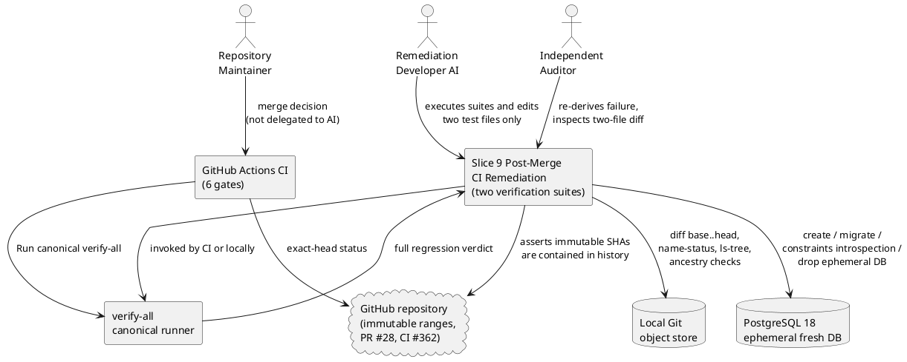
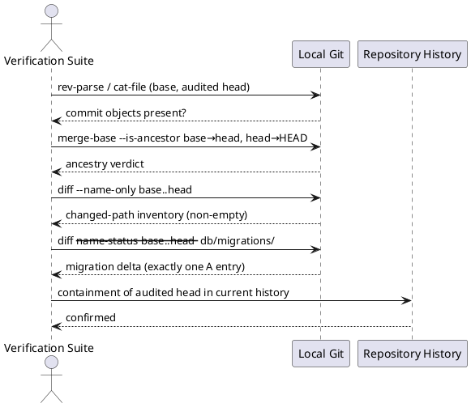
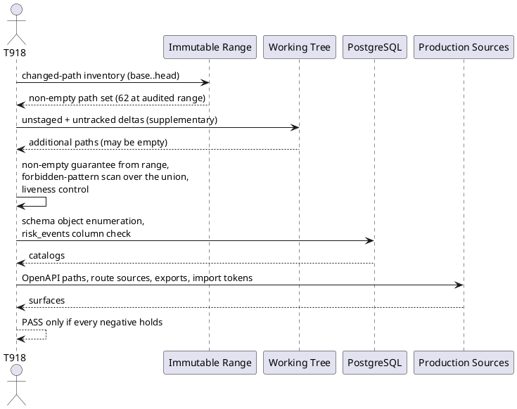
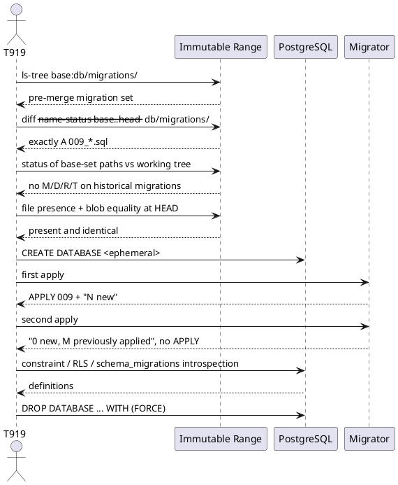
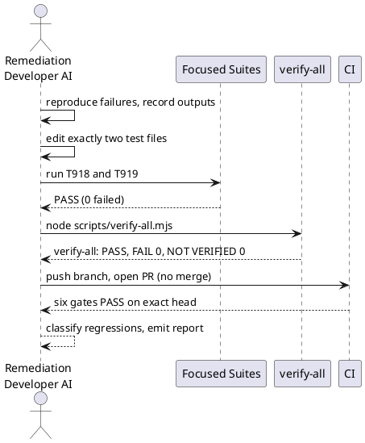
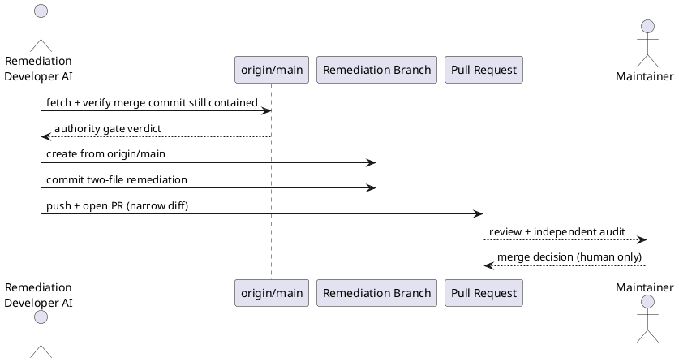

# Slice 9 Post-Merge CI Remediation — Requirements Specification

| Field | Value |
|---|---|
| Status | REQUIREMENTS READY FOR REVIEW |
| Artifact class | Verification-only remediation specification (no new product behavior) |
| Repository | `pyxm1618/xiaoshuyin` |
| Remediation branch (planned) | `remediation/slice9-post-merge-ci` |
| Original merge commit (PR #28) | `6fab0b79a942c5bf961a2201138ed02bf3197859` |
| Failed post-merge CI | `CI #362` — `Integration Tests` → `Run canonical verify-all` → `G1 全量测试套件` |
| Original Slice 9 pre-merge base | `8e393c990be53c888c2e68d881bd8b23f9c37638` |
| Final audited Slice 9 feature head | `7b4f5796ef1c6ac1126f9b7bb687293df8a8ceef` |
| Affected test files | `tests/integration/safety-scope-negative.test.ts` (T918), `tests/db/safety-migration-reconcile.test.ts` (T919) |
| Merged Slice 9 specification | `specs/009-safety-hold-control-foundation/spec.md` |

This document specifies **only** the correction of the verification context defect introduced by PR #28. It does not re-open Slice 9 selection, design, implementation, or audit.

---

## Upstream Traceability

This remediation introduces **no new product requirement**. Every requirement below is a projection of an already-approved Slice 9 obligation whose *evidence derivation* became invalid after the Slice 9 feature branch was merged into `main`. The product semantics are unchanged; only the way the same semantics are proven is corrected.

| Remediation requirement group | Upstream authority |
|---|---|
| `S9PM-FR-01` – `S9PM-FR-04` (immutable range authority) | Slice 9 spec §20 Scope Guardrails, §21 Clarifications; Slice 9 plan §§20, 24; tasks `T918`, `T919`, `T920`; `AGENTS.md` §4 Traceability Contract and §5 Verification Contract |
| `S9PM-FR-05` – `S9PM-FR-09` (T918 scope negatives) | Slice 9 `FR-001`, `FR-005`, `FR-011`, `FR-022`, `FR-023`, `FR-024`, `FR-026`; Slice 9 spec §20; Slice 9 plan §20 "Scope Guardrails"; acceptance scenario 22 / 23 / 24 |
| `S9PM-FR-10` – `S9PM-FR-17` (T919 migration reconciliation) | Slice 9 `FR-018`, `FR-019`, `FR-027`; V1技术设计 §§6.6, 6.7, 7.7, 8, 9 / 9.1, 23, 27.1, 27.3, 32, 38, 39, 41; V1产品需求 `V1-C24`, `V1-C25`, `V1-C27`, `V1-C28`, `V1-C34`, `V1-C35`; Slice 9 plan §16, §24; tasks `T903`, `T919` |
| `S9PM-FR-18` – `S9PM-FR-24` (evidence contract) | `AGENTS.md` §5 Verification Contract; Slice 9 task `T920` `[VERIFY: ... bun run verify-all ...]`; CI #362 evidence |
| `S9PM-FR-25` – `S9PM-FR-28` (delivery constraints) | `AGENTS.md` §2 Non-Negotiable Boundaries, §3 Required Delivery Workflow, §7 Change Control; remediation brief §十二 / §十八 / §二十一 |

**Traceability rule.** No requirement in this document may be satisfied by a change outside the two named test files. The remediation is a *re-derivation* of existing evidence, never a relaxation of it.

---

## Scope

This is a **verification-context remediation**, not a product slice.

### In Scope

1. `tests/integration/safety-scope-negative.test.ts` — replace the mutable `origin/main...HEAD` changed-path inventory with an **immutable historical Slice 9 range** inventory, while preserving every existing forbidden-path, forbidden-object, forbidden-route, forbidden-import and unique-entry/exit assertion.
2. `tests/db/safety-migration-reconcile.test.ts` — replace `origin/main`-relative migration-set equality and `origin/main`-relative migration diff with the **immutable historical Slice 9 range** delta, while preserving fresh-apply, second-apply-no-op, shared-CHECK-literal, RLS and migration-presence evidence.
3. Root-cause reproduction, focused execution, canonical `verify-all`, full regression, exact-head CI, and regression classification with real captured output.
4. One governed requirement artifact: this `spec.md`.

### Out of Scope

1. Any change to production runtime: `apps/**`, `packages/**`.
2. Any change to migrations: `db/migrations/**` (including `009_safety_hold_control_foundation.sql`).
3. Any change to `Docs/**`, `AGENTS.md`, `.specify/**`, `.github/**`, `scripts/**` (including `scripts/verify-all.mjs`), `package.json`, `bun.lock`.
4. Any modification of the existing Slice 9 delivery artifacts under `specs/009-safety-hold-control-foundation/`.
5. Re-running Selection, Specify, Plan, Audit 1 or Audit 2; re-implementing `EnterSafetyHold`, `ResolveRisk`, RLS, Drizzle transaction path, Risk Event, or Safety Guard.
6. Any change to CI gate thresholds, `verify-all` row set, coverage audit, or test counts.
7. Merging the remediation PR, or declaring Slice 9 closed.

### Prohibitions

1. **Prohibition — vacuous pass.** The remediation shall not convert the T918 inventory assertion into "empty inventory ⇒ PASS", nor guard the assertion behind a "if merged, skip" branch.
2. **Prohibition — assertion deletion.** No existing assertion, forbidden pattern, literal set, or required test case may be removed, renamed away, merged into a weaker case, marked `skip`/`todo`/`only`, or relaxed (no `toBeGreaterThanOrEqual` substitution for an exact set comparison, no `expect.anything()`).
3. **Prohibition — context sniffing as an escape hatch.** Branching behaviour based on "am I on a feature branch" or "does `HEAD` equal `origin/main`" is forbidden; both contexts must execute the *same* assertions against the *same* immutable evidence.
4. **Prohibition — gate weakening.** `scripts/verify-all.mjs`, CI workflow, and coverage audit are read-only inputs. Making the failure green by changing a gate is a STOP condition.
5. **Prohibition — third file.** If a third file appears technically necessary, the implementation shall stop and produce a written technical-necessity proof before any edit. Convenience is not necessity.

### Input Drift Statement

Authority Gate was re-checked against the real remote-tracking state before this specification was written:

- `origin/main` = `6fab0b79a942c5bf961a2201138ed02bf3197859` (`Merge pull request #28 from pyxm1618/feat/009-safety-hold-control-foundation`).
- `7b4f5796ef1c6ac1126f9b7bb687293df8a8ceef` is an ancestor of `origin/main` (it is the second commit of the merge history).
- `8e393c990be53c888c2e68d881bd8b23f9c37638` is an ancestor of `7b4f5796ef1c6ac1126f9b7bb687293df8a8ceef`.
- Historical range inventory: **62 changed paths**, non-empty, and **zero** matches against the T918 forbidden-path pattern set.
- Historical migration delta restricted to `db/migrations/`: exactly `A db/migrations/009_safety_hold_control_foundation.sql`.

**Input Drift: NONE** at specification time. The implementing agent shall re-verify with a real fetch and record any new `main` commit as Input Drift before editing.

---

## 1. Component Positioning

### 1.1 Core Responsibility

This verification component is responsible for proving Slice 9's scope and migration invariants against the immutable historical Slice 9 change range, achieving evidence that is equally strict before and after merge.

### 1.2 Core Inputs

1. **Git object database of the local clone** — the two immutable commits (pre-merge base, final audited feature head) and the current `HEAD`; supplied by the CI checkout (`fetch-depth: 0` in the Integration job) or by a full developer clone.
2. **Current working tree** — `db/migrations/*.sql` file listing and the tracked/untracked delta used for supplementary WIP scanning.
3. **PostgreSQL test database** — `TEST_ADMIN_DATABASE_URL` (create/drop the ephemeral fresh database) and `MIGRATION_DATABASE_URL` (run the real migrator).
4. **Migrator entry point** — `scripts/db-migrate.mjs`, invoked as a subprocess against the ephemeral database.
5. **Production surface under inspection (read-only)** — `packages/domain` exports, `packages/generated/openapi.json`, `apps/server/api/src/app.ts`, `apps/server/api/src/routes/*.ts`, and the `apps/**` / `packages/**` source tree.

### 1.3 Core Outputs

1. **Per-invariant verdicts** — PASS/FAIL for the historical inventory, forbidden-scope scan, migration delta, fresh apply, second apply, shared CHECK literals, RLS and presence checks.
2. **Machine-readable failure markers** — explicit, greppable failure text when the immutable range cannot be resolved or an ancestry precondition fails (never a silent PASS).
3. **Canonical regression evidence** — the `verify-all` log line set (`command PASS`, `command FAIL`, `NOT VERIFIED`, `provenance`, `verify-all: PASS|FAIL`) and the G1 suite totals.
4. **CI evidence** — six green gates on the exact remediation head, with the `Integration Tests` job running `Run canonical verify-all`.

### 1.4 Responsibility Boundaries

This component is **NOT** responsible for:

1. Deciding whether Slice 9's Safety behaviour is correct — that was Slice 9's audit scope, unchanged here.
2. Re-verifying historical slices (001–008) or the governance gate itself.
3. Preserving `origin/main` as a meaningful reference for Slice 9 evidence. `origin/main` is mutable; it is explicitly not an input to the required evidence.
4. Managing migration numbering policy for future slices. It only proves Slice 9's own numbering was legal at its own base.
5. Any runtime behaviour, schema, authorization, RLS or audit semantics.
6. Changing CI configuration to accommodate history depth — that is an environmental precondition recorded in §4.2, not a remediation deliverable.

---

## 2. Domain Terminology

**Immutable Slice 9 Range**
: The fixed commit pair `8e393c990be53c888c2e68d881bd8b23f9c37638` (pre-merge base) → `7b4f5796ef1c6ac1126f9b7bb687293df8a8ceef` (final audited feature head), whose diff is the authoritative statement of what Slice 9 itself changed.

**Slice 9 Pre-Merge Base**
: The `main` commit onto which the Slice 9 feature branch was created; the last `main` state that contains no Slice 9 change.

**Final Audited Feature Head**
: The last Slice 9 feature commit that completed the independent audits; it is contained in `origin/main` after PR #28.

**Post-Merge Context**
: The execution context in which `HEAD` equals the merge commit and therefore also equals `origin/main`, so any `origin/main…HEAD` comparison is empty by construction.

**Merge-Context Independence**
: The property that a verification's verdict is determined only by immutable inputs, so identical assertions yield identical verdicts on the feature branch, after merge, and after later legal `main` commits.

**Changed-Path Inventory**
: The set of repository-relative paths that the verification scans for forbidden scope; it must be derived from the immutable range and may be augmented with current working-tree deltas.

**Forbidden Path Pattern Set**
: The 16 case-insensitive regular expressions currently enforced by T918, covering `support_resources`, referrals, staff queue, operations dashboard, Guardrails, `risk_review`, Digital Use, node manifest, Goals, Interventions, Plans, Tasks, Reviews, Follow-up, Problem Formulations and `safety_states`.

**Migration Delta**
: The `--name-status` record set of the immutable range restricted to `db/migrations/`.

**Historical Migration Edit**
: Any modification (`M`), deletion (`D`), rename (`R`) or type change (`T`) applied to a migration file that already existed at the pre-merge base.

**Shared CHECK Literal**
: A value in a PostgreSQL `CHECK` constraint on `case_events`, `business_audit_events`, `idempotency_keys` or `risk_events` that a previous slice introduced and that Slice 9 must not remove.

**Fresh Apply**
: Running the real migrator against a newly created empty database and receiving an `APPLY` line for the Slice 9 migration plus `Migration complete: N new`.

**Second Apply No-Op**
: Re-running the real migrator against the same database and receiving `Migration complete: 0 new, M previously applied.` with no `APPLY` line.

**Gate Weakening**
: Any change that makes a failing gate pass without removing the underlying defect — including assertion removal, tolerance widening, skip markers, threshold edits, or CI reconfiguration.

**Test Context Defect**
: A defect in which a test's *assumption about the execution context* (here: "the branch is not merged yet") is false, while the behaviour under test remains correct.

**Vacuous Pass**
: A PASS produced because the evidence set was empty or the assertion was structurally unreachable, rather than because the invariant held.

---

## 3. Roles and Boundaries

### 3.1 Core Roles

1. **Remediation Developer AI**: executes the root-cause reproduction, edits exactly the two test files, runs focused tests, `verify-all`, and records evidence; does not re-implement, re-design or merge.
2. **Independent Auditor**: re-derives the failure, inspects the two-file diff, and confirms that no assertion was weakened and that the immutable range is the only delta authority.
3. **Repository Maintainer**: owns merge decisions, the `approved-docs-change` label rule, and the final Slice 9 closure decision.

### 3.2 External Systems

1. **GitHub repository `pyxm1618/xiaoshuyin`**: source of the immutable commits, the merge commit, PR #28 and CI #362.
2. **GitHub Actions CI**: runs the six gates; the `Integration Tests` job checks out with full history (`fetch-depth: 0`) and runs `Run canonical verify-all`.
3. **Local Git object store**: resolves the immutable SHAs and produces `diff` / `name-status` / `ls-tree` output used as evidence.
4. **PostgreSQL 18 test instance**: hosts the ephemeral fresh database used for migration reconciliation.
5. **Canonical regression runner `scripts/verify-all.mjs`**: emits the authoritative gate verdict; read-only for this remediation.

### 3.3 Interaction Context



---

## 4. DFX Constraints

### 4.1 Performance

1. Each suite shall add at most a fixed number of read-only `git` subprocess calls (target: no more than 6 per suite).
2. No new network call, no `git fetch`, no `git clone` inside a test body; the immutable range must already be present locally.
3. The two focused suites shall complete within the existing per-suite budgets (T919 already allows `120 000 ms` for DB-create and migrator cases); no budget increase is permitted.
4. `node scripts/verify-all.mjs` wall-clock shall remain within the existing 600 s per-command bound; no gate row may be added.

### 4.2 Reliability

1. **Determinism**: identical repository state shall produce identical verdicts across repeated runs.
2. **Fail-loud range resolution**: if either immutable SHA is unresolvable, or the ancestry preconditions fail, the suite shall fail with an explicit marker (`S9PM_RANGE_UNAVAILABLE`, `S9PM_RANGE_NOT_ANCESTOR`, `S9PM_RANGE_EMPTY`). Silent skip or empty PASS is prohibited.
3. **History-depth precondition**: the Integration job already checks out with `fetch-depth: 0`; therefore no CI change is required. A shallow clone must surface `S9PM_RANGE_UNAVAILABLE`, never a false PASS.
4. **DB isolation**: T919 shall keep creating a uniquely named ephemeral database and dropping it with `WITH (FORCE)` in `afterAll`, including on failure.
5. **No reliance on branch name, upstream ref, or tree cleanliness** for the required evidence. `origin/main` is not an input to any required assertion.

### 4.3 Security

1. All git access is read-only (`diff`, `name-status`, `ls-tree`, `rev-parse`, `cat-file`, `merge-base`). No worktree mutation, no checkout, no reset.
2. No secret, connection string or credential may be printed in output or failure messages.
3. Admin database credentials are used only to create and drop the suite's own ephemeral database; RLS and role assumptions of the product are never bypassed to make an assertion pass.
4. The scope scans must not read or copy raw user content; they read file paths, source text and schema metadata only.

### 4.4 Maintainability

1. The two SHAs shall be declared once per file as named constants (e.g. `SLICE9_PRE_MERGE_BASE_SHA`, `SLICE9_AUDITED_FEATURE_HEAD_SHA`); no magic string repetition inside assertions.
2. A shared helper module is **not** permitted (it would be a third file). Small duplicated local `git()` helpers are the compliant choice; the duplicated surface is limited to the SHA pair and one wrapper.
3. Failure messages shall be actionable and carry the offending path or status string.
4. Test titles shall name the immutable range so a future reader does not re-interpret them as "current main vs HEAD".

### 4.5 Compatibility

1. **Pre-merge**: `HEAD == 7b4f5796…` (or a descendant feature commit) ⇒ both suites PASS.
2. **Post-merge**: `HEAD == 6fab0b79…` (or a later legal `main` commit) ⇒ both suites PASS.
3. **Future main**: a later legal slice adding `db/migrations/010_*.sql` ⇒ both suites still PASS. No assertion may require the current `main` migration set to equal `base set + 009`.
4. The suites shall remain runnable in a full local clone without any remote-tracking ref named `origin/main`.

---

## 5. Core Capabilities

### 5.1 Immutable Historical Range Authority

#### 5.1.1 Business Rules

1. **S9PM-FR-01 — Immutable range is the sole delta authority.**
   Every statement of the form "Slice 9 changed X" shall be derived from `git diff` / `git diff --name-status` / `git ls-tree` over `8e393c990be53c888c2e68d881bd8b23f9c37638..7b4f5796ef1c6ac1126f9b7bb687293df8a8ceef`.
   a. Acceptance criteria: When the suite runs in post-merge context (`HEAD` equals the merge commit and `origin/main`), the changed-path inventory and the migration delta shall be byte-identical to the values obtained on the Slice 9 feature branch.

2. **S9PM-FR-02 — Range resolvability and ancestry preconditions.**
   Before evidence is used, the suite shall assert that both SHAs resolve to commit objects, that the base is an ancestor of the audited head, and that the audited head is an ancestor of `HEAD`.
   a. Acceptance criteria: When any of these preconditions fails, the suite shall fail with `S9PM_RANGE_UNAVAILABLE` or `S9PM_RANGE_NOT_ANCESTOR`.
   b. Acceptance criteria: When the audited head is a strict ancestor of `HEAD` (post-merge), the ancestry check shall still pass.

3. **S9PM-FR-03 — Merge-context independence.**
   The required evidence shall not depend on `origin/main…HEAD`, on `origin/main` at all, on the current branch name, on whether `HEAD` equals `origin/main`, or on working-tree cleanliness.
   a. Acceptance criteria: While `HEAD` equals `origin/main` and the tree is clean, both suites shall execute all assertions and PASS.
   b. Acceptance criteria: While `HEAD` is the audited feature head on a feature branch, the same assertions shall PASS.

4. **S9PM-FR-04 — No vacuous pass, no context escape hatch.**
   The suite shall not treat an empty current-context diff as sufficient evidence, and shall not branch its assertion set by execution context.
   a. Acceptance criteria: When the historical inventory resolves to zero paths, the suite shall fail with `S9PM_RANGE_EMPTY`; the PASS path is unreachable with empty evidence.
   b. Acceptance criteria: When the two suites are compared, they shall contain no `if (merged)`, `skipIf`, `describe.skip` or environment-based assertion selector.

#### 5.1.2 Interaction Flow



#### 5.1.3 Exception Scenarios

1. **Range Objects Missing (shallow clone)**
   a. Trigger condition: one of the two immutable SHAs is unresolvable locally.
   b. System behaviour: abort before any assertion that consumes the range; emit `S9PM_RANGE_UNAVAILABLE`.
   c. User perception: a failing test naming the missing SHA and the required fetch depth; CI is red, never falsely green.
2. **Ancestry Violation (rewritten history)**
   a. Trigger condition: base is not an ancestor of the audited head, or the audited head is not an ancestor of `HEAD`.
   b. System behaviour: abort; emit `S9PM_RANGE_NOT_ANCESTOR` with both endpoints.
   c. User perception: failing test naming the violated edge.
3. **Empty Historical Range**
   a. Trigger condition: the range resolves but yields zero changed paths.
   b. System behaviour: fail with `S9PM_RANGE_EMPTY`.
   c. User perception: failing test; this is a hard STOP for the remediation, not a reason to relax.

### 5.2 T918 — Executable Scope Negatives on the Immutable Range

#### 5.2.1 Business Rules

1. **S9PM-FR-05 — Non-empty historical inventory with known Slice 9 content.**
   The changed-path inventory shall be non-empty **and** shall contain at least the Slice 9 migration path and at least one Slice 9 production source path from the audited range.
   a. Acceptance criteria: When the inventory is computed, its length shall be greater than zero (measured value at the audited range: 62) and it shall contain `db/migrations/009_safety_hold_control_foundation.sql` and at least one path under `packages/domain/src/safety/`.
   b. Acceptance criteria: When the range is replaced with a synthetic empty set, the assertion shall fail.

2. **S9PM-FR-06 — Forbidden path pattern set preserved verbatim.**
   The 16 case-insensitive patterns shall remain exactly as currently enforced, covering: `support_resources`, `referrals`, `staff queue`/assignment/account, `operations dashboard`, `Guardrails`, `risk_review`, Digital Use, node manifest, Goals, Interventions, Plans, Tasks, Reviews, Follow-up, Problem Formulations, `safety_states`.
   a. Acceptance criteria: When a path matching any one of the 16 patterns is appended to the inventory, the suite shall FAIL naming that path.
   b. Acceptance criteria: When an in-scope Slice 9 path (e.g. `packages/domain/src/safety/guard.ts`) is scanned, it shall not match any pattern.

3. **S9PM-FR-07 — Zero forbidden matches over Slice 9's own changes.**
   a. Acceptance criteria: When the historical inventory is scanned, zero paths shall match the forbidden set (verified real value at the audited range: zero).
   b. Acceptance criteria: Current working-tree deltas (unstaged modifications, untracked files) may **augment** the scanned set for WIP safety, but shall not be the source of the non-empty guarantee, and shall also be scanned for forbidden paths when present.

4. **S9PM-FR-08 — All other T918 invariants preserved unchanged.**
   The following assertions shall retain their exact semantics and coverage: no forbidden database object (`safety_states`, `support_resources`, `referrals`, `staff_queue`, `risk_reviews`, `goals`, `intervention_instances`, `plan_versions`, `tasks`, `reviews`, `problem_formulations`, `scene_node_states`), `risk_events` present, no current-state column on `risk_events` (`current_status`, `current_state`, `is_held`, `active`), no public Safety mutation route or OpenAPI path, controlled resolver absent from the production export graph, no AI/RAG/Guardrails/referral dependency, exactly one formal entry and one formal exit (`enter-safety-hold.ts`, `resolve-risk.ts`, `case-transition.ts`), and the S9-H01 generic Case status writer containment.
   a. Acceptance criteria: When the remediation diff is reviewed, the only changed lines in T918 shall be those that construct the inventory and assert its non-emptiness.

5. **S9PM-FR-09 — Matcher liveness (anti-vacuous).**
   The forbidden-path scan shall be proven active, not merely present.
   a. Acceptance criteria: When a known-forbidden path string is injected into the inventory, at least one pattern shall reject it (control assertion), so a silently-non-matching regex cannot produce a green suite.

#### 5.2.2 Interaction Flow



#### 5.2.3 Exception Scenarios

1. **Forbidden Path Appears in Historical Range**
   a. Trigger condition: any of the 16 patterns matches a historical path.
   b. System behaviour: fail immediately, naming the first offending path.
   c. User perception: failing assertion `forbidden path changed: <path>`; this means Slice 9's scope claim is false and the remediation must STOP.
2. **Inventory Empty After Refactor**
   a. Trigger condition: inventory construction returns zero paths in a resolvable range.
   b. System behaviour: fail with `S9PM_RANGE_EMPTY` (see `S9PM-FR-04`), never PASS.
   c. User perception: red suite with the marker; no "if merged then skip" path exists.

### 5.3 T919 — Migration Reconciliation on the Immutable Range

#### 5.3.1 Business Rules

1. **S9PM-FR-10 — Historical migration delta is exactly one addition.**
   `git diff --name-status <base>..<audited head> -- db/migrations/` shall yield exactly one record: `A db/migrations/009_safety_hold_control_foundation.sql`.
   a. Acceptance criteria: When the delta is computed post-merge, the result shall be exactly that single `A` record (not empty, as `origin/main`-relative comparison produces).
   b. Acceptance criteria: When the delta contains any `M`, `D`, `R` or `T` record, the suite shall FAIL.

2. **S9PM-FR-11 — No historical migration edit, historically or in the working tree.**
   No migration file that existed at the pre-merge base may show `M`/`D`/`R`/`T` — neither inside the immutable range nor when the current working tree is compared against that base.
   a. Acceptance criteria: When the tree is clean and merged, zero base-set migrations shall be modified or deleted.
   b. Acceptance criteria: When a simulated edit to `db/migrations/007_case_primary_switch.sql` is introduced in the working tree, the suite shall FAIL.
   c. Acceptance criteria: When a future legal slice adds `db/migrations/010_*.sql`, the suite shall PASS (the addition is a new path, not an edit of a base-set path).

3. **S9PM-FR-12 — Slice 9 migration exists in the final repository.**
   `db/migrations/009_safety_hold_control_foundation.sql` shall exist in the final repository tree, and its content at the audited head shall equal its content at `HEAD`.
   a. Acceptance criteria: When file existence is checked at `HEAD` post-merge, it shall be present.
   b. Acceptance criteria: When the audited-head blob and the `HEAD` blob are compared, they shall be identical (no post-audit silent edit).

4. **S9PM-FR-13 — Fresh apply reproduces the full schema.**
   On a newly created empty database, the real migrator shall apply every migration, emit `APPLY` for the Slice 9 file, and end with `Migration complete: N new`.
   a. Acceptance criteria: When the fresh database is migrated, the output shall contain `APPLY 009_safety_hold_control_foundation.sql` and a positive `N`.

5. **S9PM-FR-14 — Second apply is a no-op.**
   a. Acceptance criteria: When the migrator runs a second time on the same database, output shall match `Migration complete: 0 new, <M> previously applied.` and shall contain no `APPLY`.

6. **S9PM-FR-15 — Shared CHECK literals, RLS and migration registry preserved.**
   For `case_events_event_type_check`: `CASE_CREATED`, `CASE_PRIMARY_ASSIGNED`, `CASE_PRIMARY_REVOKED`, `CASE_SAFETY_HOLD_ENTERED`, `CASE_RISK_RESOLVED`. For `business_audit_events_event_type_check`: `CASE_PRIMARY_SWITCHED`, `CASE_SAFETY_HOLD_ENTERED`, `CASE_RISK_RESOLVED`, `PARTICIPATION_WITHDRAWN`, `OBSERVATION_RECORDED`. For `idempotency_keys_command_type_check`: `CASE_SWITCH_PRIMARY`, `CASE_ENTER_SAFETY_HOLD`, `CASE_RESOLVE_RISK`, `PARTICIPATION_WITHDRAW`, `CASE_MESSAGE_CREATE`. For `risk_events_shape_check`: `HOLD_ENTERED`. Additionally `risk_events` exists, has `relrowsecurity` and `relforcerowsecurity` both true, and `schema_migrations` contains the Slice 9 filename.
   a. Acceptance criteria: When the fresh schema is inspected, every listed literal shall be present in its constraint definition and every object/RLS assertion shall hold.
   b. Acceptance criteria: When any single literal is removed, the suite shall FAIL naming that constraint.

7. **S9PM-FR-16 — Migration prefix adjacency recomputed from the pre-merge base, never assumed.**
   The Slice 9 `009` prefix shall be compared against the migration set that existed at the pre-merge base: the prefix shall not reuse an existing number, and shall be within the existing tolerance of at most one unused prefix (measured: base highest prefix is `007`, gap of 2 because `008` was reserved by the unmerged Slice 8 branch).
   a. Acceptance criteria: When the delta is recomputed post-merge (where `main` already contains `009`), the computed adjacency shall still be evaluated against the base set and PASS.
   b. Acceptance criteria: When the prefix equals an existing base prefix, the suite shall FAIL.

8. **S9PM-FR-17 — Future-slice tolerance.**
   No assertion may require "current `main` migration set == base set + 009".
   a. Acceptance criteria: When a synthetic `010_*.sql` is present in `main` and the working tree, every T919 assertion shall still PASS.
   b. Acceptance criteria: When the suite compares migration sets, the comparison shall be against the immutable base tree (`git ls-tree <base> db/migrations/`), not against `origin/main`.

#### 5.3.2 Interaction Flow



#### 5.3.3 Exception Scenarios

1. **Migration Delta Empty (post-merge `origin/main` comparison)**
   a. Trigger condition: the delta is derived from `origin/main` after merge.
   b. System behaviour: this derivation is removed; if it were retained it would yield `[]` and fail the exact-delta assertion.
   c. User perception: the defect this remediation removes — not a migration defect.
2. **Historical Migration Modified**
   a. Trigger condition: an `M`/`D`/`R`/`T` record is present for a base-set migration.
   b. System behaviour: fail naming the path and status.
   c. User perception: red suite; a real migration-contract violation, distinct from the context defect.
3. **Fresh Apply Fails**
   a. Trigger condition: migrator exits non-zero or omits `APPLY 009`.
   b. System behaviour: fail with captured migrator stdout/stderr; still drop the ephemeral database.
   c. User perception: real migration runtime regression signal.
4. **Database Unavailable**
   a. Trigger condition: admin connection or database creation fails.
   b. System behaviour: fail in `beforeAll` within the existing timeout; do not fall back to a weaker assertion set.
   c. User perception: infrastructure failure, explicitly distinguishable from an invariant failure.

### 5.4 Evidence and Verification Contract

#### 5.4.1 Business Rules

1. **S9PM-FR-18 — Root cause reproduced and recorded before the fix.**
   a. Acceptance criteria: When the failure is reproduced, the record shall show: T918 `changed.length = 0`; T919 `added = []`; T919 `git diff/status` against `origin/main` = empty — each attributable to PR #28 being merged into the current `main`.
2. **S9PM-FR-19 — Focused suites pass.**
   a. Acceptance criteria: When `bunx vitest run tests/integration/safety-scope-negative.test.ts` and `bunx vitest run tests/db/safety-migration-reconcile.test.ts` are executed, both shall PASS with zero failed tests.
3. **S9PM-FR-20 — Canonical `verify-all` passes.**
   a. Acceptance criteria: When `node scripts/verify-all.mjs` runs, the summary shall report `command FAIL: 0`, `NOT VERIFIED: 0`, `provenance: PASS`, `verify-all: PASS`.
4. **S9PM-FR-21 — Full regression passes with real counts.**
   a. Acceptance criteria: When the G1 suite completes, the reported file/test totals shall be taken from real output with zero failures (baseline at the failing run: 231 files / 1397 tests; the remediation report shall cite the actual observed totals, not the baseline).
5. **S9PM-FR-22 — Exact-head CI is green on all six gates.**
   a. Acceptance criteria: When CI runs on the exact remediation head, `Spec Governance`, `Static Checks`, `Unit Tests`, `Integration Tests`, `DB Migration` and `Contract` shall all PASS, and `Integration Tests` shall include `Run canonical verify-all`.
6. **S9PM-FR-23 — Regression classification is evidence-based.**
   a. Acceptance criteria: The report shall state `Production Runtime Regression: NO`, `Migration Runtime Regression: NO`, `Test Context Defect: YES`, each supported by the reproduced outputs and the unchanged production/migration diff (zero files).
7. **S9PM-FR-24 — No weakening of any gate or assertion.**
   a. Acceptance criteria: When the remediation diff is reviewed, it shall contain zero deletions of assertions, zero `skip`/`only`/`todo`, zero tolerance widening, zero change to `scripts/verify-all.mjs`, `.github/**`, or coverage-audit thresholds.

#### 5.4.2 Interaction Flow



#### 5.4.3 Exception Scenarios

1. **`verify-all` Fails on an Unrelated Row**
   a. Trigger condition: a non-Slice-9 row fails in canonical regression.
   b. System behaviour: STOP; do not modify the row, the gate or its threshold.
   c. User perception: report FAIL with the exact row and captured output; BLOCKED, not PASS.
2. **CI Cannot Reach the Exact Head**
   a. Trigger condition: CI is queued, cancelled, or runs on a non-exact SHA.
   b. System behaviour: report `IN PROGRESS` or `FAIL`; never claim PASS.
   c. User perception: report status matches reality.

### 5.5 Delivery Constraints

#### 5.5.1 Business Rules

1. **S9PM-FR-25 — Change surface limited to the two test files.**
   a. Acceptance criteria: When the remediation PR diff is inspected, it shall contain exactly `tests/integration/safety-scope-negative.test.ts` and `tests/db/safety-migration-reconcile.test.ts`, plus at most this specification artifact, which must be explicitly declared in the PR description.
   b. Acceptance criteria: When a third implementation file is required, the agent shall stop and produce a written technical-necessity proof before editing.
2. **S9PM-FR-26 — Protected surfaces untouched.**
   a. Acceptance criteria: When the diff is inspected, it shall contain zero changes under `apps/**`, `packages/**`, `db/migrations/**`, `Docs/**`, `scripts/**`, `.github/**`, `package.json`, `bun.lock`, and zero modification of `specs/009-safety-hold-control-foundation/**`.
3. **S9PM-FR-27 — Branch and PR discipline.**
   a. Acceptance criteria: When the work starts, the branch shall be created from the latest `origin/main`; no commit is made to `main`; the PR is opened and left unmerged.
4. **S9PM-FR-28 — Status claim boundary.**
   a. Acceptance criteria: When the work completes, the only permitted status claims are `POST-MERGE CI REMEDIATION COMPLETE` and `READY FOR TARGETED INDEPENDENT AUDIT`; `Slice 9 CLOSED` and any merge claim are prohibited.
   b. Acceptance criteria: The final report shall use the fixed template fields (merge commit, remediation branch/head/PR, authority gate, root cause, three regression classifications, changed files, production/migration/specs-docs counts, T918/T919, historical range, non-empty paths, 009 proof, historical migration edits, focused tests, `verify-all`, full regression, exact-head CI, scope drift, final status).

#### 5.5.2 Interaction Flow



#### 5.5.3 Exception Scenarios

1. **`main` Advanced Since the Merge Commit**
   a. Trigger condition: `origin/main` contains commits after `6fab0b79…`.
   b. System behaviour: record Input Drift; re-run both suites locally; if the drift is unrelated and the immutable range is unaffected, continue; otherwise STOP and report.
   c. User perception: Input Drift recorded in the report with the new `main` SHA.
2. **Remediation Diff Exceeds Two Files**
   a. Trigger condition: any third file in the diff.
   b. System behaviour: STOP; produce justification and require an explicit audit decision.
   c. User perception: PR marked BLOCKED pending justification.

---

## 6. Data Constraints

### 6.1 Immutable Slice 9 Range

1. **`slice9_pre_merge_base_sha`**: exactly `8e393c990be53c888c2e68d881bd8b23f9c37638`; must resolve to a commit; must be an ancestor of the audited head.
2. **`slice9_audited_feature_head_sha`**: exactly `7b4f5796ef1c6ac1126f9b7bb687293df8a8ceef`; must resolve to a commit; must be an ancestor of `HEAD`.
3. **`historical_changed_path_count`**: strictly greater than zero; measured 62 at the audited range; must include the Slice 9 migration and at least one `packages/domain/src/safety/` path.
4. **`origin_main`**: explicitly not an evidence input; its value must not affect any required verdict.

### 6.2 Forbidden Path Pattern Set

1. **Pattern count**: exactly 16; the set is closed for this remediation and shall not be reduced.
2. **`support_resources`**: any path segment matching `support_resources` / `support-resource` / `support_resource`.
3. **`referrals`**: any path segment matching `referral`.
4. **`staff queue`**: any path segment matching `staff_queue` / `staff-queue` / `staff_assignment` / `staff_account`.
5. **`operations dashboard`**: any path segment matching `operations_dashboard` / `operations-dashboard`.
6. **`Guardrails`**: any path segment matching `guardrail`.
7. **`risk_review`**: any path segment matching `risk_review` / `risk-review`.
8. **`Digital Use`**: any path segment matching `digital_use` / `digital-use`.
9. **`node manifest`**: any path segment matching `node_manifest` / `node-manifest`.
10. **`Goals`**: a path ending in `goal.ts` / `goals.ts` / `goal.sql` / `goals.sql`.
11. **`Interventions`**: a path ending in `intervention(s).ts|sql`.
12. **`Plans`**: a path ending in `plan(s).ts|sql`.
13. **`Tasks`**: a path ending in `task(s).ts|sql`.
14. **`Reviews`**: a path ending in `review(s).ts|sql`.
15. **`Follow-up`**: any path segment matching `follow_up` / `follow-up`.
16. **`Problem Formulations`**: a path ending in `problem_formulation(s).ts|sql`.
17. **`safety_states`**: any path segment matching `safety_state` / `safety-states`.

### 6.3 Migration Delta Record

1. **`delta_path`**: exactly `db/migrations/009_safety_hold_control_foundation.sql`.
2. **`delta_status`**: exactly `A` (added).
3. **`delta_cardinality`**: exactly 1 record over the immutable range restricted to `db/migrations/`.
4. **`historical_edit_count`**: exactly 0 — zero `M`/`D`/`R`/`T` records for any path in the pre-merge base migration set, both inside the immutable range and when comparing the current working tree against that base.

### 6.4 Slice 9 Migration Identity

1. **`filename`**: exactly `009_safety_hold_control_foundation.sql`.
2. **`numeric_prefix`**: `009`; must not equal any prefix present in the pre-merge base migration set; must be at most two greater than the base set's highest prefix (measured base highest: `007`).
3. **`presence_at_head`**: the file must exist in the tree at `HEAD`.
4. **`blob_equality`**: the blob at the audited head must equal the blob at `HEAD`.
5. **`apply_semantics`**: applies exactly once per database and is idempotent on re-apply, as reported by the real migrator.

### 6.5 Shared CHECK Literal Sets

1. **`case_events_event_type_check`**: must contain `CASE_CREATED`, `CASE_PRIMARY_ASSIGNED`, `CASE_PRIMARY_REVOKED`, `CASE_SAFETY_HOLD_ENTERED`, `CASE_RISK_RESOLVED`.
2. **`business_audit_events_event_type_check`**: must contain `CASE_PRIMARY_SWITCHED`, `CASE_SAFETY_HOLD_ENTERED`, `CASE_RISK_RESOLVED`, `PARTICIPATION_WITHDRAWN`, `OBSERVATION_RECORDED`.
3. **`idempotency_keys_command_type_check`**: must contain `CASE_SWITCH_PRIMARY`, `CASE_ENTER_SAFETY_HOLD`, `CASE_RESOLVE_RISK`, `PARTICIPATION_WITHDRAW`, `CASE_MESSAGE_CREATE`.
4. **`risk_events_shape_check`**: must contain `HOLD_ENTERED`.
5. **`risk_events`**: exactly one table; `relrowsecurity = true`; `relforcerowsecurity = true`.
6. **`schema_migrations`**: must contain `009_safety_hold_control_foundation.sql`.

---

## Acceptance Scenarios

1. **Post-merge context (the failing context).**
   Given `HEAD` equals `6fab0b79a942c5bf961a2201138ed02bf3197859`, the tracked tree is clean, and `origin/main` equals `HEAD`, when both suites run, then T918 and T919 shall PASS with the same assertion set used pre-merge.

2. **Pre-merge feature context (regression of intent).**
   Given `HEAD` equals `7b4f5796ef1c6ac1126f9b7bb687293df8a8ceef` on a feature branch, when both suites run, then they shall PASS.

3. **Future-main context (durability).**
   Given a later legal `main` containing an additional `db/migrations/010_*.sql`, when both suites run, then they shall PASS and no assertion shall compare the current `main` migration set to `base set + 009`.

4. **Historical inventory non-empty.**
   Given the immutable range, when the inventory is computed, then `changedPaths.length` shall be greater than zero (measured: 62) and shall include the Slice 9 migration path.

5. **Forbidden-scope scan is live.**
   Given the 16 preserved patterns, when a path matching any one of them is injected into the inventory, then the suite shall FAIL naming that path.

6. **Slice 9 historical range is clean.**
   Given the immutable range, when every path is scanned, then zero paths shall match the forbidden set.

7. **Migration delta is exact.**
   Given the immutable range, when `name-status` is restricted to `db/migrations/`, then the result shall be exactly `A db/migrations/009_safety_hold_control_foundation.sql`.

8. **Historical migration edits are detected.**
   Given any `M`/`D`/`R`/`T` record on a pre-merge-base migration, inside the range or in the working tree, when the suite runs, then it shall FAIL naming the path and status.

9. **Slice 9 migration is present in the final repository.**
   Given the merged tree, when presence and blob identity are checked, then the file shall exist at `HEAD` and match the audited-head blob.

10. **Fresh apply and second apply.**
    Given an empty ephemeral database, when the migrator runs twice, then the first run shall apply `009` with a positive new count and the second run shall report `0 new` with no `APPLY`.

11. **Shared CHECK literals.**
    Given the fresh schema, when the four constraints are inspected, then every listed literal shall be present, `risk_events` shall exist with forced RLS, and `schema_migrations` shall contain `009`.

12. **Range unavailable fails loudly.**
    Given a shallow clone missing the immutable commits, when the suite runs, then it shall FAIL with `S9PM_RANGE_UNAVAILABLE` and shall not PASS.

13. **Empty-inventory short-circuit rejected.**
    Given a synthetic empty inventory, when the suite runs, then it shall FAIL with `S9PM_RANGE_EMPTY`; no context branch may convert emptiness into PASS.

14. **No production or migration change.**
    Given the remediation diff, when it is inspected, then production files changed = 0, migration files changed = 0, `Docs`/`specs/009` changed = 0.

15. **Canonical regression.**
    Given the remediated head, when `node scripts/verify-all.mjs` runs, then the summary shall report `command FAIL: 0`, `NOT VERIFIED: 0`, `verify-all: PASS`.

16. **Exact-head CI.**
    Given the remediation PR, when CI completes on the exact head, then all six gates shall PASS.

17. **Claim boundary.**
    Given the completed remediation, when the report is issued, then it shall declare `POST-MERGE CI REMEDIATION COMPLETE` and `READY FOR TARGETED INDEPENDENT AUDIT` only, with `Test Context Defect: YES`, and shall not merge the PR nor declare Slice 9 closed.

---

## Acceptance Evidence

| Requirement | Evidence | Derivation | PASS condition |
|---|---|---|---|
| `S9PM-FR-01`, `03` | Post-merge and pre-merge suite runs | `bunx vitest run tests/integration/safety-scope-negative.test.ts`, `bunx vitest run tests/db/safety-migration-reconcile.test.ts` executed once on the audited feature head and once on the merge/current `main` head | Both contexts PASS with an identical assertion set |
| `S9PM-FR-02`, `04` | Failure markers | Unit-level negative control: unresolvable / non-ancestor / empty range | Explicit `S9PM_RANGE_*` failure, never PASS |
| `S9PM-FR-05` | Historical inventory | `git diff --name-only 8e393c…..7b4f…` | 62 paths (measured), non-empty, contains `009_*.sql` and a `packages/domain/src/safety/` path |
| `S9PM-FR-06`, `09` | Matcher liveness | Diff review plus injected-path control | 16 patterns intact; at least one negative control rejects |
| `S9PM-FR-07` | Forbidden scan | `rg` over the historical inventory with the pattern set | Zero matches |
| `S9PM-FR-08` | T918 diff review | `git diff origin/main -- tests/integration/safety-scope-negative.test.ts` | Only inventory construction and non-emptiness lines modified |
| `S9PM-FR-10` | Migration delta | `git diff --name-status 8e393c…..7b4f… -- db/migrations/` | Exactly `A db/migrations/009_safety_hold_control_foundation.sql` |
| `S9PM-FR-11` | No historical edit | Suite assertion plus simulated edit control | Clean tree PASS; simulated `007` edit FAIL; future `010` PASS |
| `S9PM-FR-12` | Presence and blob | `git cat-file` on both trees | Present; identical blob |
| `S9PM-FR-13`, `14` | Migrator output | Real two-run migrator output captured in the suite | `APPLY 009` + `N new`; then `0 new` |
| `S9PM-FR-15` | Constraint introspection | `pg_constraint` / `pg_class` / `schema_migrations` queries | All literals and objects present; RLS forced |
| `S9PM-FR-16`, `17` | Prefix adjacency and future tolerance | Base `ls-tree` recomputation; synthetic `010` control | Delta `2` against base highest `007`; future `010` does not fail |
| `S9PM-FR-18` | Root cause record | Captured pre-fix outputs | `changed.length = 0`; `added = []`; `status = []` |
| `S9PM-FR-19` | Focused suites | The two `bunx vitest run` commands | 0 failed |
| `S9PM-FR-20`, `21` | Canonical regression | `node scripts/verify-all.mjs` output | `verify-all: PASS`; FAIL 0; NOT VERIFIED 0; G1 totals with 0 failed |
| `S9PM-FR-22` | CI | Exact-head PR checks | Six gates PASS on the exact head |
| `S9PM-FR-23` | Classification | Diff counts plus reproduced outputs | Production 0, migration 0, test context YES |
| `S9PM-FR-24` | No weakening | Diff review of deleted lines and markers | Zero assertion deletions, zero skip/only, zero gate edits |
| `S9PM-FR-25`, `26` | Change surface | `git diff --name-only origin/main...HEAD` | 2 test files (+ declared spec artifact); zero protected paths |
| `S9PM-FR-27`, `28` | Process | Branch, PR and final report | Branch from latest `origin/main`; PR unmerged; fixed report template with the two permitted status claims |

### Required Verification Commands

```text
bunx vitest run tests/integration/safety-scope-negative.test.ts
bunx vitest run tests/db/safety-migration-reconcile.test.ts
node scripts/verify-all.mjs
```

Optional, non-authoritative reproduction aids (must not substitute for the three commands above):

```text
git diff --name-only 8e393c990be53c888c2e68d881bd8b23f9c37638..7b4f5796ef1c6ac1126f9b7bb687293df8a8ceef | wc -l
git diff --name-status 8e393c990be53c888c2e68d881bd8b23f9c37638..7b4f5796ef1c6ac1126f9b7bb687293df8a8ceef -- db/migrations/
git diff --name-only origin/main...HEAD | wc -l   # expected 0 post-merge: the defect, not evidence
```

---

## Traceability Matrix

| Requirement | Slice 9 FR / upstream | Task | Primary evidence |
|---|---|---|---|
| `S9PM-FR-01` | §20 Scope Guardrails; plan §20 | T918, T919 | Post-merge inventory equality |
| `S9PM-FR-02` | `AGENTS.md` §5 | T918, T919 | Ancestry preconditions + markers |
| `S9PM-FR-03` | `AGENTS.md` §5; task T920 | T918, T919 | Pre/post-merge identical verdicts |
| `S9PM-FR-04` | Slice 9 spec §20 | T918 | `S9PM_RANGE_EMPTY` control |
| `S9PM-FR-05` | `FR-001`, `FR-024` | T903, T918 | Non-empty inventory with known paths |
| `S9PM-FR-06` | `FR-024`; plan §20 | T918 | 16 preserved patterns + liveness |
| `S9PM-FR-07` | `FR-024`, `FR-026` | T918, T920 | Zero forbidden matches |
| `S9PM-FR-08` | `FR-001`, `FR-005`, `FR-011`, `FR-022`, `FR-023` | T918 | Diff review: other assertions untouched |
| `S9PM-FR-09` | plan §20 mechanical negatives | T918 | Injected-path control |
| `S9PM-FR-10` | `FR-018`, `FR-027` | T903, T919 | Exact `A` delta |
| `S9PM-FR-11` | plan §16, §24 migration reconciliation | T919 | Historical + working-tree edit detection |
| `S9PM-FR-12` | `FR-016`, `FR-018` | T919 | Presence + blob equality |
| `S9PM-FR-13` | `FR-027`; V1技术设计 §23 | T919 | Fresh apply output |
| `S9PM-FR-14` | `FR-019` | T919 | `0 new` second apply |
| `S9PM-FR-15` | `FR-001`, `FR-018`; V1技术设计 §6.7 | T918, T919 | Constraint/RLS introspection |
| `S9PM-FR-16` | plan §16 integration metadata rule | T919 | Prefix adjacency vs base |
| `S9PM-FR-17` | Slice 9 plan §16, §21 sequence | T919 | Synthetic `010` tolerance |
| `S9PM-FR-18` | CI #362 evidence | T920 | Reproduced outputs |
| `S9PM-FR-19` | task T920 `[VERIFY]` | T920 | Focused suites |
| `S9PM-FR-20`, `21` | task T920 `[VERIFY: bun run verify-all]` | T920 | Canonical log |
| `S9PM-FR-22` | `AGENTS.md` §3 step 11 | T920 | Exact-head CI |
| `S9PM-FR-23` | `AGENTS.md` §5 | T920 | Classification |
| `S9PM-FR-24` | `AGENTS.md` §2 | T920 | No-weakening diff review |
| `S9PM-FR-25`, `26` | `AGENTS.md` §7 change control; brief §十二 | T920 | Change-surface diff |
| `S9PM-FR-27`, `28` | `AGENTS.md` §3; brief §十八 / §二十一 | T920 | Branch/PR/report |

---

## Open Decisions

1. **Specification artifact in the remediation PR.** This `spec.md` is a governed requirement artifact produced before implementation. Committing it makes the PR diff three files, which must be declared in the PR description; the two implementation files remain the only code change. Any further file requires the technical-necessity proof described in `S9PM-FR-25`.
2. **Exact historical path count.** 62 is the measured value at the audited range. The suite should assert `> 0` plus known-path containment rather than pinning 62, so the evidence remains valid if the immutable range is ever re-pointed by an approved upstream change.

No unresolved product or architecture ambiguity remains for this remediation. The only frozen inputs are the two SHAs.