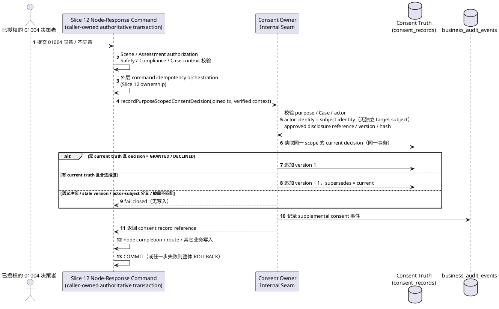

# Slice 14 — Consent Supplemental Assessment Owner Seam (Digital Use 01004)

**Feature Directory**: `specs/014-consent-supplemental-assessment-owner-seam`
**Created**: 2026-11-12
**Revised**: 2026-11-12（Consent Owner Review 后的精准修订；本轮关闭 Subject Authority，仍不进入 Plan / Tasks / 实现 / migration / 独立审计）
**Status**: **SPEC REVISION COMPLETE / READY FOR INDEPENDENT SPEC AUDIT**
**V1 Phase**: Phase 1 — Common Core 地基（Consent owner 的窄幅补齐）
**Execution Role**: 本 Spec 投影 `Slice 1 Consent Domain` 的 owner remediation 需求；它不是 Slice 2 语义变更，不是 Slice 12 runtime 实现，也不是独立设计文档。
**Authority Docs**: `Docs/总产品需求.md` → `Docs/V1产品需求.md` → `Docs/总体技术架构.md` → `Docs/V1技术设计.md` → Slice 12 Frozen Spec / Plan → Slice 4 Frozen Spec / Slice 1 Frozen Data Model / Slice 11 Frozen Manifest → 本 Spec
**Repository baseline**: `origin/main` = `eaf2bb3adc2d9499a4ed84d0ca560c55209628f8`（当前 HEAD 同 SHA，无 drift）
**Docs Modified**: NO
**Migration Contract**: **NEW FORWARD MIGRATION / BACKWARD-COMPATIBLE SCHEMA EXPANSION / NO HISTORICAL MIGRATION EDIT**
**Scope Expansion**: NO（仅 Digital Use canonical flow 01004 的窄幅 owner remediation）
**Open Product Decisions**: **0**（Subject Authority 已由 Owner / Product Ruling 关闭，见 §12.1）

> 本 Spec 只投影已批准的 Consent / Compliance / Digital Use 语义。它不修改产品语义，不建立第二套 Consent、Age、Guardian、Authorization、Compliance、Safety 或 Evidence 事实源，也不提前实现 Slice 12 的 Scene / Assessment runtime。
>
> **Design Gate**：Subject Authority 已由 Owner / Product Ruling 关闭（见 §12.1），`DESIGN GATE BLOCKED — SUBJECT AUTHORITY DECISION REQUIRED` 关闭。本 Spec 仍**不得直接进入 Plan**；下一步必须先通过独立 Spec Audit。Plan AI 不得自行再设计或扩大 subject 规则。

---

## Upstream Traceability

**Purpose**: 提供可机械核对的来源索引。本表只引用已经存在或被本 Spec 投影的上位语义，不新增任何需求。

| Upstream ID / Section | Source | Projected in |
|---|---|---|
| `U02` | `Docs/V1产品需求.md` §23 | §3 术语；§5 FR-001–FR-006（同意按 purpose 区分） |
| `V1-C20` | `Docs/V1产品需求.md` §18.1 | §4、§5 FR-001、FR-014–FR-019（Account / Person / Family / Participant / Purpose / Consent 边界分离） |
| `V1-C39` | `Docs/V1产品需求.md` §19A.2 / `Docs/V1技术设计.md` §7.7A / §10 | §5 FR-072–FR-076（guardian consent-first 语义不得变化） |
| `V1-C41` | `Docs/V1产品需求.md` §19A.5 / `Docs/V1技术设计.md` §27B.4 / §40 | §5 FR-026–FR-031、FR-067–FR-068（敏感处理的 separate consent 与披露可追溯） |
| `V1-D03` | `Docs/V1产品需求.md` §12.5 / `Docs/V1技术设计.md` §28.3 | §2、§3、§5 FR-001–FR-013（01004 / 01000 的 consent 边界） |
| `V1-D43` | `Docs/V1产品需求.md` §12.2A | §5 FR-006、FR-062（01004 只属于 Digital Use canonical flow） |
| `01004` | `Docs/V1产品需求.md` §12.5（测评汇总说明 / 知情同意） | §2 目标；§5 FR-001–FR-013；§10 Acceptance Scenarios |
| `01000` | `Docs/V1产品需求.md` §12.5（测评汇总） | §4 Out of Scope（01000 不在本 Spec 实现） |
| `A2002` | `Docs/V1产品需求.md` §12.3 | §4 Out of Scope（routing 属 Slice 12） |
| `§7.0` | `Docs/V1技术设计.md` | §5 FR-036–FR-038（caller-owned authoritative transaction） |
| `§7.7A` | `Docs/V1技术设计.md` | §5 FR-032–FR-034、FR-063、FR-072–FR-076（guardian / compliance profile 现状语义） |
| `§10` | `Docs/V1技术设计.md` | §5 FR-072–FR-076（UNDER_14 consent gate 顺序不变） |
| `§28.2` | `Docs/V1技术设计.md` | §9 非目标（不新增 public Consent API） |
| `§28.3` | `Docs/V1技术设计.md` | §4 Out of Scope（Scene / Assessment API 属 Slice 12） |
| `§29.5` | `Docs/V1技术设计.md` | §5 FR-012、FR-068（撤回阻断后续处理的最小语义） |
| Slice 12 Frozen Spec §8.8 / §10.3 / §11.3 | `specs/012-digital-use-assessment-runtime/spec.md` on `origin/spec/012-digital-use-assessment-runtime` @ `5e397fee86eb29da1acc1a5a1d176e0c73aa8849` | §3、§5 FR-001–FR-013、FR-035–FR-039、FR-064–FR-066 |
| Slice 12 Frozen Plan §7.5 / §8.1 / §11 | `specs/012-digital-use-assessment-runtime/plan.md` on `origin/plan/012-digital-use-assessment-runtime` @ `496f8d33c7147fcb77848fa1acc8e990d75c2ab0` | §1、§2、§5 FR-035–FR-039、FR-064–FR-070 |
| Owner / Product Ruling — Subject Authority | 本轮 Owner / Product Ruling（2026-11-12），记录于 §12.1 | §3、§5 FR-014–FR-019、FR-064–FR-066、FR-077–FR-078；§6.1、§12.1 |
| Slice 4 Frozen Spec FR-001 / FR-002 / §10 | `specs/004-case-participant-core/spec.md` on `origin/feat/004-case-participant-core` @ `79a3267152b16bce65f668c1a57313956fc885b5` | §12.1 Subject Authority ruling（Participant ≠ Family membership ≠ guardian，也不是 Consent subject 来源） |
| Slice 1 Frozen Data Model §6–§8 / `contracts/consent-onboarding.md` | `specs/001-family-identity-core/data-model.md`、`specs/001-family-identity-core/contracts/consent-onboarding.md` | §6.1、§6.3、§5 FR-032–FR-034、FR-063、FR-072–FR-076 |
| `db/migrations/001_initial_schema.sql` `consent_records` | current main | §1 现状；§5.11 Migration Contract；§6.1 Purpose × Field × Decision Invariant |
| `db/migrations/002_case_core.sql` `cases` / `db/migrations/005_case_participant_core.sql` `case_participants` | current main | §12.1 Subject Authority ruling evidence（不得从 Case / Participant 推导独立 target subject） |
| `packages/compliance/src/notices.ts` / `repository.ts` / `evidence.ts` | current main | §1 现状；§5 FR-026–FR-031、FR-067–FR-068 |

**Frozen requirement index**: §5 Functional Requirements，FR-001 … FR-078。

**Blocking rule**: 任何无法追溯到上表来源的行为都是 `NEEDS UPSTREAM DECISION`，不得实现。Subject Authority 已由 §12.1 的 Owner / Product Ruling 关闭为 `actor == subject`；FR-064–FR-066、FR-077–FR-078 投影该裁定，不再是 upstream blocker。

---

<!-- Governance-format index block (non-semantic). Added only so `.specify/scripts/validate-governance.mjs` can locate the four canonical headings. It creates no requirement, no scenario, no scope change and no product semantics. -->

## Acceptance Scenarios

**Authoritative acceptance scenarios remain §10 Acceptance Scenarios, items 1–36.**

## Acceptance Evidence

**Authoritative acceptance evidence remains §11 Acceptance Evidence.**

---

## Scope

**In scope**

1. 让现有 Consent owner 能承载 `01004` 所需的、purpose-scoped 的补充测评同意决策：`GRANTED` / `DECLINED` / `REVOKED`。
2. 提供 owner 内部命令 seam，使调用方可以在自己的权威事务上下文中原子地写入该决策。
3. 以 **new forward migration + backward-compatible schema expansion** 方式，对现有 `consent_records` 做 purpose-discriminated 约束扩展；不编辑任何历史 migration；`UNDER_14_GUARDIAN_CONSENT` 原语义 100% 保留。
4. 保证 Single Consent Truth：只有一个 Consent owner，Scene / Evidence 只能保存引用。
5. 将 Subject Authority 冻结为 `consent subject = decision actor = authenticated + authorized actor Person`；本 purpose 不存在另一个独立 target Consent subject（见 §12.1）。

**Out of scope**

1. `01004` 节点本身、`01000` 节点、`scene_node_states`、`scene_artifacts`、Digital Use routing、Assessment API（均属 Slice 12）。
2. public Consent API 新增（`POST /consents/supplemental-assessment` 等一律禁止）。
3. 任何第二套 Consent 存储、State Machine、DSL、Preference Center 或通用同意平台。
4. Evidence Core substantive facts（device usage、parent observation、statement、impact 等）。
5. 任何 Slice 2 semantic change。
6. 01004 disclosure 文案内容、批准流程或 disclosure authoring（由独立上游 authority 拥有）。
7. Subject Authority 规则的再设计或扩大（已由 Owner / Product Ruling 关闭；本 Spec 只投影 `actor == subject` 裁定，不新造、不扩展 subject 规则）。

**Non-goals**

- 不重构 Consent 为通用平台。
- 不新增 public revoke UI / API。
- 不伪造 guardian identity、guardian account、onboarding request 或 UNDER_14 年龄证据。
- 不把 Assessment answers 放进 Consent evidence。
- 不改变既有 guardian consent 的 notice / evidence / gate / binding / revocation chain。
- 不把本 purpose 泛化为未来所有 Scene 的 generic supplemental-assessment consent。

---

## 1. 现状与问题（Owner Review 结论复核）

本 Spec 修订前重新读取了以下真实现状：

| 现状 | 证据位置 | 结论 |
|---|---|---|
| `ConsentPurpose` 只有 `UNDER_14_GUARDIAN_CONSENT` | `packages/contracts/src/schemas.ts`；`db/migrations/001_initial_schema.sql`；`specs/001-family-identity-core/data-model.md` §7 | 无第二个 purpose |
| `ConsentDecision` 只有 `GRANTED` / `REVOKED` | 同上 | 无 `DECLINED` |
| `guardian_person_id NOT NULL`、`guardian_account_id NOT NULL` | `db/migrations/001_initial_schema.sql` `consent_records` | 当前 schema 强制 guardian identity |
| `consent_request_binding` 要求 `GRANTED` 必须有 `onboarding_request_id`、`REVOKED` 必须为空 | 同上 | 当前 schema 强制 guardian onboarding |
| `ConsentEvidence` 固定五字段且 `declared_age_band = UNDER_14` | `packages/contracts/src/schemas.ts`；`packages/compliance/src/evidence.ts` | 不能复用于补充测评 |
| guardian gate / binding 读取固定 purpose | `packages/compliance/src/repository.ts`（`getValidConsentForBinding` / `getConsentRecordForGate` / `insertConsentRecord` 硬编码 purpose） | 只表达 guardian 事实 |
| 通知目录只有 guardian purpose 的告知 | `packages/compliance/src/notices.ts` | 无已批准的 01004 披露 |
| 审计事件词汇只有 guardian consent 事件 | `db/migrations/010_problem_formulation_safety_vocabulary_reconcile.sql` | 无 supplemental 事件 |
| 无任何补充测评 consent seam | `apps/server/api/src/routes/consents.ts`、`packages/compliance/src/*` | 无 owner capability |
| `cases` 没有 `subject_person_id`；只有 `family_id` / `created_by_person_id` / status / phase / primary / version | `db/migrations/002_case_core.sql` | Case 本身不定义独立 target subject；本 purpose 的 Consent subject 恒为 actor（§12.1） |
| `case_participants.person_id` 只是 Case 级参与关系；Slice 4 明确 Participant ≠ Family membership ≠ guardian ≠ subject；Slice 12 §10.3 明确参与不自动获得 Assessment 权利 | `db/migrations/005_case_participant_core.sql`；`origin/feat/004-case-participant-core` Frozen Spec FR-001 / FR-002；Slice 12 Frozen Spec §10.3 | Participant 不是独立 target subject 来源，也不是 consent actor 来源 |
| Slice 12 Frozen Plan §7.5 要求决策绑定 `actor/subject/Case`，但未定义 subject 来源 | `origin/plan/012-digital-use-assessment-runtime` Plan §7.5 / §11 | 该绑定已由 §12.1 的 `actor == subject` 裁定满足，无需另解 target subject |
| 01004 manifest 节点无 subject / participant scope 字段 | `packages/scenes/digital-use/node-manifest.ts` 01004 entry；Slice 11 Frozen Spec FR-010 | manifest 不提供、也不需要独立 target subject authority |
| 无已批准的 01004 disclosure / notice artifact | `packages/compliance/src/notices.ts`；`NOTICE_CATALOG` 只有 guardian notice | 01004 disclosure authority absent |

**结论**：

- `01004 CONSENT GAP: CONFIRMED`；
- `CURRENT CONTRACT DIRECTLY SUFFICIENT: NO`；
- `SLICE 12 LOCAL CONSENT TRUTH: FORBIDDEN`；
- `OWNER REMEDIATION: REQUIRED`；
- `MIGRATION “ADDITIVE MIGRATION ONLY” 不足: CONFIRMED`——现有 `guardian_person_id` / `guardian_account_id NOT NULL` 与 `GRANTED → onboarding_request_id NOT NULL` 无法在“不修改现有约束”的前提下承载不伪造 guardian / onboarding 的 supplemental decision；
- `SUBJECT AUTHORITY: CLOSED — ACTOR = SUBJECT`（见 §12.1）；
- `APPROVED 01004 DISCLOSURE: ABSENT`（见 §12.2）。

本 Spec 不重复实现任何已由最新 main 完整解决的问题。

---

## 2. 目标

让现有 Consent owner 合法、可审计、可版本化地承载 `01004` 的 purpose-scoped 补充测评同意决策，同时使 `UNDER_14_GUARDIAN_CONSENT` 的全部既有语义保持不变；并只提供内部 authoritative seam，不提供 public API。

本 purpose 的 Consent subject 已被冻结为 decision actor 本身：它是当前经过认证且经过 Assessment/Scene authorization 的用户本人，对进入本次 Case 的 supplemental-assessment flow 作出的知情同意。该 Consent 不表达对另一个 Person 的同意，也不替代其它 Gate。

本 Spec 同时明确两个与 Disclosure 相关的独立 Gate（它们与已关闭的 Subject Authority 相互独立）：

1. **Slice 14 Owner Capability Gate**：owner seam 只接受 server-resolved、approved 的 disclosure reference/version/hash；缺失时 fail closed。
2. **Slice 12 Integration Gate**：即使 Slice 14 owner remediation 完成，Slice 12 仍必须另外证明存在 approved 01004 disclosure authority，才能执行 01004。

`Slice 14 owner capability ready ≠ Slice 12 01004 fully ready`。

---

## 3. 术语

**DIGITAL_USE_SUPPLEMENTAL_ASSESSMENT**
: 本 Spec 冻结的唯一 purpose 标识，只服务于 Digital Use canonical flow `01004`。它不是 generic supplemental-assessment consent，不自动适用于未来其它 Scene，其它 Scene 不得直接复用，除非另有正式 authority。

**Supplemental Consent Decision**
: 决策主体（同时就是该 Consent 的 subject）针对某个 `Family` + `Case` + `DIGITAL_USE_SUPPLEMENTAL_ASSESSMENT` 作出的、带版本与披露证据的同意事实。

**Decision Actor**
: 实际作出本次决策的、由服务端认证并记录的人（account + person）。在 `DIGITAL_USE_SUPPLEMENTAL_ASSESSMENT` 下，actor 同时就是该 Consent 的 subject；actor 身份不因 Family membership、active participation 或 Case 创建者身份自动获得资格，必须先通过该 `01004` 的 Assessment / Scene authorization。

**Decision Subject**
: 本 purpose 下不存在独立于 decision actor 的目标 person。Consent subject 恒等于 decision actor，即经过认证且经过 Assessment/Scene authorization 的用户本人。不得从 `CaseParticipant`、guardian relationship、Family membership、ordinary Evidence、Assessment substantive subject、child Person 或客户端提交的 `subjectPersonId` 推导另一个 Consent subject。详见 §12.1。

**Current Decision**
: 同一逻辑 scope（`Family` + `Case` + `purpose` + `actor person`，其中 actor person 同时就是 subject）内尚未被后续版本取代的最新 decision。历史版本只可追加、不可覆盖或删除。

**DECLINED**
: 在该逻辑 scope 内此前从未存在 `GRANTED` truth 的前提下，用户本次明确不同意。

**REVOKED**
: 在该逻辑 scope 内此前已经存在 `GRANTED` truth，用户后来明确撤回该 `GRANTED`。

**01004**
: Digital Use 场景中的“测评汇总说明 / 知情同意”节点，负责解释测评目的、方式、用途、所需时间与免责声明，并取得用户明确同意或拒绝。节点本身的 runtime 属 Slice 12。

---

## 4. 单一事实源与边界

- Consent owner 是补充测评同意决策的唯一事实源。
- Scene 状态、Scene artifact、普通 Evidence 以后最多只能保存 consent record reference / result reference，不能成为 decision owner。
- 不新增 `supplemental_consents` 表或 Slice 12 私有 consent 表。
- 不把 `scene_node_states`、`scene_artifacts` 或 ordinary Evidence 当作 consent truth。
- Consent evidence 只表达“谁、针对什么 purpose / disclosure、何时、作出什么 decision”；Assessment Evidence 只表达 substantive facts，二者不得互相替代。
- 本 purpose 的 Consent 只表达当前 actor 本人的知情同意，不表达对另一个 Person 的同意，也不构成对其它 Person 数据的处理授权；后续处理其它 Person 数据仍须独立满足 Authorization、Purpose / Visibility、UNDER_14 Guardian Consent 与 Compliance。
- `DIGITAL_USE_SUPPLEMENTAL_ASSESSMENT` 只属于 01004，不得成为 universal consent engine、arbitrary purpose registry 或 all-future-scene framework。

---

## 5. Functional Requirements（EARS）

### 5.1 Purpose 与隔离

- **FR-001** WHERE the Consent owner records a decision, THE SYSTEM SHALL associate it with exactly one explicit `purpose`; a decision without an exact purpose SHALL be rejected.
- **FR-002** THE SYSTEM SHALL provide exactly one owner-approved purpose `DIGITAL_USE_SUPPLEMENTAL_ASSESSMENT` for Digital Use `01004`, and SHALL keep `UNDER_14_GUARDIAN_CONSENT` as a distinct purpose. This purpose SHALL NOT be a generic supplemental-assessment consent and SHALL NOT automatically apply to any future Scene.
- **FR-003** IF a record's purpose is `DIGITAL_USE_SUPPLEMENTAL_ASSESSMENT`, THEN THE SYSTEM SHALL NOT treat `UNDER_14_GUARDIAN_CONSENT` as satisfied, and vice versa.
- **FR-004** WHEN any guardian consent gate (`assertMinorProcessingAllowed`, consent binding, profile pointer, revocation chain) evaluates consent, THE SYSTEM SHALL consider only `UNDER_14_GUARDIAN_CONSENT` records.
- **FR-005** WHEN any 01004 supplemental-assessment consumer evaluates consent, THE SYSTEM SHALL consider only the exact scoped `DIGITAL_USE_SUPPLEMENTAL_ASSESSMENT` current decision.
- **FR-006** THE SYSTEM SHALL NOT allow a `DIGITAL_USE_SUPPLEMENTAL_ASSESSMENT` record to authorize unrelated processing, Family membership, Case access, participant visibility, AI processing, cross-member sharing or notification.

### 5.2 Decision 语义

- **FR-007** THE SYSTEM SHALL be able to represent exactly three decision values for `DIGITAL_USE_SUPPLEMENTAL_ASSESSMENT`: `GRANTED`, `DECLINED`, `REVOKED`.
- **FR-008** WHEN a first decision under a logical scope is an explicit refusal and no prior `GRANTED` truth exists in that scope, THE SYSTEM SHALL record it as `DECLINED`.
- **FR-009** WHEN a decision withdraws an existing `GRANTED` truth in the same logical scope, THE SYSTEM SHALL record it as `REVOKED`.
- **FR-010** IF an explicit refusal is submitted while the current truth is already `GRANTED` and the caller does not present it as a revocation, THEN THE SYSTEM SHALL fail closed with a semantic conflict and SHALL NOT write `DECLINED` and SHALL NOT silently rewrite it as `REVOKED`.
- **FR-011** WHEN the current truth is `DECLINED` and the user later explicitly agrees, THE SYSTEM SHALL append a new `GRANTED` version that supersedes the `DECLINED` version.
- **FR-012** WHEN the current truth is `GRANTED` and the user later explicitly revokes, THE SYSTEM SHALL append a new `REVOKED` version that supersedes the `GRANTED` version.
- **FR-013** THE SYSTEM SHALL NOT represent `01004 “不同意”` as `REVOKED` when no prior consent existed.

### 5.3 作用域与 Subject Authority

**Subject Authority ruling（CLOSED，见 §12.1）**：本 purpose 的 `consent subject = decision actor = authenticated + authorized actor Person`。不存在另一个独立的 target Consent subject。

- **FR-014** WHEN the Consent owner records a supplemental decision, THE SYSTEM SHALL require a server-verified `Family` + `Case` identity, a server-verified authenticated and authorized decision actor (the actor IS the Consent subject), and the exact purpose. THE SYSTEM SHALL NOT require a separately resolved target subject.
- **FR-015** IF `Family`, `Case`, authenticated decision actor or purpose is missing, unknown or unverifiable, THEN THE SYSTEM SHALL fail closed and SHALL NOT create a blanket or scope-less consent.
- **FR-016** THE SYSTEM SHALL scope the decision to one `Family` + one `Case` + one actor person (who is the Consent subject) + one purpose; a supplemental decision SHALL NOT authorize a different Case or a different Person as actor/subject, and SHALL NOT become a future-all-assessments consent.
- **FR-017** THE SYSTEM SHALL record the decision actor as a fact of that decision, and that actor SHALL be the Consent subject. A different Person SHALL NOT be substituted as actor or subject within the same logical scope; a different actor naturally forms a different logical scope (actor == subject), not a second concurrent truth inside the original scope.
- **FR-018** THE SYSTEM SHALL verify that the decision actor (who is the Consent subject) and the Case belong to the same Family scope before writing.
- **FR-019** THE SYSTEM SHALL NOT derive guardian identity, guardian consent or parental authority from Family membership, active participation, Case ownership or the decision actor field.
- **FR-064** THE SYSTEM SHALL treat the authenticated and authorized decision actor as the Consent subject for `DIGITAL_USE_SUPPLEMENTAL_ASSESSMENT`; the Consent subject and the decision actor SHALL be the same Person. THE SYSTEM SHALL NOT resolve, require or persist any separate independent target subject for this purpose.
- **FR-065** THE SYSTEM SHALL NOT derive a separate Consent subject or target subject from client-supplied input, `CaseParticipant`, guardian relationship, Family membership, ordinary Evidence, Assessment substantive subject, child Person, Case creator, active participation, or any uniqueness heuristic. Client-supplied subject identity SHALL NOT be authoritative.
- **FR-066** IF the caller presents or implies a Person other than the authenticated and authorized actor as the Consent actor/subject, THEN THE SYSTEM SHALL fail closed and SHALL NOT write; client substitution of another Person as the Consent actor/subject SHALL be forbidden.
- **FR-077** THE SYSTEM SHALL express, for `DIGITAL_USE_SUPPLEMENTAL_ASSESSMENT`, only the authenticated actor's own informed consent to enter the `01004` → `01000` supplemental-assessment flow. It SHALL NOT express guardian consent, child consent, consent on behalf of another Person, Family-wide consent, blanket future consent, or authorization to process otherwise unauthorized Person data.
- **FR-078** WHEN any downstream processing involves data of a Person other than the Consent actor, THE SYSTEM SHALL require the independent Authorization, Purpose / Visibility, UNDER_14 Guardian Consent and Compliance gates; the `01004` Consent SHALL NOT substitute for any of them.

### 5.4 版本与 supersession

- **FR-020** WHEN the first decision for a logical scope is written, THE SYSTEM SHALL assign version `1`.
- **FR-021** WHEN a later decision for the same logical scope is written, THE SYSTEM SHALL assign exactly `current version + 1` and SHALL reference the current version as its superseded predecessor.
- **FR-022** THE SYSTEM SHALL guarantee that at most one current (not superseded) supplemental decision exists per `Family` + `Case` + `purpose` + `actor person` logical scope at any time; the actor person IS the Consent subject. Two mutually conflicting current decisions for the same logical scope SHALL be impossible.
- **FR-023** IF the caller presents an expected version that is not the current version, THEN THE SYSTEM SHALL fail closed with a stale-version conflict and SHALL NOT append.
- **FR-024** THE SYSTEM SHALL NOT update, overwrite or delete a historical supplemental decision; history SHALL remain append-only and traceable.
- **FR-025** WHEN the same logical decision is submitted again for the current version with the same semantic payload, THE SYSTEM SHALL treat it as a replay-safe no-op and SHALL NOT create a duplicate row.

### 5.5 披露与 evidence

- **FR-026** WHEN the Consent owner records a supplemental decision, THE SYSTEM SHALL bind it to a server-resolved, approved, purpose-appropriate, versioned disclosure identity (stable reference + version + integrity hash) for `DIGITAL_USE_SUPPLEMENTAL_ASSESSMENT` that the user actually saw. Client-supplied disclosure text SHALL NOT be authoritative.
- **FR-027** IF no approved 01004 disclosure identity exists, or the submitted disclosure identity does not match the current approved one, THEN THE SYSTEM SHALL fail closed and SHALL NOT write the decision.
- **FR-028** THE SYSTEM SHALL record purpose-discriminated evidence proving at least: the disclosure / notice identity, the confirmation statement hash, the purpose, the decision, the decision actor (which IS the Consent subject), and the decision time.
- **FR-029** THE SYSTEM SHALL NOT reuse the existing UNDER_14 `ConsentEvidence` shape for supplemental decisions, and SHALL NOT relax the guardian evidence contract.
- **FR-030** THE SYSTEM SHALL NOT persist raw client IP or raw User-Agent; if the existing design uses HMAC/hash discipline, the same privacy discipline SHALL continue.
- **FR-031** THE SYSTEM SHALL NOT store Assessment answers, device-usage facts, parent observations, statements or impact narratives inside Consent evidence.
- **FR-067** THE SYSTEM SHALL NOT accept disclosure content authored by the caller, generated temporarily by a model, copied from the guardian notice, or treated as an approved notice merely because it is plain text. Disclosure content and approval ownership are outside Slice 14.
- **FR-068** THE SYSTEM SHALL NOT treat Slice 14 owner-capability completion as sufficient to execute 01004. Slice 12 SHALL separately prove that an approved 01004 disclosure authority exists before the 01004 Consent Gate can pass.

### 5.6 不伪造 guardian 事实与 purpose 不变量

- **FR-032** WHEN recording a `DIGITAL_USE_SUPPLEMENTAL_ASSESSMENT` decision, THE SYSTEM SHALL NOT require or fabricate `guardian_person_id`, `guardian_account_id`, `onboarding_request_id`, `bound_person_id`, `bound_at`, an UNDER_14 age band or a guardian onboarding request row.
- **FR-033** THE SYSTEM SHALL NOT create a fake guardian request, fake relationship or fake age evidence merely to satisfy guardian-oriented constraints.
- **FR-034** WHILE a row's purpose is `UNDER_14_GUARDIAN_CONSENT`, THE SYSTEM SHALL keep every existing guardian invariant strictly enforced: non-null guardian person/account, GRANTED requires a valid onboarding request, REVOKED has no onboarding request, subject/supersession/binding/evidence rules unchanged.
- **FR-063** IF a record's purpose is `UNDER_14_GUARDIAN_CONSENT` and its decision is `DECLINED`, THEN THE SYSTEM SHALL reject it as invalid and SHALL NOT persist it. `UNDER_14_GUARDIAN_CONSENT + DECLINED = INVALID`；新增 `DECLINED` 不得让 guardian consent 获得历史上不存在的合法 decision。
- **FR-069** WHEN recording a `DIGITAL_USE_SUPPLEMENTAL_ASSESSMENT` decision, THE SYSTEM SHALL enforce a purpose-discriminated field invariant: guardian identity/account and onboarding request are **NOT REQUIRED and MUST NOT be fabricated**; `GRANTED` / `DECLINED` SHALL be legal without them; `REVOKED` SHALL be legal only when an existing current `GRANTED` is subsequently revoked.

### 5.7 内部 owner command / seam

- **FR-035** THE SYSTEM SHALL provide one internal authoritative Consent owner command for recording a purpose-scoped decision, conceptually equivalent to `recordPurposeScopedConsentDecision(...)`; function naming may differ but semantics SHALL be single and authoritative.
- **FR-036** WHEN the internal owner command is invoked, THE SYSTEM SHALL join the caller-owned authoritative transaction context: the same checked-out client and the same underlying transaction. The implementation MAY use a shared Drizzle transaction plus its exact underlying `PoolClient`; the concrete TypeScript type is deferred to Plan / Implementation and SHALL NOT be frozen by this Spec.
- **FR-037** THE SYSTEM SHALL NOT start its own transaction (`BEGIN`), commit (`COMMIT`), roll back (`ROLLBACK`), or check out a second client inside the owner command.
- **FR-038** THE SYSTEM SHALL NOT perform Scene node completion, route advancement, Case phase transition, artifact write or idempotency snapshot ownership inside the owner command; those remain the caller's responsibilities.
- **FR-039** WHEN the owner command succeeds, THE SYSTEM SHALL return the authoritative consent record reference (identity, decision, version, decided time) so the caller can reference it without duplicating consent truth.

### 5.8 Authorization

- **FR-040** WHEN the internal owner command is invoked, THE SYSTEM SHALL rely only on server-verified context for actor (who is the Consent subject), Family, Case and purpose; client-supplied claims SHALL NOT be treated as authorization facts.
- **FR-041** IF the authenticated actor is absent, or is not a member of the Case's Family, or the Case/purpose does not verify in the same transaction, THEN THE SYSTEM SHALL fail closed.
- **FR-042** THE SYSTEM SHALL NOT grant consent capability merely because the actor is a Family member, an active participant, a Case creator or a Family manager.
- **FR-043** THE SYSTEM SHALL NOT restrict supplemental consent to guardians; `01004` is not guardian consent.
- **FR-044** THE SYSTEM SHALL perform only minimal defensive checks needed to keep the Consent fact well-scoped, and SHALL NOT build a second generic RBAC or duplicate Slice 12's Scene/Assessment authorization tree.
- **FR-045** IF the upstream caller cannot present evidence that the request already passed the authoritative Scene/Assessment authorization for this exact `01004` response, THEN THE SYSTEM SHALL fail closed.

### 5.9 幂等与并发

- **FR-046** THE SYSTEM SHALL NOT introduce a second business-command idempotency truth or a consent-specific idempotency store. Request-level idempotency orchestration belongs to the caller's authoritative command.
- **FR-047** WHEN the same logical decision is submitted again with the same expected current version and identical semantic payload, THE SYSTEM SHALL produce no duplicate supplemental consent row; WHEN the same logical scope is submitted with a conflicting payload, THE SYSTEM SHALL return a conflict.
- **FR-048** WHILE two supplemental decisions race for the same logical scope, THE SYSTEM SHALL ensure at most one legal current decision survives; the losing request SHALL fail closed.
- **FR-049** WHEN two `GRANTED` decisions race, THE SYSTEM SHALL NOT leave two current `GRANTED` truths.
- **FR-050** IF a caller-owned transaction later fails and rolls back, THEN THE SYSTEM SHALL leave no supplemental consent row, no supplemental audit event and no idempotency/result residue attributable to the rolled-back command.
- **FR-070** THE SYSTEM SHALL keep the outer `POST /api/v1/cases/:id/scene/nodes/:nodeCode/responses` command and its idempotency/result orchestration under Slice 12 ownership. The Slice 14 seam SHALL NOT establish a second idempotency table, a second `runIdempotentCommand` boundary, or a nested idempotency command; it SHALL be replay-safe only through DB uniqueness / version / concurrency invariants.

### 5.10 审计

- **FR-051** WHEN a supplemental decision is successfully written, THE SYSTEM SHALL record it in the existing `business_audit_events` store and SHALL NOT create a second audit table.
- **FR-052** THE SYSTEM SHALL provide the minimal event vocabulary needed to trace supplemental consent granted / declined / revoked, reusing the existing `CONSENT` resource type and transaction-scoped audit discipline.
- **FR-053** THE SYSTEM SHALL NOT implement a public revoke UI/API merely to complete the audit vocabulary.

### 5.11 迁移与兼容

- **FR-054** THE SYSTEM SHALL apply the change through a **new forward migration** and SHALL NOT edit `001_initial_schema.sql` or any historical migration.
- **FR-055** WHEN the new migration runs against a database containing existing guardian consent rows, THE SYSTEM SHALL preserve every existing row and every existing guardian invariant: no historical row SHALL become invalid, mutated or reinterpreted.
- **FR-056** THE SYSTEM SHALL make the change a **backward-compatible schema expansion**: existing `consent_records` constraints MAY be expanded, but only through purpose-discriminated branches. `UNDER_14_GUARDIAN_CONSENT` SHALL keep 100% of its existing field/decision/onboarding invariants; `DIGITAL_USE_SUPPLEMENTAL_ASSESSMENT` SHALL NOT be forced to fabricate guardian identity or onboarding request.
- **FR-057** THE SYSTEM SHALL prove the migration by: empty-database reproduction, real upgrade from the current `origin/main` schema with representative guardian data, and a second apply that is a zero-new no-op.
- **FR-058** IF the migration fails, THEN THE SYSTEM SHALL leave no partially applied schema state.
- **FR-071** THE SYSTEM SHALL NOT drop, weaken, widen or reinterpret any guardian-only constraint. It MAY expand existing `consent_records` constraints only inside the purpose-discriminated branch, and SHALL prove the guardian branch with database-level negative tests. No second consent table SHALL be created.

### 5.12 Public surface 与边界

- **FR-059** THE SYSTEM SHALL NOT add a public Consent route for supplemental assessment (for example `POST /consents/supplemental-assessment`) and SHALL NOT add a public supplemental revoke route.
- **FR-060** THE SYSTEM SHALL keep the existing public consent read contract's guardian semantics unchanged, and SHALL NOT expose the new supplemental records through an unapproved public surface.
- **FR-061** THE SYSTEM SHALL keep `UNDER_14_GUARDIAN_CONSENT` notice, acceptance statement, evidence, gate order, binding sequence, profile pointer and revocation chain exactly as they are.
- **FR-062** THE SYSTEM SHALL NOT implement `01004` node, `01000` node, `scene_node_states`, `scene_artifacts`, Digital Use routing, Assessment API, or any Slice 12 private consent state.

### 5.13 Guardian 兼容性（完全不变）

- **FR-072** THE SYSTEM SHALL keep UNDER_14 consent-first onboarding unchanged; no remediation path SHALL create a formal child Person before valid guardian consent.
- **FR-073** THE SYSTEM SHALL keep `guardian_person_id` and `guardian_account_id` semantics unchanged for guardian consent.
- **FR-074** THE SYSTEM SHALL keep `UNDER_14_GUARDIAN_CONSENT`, `guardian_consent_requests`, the existing `GRANTED` onboarding requirement and the existing `REVOKED` chain unchanged.
- **FR-075** THE SYSTEM SHALL keep `person_compliance_profiles` guardian consent pointer semantics unchanged.
- **FR-076** THE SYSTEM SHALL keep `assertMinorProcessingAllowed()`, Slice 6 guardian-consent reads and Slice 10 compliance composition behavior unchanged. The new supplemental capability SHALL be an additive purpose branch, never a rewrite of guardian consent.

---

## 6. 数据约束（逻辑约束，不涉及物理设计）

### 6.1 Purpose × Field × Decision Invariant

| Purpose | `guardian_person_id` | `guardian_account_id` | `onboarding_request_id` | 合法 decision | 说明 |
|---|---|---|---|---|---|
| `UNDER_14_GUARDIAN_CONSENT` | **REQUIRED**（现有语义） | **REQUIRED**（现有语义） | `GRANTED` 时 **REQUIRED**；`REVOKED` 时 **MUST be NULL** | `GRANTED` / `REVOKED` only | `DECLINED` **INVALID**；现有约束 100% 保留 |
| `DIGITAL_USE_SUPPLEMENTAL_ASSESSMENT` | **NOT REQUIRED / MUST NOT be fabricated** | **NOT REQUIRED / MUST NOT be fabricated** | **NOT REQUIRED / MUST NOT be fabricated** | `GRANTED` / `DECLINED`；`REVOKED` only when an existing current `GRANTED` is subsequently revoked | 不伪造 guardian / onboarding；`actor == subject`；01004-only |

**不变量**：

1. 每一行必须精确落入且只落入一个 purpose 分支；混合 purpose 字段组合 SHALL be invalid。
2. `UNDER_14_GUARDIAN_CONSENT + DECLINED = INVALID`（FR-063）。
3. `DIGITAL_USE_SUPPLEMENTAL_ASSESSMENT` 的 `GRANTED` / `DECLINED` 不得要求任何 guardian identity、guardian account 或 onboarding request（FR-069）。
4. `DIGITAL_USE_SUPPLEMENTAL_ASSESSMENT + REVOKED` 只允许用于撤回已有 current `GRANTED`；首次“不同意”必须是 `DECLINED`，不得写成 `REVOKED`。
5. 新 migration 可对现有 `consent_records` 约束做 purpose-discriminated 扩展，但任何 guardian-only 约束不得被删除、放宽或重新解释（FR-071）。
6. 对于 `DIGITAL_USE_SUPPLEMENTAL_ASSESSMENT`，Consent subject 必须恒等于 decision actor；不得存在独立 target subject 参与 scope 或 current decision 唯一性判断（FR-014–FR-017、FR-064–FR-066）。
7. **Persistence neutrality**：本 Spec 不强制 Plan / DB 必须存两个重复的 actor/subject UUID 字段。允许后续 Plan 采用一个 canonical `decision_actor_person_id` 承载本 purpose 的 actor/subject identity；如果 Plan 选择同时存在 actor 与 subject 两列，则必须保证两者在本 purpose 下不可分叉。不得为了形式完整强制重复存储。
8. 本 purpose 的 Consent 不得被当作 guardian consent、child consent、on behalf of another Person、Family-wide 或 blanket future consent，也不得替代后续处理其它 Person 数据所需的 Authorization、Purpose / Visibility、UNDER_14 Guardian Consent 或 Compliance（FR-077–FR-078）。

### 6.2 Supplemental Assessment Consent Fact

对应术语：**Supplemental Consent Decision**。

1. **决策主体**：必填；必须来自服务端认证上下文，不得由请求体自声明；在本 purpose 下该决策主体同时就是 Consent subject。
2. **决策主体账号**：必填；与决策主体同源。
3. **Family 作用域**：必填；用于既有 Family 级隔离，不得跨 Family。
4. **Case 作用域**：必填；一次决策只属于一个 Case。
5. **Consent subject / 决策主体身份**：必填且恒等于服务端认证、并经该 `01004` Assessment / Scene authorization 的 decision actor；不得为空、不得匿名、不得由客户端提供。本 purpose 不存在独立 target subject；不得从 `CaseParticipant`、guardian relationship、Family membership、ordinary Evidence、Assessment substantive subject、child Person 或客户端 `subjectPersonId` 推导。
6. **purpose**：必填且精确等于 `DIGITAL_USE_SUPPLEMENTAL_ASSESSMENT`。
7. **decision**：必填，取值范围严格为 `GRANTED` / `DECLINED` / `REVOKED`。
8. **version**：必填，整数，首版为 1，后续严格递增 1。
9. **supersedes**：首版为空；后续必须指向同一逻辑 scope 的当前版本；不得指向其他 Case / actor（subject）/ purpose。
10. **decision timestamp**：必填，由服务端生成，不得由客户端指定。
11. **披露版本**：必填；必须是该 purpose 下已批准的版本。
12. **披露哈希**：必填；必须与披露版本内容一致。
13. **确认语句哈希**：必填；表达用户实际确认或拒绝的语句。
14. **evidence**：必填；purpose-discriminated 且通过对应 schema 校验，不得自由 jsonb。
15. **不可变性**：除允许的“首次绑定”类字段外，决策事实写入后不得原地更新；更正必须通过新版本表达。
16. **唯一性**：同一 `Family` + `Case` + actor person（即 subject）+ purpose 至多一条 current truth；该 scope 不得同时存在两个相互冲突的 current decisions。

### 6.3 Guardian Consent Fact（保持不变）

`UNDER_14_GUARDIAN_CONSENT` 的字段语义、必填性、约束与版本链完全沿用 `specs/001-family-identity-core/data-model.md` §6–§8 与 `contracts/consent-onboarding.md`。本 Spec 不重述、不放宽、不替换。

---

## 7. 交互流程



**约束**：Owner 不拥有 `BEGIN` / `COMMIT` / `ROLLBACK`、不 checkout 第二个 client、不建立第二套 idempotency 结果。Subject Authority 已关闭（§12.1）：owner 直接以认证且经授权的 actor 作为 Consent subject，不解析、不持久化独立 target subject。

---

## 8. 异常场景

1. **缺少 purpose / purpose 不匹配**
   a. 触发条件：调用方未提供 purpose，或提供的不是 `DIGITAL_USE_SUPPLEMENTAL_ASSESSMENT`。
   b. 系统行为：owner seam 拒绝，不读取、不写入任何 consent 行。
   c. 调用方感知：fail-closed 的 validation / conflict 错误类别。

2. **Case / actor 不可验证**
   a. 触发条件：Case 不存在、不属于该 Family，或 actor 缺失 / 未认证 / 非该 Family 成员 / 未通过该 `01004` 的 Assessment 或 Scene authorization。
   b. 系统行为：不写入；不泄露另一 Family 的存在性细节；不尝试从 Case / Participant 中补解析一个 target subject。
   c. 调用方感知：authorization / not-found 类的不可区分错误。

3. **缺少已批准披露或披露不匹配**
   a. 触发条件：无 `DIGITAL_USE_SUPPLEMENTAL_ASSESSMENT` 披露条目，或提交的披露版本/hash 与当前批准版本不一致。
   b. 系统行为：fail closed，不写 consent，不写 supplemental audit。
   c. 调用方感知：consent disclosure 相关错误。

4. **首次拒绝被误写为 REVOKED**
   a. 触发条件：同一 scope 从未有 `GRANTED`，但调用方尝试以撤回语义提交。
   b. 系统行为：拒绝该语义；只接受 `DECLINED` 作为首次拒绝；不得生成 `REVOKED`。
   c. 调用方感知：semantic conflict。

5. **已 GRANTED 后被提交为“不同意”但非撤回**
   a. 触发条件：current truth 为 `GRANTED`，请求试图写入第二个 `DECLINED`。
   b. 系统行为：拒绝；不得产生两个 current truth；不得把“不同意”改写成 `REVOKED`。
   c. 调用方感知：conflict，要求调用方明确撤回语义。

6. **stale expected version**
   a. 触发条件：调用方期望的 version 不是当前 current version。
   b. 系统行为：不追加；不改写历史。
   c. 调用方感知：version conflict。

7. **并发 double grant / grant vs decline**
   a. 触发条件：两个事务几乎同时写同一 scope。
   b. 系统行为：由 owner 侧 current-truth 串行化与唯一性保证至多一个合法结果；失败方整体回滚。
   c. 调用方感知：一个成功，另一个 conflict / fail closed。

8. **调用方事务后续失败**
   a. 触发条件：consent 写入成功后，调用方注入失败或后续步骤异常。
   b. 系统行为：外层回滚后，consent 行、audit 事件、幂等结果均不存在。
   c. 调用方感知：调用方事务失败；无部分 consent truth 残留。

9. **legacy / malformed evidence**
   a. 触发条件：读取到不符合对应 purpose evidence schema 的行。
   b. 系统行为：fail closed，视为不可用；不得静默修复或放宽 schema。
   c. 调用方感知：consent unavailable / invalid。

10. **跨 Family / 跨 Case 读取**
    a. 触发条件：actor 尝试读取其他 Family 或其他 Case 的 supplemental truth。
    b. 系统行为：被 RLS 与应用授权双重拒绝。
    c. 调用方感知：不可区分的不存在 / 无权。

11. **尝试引入独立 target subject 或 actor/subject 分叉**
    a. 触发条件：调用方或实现试图为本 purpose 引入另一个 target subject（`subjectPersonId`、Participant、child Person、guardian 关系等），或试图让 actor 与 subject 分叉。
    b. 系统行为：fail closed；不解析、不写入；不得从 Case / Participant / Evidence 寻找替代 subject。
    c. 调用方感知：validation / authorization error。

12. **guardian purpose 被写入 DECLINED**
    a. 触发条件：调用方试图以 `UNDER_14_GUARDIAN_CONSENT + DECLINED` 写入。
    b. 系统行为：拒绝；数据库与 owner 均不得接受；不得因新增 DECLINED 而扩大 guardian 合法 decision 集合。
    c. 调用方感知：validation / constraint violation。

13. **guardian notice 被复用为 01004 披露**
    a. 触发条件：调用方或实现尝试用 `NOTICE_CATALOG` 的 guardian notice/version/hash 作为 01004 披露。
    b. 系统行为：fail closed；不得写入 consent。
    c. 调用方感知：disclosure authority missing。

14. **客户端提交 subject 身份或 disclosure**
    a. 触发条件：请求体包含 subject person ID / `subjectPersonId`、另一 Person 的 actor 声明、disclosure 文案、notice 内容或等价的自声明内容。
    b. 系统行为：subject / actor 字段被忽略或拒绝，不构成 scope、授权或披露事实；scope 始终由服务端认证且经授权的 actor 派生；disclosure 非权威，缺失 approved disclosure 时 fail closed。
    c. 调用方感知：validation / authorization / disclosure error。

15. **owner seam 试图建立第二套幂等或事务**
    a. 触发条件：实现尝试在 seam 内 `BEGIN` / `COMMIT` / `ROLLBACK`、checkout 第二 client、创建第二 idempotency 表或嵌套 `runIdempotentCommand`。
    b. 系统行为：在评审/架构 guard 中拒绝；实现不符合 FR-036 / FR-037 / FR-070。
    c. 调用方感知：implementation review FAIL，不得合并。

---

## 9. 非目标与禁止项

- 禁止 `supplemental_consents` 表、Slice 12 私有 consent 表、Scene/Evidence 私有 consent ledger。
- 禁止 `scene_node_states` / `scene_artifacts` / ordinary Evidence 成为 consent truth。
- 禁止 universal consent engine、generic privacy preference center、arbitrary consent-purpose registry、dynamic consent DSL、all-future-scene consent framework、generic consent workflow engine、notification consent、AI consent、research consent、sharing consent。
- 禁止 public `POST /consents/supplemental-assessment` 及任何等价 public 入口。
- 禁止复用 `UNDER_14_GUARDIAN_CONSENT` 的 purpose、notice、evidence shape 来表达补充测评。
- 禁止把 Assessment answers 写入 Consent evidence。
- 禁止本 PR 实现 01004 / 01000 / scene runtime / routing / Assessment API。
- 禁止修改任何历史 migration。
- 禁止删除或放宽任何 guardian-only 约束。
- 禁止将 `DIGITAL_USE_SUPPLEMENTAL_ASSESSMENT` 泛化为未来其它 Scene 的通用 consent。
- 禁止自行再设计或扩大 Subject Authority 裁定（已关闭为 `actor == subject`）；禁止引入独立 target subject、从 Case / Participant / Evidence / guardian / Family membership 推导 subject，或接受 client-supplied subject。

---

## 10. Acceptance Scenarios

1. **Guardian regression — existing UNDER_14 grant**
   **Given** 现有 guardian onboarding 请求与合法 `UNDER_14_GUARDIAN_CONSENT` GRANTED 记录，**When** 运行既有 consent grant 测试与 `assertMinorProcessingAllowed`，**Then** 全部 PASS，行为与 remediation 前一致。

2. **Guardian regression — existing revoke / re-consent / binding / profile pointer / evidence**
   **Given** 既有 guardian revoke、re-consent、onboarding requirement、evidence validation 与 profile 指针测试，**When** 运行全部相关测试，**Then** 全部 PASS；撤回链、`onboarding_request_id`、`bound_person_id`、`guardian_consent_version` 语义不变。

3. **Purpose isolation — guardian 不能满足 supplemental**
   **Given** 某 Family/Case 存在有效 `UNDER_14_GUARDIAN_CONSENT` GRANTED，**When** 检查 `DIGITAL_USE_SUPPLEMENTAL_ASSESSMENT` 的 01004 gate，**Then** 仍为未同意，不得放行。

4. **Purpose isolation — supplemental 不能满足 guardian**
   **Given** 某未成年人存在有效 `DIGITAL_USE_SUPPLEMENTAL_ASSESSMENT` GRANTED，**When** 调用 guardian consent gate / binding / profile 校验，**Then** 仍 BLOCK，不得被视为监护人同意。

5. **Supplemental GRANTED**
   **Given** 一个已验证的 Family / Case / 已认证且经 `01004` Scene-Assessment authorization 的 actor（actor 即 Consent subject）/ purpose 与当前批准披露，**When** 记录明确同意，**Then** 形成 version 1 的 current `GRANTED` truth，并返回可引用的 consent record reference。

6. **Supplemental first DECLINED**
   **Given** 同一 scope 从未存在 `GRANTED`，**When** 用户明确不同意，**Then** 记录为 `DECLINED`（不是 `REVOKED`），并形成 current truth。

7. **DECLINED → GRANTED**
   **Given** current truth 为 `DECLINED` v1，**When** 用户后来明确同意，**Then** 追加 v2 `GRANTED`，`supersedes` 指向 v1，历史 v1 保留。

8. **GRANTED → REVOKED**
   **Given** current truth 为 `GRANTED` v1，**When** 用户明确撤回，**Then** 追加 v2 `REVOKED`，`supersedes` 指向 v1，历史保留。

9. **GRANTED 后非撤回式不同意被拒绝**
   **Given** current truth 为 `GRANTED`，**When** 请求以“不同意”但非撤回语义提交，**Then** 拒绝，既不写 `DECLINED` 也不改写成 `REVOKED`。

10. **No fake guardian facts — GRANTED**
    **Given** 一次合法 supplemental `GRANTED` 决策，**When** 检查持久化事实，**Then** 不存在伪造的 guardian person、guardian account、onboarding request、bound person 或 UNDER_14 证据；也无需这些字段即可成功写入。

11. **Scope — 不同 Case 不串链 / cross-Case rejected**
    **Given** Case A 与 Case B 同属一个 Family 且同一 actor/subject、同一 purpose，**When** 分别在 A、B 记录决策，**Then** 两条 current truth 各自独立，互不 supersede、互不满足；**And When** 尝试把 A 的 decision 应用到 B，**Then** fail closed，零写入。

12. **Scope — 不同 actor（即不同 subject）/ purpose 不串链**
    **Given** 同 Case 下两个不同 actor person（各自即其 Consent subject），或 purpose 不同，**When** 分别记录决策，**Then** 版本链与 current truth 互不影响。

13. **Scope — 不同 actor 形成不同 scope，不共享 current truth**
    **Given** 同一 Family + Case + purpose 下 actor P1 已有 current truth，**When** 另一名合法且已授权的 actor P2 写入决策，**Then** 该写入属于 P2 自己的 logical scope（actor == subject），不取代、不冲突 P1 的 current truth；每个 actor scope 内仍至多一个 current truth；不得把 P2 的决策记到 P1。

14. **Version / supersession 历史准确**
    **Given** v1 `DECLINED` → v2 `GRANTED` → v3 `REVOKED`，**When** 读取历史，**Then** 三行均可追溯，`supersedes` 链准确，无覆盖删除。

15. **Concurrency — double grant**
    **Given** 两个并发 `GRANTED` 请求命中同一 scope，**When** 事务提交，**Then** 至多一个 current `GRANTED` truth，另一个 fail closed 或 replay-safe no-op。

16. **Concurrency — grant vs decline**
    **Given** 并发 `GRANTED` 与 `DECLINED` 命中同一 Family + Case + purpose + actor（actor 即 subject）scope，**When** 事务提交，**Then** 只产生一个合法 current decision，冲突方不写入。

17. **Concurrency — stale version**
    **Given** 同一 Family + Case + purpose + actor scope 内调用方期望 version 已过期，**When** 提交决策，**Then** conflict，无写入，历史不变。

18. **Idempotency — replay / mismatch**
    **Given** 同一 Family + Case + purpose + actor scope 内同一逻辑 decision 与相同 expected version / payload 重放，**When** 再次提交，**Then** 不产生重复行；**Given** 同一 scope 不同 payload，**Then** 返回 conflict。外层 request-level 幂等由 Slice 12 负责。

19. **Atomic rollback**
    **Given** 调用方事务中 consent 写入成功，**When** 注入后续 caller failure 并回滚，**Then** consent 行、audit 事件与幂等/结果残留均不存在。

20. **RLS / privacy**
    **Given** 另一个 Family 的 actor，**When** 尝试读取或写入该 Family/Case 的 supplemental truth，**Then** 被拒绝；原始 IP / UA 未被持久化；Assessment answers 不在 Consent evidence 中。

21. **Audit vocabulary**
    **Given** supplemental granted / declined / revoked 各发生一次，**When** 查询既有 `business_audit_events`，**Then** 三类事件均可追溯，且未出现第二套 audit 表。

22. **Scope negative — 无第二套实现**
    **Given** 本 remediation 的 diff，**When** 检查，**Then** 不存在第二张 Consent 表、public supplemental API、Slice 12 runtime、generic Consent framework，也不存在对历史 migration 的编辑；purpose 仅为 `DIGITAL_USE_SUPPLEMENTAL_ASSESSMENT`，未泛化。

23. **Public surface 不扩大**
    **Given** 存在 supplemental consent 记录，**When** 调用既有 public `GET /api/v1/consents`，**Then** 公开合同语义保持既有 guardian 语义，不暴露未批准的 supplemental 事实。

24. **No approved disclosure → fail closed**
    **Given** 缺少已批准的 `DIGITAL_USE_SUPPLEMENTAL_ASSESSMENT` 披露条目，**When** 尝试记录同意，**Then** fail closed，不写入任何 consent 行。

25. **Guardian purpose + DECLINED rejected**
    **Given** 一条 `UNDER_14_GUARDIAN_CONSENT` 记录候选，**When** decision 为 `DECLINED`，**Then** 在 owner 与数据库层均被拒绝，零写入；guardian 合法 decision 集合仍严格为 `GRANTED` / `REVOKED`。

26. **Supplemental DECLINED stores no fabricated guardian identity**
    **Given** 一个无 prior `GRANTED` 的合法 scope，**When** 记录 `DECLINED`，**Then** 成功写入且不存在任何伪造的 `guardian_person_id` / `guardian_account_id` / `onboarding_request_id` / bound person / UNDER_14 evidence。

27. **Supplemental GRANTED does not require guardian onboarding request**
    **Given** 不存在任何 `guardian_consent_requests` 行，**When** 记录合法 supplemental `GRANTED`，**Then** 成功写入；该 decision 不以 onboarding request 为前提，也不得复用 guardian request。

28. **Cross-person actor/subject substitution rejected**
    **Given** 服务端已认证 actor P1 且 P1 已通过该 `01004` 的 Assessment / Scene authorization，**When** 调用方提供或暗示另一个 Person P2（同 Family 另一人）作为 Consent actor 或 subject，**Then** fail closed，零写入；不得复用 P1 的 scope，不得把 decision 记到 P2，也不得从 Case / Participant 中重新解析一个 target subject。

29. **Client cannot supply authoritative subject or actor**
    **Given** 请求体包含 `subjectPersonId` 或等价的 subject / actor 自声明，**When** owner seam 处理，**Then** 该字段被忽略或拒绝，不构成授权或 scope 事实；scope 始终由服务端认证且经授权的 actor 派生；与认证 actor 冲突时 fail closed。

30. **Guardian notice cannot be reused as 01004 disclosure**
    **Given** 只有 guardian notice catalog，**When** 尝试用其 version/hash 记录 01004 supplemental decision，**Then** fail closed；不得把 guardian notice 当作 approved 01004 disclosure。

31. **No ordinary Evidence as Consent truth**
    **Given** 存在 Assessment answers、message、assertion、observation 或 scene artifact，**When** 检查 01004 consent gate 与 consent truth，**Then** 这些普通 Evidence / Scene 数据均不能替代 Consent record；node state 最多只能引用 consent record/result。

32. **Existing Slice 6 / Slice 10 consumer behavior remains compatible**
    **Given** 既有 Slice 6 guardian-consent reads 与 Slice 10 compliance composition 测试，**When** 引入 supplemental purpose 后运行，**Then** 全部 PASS；guardian gate、binding、profile pointer、Compliance feature evaluation 行为不变。

33. **Migration contract**
    **Given** 当前 `origin/main` schema 与代表性 guardian 数据，**When** 应用 new forward migration，**Then** 所有 guardian 行与不变量保持有效，supplemental 行可在不伪造 guardian/onboarding 的情况下合法写入；**And When** 第二次应用，**Then** zero-new no-op；**And** 不存在任何历史 migration 编辑。

34. **Transaction ownership**
    **Given** 调用方已持有 authoritative transaction，**When** 调用 owner seam，**Then** seam 使用同一 checked-out client / 同一 transaction，不执行 `BEGIN` / `COMMIT` / `ROLLBACK`，不 checkout 第二个 client；回滚后无 consent/audit 残留。

35. **Actor = subject — no independent target subject**
    **Given** 一个已认证且已通过该 `01004` Assessment / Scene authorization 的 actor，**When** 记录 supplemental decision，**Then** Consent subject 恒等于该 actor；系统不要求、不解析、不持久化另一个独立 target subject；不得从 `CaseParticipant`、guardian relationship、Family membership、ordinary Evidence、Assessment substantive subject、child Person 或客户端 `subjectPersonId` 推导 subject。

36. **Semantic boundary — 不替代其它 Person 数据的 Gate**
    **Given** actor 已对本 Case 记录 `DIGITAL_USE_SUPPLEMENTAL_ASSESSMENT` `GRANTED`，**When** 后续处理涉及另一 Person（例如 child）的数据，**Then** 该 Consent 不构成 Authorization、Purpose / Visibility、UNDER_14 Guardian Consent 或 Compliance 的满足；相关 Gate 仍须独立通过。

---

## 11. Acceptance Evidence

| 验证领域 | 证据类型 | 必须证明 |
|---|---|---|
| Guardian regression | 既有 integration + database 测试 | FR-034、FR-061–FR-062、FR-072–FR-076：grant / revoke / re-consent / onboarding / evidence / profile pointer / Slice 6 / Slice 10 全部 PASS |
| Purpose isolation | integration + negative tests | FR-002–FR-006、FR-063：双向均不能互相满足；guardian + DECLINED 被拒 |
| Decision semantics | integration + database tests | FR-007–FR-013：DECLINED ≠ REVOKED，历史链准确 |
| Scope / actor-subject identity / no fake guardian | database + integration tests | FR-014–FR-019、FR-032–FR-033、FR-064–FR-066、FR-069、FR-077–FR-078；actor == subject、无独立 target subject、client subject input forbidden（场景 28–29、35–36） |
| Subject Authority ruling | integration + architecture guard | FR-064–FR-066、FR-077–FR-078：actor == subject；不得从 CaseParticipant / guardian / Family membership / ordinary Evidence / child Person / client subject 推导；本 Consent 不替代其它 Person 数据的 Gate |
| Version / supersession | database tests | FR-020–FR-025 |
| Concurrency / idempotency ownership | 并发 integration tests + architecture guard | FR-046–FR-050、FR-070：无第二套 idempotency truth |
| Atomic rollback / transaction ownership | fault-injection integration test + seam review | FR-036–FR-038、FR-050 |
| Migration contract | empty DB repro + upgrade from `origin/main` + second-apply no-op + guardian negative DB tests | FR-054–FR-058、FR-071 |
| Disclosure / fail closed | integration + negative tests | FR-026–FR-031、FR-067–FR-068：guardian notice 不可顶替 |
| Authorization fail-closed | integration / negative tests | FR-040–FR-045 |
| Audit | integration + database tests | FR-051–FR-053 |
| Privacy / RLS | RLS + log/evidence tests | FR-018、FR-030–FR-031 |
| Scope negative | repository diff / architecture guard | FR-059–FR-062：无第二 consent table、无 generic platform、无历史 migration 编辑 |
| Public surface | contract test | FR-059–FR-060 |

**Minimum test inventory**：§10 场景 1–36 全部必须有对应自动化证据。场景 28–29、35–36 必须证明 `actor == subject`、client subject input FORBIDDEN、无独立 target subject，且本 Consent 不替代其它 Person 数据的 Gate；不得再标记 `BLOCKED`。无法运行的验证必须报告 `BLOCKED` / `NOT VERIFIED`，不得以推断代替。

---

## 12. Subject Authority Ruling / Remaining Dependency

### 12.1 SUBJECT AUTHORITY — CLOSED（Actor = Subject Ruling）

**Status**: `CLOSED — OWNER / PRODUCT RULING`
**Design Gate**: `PASS`（Subject Authority gate 关闭；本 Spec 仍须先通过独立 Spec Audit 才能进入 Plan）
**Scope**: 唯一 purpose `DIGITAL_USE_SUPPLEMENTAL_ASSESSMENT`

**正式裁定**：

> 01004 Consent 是当前经过认证且经过 Assessment / Scene authorization 的用户本人，对进入本次 Case 的 supplemental-assessment flow 作出的知情同意。

因此：

```
consent subject = decision actor = authenticated + authorized actor Person
```

不存在另一个独立的 target Consent subject。

**冻结 scope**：

```
family_id + case_id + purpose = DIGITAL_USE_SUPPLEMENTAL_ASSESSMENT + actor_person_id
```

其中 actor Person 同时就是该 Consent 的 subject。

**不得用于推导 Consent subject 的来源**：`CaseParticipant`、guardian relationship、Family membership、ordinary Evidence、Assessment substantive subject、child Person、client-provided `subjectPersonId`。客户端不得提交 authoritative Consent subject。

**Semantic boundary**：本 Consent 只表达“当前用户本人已知情并同意进入 `01004` → `01000` supplemental-assessment flow”。它不表达 guardian consent、child consent、consent on behalf of another Person、Family-wide consent、blanket future consent，也不表达 authorization to process otherwise unauthorized Person data。后续处理其它 Person 数据仍必须独立满足 Authorization、Purpose / Visibility、UNDER_14 Guardian Consent 与 Compliance；`01004` Consent 不得替代这些 Gate。

**Persistence neutrality**：本 Spec 只冻结 `actor == subject` 这一业务语义，不强制 Plan / DB 必须存两个重复 UUID 字段。允许后续 Plan 采用一个 canonical `decision_actor_person_id` 承载本 purpose 的 actor/subject identity。如果 Plan 选择同时存在 actor 与 subject 两列，则必须保证两者在本 purpose 下不可分叉；但不得为了形式完整强制重复存储。

**Current Decision Chain**：同一 current decision scope 至少为 `family_id` + `case_id` + `DIGITAL_USE_SUPPLEMENTAL_ASSESSMENT` + `actor_person_id`。该 scope 不得同时存在两个相互冲突的 current decisions。历史仍使用 version、supersedes，保持 append-only。

**Cross-Person Rule**：client cannot substitute another Person as the consent actor/subject; the identity is always derived from authenticated + authorized actor。本 purpose 不再要求从 Case / Participant 中寻找 target subject。

**原 GAP 复核结论（保留为关闭依据）**：以下现有权威均不定义、也不要求一个独立 target Consent subject；因此在新裁定下它们不构成对 `actor == subject` 的约束：

1. `Docs/V1产品需求.md` §12.5 只描述 01004 的告知、同意 / 拒绝与进入 01000；§18.1 将 Participant / Purpose / Consent 分开，未给出 Case → target subject 关系。
2. `Docs/V1技术设计.md` §7.2 中 `subject_person_id` 只出现在 `assertions`（Evidence fact）字段清单；§12.5 只把 01004 映射为 “consent + supplemental assessment artifact”。
3. `db/migrations/002_case_core.sql` 的 `cases` 只有 `family_id`、`created_by_person_id`、status、phase、primary、version，没有 `subject_person_id`。
4. `db/migrations/005_case_participant_core.sql` 的 `case_participants.person_id` 是 Case 级参与关系；Slice 4 Frozen Spec FR-001 / FR-002 明确 Participant ≠ Family membership ≠ guardian，Slice 12 Frozen Spec §10.3 明确参与不自动获得 Assessment 权限。Participant 不是 subject 标识，也不是 consent actor。
5. Slice 12 Frozen Plan §7.5 要求 decision 绑定 “authorized actor/subject/Case”；在新裁定下该绑定由 `actor == subject` 满足，无需另解 target subject。
6. Slice 11 Frozen Manifest 的 `01004` 节点没有 subject / participant scope 字段。
7. `person_compliance_profiles` 只提供每个 Person 的年龄 / 监护状态，不建立“哪个 Person 是该 Case 的测评对象”，也不再需要建立。
8. 现有 guardian consent 的 `bound_person_id` 只绑定 UNDER_14 监护人同意的 subject，且本 Spec 明确禁止伪造 guardian / onboarding 数据，不能借用该链路解析 01004 subject。

**明确排除的候选规则（不得由 Plan AI 自行选择）**：

| 候选 | 为何不得用于本 purpose |
|---|---|
| `cases.created_by_person_id` | 是 Case 发起人（通常是家长），不是本 Consent 的 actor/subject；本 purpose 不解析 target subject |
| Family 中唯一未成年 Person | 本 purpose 的 subject 恒为 actor；不得从 Family 成员中另选 target |
| `case_participants` 中 ACTIVE 的 Person | Participant ≠ subject，也 ≠ consent actor；Case 可无 participant；参与不等于 Assessment 权限 |
| `assertions.subject_person_id` 或其它普通 Evidence | 禁止从 ordinary Evidence 猜测 subject；Evidence 不是 Consent actor 来源 |
| `person_compliance_profiles.guardian_person_id` | guardian ≠ subject，也 ≠ consent actor；supplemental 明确不得伪造 guardian 数据 |
| 客户端提交 subject / actor | 明确禁止；client-supplied claims 不是授权事实；权威身份只来自认证 actor |
| Family membership 自动推断 | 明确禁止；membership 不等于 subject、actor 资格或 consent 资格 |

**Gate 后果**：Subject Authority 已关闭，`Open Product Decisions = 0`。原 `DESIGN GATE BLOCKED — SUBJECT AUTHORITY DECISION REQUIRED` 关闭。本 Spec 仍**不得直接进入 Plan**：下一步必须先由新的独立 AI 审核 Spec；只有独立 Spec Audit 通过后才可进入 Plan。

### 12.2 Disclosure Authority — 两个独立 Gate（非 Product Decision）

**Slice 14 Owner Capability Gate（本 Spec 可定义）**

- Consent owner seam 只接受 server-resolved、approved、versioned 的 01004 disclosure reference / version / hash。
- 无有效 approved disclosure 时：`FAIL CLOSED`。
- 客户端提交 disclosure、模型临时生成 disclaimer、复用 guardian notice、把普通文案当正式 notice：全部禁止。
- Disclosure 内容本身不属于 Slice 14 ownership。

**Slice 12 Integration Gate（必须在 Slice 12 另行证明）**

- 即使 Slice 14 owner remediation 完成，Slice 12 仍不得自动解除 Consent Gate。
- Slice 12 必须另外证明 approved 01004 disclosure authority 存在，才能真正执行 01004。
- `Slice 14 owner capability ready ≠ Slice 12 01004 fully ready`。

当前仓库 `packages/compliance/src/notices.ts` 只有 `UNDER_14_GUARDIAN_CONSENT` notice；不存在 approved 01004 disclosure artifact。该事实不阻塞 Slice 14 的 owner capability 定义，但阻塞 01004 的真实执行。

### 12.3 公开读取投影

本 Spec 明确不扩大 public surface；若后续产品需要公开读取 supplemental consent，必须有独立获批的公开合同，不能借本 remediation 顺手放开。

---

## 13. Spec Completion Gate

| Gate | 状态 | 依据 |
|---|---|---|
| Migration semantic conflict | **CLOSED** | §5 FR-054–FR-058、FR-071；§6.1 |
| Purpose-specific guardian compatibility | **CLOSED** | §5 FR-032–FR-034、FR-063、FR-072–FR-076；§6.1、§6.3 |
| Subject Authority | **CLOSED** | §12.1（`actor == subject`；无独立 target subject） |
| Purpose scope narrowed to Digital Use 01004 | **CLOSED** | §3、§5 FR-002、§9 |
| Disclosure dependency explicitly modeled | **CLOSED** | §5 FR-026–FR-031、FR-067–FR-068；§12.2 |
| Transaction ownership explicit | **CLOSED** | §5 FR-036–FR-038；§7 |
| Idempotency ownership explicit | **CLOSED** | §5 FR-046–FR-050、FR-070 |
| Guardian semantics unchanged | **CLOSED** | §5 FR-072–FR-076；§6.3 |
| No second Consent truth | **CLOSED** | §4、§9 |
| No generic Consent platform expansion | **CLOSED** | §3、§9 |
| Open Product Decisions | **0** | Subject Authority 已关闭；Disclosure dependency 属集成依赖而非 product decision |
| Disclosure Integration Dependency | **OPEN（不阻塞 Slice 14 owner remediation 设计）** | §12.2 |

**当前结论**：`SPEC REVISION COMPLETE / READY FOR INDEPENDENT SPEC AUDIT`。

Subject Authority 已关闭不代表 Disclosure dependency 已关闭；后者仍保持 `OPEN`，并继续阻止 Slice 12 真正完成 `01004`。本 Spec 不得直接进入 Plan：下一步必须是独立 Spec Audit，且不得输出 `READY FOR PLAN`。

---

**Spec 状态**: 本文档仅为需求规格（What / Why）。不包含 schema DDL、索引、函数签名、代码结构、Plan 或实现步骤。`plan.md` / `tasks.md` / 实现 / migration / 独立审计均属后续阶段。Subject Authority 已关闭；本 Spec 仍须先通过独立 Spec Audit，不得直接进入 Plan。