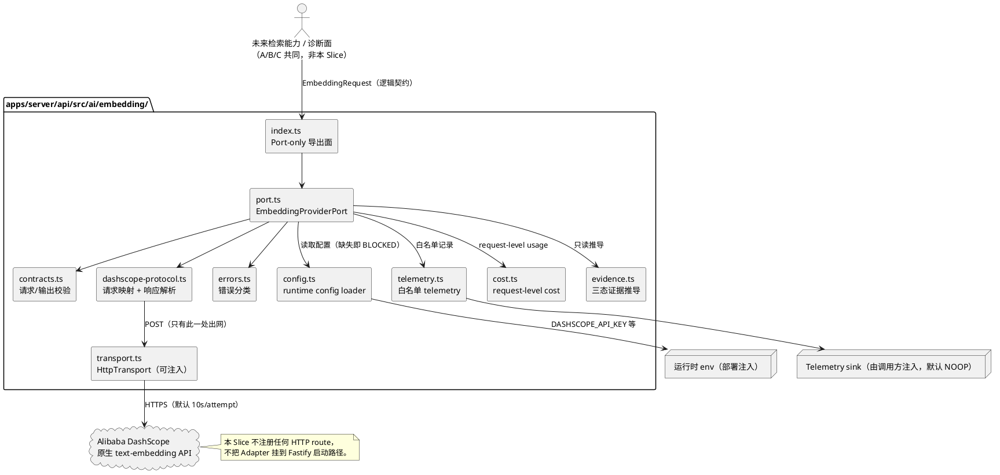
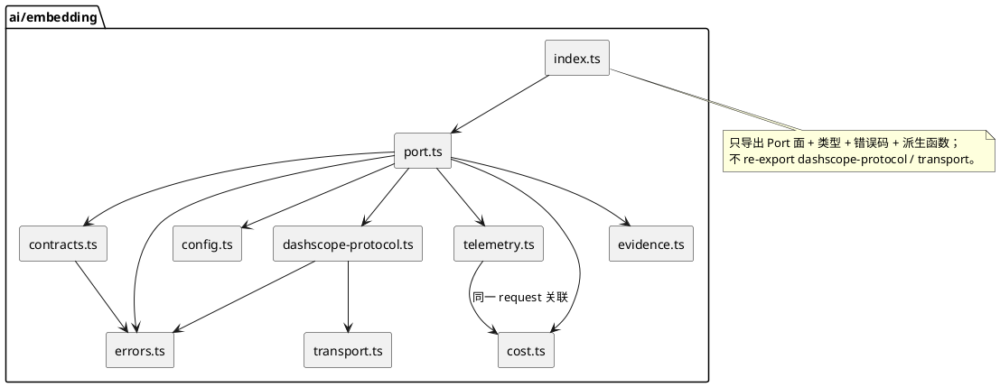
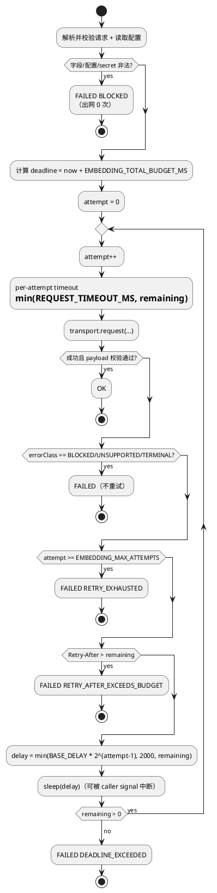
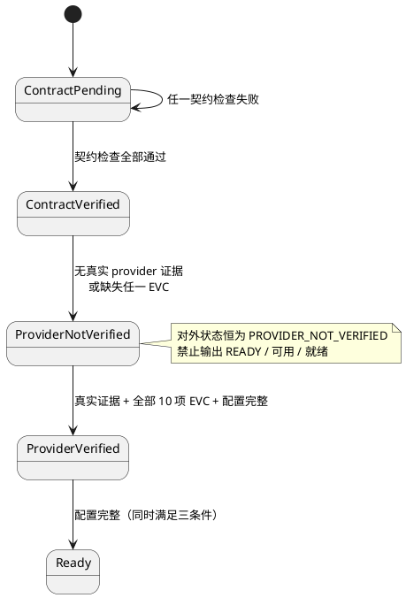
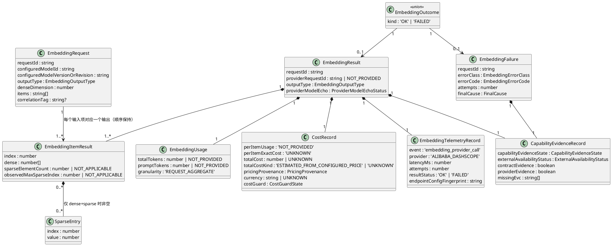

# Slice 20 — Implementation Plan（Plan AI 2）

> Repository: `pyxm1618/xiaoshuyin`
>
> Feature: `020-embedding-provider-adapter-foundation`
>
> V1 Phase: Phase 3 — Professional Knowledge & AI（`Docs/V1技术设计.md` §4.2 / §13.2 / §13.3 / §20）
>
> Role boundary: Plan AI 2 — Implementation Plan / Checklist / Tasks / Audit 1 only
>
> Status: `FINAL PASS — REVISION 4 RECONCILED（AUDIT 1 RE-RUN PASS）`
>
> Frozen Spec Authority: `specs/020-embedding-provider-adapter-foundation/spec.md`
> Revision 4，commit `95c37f45fade2dde9c90d2f16ba0e8430beadb1e`，blob `76c10f4fc81907cb1dcb37f5d522ec7086efef5b`
>
> **GOVERNANCE MODE: MODE A — NATIVE HTTP**（依据 §6.13：native HTTP + `globalThis.fetch` + 零 provider 依赖；
> 因此 `scripts/guard-static.mjs` 在 MODE A 下**必须与 base 字节级一致**，见 §5.3、§7.1 V15、NS-039）
>
> Forbidden in this artifact: production code / implementation tests / migration / CI change / guard change / Adapter implementation / provider call / model selection / route registration / Audit 2 / merge

本 Plan 的唯一职责，是把 **Frozen Spec Revision 4** 投影为一份**可直接交给 Developer AI 执行**的实现设计：
回答「到底要改哪些最小路径、按什么顺序、如何机械验证、哪些绝对不许做」。

本 Plan **不新增、不修改、不解释、不扩展**任何产品语义。所有 `SHALL` 断言仍以 `spec.md` 为唯一 Authority；
本 Plan 只回答 Spec 第 21 节委托给 Plan AI 2 的实现层决策，并在第 9 节逐项给出决定与依据。

```text
SLICE 20 PLAN AI 2 STATUS: FINAL PASS（Revision 4 targeted reconciliation + Audit 1 re-run）
SPEC: FROZEN — REVISION 4（commit 95c37f45 / blob 76c10f4f）
GOVERNANCE MODE: MODE A — NATIVE HTTP
PRODUCT IMPLEMENTATION: NOT AUTHORIZED（G1a + G1b + G2 未完成）
```

---

## 1. Upstream Traceability

### 1.1 Authority 消费关系

| 上游标识 / 来源 | 本 Plan 如何消费 | 本 Plan 不做什么 |
| --- | --- | --- |
| `Docs/总产品需求.md` | 只作为长期方向约束；不从中推导任何 V1 能力 | 不引入 V2–V5 能力 |
| `Docs/V1产品需求.md` | 只确认「专业内容/解释/Intervention 需要真实 APPROVED/PUBLISHED 版本」这一边界 | 不产生、不消费任何专业批准事实 |
| `Docs/总体技术架构.md` §11.2 | 确认 dense+sparse 专用 Adapter 是正式组件，且不要求「所有 AI 能力共用一个 SDK」 | 不建 generic AI SDK/框架层 |
| `Docs/总体技术架构.md` §11.3 | 确认 sparsevec Spike 必须使用真实 sparse payload，是**未来**独立责任 | 不做 sparsevec 编码 / pgvector 验证 |
| `Docs/V1技术设计.md` §4.2 | 确认 Phase 3 顺序：pgvector → dense+sparse → sparsevec Spike → Gold Dataset Eval → pg_jieba | 不跳过顺序、不提前做后续项 |
| `Docs/V1技术设计.md` §13.2 | 确认 A/B/C 三候选共用 dense 输入 | 不选择 A/B/C 胜者 |
| `Docs/V1技术设计.md` §13.3 | 直接冻结 Adapter 的 8 项职责（timeout/retry、model/version、output_type、dense dimension、sparse payload parsing、telemetry、error normalization、cost record） | 不为了「统一 SDK」牺牲 sparse 能力 |
| `Docs/V1技术设计.md` §20 | 确认首要候选身份与「生产 route 必须绑定 Gold Dataset + pinned version」 | 不写任何生产 pinned model 常量、不注册生产 route |
| `V1-C34` | Adapter 只声明真实契约与真实证据状态 | 不伪造 provider 成功 / cost / telemetry |
| `V1-X14` | `PROVIDER_VERIFIED` 只能来自真实 provider 证据 | 不以 mock/fixture 冒充可用性 |
| `specs/016-*/spec.md` §9 / §23 | intervention eligibility 与 AI/RAG 边界由 Slice 16 拥有 | 不读取、不推导 eligibility；不创建 AI/RAG runtime |
| `specs/017-*/spec.md` §Explicit Out of Scope | RAG / pgvector / embedding / reranking / Gold Dataset 均不属 Slice 17 | 不读写 professional knowledge 生产表 |
| `specs/018-*` Frozen Spec（远端 spec 分支） | Gold Dataset evaluation truth 由 Slice 18 拥有 | 不创建样本 / label / eval runner |
| `specs/019-*/spec.md` §8 / §9.2 | PostgreSQL 18 + pgvector dense `vector` readiness 由 Slice 19 拥有；其 §8 non-goals 把 DashScope sparse adapter / embedding provider calls 留在后续 Slice | 不做 DB 迁移 / 不做 DB 能力验证 / 不修改 Slice 19 资产 |

### 1.2 上游 requirement identifier 锚点

| Identifier | 本 Plan 的投影位置 |
| --- | --- |
| `V1-C34` / `V1-X14` | 第 6.11 节（证据三态）、第 7.6 节（EVC 映射）、第 8 节（真实 provider 验证设计） |
| `Docs/V1技术设计.md` §13.3 | 第 6.3–6.10 节（Port / Dense / Sparse / Error / Timeout / Secret / Telemetry / Cost） |
| `Docs/V1技术设计.md` §4.2 / §20 | 第 3.3 节（边界）、第 6.12 节（配置语义）、第 6.13 节（不做 model selection） |
| `Docs/总体技术架构.md` §11.2 / §11.3 | 第 5.1 节（seam 选择）、第 3.2 节（不做 sparsevec） |

### 1.3 Slice 19 non-goals 与 Slice 20 的关系（不构成冲突）

`specs/019-*/spec.md` §8 明确把 `DashScope sparse adapter`、`embedding provider calls`、`embedding adapter`（Spec §20 的首要候选）列为 **Slice 19 不做**。
这**不是**永久禁令，而是 Slice 19 的 scope 边界：这些能力被显式留在后续独立 Slice，即本 Slice。
本 Plan 因此：

1. 不修改 `specs/019-*`，不修改 Slice 19 的 readiness 资产（`db/init/02-pgvector.sh`、`scripts/lib/pgvector-readiness.mjs`、`scripts/pgvector-readiness.mjs`）；
2. 不依赖 Slice 19 runtime，也不使用其 DB；
3. 不把 Slice 19 的 `R19-pgvector-*` 规则当作 Slice 20 的永久命名禁令（理由与保守取舍见 5.5 节）。

---

## 2. Constitution Check

### 2.1 Authority hierarchy

| 检查项 | 结果 | 证据 |
| --- | --- | --- |
| 四份 Authority Docs 未被本 Plan 修改 | PASS | 本 Plan 只写入 `specs/020-embedding-provider-adapter-foundation/` |
| 四份 Authority Doc blob 与 Frozen Spec §2 记录一致 | PASS（只读核验，未改动） | `git diff --name-only` 不含 `Docs/` |
| 本 Plan 不构成第二产品/架构 Authority | PASS | 全部设计均可回溯到 Frozen Spec 的 FR/AS/NS/C20 |
| Frozen Spec 语义未被 Plan 改写 | PASS | Plan 逐条登记 FR/AS/NS 覆盖（第 7.4–7.6 节） |
| 未发现需要修改 Authority Docs 才能回答的问题 | PASS | 第 9 节 10 项全部为实现层决策 |

### 2.2 AGENTS.md 不可协商边界（逐条）

| 边界 | 本 Plan 的机械保障 |
| --- | --- |
| 不得静默改写产品需求 | Plan/Checklist/Tasks 不允许修改 `spec.md`；任务 T012 校验 spec blob 不变 |
| 不得改冻结 V1 技术栈/架构 | 不新增任何依赖（第 6.13 节）；不新增 package；不改 `package.json` / `bun.lock` |
| 不得重排/合并/删减 canonical-flow 语义 | 本 Slice 不涉及 A/010xx 节点语义 |
| 不得实现 V2–V5 能力 | NS-013/NS-021/NS-022/NS-023 由静态守卫与 architecture test 机械拒绝 |
| 不得用自主 agent 替代确定性规则 | Adapter 无 agent、无规划、无 prompt |
| 不得 bypass Authorization/Consent/Safety/Compliance/RLS/version gate | FR-044/FR-045 + architecture test（无 DB client、无 authorize/session role 调用） |
| 不得改测试/快照/fixture 让错误实现通过 | Tasks 明确禁止修改既有测试与既有 fixture；只允许新增 Slice 20 自己的测试 |
| 不得把 UNKNOWN/DECLINED/CONFLICT/failure 当成功 | 第 6.6 节错误模型；`PROVIDER_NOT_VERIFIED` 不得表述为 READY |
| 不得无新鲜证据声明 PASS/READY | 第 7 节验证矩阵 + 第 8 节证据；`READY` 只在三条件同时满足时可推导 |
| 不得因 AI 声称就合并 | 本 Plan 不授权 merge；G2 与 Slice 20 merge 均为独立决定 |

### 2.3 V1 技术设计 Phase 识别

| 项 | 值 |
| --- | --- |
| Phase | Phase 3 — Professional Knowledge & AI |
| Phase 3 当前已交付 | Slice 16（intervention eligibility）、Slice 17（professional knowledge lifecycle）、Slice 18（Gold Dataset spec，未合并 main）、Slice 19（pgvector dense readiness，已合并） |
| 本 Slice 在 Phase 3 中的位置 | pgvector readiness **之后**、sparsevec Spike **之前**的唯一 route-neutral 前置 |
| 是否发明并行 roadmap | 否（顺序与 §4.2 完全一致） |

### 2.4 Change control

| 规则 | 本 Plan 的处理 |
| --- | --- |
| Authority 变更必须走 authority-inputs + authority-impacts + 下游收敛 | 本 Plan 不触发任何 Authority 变更（`Docs/**` diff = 0） |
| 生产路径所有权只能由仓库受控 registry 授予 | 第 5.2 节：Slice 20 只注册**一条** FEATURE PREFIX 规则；MODE A 下 ownership 注册**无条件必需**（C20-21） |
| registry 变更不得与 product 实现同车 | 第 5.6 节：治理 PR（仅 registry）与实现 PR 严格分离 |
| Rule 8 是否可改由实际依赖决定 | 第 5.3 节：MODE A 下 guard **字节级不变**；Rule 8 allowance 仅 MODE B（真实 provider SDK import）才存在，当前**不成立** |
| 完成任务的证据必须绑定真实合并实现 PR 与 `[VERIFY:...]` 契约 | `tasks.md` 每任务提供 `[REQ:...]` / `[VERIFY:...]` 契约 |

### 2.5 Verification contract

| 声明类型 | 本 Plan 要求的证据 |
| --- | --- |
| `CONTRACT_VERIFIED` | 离线 vitest 契约测试 + architecture test + guard 通过（无需真实 provider） |
| `PROVIDER_NOT_VERIFIED` | 真实 provider 证据缺失时的**始终**有效对外状态 |
| `PROVIDER_VERIFIED` | 只在 I7 受控真实调用并覆盖 EVC-01..EVC-10 时产生 |
| 声称 READY | 被禁止；只有 `CONTRACT_VERIFIED` + `PROVIDER_VERIFIED` + 配置完整才可由 `deriveCapabilityEvidence` 推导 |

### 2.6 Constitution Check 结论

```text
Constitution Check: PASS
Authority Gate: PASS
Scope Contract: PASS
STOP 条件: 若实现需要修改 Docs/**、spec.md、Slice 16–19 或改动 V1 技术栈 → STOP 并上报，不得就地变通
```

---

## 3. Scope Contract

### 3.1 本 Slice OWNS（实现层投影）

1. 一个 route-neutral 的 Embedding Provider Port（请求/响应/错误/状态/成本/遥测的稳定逻辑契约）。
2. Dense 输出契约与校验（有限数值、声明维度、确定性拒绝）。
3. DashScope sparse payload 的**解析与校验**，归一化为 `{index, value}` 升序列表。
4. `output_type` 语义（`dense` / `dense+sparse`）与不支持组合的显式拒绝。
5. configured model identity 与 provider model echo 的**分离**记录。
6. bounded timeout / retry budget / caller cancellation。
7. provider error normalization（`BLOCKED` / `UNSUPPORTED` / `RETRYABLE` / `TERMINAL`）。
8. request-level cost record（不伪造 per-item）。
9. 最小 telemetry 记录（白名单字段，零明文、零 secret）。
10. secret 运行时注入边界。
11. 三态证据模型与只读推导函数。
12. candidate-neutral 的机械证明（无 route 参数、无 winner 声明）。

### 3.2 本 Slice 明确 NOT OWNS

| 能力 | 归属 |
| --- | --- |
| sparsevec 编码 / 索引 / 距离 / pgvector 验证 | 未来 sparsevec Spike（Slice 19 non-goals 明确留给后续） |
| pg_jieba / 专业词典 / lexical 检索 | 未来 B 路线独立责任 |
| knowledge_embeddings / knowledge_chunks 持久化 | 未来独立责任（本 Slice 明确不持久化） |
| retrieval pipeline / hard filters / top-k / ranking | 未来独立责任 |
| reranker / fusion / RRF / hybrid search | 未来独立责任 |
| Context Builder / AI Task Runtime / TaskModelRegistry | 未来独立责任 |
| Gold Dataset runtime / eval / label | Slice 18 |
| Professional Knowledge identity/version/review/publication | Slice 17 |
| Intervention eligibility | Slice 16 |
| PostgreSQL 18 + pgvector dense readiness | Slice 19 |
| production `embedding_route_version` / `rag_route_version` | 未来带 Gold Dataset 证据的独立责任 |
| A/B/C winner selection | 未来 Gold Dataset Eval |
| reviewer / approval / qualification authority | Slice 16/17 + Staff Authority |
| 用户可见 AI 功能 / HTTP route / 页面 / 推送 | 不属于本 Slice |
| generic provider registry / model registry / plugin / workflow / eval platform / vector abstraction | 永久禁止 |

### 3.3 与 Slice 16–19 的可执行边界

| 上游 | 本 Slice 允许的接触面 | 本 Slice 禁止的接触面 |
| --- | --- | --- |
| Slice 16 | 无（只在文档中承认其 truth） | 不读写 intervention 表；不调用 eligibility |
| Slice 17 | 无 | 不读写 `professional_knowledge_*`；路径不含 `professional-knowledge` |
| Slice 18 | 无 | 不引用 Gold Dataset fixture / label |
| Slice 19 | 无（不 import、不修改、不执行其脚本） | 不改 `db/**`；不 import `pgvector-readiness`；不做 DB 连接 |

### 3.4 Negative-scope 的机械门禁归属（与 NS-001..NS-042 一一对应）

> MODE A 口径：Rule 8 不新增任何豁免、不新增任何 fixture；下面的门禁集合**不含** guard 改动。

| 门禁类型 | 承载者 | 覆盖 NS |
| --- | --- | --- |
| `.specify/implementation-ownership.json`（G1b 唯一 delta） | 唯一 seam 注册 + unknown path fail closed | NS-031, NS-032, NS-039 |
| `scripts/guard-static.mjs` 现有规则（MODE A 下**字节不变**） | R6 / R8 / R10 / R11 / R17 / R19 | NS-001..NS-007, NS-014..NS-019, NS-023, NS-027, NS-029, NS-030 |
| `tests/architecture/embedding-provider-boundary.test.ts`（新增） | 结构/依赖/命名/导出面 + provider egress 只在 seam + consumer 只经 Port + endpoint policy + 依赖边界 | NS-005, NS-006, NS-008..NS-013, NS-020..NS-026, NS-033..NS-042 |
| diff 断言（实现 PR 的机械检查） | `git diff --name-only` | NS-001..NS-004, NS-016..NS-019 |
| 契约测试字段断言 | Port/Dense/Sparse/Error/Cost/Telemetry | NS-033..NS-038 |

### 3.5 硬边界（任何任务违反即 FAIL，不得以「未来方便」为由放宽）

```text
FORBIDDEN PATHS（生产代码绝不触碰）：
  Docs/**
  specs/016-*
  specs/017-*
  specs/018-*
  specs/019-*
  db/**
  packages/ai/**
  packages/rag/**
  packages/memory/**
  apps/miniprogram/**
  apps/operations/**
  packages/notifications/**
  .specify/implementation-ownership.json   ← 只在 G1b 治理 PR 修改（唯一 delta）
  scripts/guard-static.mjs                 ← MODE A：任何 PR 都不得修改（字节级不变；见 AS-035 / NS-039）
  .specify/change-bindings/**              ← 只在实现 PR 创建自己的 binding
  package.json / bun.lock                  ← 零新依赖，绝不修改
  .env / .env.example / .env.*             ← 绝不修改（理由见 6.8 节）
  apps/server/api/src/app.ts               ← 不接入启动期依赖、不注册 route
```

---

## 4. Remote Truth（Plan AI 2 复核结果）

### 4.1 核验表

| 项 | 值 | 核验方式 |
| --- | --- | --- |
| `origin/main` | `fa7a68457ed75e3318efcfbe49dd31f5d4aab100` | `git rev-parse origin/main` |
| `origin/main` latest commit | `Merge pull request #111 from pyxm1618/fix/019-post-merge-targeted-remediation` | `git log --oneline` |
| Planning branch | `plan/020-embedding-provider-adapter-foundation` | `git rev-parse --abbrev-ref HEAD` |
| Planning base（Revision 4 本轮开始） | merge commit `be97f9e2`（普通 merge `origin/main`，未改写 Frozen 历史） | `git log --oneline -1` |
| Planning HEAD（冻结） | 由本轮 closeout 报告记录（Revision 4 response-envelope reconciliation commit） | `git rev-parse HEAD` |
| 上一 Planning HEAD（Revision 3 语义） | `bb1e5907f42b4020a6166534f4fa5d8aa6be4c46` —— provider response-envelope planning 部分 SUPERSEDED | `git log --oneline` |
| ahead / behind vs `origin/main` | ahead 15 / behind 0（Revision 4 reconciliation 起始实测）；最终 Planning HEAD 与 ahead/behind 以 closeout 报告为准，不在 Plan 内硬编码 | `git rev-list --left-right --count origin/main...HEAD` |
| Frozen Spec authority commit | `95c37f45fade2dde9c90d2f16ba0e8430beadb1e`（Revision 4，REVISION 4 REMOTE READ-BACK VERIFIED） | `git log --oneline origin/spec/020-*` |
| Frozen `spec.md` blob | `76c10f4fc81907cb1dcb37f5d522ec7086efef5b` | `git hash-object specs/020-*/spec.md` + `git ls-tree HEAD` |
| Frozen Spec semantic drift | 0 | plan/checklist/tasks 不修改 `spec.md`（T012 复核 blob） |
| `scripts/guard-static.mjs` blob | `50c6864fc9337b2ca5a996bc98dc5e7647be798c`（main / 当前工作树一致；merge latest main 后实测） | `git rev-parse origin/main:scripts/guard-static.mjs` = `git rev-parse HEAD:scripts/guard-static.mjs` |
| guard baseline self-test | `PASS (39 synthetic fixtures validated)`；`guard-static: PASS (0 violations)` | 本轮实跑 |
| Authority docs drift | 0 | `Docs/**` 未修改 |
| 竞争 Slice 20 实现 | 0 | main 上无 `apps/server/api/src/ai/`；`packages/` 无 `ai|rag|memory` |
| main 上 Slice 20 feature 目录 | **不存在**（`git ls-tree origin/main -- specs/020-*` 为空）→ G1a 仍必需 | `git ls-tree` |
| `package.json` provider 依赖 | 无 `dashscope` / `@alicloud` / 任何 provider SDK；`engines.node = 26.13.0` | 只读核验 |
| Open PR | #112 `chore(s20): admit frozen Slice 20 spec and planning authority`（open，head `974d730e`，BLOCKED by unresolved review thread；未合并） | `gh pr view 112` |
| `PRODUCT_PREFIXES` | `apps/`、`packages/`、`db/` | `validate-change-governance.mjs` |
| `FIXED_EXEMPT_PREFIXES` | `.specify/`、`.github/`、`specs/`、`tests/`、`scripts/`、`Docs/` | 同上 |
| ownership resolution | `LONGEST_MATCH`，未知 production path fail closed | `implementation-ownership.json` |
| ownership PREFIX 约束 | PREFIX path 必须以 `/` 或 `-` 结尾；禁止通配符 | `validate-change-governance.mjs` |
| ownership 现有 embedding 条目 | 无 | registry 全文检索 |
| Rule 8 `FORBIDDEN_SAFETY_IMPORTS` | 含 `dashscope`、`@alicloud`、`openai`、`anthropic`、`guardrails`、`ollama`、`langchain` 等 | `guard-static.mjs:447` |
| Rule 8 作用域 | `runSafetyRules()` 扫描 `ROOT` 全仓库 `.ts/.tsx/.js/.mjs/.cjs`（不豁免 `tests/`） | `guard-static.mjs:488` |
| Rule 8 self-test 分发 | 按 `sample.rule === 'R8-safety-scope'` 直接调用 `checkSafetyScopeNegatives(path, content, report)` | `guard-static.mjs:1286` |
| Rule 19 现状（main） | `forbiddenTokens`（`knowledge_embeddings`/`sparsevec`/`pg_jieba`/`pg_textsearch`/`hnsw`/`ivfflat`）与 `EmbeddingAdapter`/`RerankerAdapter` 检测作用于**全仓库**（豁免 `tests/`、`specs/`、`Docs/`） | `guard-static.mjs:1005` |
| Rule 17 | 只作用于路径含 `professional-knowledge` 的文件 | `guard-static.mjs` `checkProfessionalKnowledgeBoundaries` |
| `FORBIDDEN_PATHS` | `apps/miniprogram`、`apps/operations`、`packages/ai`、`packages/rag`、`packages/memory`、`packages/notifications` | `guard-static.mjs:365` |
| 现有 env 约定 | `runtime-env.ts`：显式 required、无默认 secret、`NODE_ENV` 未设视为 production | 只读 |
| 启动期依赖约束 | `plugins/config.ts` 在 `app` 启动时调用 `loadRuntimeConfig`，缺任一 secret 即 fail | 只读 → 本 Plan 不得把 embedding 配置并入该路径（6.12） |
| Node 版本 | `engines.node = 26.13.0`；`target ES2024`；`strict` + `noUncheckedIndexedAccess` + `exactOptionalPropertyTypes` | `package.json` / `tsconfig.base.json` |
| 测试约定 | `vitest`，`include: tests/**/*.test.ts`，`maxWorkers: 1`，`setupFiles: tests/setup/env.ts`（要求 `DATABASE_URL`） | `vitest.config.ts` |
| canonical 回归入口 | `scripts/verify-all.mjs`（含 `guard:static`、`typecheck`、`guard-static --self-test`、`validate-governance`、`run-governance-tests`） | 只读 |
| 现有 evidence 目录 | `tests/evidence/`（`SKIP_DIRS` 含 `tests/evidence`） | `guard-static.mjs:22` |

### 4.2 PR #111 对 Slice 20 规划的影响（关键）

PR #111 `fix(s19): scope pgvector static guard and align Stage A compose image` 的 guard 变更把 **Rule 19 的
`forbiddenTokens` 与 `EmbeddingAdapter` / `RerankerAdapter` 检测收窄到 Slice 19 自己的实现面**
（`db/init/02-pgvector.sh`、`scripts/pgvector-readiness.mjs`、`scripts/lib/pgvector-readiness.mjs`）。

这产生一个**必须显式处理的不确定性**：Rule 19 的严格度取决于 #111 是否已合并。

本 Plan 的决定（fail-closed、不依赖 PR 合并结果）：

```text
PLAN DECISION R4-1:
  Slice 20 的命名与 token 选择，在 #111 合并前后都成立。
  即：无论 Rule 19 是「全仓库严格」还是「仅 Slice 19 面」，
  Slice 20 的 seam 代码都不使用 EmbeddingAdapter / RerankerAdapter 标识符，
  不使用 embedding-adapter.ts / reranker-adapter.ts 文件名，
  不出现 sparsevec / knowledge_embeddings / pg_jieba / pg_textsearch / hnsw / ivfflat token。
  理由：
    (a) 这些 token 的**语义**本就被 NS-001/NS-005/NS-006/NS-008/NS-010 与 FR-021 禁止；
    (b) 依赖「另一个 PR 的守卫收窄」来获得命名自由度，等于让 Slice 20 的可行性
        依附于一个与本 Slice 无关的治理改动，违反 fail-closed；
    (c) 保守命名在任何 main 状态下都可通过，且不产生语义损失。
```

由此产生的协同要求：

| 情形 | 处理 |
| --- | --- |
| #111 在 G1b 之前合并 | MODE A 下 G1b **不触碰** `scripts/guard-static.mjs`，与 #111 的 Rule 19 改动无冲突面；G1b 只需 merge main 并保持 guard blob 等于 base blob（V15） |
| #111 在 G1b 之后合并 | 与 Slice 20 无关：Slice 20 的治理 delta 只有 ownership registry，guard 不参与 |
| #111 长期不合并 | 不影响：Slice 20 采用保守命名，且 MODE A 下 guard 字节不变，两种 guard 版本都 PASS |

**Revision 3 影响**：Revision 2 的治理假设（「G1b 必须改 Rule 8：allowance + F1..F11」）已被 Revision 3 **废弃（SUPERSEDED）**，
因此旧计划才需要评估「Rule 8 改动区与 #111 Rule 19 改动区相邻」。MODE A 下该冲突面**完全消失**（见 §5.3）。

**Revision 4 影响**：仅修订 native HTTP success response envelope（`output.embeddings`）及其下游 parser/test/verification；
Revision 3 的治理模式决定（MODE A）、seam、route-neutral、sparse/dense 契约、证据模型等**全部保持有效**。

### 4.3 Duplicate / drift 结论

```text
Competing Slice 20 spec:        NONE
Competing Slice 20 branch:      NONE（除本 planning branch）
Competing Slice 20 PR:          NONE
Existing embedding production owner: NONE（registry 60 条规则中无 `ai/` 相关条目）
Authority drift:                0
Frozen Spec semantic drift:     0
Frozen Spec revision:           4（95c37f45 / blob 76c10f4f）
GOVERNANCE MODE:                MODE A — NATIVE HTTP
```

---

## 5. Phase G — Governance Prerequisite

> 本节冻结**唯一**生产实现 seam，以及使该 seam 被 ownership 授权所需的最小治理改动。
> 本节**不创建任何文件**；只冻结 G1b 必须提交的精确 delta（MODE A：**恰好一行** registry 规则）。

### 5.0 GOVERNANCE MODE 声明（冻结）

```text
GOVERNANCE MODE: MODE A — NATIVE HTTP
```

**选择依据（唯一依据：实际实现依赖，而非偏好）**

| 事实来源 | 值 | 推论 |
| --- | --- | --- |
| §6.13 SDK 决定 | **不使用** DashScope SDK | 不产生 `dashscope` 命中的 import |
| §6.13 HTTP 客户端 | `globalThis.fetch`（Node 26 原生） | 无 provider 客户端依赖 |
| §6.13 `@alicloud` 包 | **不使用** | 不产生 `@alicloud` 命中的 import |
| `package.json` / `bun.lock` | 零新增依赖 | 依赖图无 provider SDK |
| 结论（C20-21） | 不存在命中 Rule 8 forbidden token 的 provider import → **MODE A** | Rule 8 allowance **不得出现** |

由此冻结三条不可协商结论：

1. **ownership 注册无条件必需**（MODE A 也需要；否则 seam 是 unknown production path，validator fail closed）。
2. **`scripts/guard-static.mjs` 在 MODE A 下必须与 base 字节级一致**；不新增 allowance、不新增 fixture、不删除/不放宽任何规则。
3. **不得为了进入 MODE B 而人为引入 SDK**（NS-040）；MODE B 只有「真实实现依赖命中 forbidden token」时才成立，当前**不成立**。

### 5.1 唯一 Adapter implementation seam

```text
EXACT IMPLEMENTATION SEAM（唯一生产路径前缀）
apps/server/api/src/ai/embedding/
```

**为什么这是最小的正确 seam（Why this is the smallest correct seam）**

1. **它落在已经存在的应用边界内**：`apps/server/api` 是当前唯一的 API 组合根（Fastify + 现有 plugins/services/routes），
   不需要新建 package、不需要改 workspace 拓扑、不需要改 `package.json`。
2. **它不落在任何 FORBIDDEN_PATHS**：`packages/ai`、`packages/rag`、`packages/memory`、`apps/miniprogram`、
   `apps/operations`、`packages/notifications` 全部避开。
3. **它足够窄**：一个目录只承载「一个 Port + 一个 provider adapter 的协议/校验/错误/成本/遥测」，
   不承载 generic provider registry、不承载检索、不承载持久化。
4. **它使 consumer 只能经 Port 访问**：`index.ts` 只导出 Port 面；provider 专有模块不出现在导出面，
   因此 business consumer 不可能直接 import provider 客户端。
5. **它不需要 Rule 8 放宽**：MODE A 的 seam 内没有 `dashscope` / `@alicloud` import（§6.13），
   因此 `scripts/guard-static.mjs` 保持字节级不变即可；使该目录合法的唯一治理动作是 ownership registry 注册。
   这同时消除了「相邻目录 `embedding-extra/`、`embeddings/` 是否被前缀误放行」这一整类风险（NS-039）。
6. **它满足 NS-032 的机械判据**：NS-032 禁止的是「目录级泛化授权（如 `ai/`、`provider/`、`providers/`、`embeddings/`）」；
   本 seam 的 path 是 `apps/server/api/src/ai/embedding/`，绑定**单一 feature、单一 provider、单一能力**，
   且 registry 只新增**一条**规则。`apps/server/api/src/ai/` 这个父目录**不**获得任何所有权。

**为什么不选其它候选**

| 候选路径 | 拒绝理由 |
| --- | --- |
| `packages/ai/**`、`packages/rag/**`、`packages/memory/**` | FORBIDDEN_PATHS；且构成 generic AI/RAG package |
| `apps/server/api/src/providers/**` 或 `.../providers/dashscope/` | `providers/` 是 NS-032 明确点名的泛化目录；会开启「多 provider」语义 |
| `apps/server/api/src/ai/**`（父目录） | 目录级泛化授权，NS-032 禁止 |
| `apps/server/api/src/services/**` | 与既有 SHARED/EXACT ownership 冲突；services 是业务服务层，不是 provider 适配层 |
| `packages/domain/src/embedding-*.ts` | 会让 domain 依赖外部 provider；且 R11/architecture 方向错误 |
| `db/**` / `scripts/**` | 与 Slice 19 资产重叠，且 provider 适配不属于 DB/工具层 |

### 5.2 Ownership matcher 设计（G1b 唯一 delta）

> MODE A 下 G1b 的**唯一**改动就是下面这一条 registry 规则；`scripts/guard-static.mjs` 不在此列。

`.specify/implementation-ownership.json` 只新增**一条**规则（追加到 `rules[]` 末尾）：

```json
{
  "id": "embedding-provider-adapter-020",
  "match": {
    "kind": "PREFIX",
    "path": "apps/server/api/src/ai/embedding/"
  },
  "ownership": {
    "kind": "FEATURE",
    "features": [
      "020-embedding-provider-adapter-foundation"
    ]
  }
}
```

机械约束（validator 会强制）：

| 约束 | 值 | 核验 |
| --- | --- | --- |
| `kind` ∈ {EXACT, PREFIX} | PREFIX | validator 第 147 行 |
| path 是 production path | `apps/` 前缀 → 是 | `isProductPath` |
| PREFIX 以 `/` 结尾 | 是 | validator 第 152 行 |
| 无通配符 `* ? [ ] { }` | 无 | validator 第 151 行 |
| `FEATURE` 恰好 1 个 feature | 1 | validator 第 166 行 |
| feature 目录存在且有 spec.md | 依赖 G1a | `validateFeatureExists` |
| 不与既有规则重复 matcher | 无重复 | validator 第 156 行 |

**为什么必须 PREFIX 而不是 12 条 EXACT**

- seam 内部会有多个文件（port/contracts/config/errors/transport/protocol/telemetry/cost/evidence/index）。
- 用 EXACT 会让「每个新文件都要新注册一条规则」，导致实现 PR 与 registry 变更同车（被 validator 明确禁止），
  或需要反复开治理 PR，把治理成本转成实现阻塞。
- 一条 PREFIX 覆盖**同一目录**，仍是「最小可证明安全的窄前缀」，且不引入任何通配语义。

**为什么不是 `apps/server/api/src/ai/` 或更宽**

- 更宽的前缀会让**未来任何** AI 子目录都被 Slice 20 拥有，构成 NS-032 的泛化授权，且会被 Audit 2 判为越界。
- 本 Plan 的 checklist 有专门的机械项：registry 中必须**恰好存在一条** path 等于
  `apps/server/api/src/ai/embedding/` 的新增规则，且**不存在** path 为
  `apps/server/api/src/ai/`、`apps/server/api/src/providers/`、`apps/server/api/src/embeddings/` 的规则。

### 5.3 Rule 8：MODE A 下不做任何修改（原 delta B 降级为 MODE B-only）

**MODE A 冻结结论**

```text
scripts/guard-static.mjs   MODE A: BYTE-IDENTICAL TO BASE — NO EDIT
Rule 8 allowance           MODE A: MUST NOT EXIST
provider import fixture    MODE A: MUST NOT BE ADDED
```

现状（只读事实，`scripts/guard-static.mjs:447-486`）：

- `FORBIDDEN_SAFETY_IMPORTS` 含 `dashscope`、`@alicloud`、`openai`、`anthropic`、`guardrails`、`ollama`、`langchain` 等；
- `checkSafetyScopeNegatives(relPath, content, report)` 对**所有**被扫描的实现代码做 `specifier.includes(forbidden)`；
- `runSafetyRules()` 作用域是仓库全部 `.ts/.tsx/.js/.mjs/.cjs`（不豁免 `tests/`）；
- self-test 通过 `rule: 'R8-safety-scope'` 直接分发。

**为什么这在本 Plan 下不构成阻塞**

1. §6.13 决定 native HTTP + `globalThis.fetch`，seam 代码**不 import** `dashscope` / `@alicloud`；
2. `@alicloud` 包不引入；`package.json` / `bun.lock` 零新增依赖；
3. 因此 Rule 8 的全局条目对 seam **不产生任何命中**——既不需要放宽，也没有需要「允许」的 import；
4. 若未来实现真的需要 provider SDK，那是**依赖图语义变更**，必须先回到 Spec Revision 流程重新授权，
   而不是在 G1b 里预先预留 allowance 或 fixture（NS-040）。

**MODE A 的机械证据（替代 Rule 8 改动）**

| 证据 | 机械判据 | 对应 |
| --- | --- | --- |
| guard 字节不变 | `git rev-parse <base>:scripts/guard-static.mjs` == `git rev-parse HEAD:scripts/guard-static.mjs` | AS-035 / NS-030 / NS-039 / V15 |
| guard 自测不退化 | `node scripts/guard-static.mjs --self-test` → `PASS (39 synthetic fixtures validated)` | V7 |
| 全局保护仍在 | `FORBIDDEN_SAFETY_IMPORTS` 仍含全部既有 token；diff 无删除 | NS-027 / NS-029 |
| 无新增 fixture | self-test 数量 == base 数量（39），且无 `slice20 …` fixture | NS-039 |
| 依赖边界 | seam、`package.json`、lockfile 中 `dashscope` / `@alicloud` / provider SDK 命中 = 0 | NS-040 / V16 |
| provider egress 边界 | architecture test：`fetch(` 调用点仅在 seam 内，且业务 egress 仅 `transport.ts` | AS-035 / T010 |
| consumer boundary | architecture test：seam 外不得 import `ai/embedding/transport` 或 `dashscope-protocol`；只能经 `index.ts` Port 面 | AS-035 / T010 |
| endpoint policy | 只接受 `https://{host}/api/v1/services/embeddings/text-embedding/text-embedding`，host 必须落在批准后缀；无 override 通道 | AS-035 / T010 |
| unknown path fail closed | validator 对未注册 production path 直接失败；registry 无更宽 matcher | AS-035 / §5.2 |

**MODE B 参考（条件说明；当前明确不进入）**

MODE B 只有在实现**真实包含**命中 Rule 8 forbidden token 的 provider import 时才成立（AS-036）。
届时其合法形态才是「对唯一 seam 做精确 path-aware allowance + positive/negative fixtures（含 cross-path 与
unknown-path 拒绝）」。**当前 Plan 明确不进入 MODE B**，因此：

- 不新增 `R8_PATH_SCOPED_ALLOWANCES`；
- 不新增 `isR8PathAllowed` 或任何 path 归一化函数；
- 不新增任何 provider import fixture（含正例）；
- 不修改 `scripts/guard-static.mjs` 的任何一行。

**MODE B 的边界原则（仅当未来触发时适用，当前不成立）**

- allow set 只含 `dashscope` / `@alicloud` 两个 token × 唯一 seam 前缀；`openai` / `guardrails` 等一律不放宽；
- 任何 token 或前缀扩张都必须是一次显式、可审计的 diff；
- 该形态**当前不成立**，因此不得提前落地任何部分。

### 5.4 Guard adversarial fixtures — MODE B only（当前 NOT APPLICABLE）

```text
MODE A: fixtures F1..F11 MUST NOT BE ADDED（NS-039）
MODE B: 仅当实现真实 import 命中 forbidden token 时才需要
```

MODE A 下 `scripts/guard-static.mjs` 字节级不变，因此：

- self-test 的 fixture 数量必须等于 base 数量（当前 **39**）；
- 不得出现任何 `slice20 …` fixture 名称；
- 不得为了"证明 allowance 可用"而新增正例 fixture——因为 MODE A 中**不存在** allowance。

下表只是 **MODE B 条件触发时的候选设计**（历史残留设计的归档，当前不得落地），
用于将来若实现真的引入 provider SDK 时快速复用其对抗维度：

| # | fixture 名称 | 合成 path | 合成 content | `expectViolation` | 证明什么 |
| --- | --- | --- | --- | --- | --- |
| F1 | `slice20 authorized seam allows dashscope` | `apps/server/api/src/ai/embedding/dashscope-protocol.ts` | `import { X } from 'dashscope';` | `false`（正例） | 授权 seam 内允许 |
| F2 | `slice20 authorized seam allows @alicloud` | `apps/server/api/src/ai/embedding/transport.ts` | `import { Y } from '@alicloud/tea-util';` | `false`（正例） | 授权 seam 内允许第二种 token |
| F3 | `slice20 adjacent directory rejected` | `apps/server/api/src/ai/embedding-extra/x.ts` | `import { X } from 'dashscope';` | `true` | 相邻目录（`embedding-extra/`）不放行 |
| F4 | `slice20 similar-name directory rejected` | `apps/server/api/src/ai/embeddings/x.ts` | `import { X } from 'dashscope';` | `true` | 相似命名（`embeddings/`）不放行 |
| F5 | `slice20 outside seam service rejected` | `apps/server/api/src/services/embedding-call.ts` | `import { X } from 'dashscope';` | `true` | seam 外业务层不放行 |
| F6 | `slice20 cross-path package rejected` | `packages/domain/src/embedding-port.ts` | `import { X } from 'dashscope';` | `true` | 跨树不放行 |
| F7 | `slice20 unknown path rejected` | `apps/server/api/src/ai/unknown/x.ts` | `import { X } from 'dashscope';` | `true` | 未注册路径 fail-closed |
| F8 | `slice20 traversal path rejected` | `apps/server/api/src/ai/embedding/../../services/x.ts` | `import { X } from 'dashscope';` | `true` | 路径归一化先于前缀匹配生效 |
| F9 | `slice20 non-authorized token inside seam rejected` | `apps/server/api/src/ai/embedding/x.ts` | `import OpenAI from 'openai';` | `true` | narrow allowance 只放宽 2 个 token |
| F10 | `slice20 guardrails regression still rejected` | `packages/domain/src/legacy.ts` | `import { Guard } from '@alibaba/guardrails';` | `true` | 既有 Safety 保护未回归 |
| F11 | `slice20 public safety route regression still rejected` | `apps/server/api/src/routes/evil-s20.ts` | `app.post('/api/v1/safety/resolve-risk', h);` | `true` | Rule 8 非 import 分支未受影响 |

**MODE A 的等价覆盖**：上表试图证明的「路径精确性 / 跨树拒绝 / unknown-path 拒绝 / 相邻名拒绝」
在 MODE A 中由 **ownership matcher** 承担（§5.2 + §5.3 证据表），不需要也不能通过 guard fixture 证明。
`unknown production path fail closed` 由 `validate-change-governance.mjs` 的 ownership resolution 机械保证。

### 5.5 不申请 Rule 19 豁免 + 命名/token 禁令（不可协商）

本 Plan **不修改** Rule 19，也**不申请** Rule 19 的任何豁免。原因：

1. Rule 19 属于 Slice 19 的治理面；Slice 20 修改它等于让 Slice 20 的可行性依赖 Slice 19 的守卫被放宽；
2. Rule 19 禁止的 token（`sparsevec` 等）与 NS-001/NS-005/NS-006/NS-008/NS-010 语义完全一致，
   Slice 20 本来就不该出现它们；
3. 若 #111 合并后 Rule 19 收窄，Slice 20 仍然保持同一保守命名（见 R4-1）。

**seam 内命名与 token 禁令（architecture test 与 guard 双重机械检查）**

```text
禁止的文件名模式：
  (?:embedding|reranker)[-_]?adapter\.(ts|tsx|js|mjs|cjs)

禁止的标识符：
  EmbeddingAdapter, RerankerAdapter

禁止的字面量（任何位置，含注释与字符串）：
  sparsevec, knowledge_embeddings, pg_jieba, pg_textsearch, hnsw, ivfflat

推荐的命名（本 Plan 冻结）：
  port.ts                EmbeddingProviderPort / EmbeddingRequest / EmbeddingOutcome
  contracts.ts           validateRequest / normalizeDense / normalizeSparse
  config.ts              loadEmbeddingRuntimeConfig
  errors.ts              EmbeddingErrorCode / classifyProviderError / EmbeddingFailure
  transport.ts           HttpTransport / FetchHttpTransport
  dashscope-protocol.ts  DashScopeRequestMapper / parseDashScopeResponse
  telemetry.ts           EmbeddingTelemetrySink / EmbeddingTelemetryRecord / sanitizeTelemetry
  cost.ts                CostRecord / EmbeddingCostGuard
  evidence.ts            deriveCapabilityEvidence / CapabilityEvidenceRecord
  index.ts               Port-only 导出面
```

### 5.6 Phase G 依赖链（G1a → G1b → G2；MODE A）

关键机械事实（本轮核验）：`validate-change-governance.mjs` 的 `validateFeatureExists()` 要求
`.specify/implementation-ownership.json` 中引用的 feature 在**被校验的 HEAD 工作树**中存在
`specs/<feature>/spec.md`。而 `git ls-tree origin/main -- specs/020-*` 为空——Frozen Spec **未合并 main**。
因此 **G1a 仍然必需**。

说明：validator 允许 `specs/` 与 registry 同车（`specs/` 是 fixed-exempt）；本 Plan 仍选择 G1a 独立，
用于隔离 spec admission 与 registry governance。G1a 是**打包选择**，不是 validator 唯一允许的形态。

```text
G1a  SPEC / PLANNING ADMISSION PR（文档 PR，无生产代码，无治理改动）
     内容：specs/020-embedding-provider-adapter-foundation/
             spec.md（Frozen Revision 4，blob 76c10f4f，逐字节不变）
             plan.md / checklist.md / tasks.md
     分类：specs/ 属 FIXED_EXEMPT → 不触发 change-binding
     PASS 条件：validate-governance PASS；spec.md blob == 76c10f4f；不含任何 .specify/** 或 scripts/** 改动
     额外：G1a 不携带任何其它 artifact

       ↓（必须先合并到 main）

G1b  GOVERNANCE PREREQUISITE PR（MODE A：唯一 delta = ownership registry）
     内容：.specify/implementation-ownership.json   +1 条 PREFIX 规则（§5.2）
     （不修改 scripts/guard-static.mjs；不新增 fixture；不新增 allowance）
     分类：.specify/ 属 FIXED_EXEMPT → 不触发 change-binding
     PASS 条件：
           node scripts/guard-static.mjs                  → PASS（真实树 0 violation）
           node scripts/guard-static.mjs --self-test      → PASS（baseline 39 fixtures，数量不变）
           node .specify/scripts/validate-governance.mjs  → PASS
           node .specify/scripts/tests/run-governance-tests.mjs → PASS
           node .specify/scripts/validate-change-governance.mjs --base <main-before> → PASS
           git rev-parse <main-before>:scripts/guard-static.mjs == git rev-parse HEAD:scripts/guard-static.mjs
           git diff 不含任何 product implementation（apps/**、packages/**、db/**、tests/**）

       ↓

G2  INDEPENDENT GOVERNANCE AUDIT + MERGE（独立审计 + 独立合并决定）
     审计者：不属于本 Plan AI 2、不属于未来 Developer AI 的独立 AI
     审计内容（MODE A 专属）：
       - MODE A 被正确选择（实现确为 native HTTP，无 provider SDK import）
       - ownership 唯一且窄（1 条 PREFIX、带尾 `/`、无宽泛 matcher）
       - scripts/guard-static.mjs 与 base 字节相同
       - 无 provider SDK 依赖（package.json / lockfile / import 扫描）
       - 无 provider import allowance、无 provider import fixture
       - unknown production path 仍 fail closed
     合并：独立决定，不由任何 AI 的「完成」声明替代
```

**为什么 G1a 与 G1b 不能合并成一个 PR**：

- 若合并，registry 变更会与 `specs/` 文档同车；虽然 validator 允许（`specs/` 是 exempt），
  但 governance 的 separation-of-concerns 要求「registry 变更必须 land separately」，
  且 spec admission 是所有后续 PR 的 base，越早独立合并越安全；
- 更重要的是：G1b 需要**稳定的 main base** 来做 `--base` 对比；把文档与注册同车会让 diff 语义混杂。

**为什么治理 PR 不能包含 Adapter 实现**：

- validator 明确禁止 `implementation-ownership.json` 变更与 product implementation 或 change-binding 同车；
- Frozen Spec §19.2 流程约束要求治理 prerequisite 必须独立于 product implementation PR；
- 若同车，则「治理先于实现被独立审计」这一控制完全失效。

### 5.7 治理 PR 的 forbidden content（机械清单）

```text
G1b（MODE A）绝不包含：
  apps/**            任何文件
  packages/**        任何文件
  db/**              任何文件
  tests/**           任何文件（含 architecture test）
  scripts/**         任何文件 —— 尤指 scripts/guard-static.mjs（byte-identical 要求）
  .specify/change-bindings/**    任何文件
  .specify/authority-*           任何文件
  Docs/**            任何文件
  specs/**           任何文件（spec.md / plan.md 等只能由 G1a 引入）
  package.json / bun.lock / .env*
  任何 provider import fixture / allowance 定义 / SDK 依赖
```

### 5.8 治理 PR 的验收命令（原样执行，检查真实输出）

```bash
node scripts/guard-static.mjs
node scripts/guard-static.mjs --self-test
node .specify/scripts/validate-governance.mjs
node .specify/scripts/tests/run-governance-tests.mjs
node .specify/scripts/validate-change-governance.mjs --base origin/main
git rev-parse origin/main:scripts/guard-static.mjs
git rev-parse HEAD:scripts/guard-static.mjs
git diff --name-only origin/main...HEAD
```

`git rev-parse` 两行输出必须**逐字节相同**（MODE A 硬约束）。

`git diff --name-only` 的期望结果必须**恰好**是**一个**文件：

```text
.specify/implementation-ownership.json
```

（若 G1a 与 G1b 分属两个 PR，则 G1a 的 diff 恰好是 `specs/020-embedding-provider-adapter-foundation/{spec.md,plan.md,checklist.md,tasks.md}` 四个文件；G1a、G1b 各自的 diff 都不含 `scripts/**`。）

---
## 6. Phase I — Product Implementation

> 本节只冻结**结构、契约、状态机与决策**，不写实现。所有类型声明都是**契约示意**（interface / type），
> 不是可直接落地的实现代码；Developer AI 按 `tasks.md` 的 8 字段任务落地。

### 6.1 上下文视图



图外说明：图中不含数据库、pgvector、检索、Gold Dataset、Context Builder、AI Task Runtime —— 它们既不是本 Slice
的内部结构，也不是其依赖。

### 6.2 组件总体架构与文件划分



| 文件（seam 内唯一允许的 10 个） | 职责 | 是否出现在 `index.ts` 导出面 | 是否允许出网 | 是否允许读 env |
| --- | --- | --- | --- | --- |
| `port.ts` | Port 类型与接口、状态枚举、outcome union | 是 | 否 | 否 |
| `contracts.ts` | 请求校验、dense 校验、sparse 校验与 canonical sort | 类型 | 否 | 否 |
| `errors.ts` | `EmbeddingErrorCode`、provider 错误分类、failure 构造（无 secret/原始 body） | 是 | 否 | 否 |
| `config.ts` | `loadEmbeddingRuntimeConfig(env)`（**lazy**、调用时读取、缺失即 BLOCKED） | 类型 + loader | 否 | 是（只此一处） |
| `transport.ts` | `HttpTransport` 接口 + `FetchHttpTransport`（默认，唯一出网点） | 否（只经 factory 注入） | 是 | 否 |
| `dashscope-protocol.ts` | 请求体映射、成功/错误响应解析、provider 错误码→内部错误码 | 否 | 否 | 否 |
| `telemetry.ts` | 白名单记录构造 + `sanitizeTelemetry` + `EmbeddingTelemetrySink` | 类型与接口 | 否 | 否 |
| `cost.ts` | `CostRecord` 构造 + 进程内 `EmbeddingCostGuard` | 类型 | 否 | 否 |
| `evidence.ts` | `deriveCapabilityEvidence`（纯函数）+ 只读记录 | 是（函数 + 类型） | 否 | 否 |
| `index.ts` | Port-only 导出面 + `createEmbeddingProvider(config, deps?)` 工厂 | 是 | 否 | 否 |

**为什么必须让 `config.ts` 成为唯一 env 读取点**：FR-042/AS-020 要求 secret 只在运行时注入且不泄漏；
把 env 读取集中到单文件，使「secret 读取位置」可被静态断言（architecture test 检查除 `config.ts` 外无 `process.env` 访问）。

**为什么 `transport.ts` 可注入**：FR-007 要求可注入确定性 fake provider，使全部 Port 契约测试在无凭据时可运行。
注入点是 `HttpTransport`，不是「第二个 provider」——契约测试注入的是 fixture 响应，不产生 provider availability 语义。

### 6.3 Port 契约

```ts
// 契约示意（非实现）
type EmbeddingOutputType = 'dense' | 'dense+sparse';
type ProviderModelEchoStatus = 'PROVIDER_MODEL_ECHO_VERIFIED' | 'PROVIDER_MODEL_ECHO_NOT_AVAILABLE';

interface EmbeddingRequest {
  readonly requestId: string;                          // 调用方中性逻辑 id（不承载业务 truth）
  readonly configuredModelId: string;                  // 配置 provenance
  readonly configuredModelVersionOrRevision: string;    // 配置 provenance（不是 provider 回显）
  readonly outputType: EmbeddingOutputType;
  readonly denseDimension: number;                     // 显式声明，来自配置
  readonly items: readonly string[];                   // 1..MAX_BATCH_SIZE，顺序即输出顺序
  readonly correlationTag?: string;                    // 可选，^[A-Za-z0-9._:-]{1,64}$，仅用于日志关联
}

interface EmbeddingProviderPort {
  embed(request: EmbeddingRequest, signal?: AbortSignal): Promise<EmbeddingOutcome>;
}
```

**请求字段的机械约束**

| 字段 | 必填 | 校验失败结果 | 说明 |
| --- | --- | --- | --- |
| `requestId` | 是 | `INVALID_REQUEST`（BLOCKED） | `^[A-Za-z0-9._:-]{1,128}$`；缺失/非法不发起 provider 调用 |
| `configuredModelId` | 是 | `INVALID_REQUEST`（BLOCKED） | 空字符串视为缺失 |
| `configuredModelVersionOrRevision` | 是 | `INVALID_REQUEST`（BLOCKED） | 空字符串视为缺失 |
| `outputType` | 是 | `OUTPUT_TYPE_INVALID`（BLOCKED） | 只接受两个字面量；其它显式拒绝，不预留未来类型 |
| `denseDimension` | 是 | `INVALID_REQUEST`（BLOCKED） | 正整数；与配置一致性由 `config.ts` 提供 |
| `items` | 是 | `INVALID_REQUEST`（BLOCKED） | 长度 1..`EMBEDDING_MAX_BATCH_SIZE`；每项非空白、≤ `EMBEDDING_MAX_INPUT_CHARS` |
| `correlationTag` | 否 | `INVALID_REQUEST`（BLOCKED） | 只做字符集/长度校验；Adapter **不解释**其语义 |
| `signal` | 否 | `ABORTED`（TERMINAL） | 调用方取消必须被尊重，不重试 |

**请求绝不包含**：endpoint、API key、region 凭据、Family/Case id、approval/Gold/RAG route/authorization truth、route 选择参数（FR-002 / FR-052 / NS-013）。

**响应契约**

```ts
// 契约示意（非实现）
interface SparseEntry { readonly index: number; readonly value: number; }

interface EmbeddingItemResult {
  readonly index: number;                                  // 与输入下标一一对应
  readonly dense: readonly number[];                        // length === denseDimension
  readonly sparse: readonly SparseEntry[] | null;           // null ⇔ outputType === 'dense'
  readonly sparseElementCount: number | 'NOT_APPLICABLE';
  readonly observedMaxSparseIndex: number | 'NOT_APPLICABLE';  // 观测值，不是 bound
}

interface EmbeddingResult {
  readonly requestId: string;
  readonly providerRequestId: string | 'NOT_PROVIDED';
  readonly outputType: EmbeddingOutputType;
  readonly items: readonly EmbeddingItemResult[];           // 顺序 = 输入顺序，长度 = 输入长度
  readonly configuredModel: {
    readonly modelId: string;
    readonly versionOrRevision: string;                     // 配置 provenance
  };
  readonly providerModelEcho: ProviderModelEchoStatus;
  readonly usage: EmbeddingUsage;
  readonly cost: CostRecord;
  readonly telemetry: EmbeddingTelemetryRecord;
  readonly capabilityEvidence: CapabilityEvidenceRecord;
}

type EmbeddingOutcome =
  | { readonly kind: 'OK'; readonly result: EmbeddingResult }
  | { readonly kind: 'FAILED'; readonly failure: EmbeddingFailure };
```

**all-or-nothing**：`EmbeddingOutcome` 没有第三种形态，因此结构上不可能返回「部分成功集合」（FR-006 / AS-017 / C20-15）。

**调用方不可感知 provider 专有字段**：`items` / `dense` / `sparse` / `usage.totalTokens` 是本 Plan 定义的逻辑字段名，
与 provider 的 `embeddings` / `embedding` / `sparse_embedding` / `usage.total_tokens` 无同名映射（FR-008）。

**Port 使用示意（契约示意，非实现）**

```ts
const outcome = await port.embed({
  requestId: 'req-0001',
  configuredModelId: modelIdFromConfig,
  configuredModelVersionOrRevision: versionFromConfig,
  outputType: 'dense+sparse',
  denseDimension: 1024,
  items: [syntheticSample],
});
```

### 6.4 Dense 契约

| 规则 | 机械判据 | 违反结果 |
| --- | --- | --- |
| 类型 | `Array.isArray(dense)` 且每元素 `typeof === 'number'` | `RESPONSE_MALFORMED`（TERMINAL） |
| 有限性 | 每元素 `Number.isFinite` | `DENSE_INVALID_VALUE`（TERMINAL）— 禁止 NaN / ±Infinity / 字符串数字 / 嵌套数组 |
| 维度 | `dense.length === request.denseDimension` | `DIMENSION_MISMATCH`（TERMINAL）— 禁止截断 / 补零 / 二次降维 |
| 空向量 | `denseDimension > 0` 且 `dense.length === 0` | `DIMENSION_MISMATCH`（TERMINAL） |
| 卡片性 | `embeddings.length === items.length` | `DENSE_CARDINALITY_MISMATCH`（TERMINAL） |
| 索引完整性 | provider `index` 集合恰好等于 `0..items.length-1`，且唯一 | `RESPONSE_MALFORMED`（TERMINAL） |
| 顺序 | Adapter 依据 provider `index` 重排为输入顺序 | 输出 `items[k].index === k` 恒成立 |
| 持久化 | 无 INSERT/UPDATE/CREATE；无 DB client | architecture test + diff 断言 |
| 缓存 | 无跨请求缓存；相同输入两次调用 → 两次出网 | 契约测试计数断言 |

**维度数值是配置语义，不是产品事实**：`denseDimension` 由 `EMBEDDING_DENSE_DIMENSION` 提供，
任何测试 fixture 中的 1024 / 1023 等值只是测试输入，**不得**写成生产常量或「某模型的真实维度」（FR-024 / FR-025）。

### 6.5 Sparse payload 契约

| 规则 | 机械判据 | 违反结果 |
| --- | --- | --- |
| 存在性 | `outputType === 'dense+sparse'` 且 provider 响应**不含** `sparse_embedding` 字段 | `SPARSE_NOT_RETURNED`（UNSUPPORTED）— 禁止伪造空 sparse（FR-019） |
| 存在但为空 | 字段存在且为 `[]` | 成功，`sparse: []`，`sparseElementCount: 0` |
| 结构 | 每项必须是对象，且 `index` 为 number、`value` 为 number | `SPARSE_MALFORMED`（TERMINAL） |
| index 类型 | `Number.isInteger(index)` 且 `index >= 0` | `SPARSE_INDEX_INVALID`（TERMINAL）— 拒绝 `-1`、`3.5` |
| index 唯一性 | canonical sort 后相邻 index 不相等 | `SPARSE_INDEX_DUPLICATE`（TERMINAL）— 禁止 last-wins / 去重掩盖（AS-030） |
| index 上界 | **只**在配置了 `EMBEDDING_SPARSE_VOCABULARY_MAX` 时检查 `index < N` | `SPARSE_INDEX_INVALID`（TERMINAL） |
| index 与 dense 维度 | **绝不比较**（既不作为上界，也不因 `index >= denseDimension` 失败） | 无此类检查；architecture test 断言不存在该比较（FR-017/FR-063/NS-035） |
| value 有限性 | `Number.isFinite(value)` | `SPARSE_VALUE_INVALID`（TERMINAL） |
| 元素上限 | `entryCount <= EMBEDDING_MAX_SPARSE_ELEMENTS` | `SPARSE_LIMIT_EXCEEDED`（TERMINAL）— 禁止截断保留前 N 个（FR-018/AS-008） |
| token | provider `token` 为可选、非权威 metadata | **丢弃**，不进入 normalized output，不参与校验 |
| 排序 | Adapter canonical sort by `index` 升序 | 输出严格递增；与 provider 返回顺序无关（FR-016/FR-065/AS-032/NS-038） |
| 观测值 | `observedMaxSparseIndex` 记录 max(index) | 仅证据字段，**不得**成为 upper bound（FR-064/AS-031） |
| dense-only | `outputType === 'dense'` 时忽略且不解析 sparse | `sparse: null`，无解析副作用（FR-020/AS-010） |

**明确不做（本 Slice 的 sparse 只到解析/校验为止）**

- 不做 sparsevec 编码（不构造任何 `sparsevec` SQL 或字面量）；
- 不做 pgvector 写入 / 查询 / 距离 / 索引；
- 不做 sparse + dense 融合 / RRF / rerank；
- 不做 sparse vocabulary 的持久化或缓存。

以上由 architecture test（token 禁令 + 无 DB/无 import）与 diff 断言双重机械保障（FR-021 / NS-005 / NS-009 / NS-010）。

### 6.6 Error model

```ts
// 契约示意（非实现）
type EmbeddingErrorClass = 'BLOCKED' | 'UNSUPPORTED' | 'RETRYABLE' | 'TERMINAL';

type EmbeddingErrorCode =
  | 'INVALID_REQUEST' | 'OUTPUT_TYPE_INVALID' | 'ENDPOINT_NOT_ALLOWED'
  | 'CONFIG_MISSING' | 'CONFIG_INVALID' | 'SECRET_MISSING' | 'COST_LIMIT_REACHED'
  | 'OUTPUT_TYPE_UNSUPPORTED' | 'SPARSE_NOT_RETURNED'
  | 'AUTH_TERMINAL' | 'REQUEST_REJECTED'
  | 'DENSE_INVALID_VALUE' | 'DIMENSION_MISMATCH' | 'DENSE_CARDINALITY_MISMATCH'
  | 'SPARSE_MALFORMED' | 'SPARSE_INDEX_INVALID' | 'SPARSE_INDEX_DUPLICATE' | 'SPARSE_VALUE_INVALID' | 'SPARSE_LIMIT_EXCEEDED'
  | 'RESPONSE_MALFORMED' | 'MODEL_ECHO_MISMATCH'
  | 'RATE_LIMITED' | 'PROVIDER_UNAVAILABLE' | 'TIMEOUT'
  | 'RETRY_EXHAUSTED' | 'DEADLINE_EXCEEDED' | 'ABORTED';

interface EmbeddingFailure {
  readonly requestId: string;
  readonly providerRequestId: string | 'NOT_PROVIDED';
  readonly errorClass: EmbeddingErrorClass;
  readonly errorCode: EmbeddingErrorCode;
  readonly attempts: number;
  readonly finalCause: 'NOT_RETRYABLE' | 'RETRY_EXHAUSTED' | 'DEADLINE_EXCEEDED' | 'RETRY_AFTER_EXCEEDS_BUDGET' | 'CANCELLED';
  readonly capabilityEvidence: CapabilityEvidenceRecord;
  // 绝不含：原始响应 body、provider 堆栈、API key、Authorization header、输入原文
}
```

**分类表（与 Spec 第 14.2 节一致，不新增行）**

| 触发 | errorClass | errorCode | 是否重试 |
| --- | --- | --- | --- |
| 请求字段缺失/非法/空输入/空白/超长/超批量 | BLOCKED | `INVALID_REQUEST` | 否（且 provider 调用计数必须为 0） |
| `outputType` 非两字面量之一 | BLOCKED | `OUTPUT_TYPE_INVALID` | 否 |
| base URL 非 https 或 host 不在 allowlist / 含 path | BLOCKED | `ENDPOINT_NOT_ALLOWED` | 否 |
| 必需配置缺失或类型非法 | BLOCKED | `CONFIG_MISSING` / `CONFIG_INVALID` | 否 |
| `DASHSCOPE_API_KEY` 缺失 | BLOCKED | `SECRET_MISSING` | 否（出网计数 0，AS-020） |
| 进程内累计 token 上限已达 | BLOCKED | `COST_LIMIT_REACHED` | 否 |
| 配置未提供该 outputType 的 provider 字面量 | UNSUPPORTED | `OUTPUT_TYPE_UNSUPPORTED` | 否 |
| 要求 sparse 但响应无 `sparse_embedding` | UNSUPPORTED | `SPARSE_NOT_RETURNED` | 否 |
| HTTP 401 / 403 | TERMINAL | `AUTH_TERMINAL` | 否（AS-015：调用计数 = 1） |
| HTTP 400 / 404 / 422 等确定性 4xx | TERMINAL | `REQUEST_REJECTED` | 否 |
| provider 错误码映射到确定性失败 | TERMINAL | 对应 code | 否 |
| dense/sparse/model echo 校验失败 | TERMINAL | 对应 code | 否 |
| HTTP 429 | RETRYABLE | `RATE_LIMITED` | 是（受预算，尊重 Retry-After） |
| HTTP 5xx / 网络错误 | RETRYABLE | `PROVIDER_UNAVAILABLE` | 是（受预算） |
| 单次 attempt 超时 | RETRYABLE | `TIMEOUT` | 是（受预算） |
| caller abort | TERMINAL | `ABORTED` | 否 |
| 重试次数耗尽 | TERMINAL | `RETRY_EXHAUSTED` | 否（`finalCause='RETRY_EXHAUSTED'`） |
| 总预算耗尽 | TERMINAL | `DEADLINE_EXCEEDED` | 否 |

**失败语义不变量**

1. 任何失败都**不得**返回向量或上一次结果（FR-035）；
2. 任何 `RETRYABLE` 分类在耗尽后**必须**变成 `TERMINAL`（第 14.2 节「重试或超时耗尽」行）；
3. `UNSUPPORTED` 不得降级为「空 sparse」；`BLOCKED` 不得降级为「使用代码默认模型」（第 14.1 节约束 7/8）；
4. 错误对象与日志中不得包含 secret、完整原始响应或 provider 内部堆栈（FR-034）；
5. 能力证据状态在**任何**错误下都不得升为 `PROVIDER_VERIFIED`（第 14.2 节机械规则 2）。

### 6.7 Timeout / retry / cancellation



| 决策 | 值 | 依据 |
| --- | --- | --- |
| 退避是否随机 | **否**，确定性 `min(base * 2^(attempt-1), cap)` | 可机械测；避免 hidden exponential storm（Spec §13 用户约束） |
| 退避上限 | 2000 ms | 远小于总预算，避免单次等待吞掉全预算 |
| 是否跨 provider fallback | **否**，无任何第二 provider | §20「未经评测与数据审核的第二供应商不做自动 fallback」 + NS-012 |
| 是否无限重试 | **否**，`MAX_ATTEMPTS ≤ 3` 且总预算硬上限 | FR-029 |
| 是否在重试时复用上一条请求的 usage 累计 | **否**，每次 attempt 独立记录，只有成功结果计入 cost record | FR-036（并发/状态隔离） |
| 并发安全 | Port 无实例级可变状态；`cost guard` 与 `attempt` 计数均为调用局部，唯一共享量是进程级 token 累计（受单线程 event loop 保护，读取后写入不跨 await） | FR-036 |

**caller cancellation**：`signal.aborted` 在 attempt 前、attempt 中、backoff sleep 中三处检查；
任一命中 → `ABORTED`（TERMINAL），不重试，且不计为 provider 失败。

**总预算与单次预算的关系**：`remaining = deadline - now`；`perAttemptTimeout = min(REQUEST_TIMEOUT_MS, remaining)`；
若 `remaining <= 0` → `DEADLINE_EXCEEDED`。这保证 `总耗时 ≤ TOTAL_BUDGET_MS + 单次最小调度开销`。

### 6.8 Secrets

| 项 | 决策 |
| --- | --- |
| 注入 seam | 运行时 `process.env`，**只**在 `config.ts` 读取 |
| 读取位置 | `loadEmbeddingRuntimeConfig(env: NodeJS.ProcessEnv)`；**不**并入 `apps/server/api/src/runtime-env.ts` 的 `loadRuntimeConfig`（避免 app 启动期强依赖，Spec §18.10） |
| secret 变量 | `DASHSCOPE_API_KEY`（无默认；缺失 → `SECRET_MISSING` BLOCKED，且出网 0 次） |
| secret 长度 | 非空即通过（不在客户端做 provider 侧长度策略推断，避免伪造 provider 规则）；仅做 `trim().length > 0` |
| secret 生命周期 | 只在单次 `embed()` 调用栈内持有于局部变量；不写入任何 record、不缓存、不放入 request 对象副本 |
| 请求头 | 由 `FetchHttpTransport` 在发请求瞬间拼接；不存进任何可序列化结构 |
| 日志/telemetry/error/cost/snapshot | 零出现；`sanitizeTelemetry` 使用字段白名单（生产式构造，非黑名单替换） |
| 测试 | 契约测试只使用 `test-*` 字面量占位符；真实 secret 不被测试读取 |
| 真实验证 | I7 从运行时 env 读取，绝不硬编码，绝不写入 artifact |
| `.env.example` | **不修改**（理由见下） |

**为什么本 Slice 不修改根 `.env.example`（重要机械理由）**

`validate-change-governance.mjs` 把「非 production、非 fixed-exempt」的路径归为 `unknownChanged`；
`.env.example` 恰好落在该集合（`FIXED_EXEMPT_PREFIXES` 不含根文件，`FIXED_EXEMPT_FILES` 只有 `AGENTS.md`）。
而 `FEATURE_IMPLEMENTATION` 分类**禁止**吸收 `unknownChanged` 路径（validator 第 280 行）。
因此若实现 PR 修改 `.env.example`，同车的 governance 校验会失败；若拆成 `REPOSITORY_INFRASTRUCTURE` PR，
又会让「secret 变量名」这一实现契约脱离实现 PR 独立漂移。

本 Plan 的 fail-closed 处理：

1. 变量命名与语义**只**在 `config.ts` 的 JSDoc + 本 Plan 6.12 节文档化；
2. FR-043 的机械验收改为：仓库内 `.env*` 文件**未被本 Slice 修改**（`git diff` 为空）+ 全仓库 secret 扫描无可用凭据；
3. 若未来需要示例文件条目，必须由独立 `REPOSITORY_INFRASTRUCTURE`/文档改动处理，**不得**混入实现 PR。

### 6.9 Telemetry

```ts
// 契约示意（非实现）
interface EmbeddingTelemetryRecord {
  readonly event: 'embedding_provider_call';
  readonly logicalRequestId: string;
  readonly provider: 'ALIBABA_DASHSCOPE';           // 常量，不是 registry
  readonly configuredModelId: string;
  readonly configuredModelVersionOrRevision: string;
  readonly outputType: EmbeddingOutputType;
  readonly denseDimension: number;
  readonly latencyMs: number;
  readonly attempts: number;
  readonly providerRequestId: string | 'NOT_PROVIDED';
  readonly resultStatus: 'OK' | 'FAILED';
  readonly errorClass?: EmbeddingErrorClass;
  readonly errorCode?: EmbeddingErrorCode;
  readonly sparseElementCount: number | 'NOT_APPLICABLE';
  readonly endpointConfigFingerprint: string;        // sha256(baseUrl) 前 12 位 hex
}

interface EmbeddingTelemetrySink {
  emit(record: EmbeddingTelemetryRecord): void;
}

const NOOP_TELEMETRY_SINK: EmbeddingTelemetrySink;   // 默认
```

| 规则 | 判据 | 依据 |
| --- | --- | --- |
| 白名单构造 | 记录对象由显式字段赋值构造，禁止 `{...request}` / `{...providerJson}` | FR-039 |
| 禁止内容 | `items` 原文、secret、Authorization、完整 endpoint URL、provider 原始 body | FR-010 / FR-039 / SR-02 |
| endpoint 指纹 | 只记 sha256 前 12 位（不可逆、不含 host 全量） | 兼顾可关联性与零泄漏 |
| sink 故障隔离 | `emit` 抛错被吞并记录为内部事件；调用结果状态**不变** | FR-040 |
| exporter | **不接入** OpenTelemetry / Phoenix；只定义 sink 接口 | Spec §21 Q5 委托；NS-021（不建通用可观测平台） |
| 默认实现 | `NOOP_TELEMETRY_SINK`；未来消费者可用 Fastify `app.log` 适配 | 不修改 `app.ts`；无启动期依赖 |
| 允许的单例常量 | `'ALIBABA_DASHSCOPE'` 字面量，无动态 provider 列表 | NS-020（禁止 provider registry） |

### 6.10 Cost record

```ts
// 契约示意（非实现）
interface EmbeddingUsage {
  readonly totalTokens: number | 'NOT_PROVIDED';
  readonly promptTokens: number | 'NOT_PROVIDED';
  readonly granularity: 'REQUEST_AGGREGATE';
}

interface CostRecord {
  readonly logicalRequestId: string;
  readonly providerRequestId: string | 'NOT_PROVIDED';
  readonly usage: EmbeddingUsage;
  readonly perItemUsage: 'NOT_PROVIDED';
  readonly perItemExactCost: 'UNKNOWN';
  readonly configuredModel: { readonly modelId: string; readonly versionOrRevision: string };
  readonly pricingProvenance: 'CONFIGURED_PER_1K_TOKENS' | 'NOT_CONFIGURED';
  readonly totalCost: number | 'UNKNOWN';
  readonly totalCostKind: 'ESTIMATED_FROM_CONFIGURED_PRICE' | 'UNKNOWN';
  readonly currency: string | 'UNKNOWN';
  readonly costGuard: 'OK' | 'LIMIT_REACHED_AFTER_CALL';
}
```

| 规则 | 判据 | 依据 |
| --- | --- | --- |
| usage 来源 | 只来自 provider 响应 `usage.total_tokens` / 可选 `prompt_tokens` | FR-037 / FR-067（request-level aggregate） |
| per-item | 恒为 `NOT_PROVIDED` / `UNKNOWN`；**绝不**平均分摊、按字符数推算、填 0 | FR-038 / FR-067 / NS-037 |
| 总成本 | 只有配置了 `EMBEDDING_PRICE_PER_1K_TOKENS` 时才计算，`totalCostKind = ESTIMATED_FROM_CONFIGURED_PRICE` | FR-037「若计算」；AND 不得标记 exact |
| 未配置价格 | `totalCost = 'UNKNOWN'`，`pricingProvenance = 'NOT_CONFIGURED'` | 「unknown cost 必须保持 unknown」 |
| 关联性 | 同时记录逻辑 `requestId` 与 provider `requestId` | FR-037 / FR-038 |
| 持久化 | 无 DB、无文件、无账本；只有进程内 `EmbeddingCostGuard` 计数器 | NS-001 / 不建 billing platform |
| 单次/累计上限 | `EMBEDDING_MAX_TOKENS_PER_CALL` / `EMBEDDING_MAX_TOKENS_PER_PROCESS`；累计达上限后**后续**调用 `COST_LIMIT_REACHED` | SR-07 可机械测试 |
| 单次超限 | 该次结果成功但 `costGuard = 'LIMIT_REACHED_AFTER_CALL'`，并把累计标记为已达上限；**不**伪造为失败或成功降级 | 成本已发生不可撤销，诚实记录 |

**为什么 `costGuard` 不在调用前拒绝单次超限**：请求前无法知道 provider 真实 token 数，任何「预估算」都会变为伪造成本语义（NS-037）。
因此单次超限只能**观测后**冻结后续调用，这正是 fail-closed 的可执行形式。

### 6.11 Evidence model（三态，纯推导、只读）

```ts
// 契约示意（非实现）
type CapabilityEvidenceState = 'CONTRACT_VERIFIED' | 'PROVIDER_VERIFIED';
type ExternalAvailabilityStatus = 'PROVIDER_NOT_VERIFIED' | 'READY';

interface ProviderVerificationRecord {
  readonly source: 'REAL_ALIBABA_DASHSCOPE_CALL';
  readonly executedAt: string;                 // ISO-8601
  readonly environmentId: string;
  readonly configuredModelId: string;
  readonly configuredModelVersionOrRevision: string;
  readonly providerRequestId: string;
  readonly providerModelEcho: ProviderModelEchoStatus;
  readonly evcCoverage: readonly ('EVC-01'|'EVC-02'|'EVC-03'|'EVC-04'|'EVC-05'|'EVC-06'|'EVC-07'|'EVC-08'|'EVC-09'|'EVC-10')[];
  readonly command: string;
  readonly inputDigest: string;                // sha256 of synthetic input
  readonly resultSummary: string;              // sanitized
}

interface CapabilityEvidenceRecord {
  readonly capabilityEvidenceState: CapabilityEvidenceState;
  readonly externalAvailabilityStatus: ExternalAvailabilityStatus;
  readonly contractEvidence: boolean;
  readonly providerEvidence: boolean;
  readonly missingEvc: readonly string[];
}

declare function deriveCapabilityEvidence(input: {
  contractChecksAllPassed: boolean;
  configComplete: boolean;
  providerVerification: ProviderVerificationRecord | null;
}): CapabilityEvidenceRecord;
```

推导状态机（唯一允许的转换）：



| 规则 | 判据 | 依据 |
| --- | --- | --- |
| 无 setter | 无任何 `setCapabilityState()` / 可写字段；记录 `Object.freeze` 或 `readonly` | FR-041 |
| mock/fixture 上限 | 只能产生 `CONTRACT_VERIFIED` | FR-054 / AS-025 / NS-033 |
| 缺 EVC 回退 | `evcCoverage.length !== 10` → `PROVIDER_NOT_VERIFIED`，`missingEvc` 列出缺项 | FR-056 / FR-062 / AS-027 |
| 跨级禁止 | `CONTRACT_VERIFIED` 永不推导 `PROVIDER_VERIFIED` | FR-061 |
| READY 条件 | 需要 `providerEvidence === true` **且** `contractEvidence === true` **且** `configComplete === true` | FR-055 |
| 当前状态 | 本 Slice 规划阶段：无实现 → `PROVIDER_NOT_VERIFIED` | Spec Acceptance Evidence |

**为什么 evidence 放在 `apps/` 而不是 `tests/`**：推导函数是生产契约的一部分（诊断面需要它），
而**证据产物**（json）放在 `tests/evidence/`（exempt、被 guard `SKIP_DIRS` 跳过、与 `verify-all.log` 同目录）。

### 6.12 Configuration 决策表

> 全部为 **implementation configuration**，**不是** Product Authority。
> 数值可调整，但必须保持「bounded / configurable / deterministic / fail-closed」，且不得突破本表列出的硬上限。

| 变量 | 类型 / 范围 | 默认 | 必需性 | 依据 |
| --- | --- | --- | --- | --- |
| `DASHSCOPE_API_KEY` | secret，非空 | 无 | 调用时必需 | SR-01 / FR-042 |
| `DASHSCOPE_EMBEDDING_BASE_URL` | `https://<host>`（不含 path） | 无 | 必需 | SR-05；只允许官方当前 workspace 主机后缀 `.maas.aliyuncs.com`；path 由代码常量拼接；历史遗留 host 若需启用必须另行治理 |
| `EMBEDDING_MODEL_ID` | 非空字符串 | 无 | 必需 | FR-022 / FR-024（配置给定，非写死） |
| `EMBEDDING_MODEL_VERSION_OR_REVISION` | 非空字符串 | 无 | 必需 | FR-022 / FR-026（配置 provenance） |
| `EMBEDDING_DENSE_DIMENSION` | 正整数 | 无 | 必需 | FR-011 / FR-022 |
| `EMBEDDING_OUTPUT_TYPE_DENSE_PARAM` | 非空字符串 | 无 | 使用 `dense` 时必需 | Spec §2.3 委托：provider 字面量必须在复核官方合同后给定；缺失 → `OUTPUT_TYPE_UNSUPPORTED`，**不猜测** |
| `EMBEDDING_OUTPUT_TYPE_DENSE_SPARSE_PARAM` | 非空字符串 | 无 | 使用 `dense+sparse` 时必需 | 同上 |
| `EMBEDDING_TEXT_TYPE` | `query` \| `document` | `document` | 非必需 | Spec §2.3 参数存在；本 Slice 用例为内容侧；未来 query 侧需 retrieval 责任授权 |
| `EMBEDDING_REQUEST_TIMEOUT_MS` | 1000..60000 | `10000` | 非必需 | 同步 API + 短文本；30s 客户端默认超时内留足重试空间 |
| `EMBEDDING_MAX_ATTEMPTS` | 1..3 | `3` | 非必需 | AS-014（最多 2 次重试 → 总 3 次）；硬上限 3 防风暴 |
| `EMBEDDING_TOTAL_BUDGET_MS` | ≤120000 | `35000` | 非必需 | 3 × 10s + 最多 250ms+500ms 退避 ≈ 30.75s；35s 保留调度余量；配置更小时由 deadline 截断重试 |
| `EMBEDDING_RETRY_BASE_DELAY_MS` | 50..2000 | `250` | 非必需 | 确定性退避基数；cap 2000 |
| `EMBEDDING_MAX_BATCH_SIZE` | 1..64 | `16` | 非必需 | 保守批量上限；**不声明**为任何 provider 官方上限 |
| `EMBEDDING_MAX_INPUT_CHARS` | 1..32000 | `6000` | 非必需 | 保守输入长度上限，避免超长输入与超长计费 |
| `EMBEDDING_MAX_SPARSE_ELEMENTS` | 1..65536 | `20000` | 非必需 | FR-018 可配置非零上限；**不是** provider 公布的 vocabulary/element bound；默认值高于默认输入长度可能产生的 token 数，避免误拒合法 payload |
| `EMBEDDING_SPARSE_VOCABULARY_MAX` | 正整数 | 未设置 | 可选 | FR-064：**只有**权威配置才作为 index 上界 |
| `EMBEDDING_PRICE_PER_1K_TOKENS` | 十进制字符串 ≥ 0 | 未设置 | 可选 | FR-037：未设置 → `totalCost = UNKNOWN` |
| `EMBEDDING_PRICE_CURRENCY` | ISO-4217 三字母 | `CNY`（仅当价格已设） | 条件性 | cost record provenance |
| `EMBEDDING_MAX_TOKENS_PER_CALL` | 正整数 | `200000` | 非必需 | SR-07 单次观测上限 |
| `EMBEDDING_MAX_TOKENS_PER_PROCESS` | 正整数 | `2000000` | 非必需 | SR-07 累计上限（进程内） |
| `EMBEDDING_VERIFICATION_ENABLED` | `true`\|`false` | `false` | 非必需 | §18.4：CI 默认**不**访问真实 provider |

**配置语义硬约束**

1. 配置**不是启动期强依赖**：`app.ts` 启动时不读取任何 `EMBEDDING_*`；缺失只在调用时变成 `BLOCKED`（Spec §18.10 / FR-022/FR-023）；
2. 无任何代码常量可替代缺失的 `MODEL_ID` / `VERSION` / `DIMENSION`（FR-024/FR-025）；
3. `EMBEDDING_OUTPUT_TYPE_*_PARAM` 缺失时**不**回退到逻辑名（`dense` / `dense+sparse` 是内部逻辑名，不是 provider 字面量事实）；
4. `EMBEDDING_SPARSE_VOCABULARY_MAX` 未设置时，只校验非负整数 / 唯一 / 有限值（provider-contract-safe）；
5. 所有超范围值 → `CONFIG_INVALID`（BLOCKED），绝不 clamp。

### 6.13 Provider protocol 与依赖决策

**决定：不引入 DashScope SDK，不引入任何新依赖。**

| 项 | 决定 | 依据 |
| --- | --- | --- |
| SDK | **不使用** | ① 原生接口才提供 sparse（Spec §2.3 官方事实）；② 零新依赖 = 最小供应链面；③ SDK 会把 provider 语义渗透进类型与日志，增加 secret/原始 body 泄漏面 |
| HTTP 客户端 | Node 26 全局 `fetch`（`globalThis.fetch`） | 已存在、零依赖、可被 `HttpTransport` 包裹以便确定性测试 |
| 新增 npm 依赖 | **0** | `package.json` / `bun.lock` 不修改 |
| `@alicloud` 包 | **不使用** | MODE A 下不存在任何 Rule 8 allowance；本 Plan 不引入（NS-040） |
| 治理模式推论 | **MODE A — NATIVE HTTP** | 无命中 Rule 8 forbidden token 的 provider import → 不需要 guard 改动，只注册 ownership（C20-21） |
| provider 端点 | 常量 path + 配置 host | Spec §2.3：`POST https://{host}/api/v1/services/embeddings/text-embedding/text-embedding` |
| 请求体 | `{ model, input: { texts }, parameters: { dimension, output_type, text_type, instruct? } }` | Spec §2.3 |
| 成功响应解析字段（严格 `HTTP_OUTPUT_WRAPPED`） | `request_id`、`output.embeddings[].index`、`output.embeddings[].embedding`、`output.embeddings[].sparse_embedding[]`、`usage.total_tokens`、`usage.prompt_tokens?`；top-level `embeddings` 不是 native HTTP success | Spec §2.3 / FR-068 / FR-069 |
| 错误响应解析字段 | `code`、`message`、`request_id` | Spec §2.3 |
| provider `output_type` 字面量 | 官方合同复核结果为 `dense` / `dense&sparse`；仍由 `EMBEDDING_OUTPUT_TYPE_*_PARAM` 配置提供 | Spec §2.3 禁止把内部逻辑名当 provider 事实；官方复核给出候选字面量，配置化保留 provider drift 时的 fail-closed 面 |
| provider model 回显 | 不要求；若返回 `model` 则必须一致 | Spec §2.3 冻结事实 7 + FR-026 |
| usage 粒度 | request-level aggregate | Spec §2.3 冻结事实 8 |

**`instruct` 参数**：默认不发送（不配置）；若未来需要 instruction，属独立语义变更，本 Slice 不引入。

**为什么把 provider 字面量做成配置而不是常量**

Frozen Spec 授权 Plan AI 2 在「Provider contract 复核后」确定映射；本轮已复核官方文档（Frozen §2.3），官方列出的 `output_type` 取值为 `dense` / `sparse` / `dense&sparse`，本 Slice 只用 `dense` 与 `dense&sparse`。Plan 仍不调用 provider、不臆造字面量；配置化用于 provider drift 时 fail-closed。
三种做法的风险评估：

| 做法 | 风险 |
| --- | --- |
| 直接把内部名 `dense` 当 provider 字面量 | 违反 Spec §2.3 禁止项；可能被真实 provider 拒绝 |
| 常量写死一个猜测值 | 把猜测变成「事实」，在 I7 前无法证伪，且违反 fail-closed |
| 配置化 + 缺失 → `OUTPUT_TYPE_UNSUPPORTED` | 唯一不会产生错误事实的做法；I7 时由人工按官方文档填写 |

结论：采用第三种。这**不**增加产品语义，只是把「不可猜的外部字面量」显式化。

**MODE A 的依赖后果（与 §5.0 一致）**：本节的 native HTTP + `globalThis.fetch` + 零 provider 依赖，
直接决定治理形态是 MODE A——`scripts/guard-static.mjs` 字节不变、无 allowance、无 provider import fixture，
唯一治理 delta 是 ownership registry。若实现被迫引入 provider SDK，必须先改 Spec（NS-040），不得就地切换 MODE B。

### 6.13.1 Native HTTP success envelope normalization（Revision 4）

**唯一接受的 success envelope：`HTTP_OUTPUT_WRAPPED`。**

Parser 必须按以下固定顺序机械执行，不得改变顺序或增加 permissive 分支：

1. response 必须是 object（非 object → `MALFORMED_PROVIDER_RESPONSE`）；
2. 校验顶层 `request_id`（缺失或类型错误 → `MALFORMED_PROVIDER_RESPONSE`）；
3. `output` 必须是 object（缺失或非 object → `MALFORMED_PROVIDER_RESPONSE`）；
4. `output.embeddings` 必须存在且为数组（缺失或类型错误 → `MALFORMED_PROVIDER_RESPONSE`）；
5. 若 top-level `embeddings` 同时存在 → `AMBIGUOUS_PROVIDER_RESPONSE`（TERMINAL；禁止 precedence / merge / fallback）；
6. 只读 `output.embeddings`；不得对 `data` / `result` / `payload` / `response` 或任意深层做 recursive/deep search；
7. normalize 为 `NormalizedProviderResponse { provider_request_id, embeddings, usage, observed_response_envelope: 'HTTP_OUTPUT_WRAPPED' }`，并在 seam 内记录 `observedResponseEnvelope`；
8. 再进入 dense/sparse 校验（§6.4–6.5）；raw provider envelope 不得离开 seam，不得由 `index.ts` 导出。

**Failure semantics（机械可判）**

| 条件 | 分类 | 稳定码 |
| --- | --- | --- |
| 非 object / 非 JSON / `output` 缺失或非 object / `output.embeddings` 缺失或非数组 / `request_id` 缺失或类型错误 | TERMINAL | `MALFORMED_PROVIDER_RESPONSE` |
| `output.embeddings` 与 top-level `embeddings` 同时存在 | TERMINAL | `AMBIGUOUS_PROVIDER_RESPONSE` |
| 仅 top-level `embeddings`（SDK-flat surface） | TERMINAL | `MALFORMED_PROVIDER_RESPONSE` |
| 仅 `data.embeddings` / `result.embeddings` / `payload.embeddings` / `response.embeddings` 或任意未冻结嵌套 | TERMINAL | `MALFORMED_PROVIDER_RESPONSE` |

以上 failure 均为确定性失败，不重试，不使用 generic parser / recursive finder / envelope precedence。
真实 provider verification 必须记录 `observed_response_envelope`；若观测到其它 shape，记录失败证据并保持 `PROVIDER_NOT_VERIFIED`，任何 accepted-envelope 变化必须另走 change control（FR-069）。

### 6.14 并发与无状态

| 规则 | 判据 |
| --- | --- |
| Port 实例无请求可变状态 | `embed()` 的所有状态（attempts、deadline、accrued usage）均为调用局部 |
| 唯一共享状态 | 进程级 token 累计（`EmbeddingCostGuard`），单线程 event loop 内读取-判断-写入之间不跨 `await` |
| 并发隔离测试 | 用两个不同 `configuredModelId` 的并发调用，断言 telemetry/cost 不串扰（FR-036） |
| 无跨请求缓存 | 相同输入两次调用必须两次出网（FR-015） |

### 6.15 数据模型



| 设计决策 | 理由 |
| --- | --- |
| `EmbeddingResult` 与 `EmbeddingFailure` 都由 `EmbeddingOutcome` 承载 | 结构上排除「部分成功 / 失败带向量」 |
| `SparseEntry` 只有 `index` + `value` | `token` 非权威，丢弃；避免下游误用 provider metadata |
| 无 `id` / `createdAt` 等技术字段 | 本 Slice 不持久化，派生数据不留 DB 痕迹 |
| `CapabilityEvidenceRecord` 同时挂在成功与失败上 | 任何一次调用都能机械读到「当前证据状态」，且不可写 |
| 对象全部 `readonly` | 防止下游就地篡改证据或成本字段 |

### 6.16 Phase I 实现序列（依赖顺序）

```text
I1 Port/types        → 只有类型与导出面，无出网、无 env
I2 Adapter           → config + transport + protocol（可出网，但无校验）
I3 validation/error/retry → contracts + errors + 重试/超时/取消
I4 telemetry/cost/secrets → 白名单记录、cost record、secret 归零
I5 contract tests    → 用 fake transport 覆盖 Port/Dense/Sparse/Error/Retry
I6 architecture/static guards → 边界机械证明
I7 optional real provider verification → 显式 opt-in，不进入常规 CI
I8 canonical regression → guard + typecheck + vitest + governance，STOP at READY FOR AUDIT 2
```

每个 I 任务都以「先写会失败的测试，再实现」为纪律（AGENTS.md §6 test-first），且不得越过本任务的 Allowed paths。

---
## 7. Verification Plan

### 7.1 命令矩阵

| # | 命令 | 何时 | 期望 | 是否访问真实 provider |
| --- | --- | --- | --- | --- |
| V1 | `bunx vitest run tests/ai/embedding-provider-contract.test.ts` | I5 后 / PR / CI | exit 0，全部用例 PASS | 否 |
| V2 | `bunx vitest run tests/ai/embedding-dashscope-adapter.test.ts` | I2/I3 后 / PR / CI | exit 0 | 否 |
| V3 | `bunx vitest run tests/architecture/embedding-provider-boundary.test.ts` | I6 后 / PR / CI | exit 0 | 否 |
| V4 | `bunx tsc --noEmit`（`apps/server/api`） | 每个 I 任务后 / PR / CI | exit 0 | 否 |
| V5 | `bunx tsc -p tsconfig.base.json --noEmit` | PR / CI | exit 0 | 否 |
| V6 | `node scripts/guard-static.mjs` | PR / CI | `PASS (0 violations)` | 否 |
| V7 | `node scripts/guard-static.mjs --self-test` | PR / CI | `PASS (39 synthetic fixtures validated)` —— 数量必须等于 base（MODE A 不新增 fixture） | 否 |
| V8 | `node .specify/scripts/validate-governance.mjs` | PR / CI | `Spec governance validation PASS` | 否 |
| V9 | `node .specify/scripts/tests/run-change-governance-tests.mjs` | 治理 PR / CI | 全部 PASS | 否 |
| V10 | `node .specify/scripts/validate-change-governance.mjs --base origin/main` | 每个 PR / CI | `Change governance PASS` | 否 |
| V11 | `node scripts/verify-all.mjs` | I8 / 最终 PR head | `verify-all: PASS` | 否 |
| V12 | `EMBEDDING_VERIFICATION_ENABLED=true bunx vitest run tests/ai/embedding-provider-verification.test.ts` | **仅** I7 手动 | 10 项 EVC 全部 PASS；产出 `tests/evidence/embedding-provider-verification.json` | **是** |
| V13 | `git diff --name-only origin/main...HEAD` | 每个 PR | 与任务 Allowed paths 精确一致 | 否 |
| V14 | `bunx vitest run tests/integration/embedding-provider-no-persistence.test.ts` | I5 后 / PR / CI | exit 0；调用前后 DB 表清单/行数快照逐项相同 | 否 |
| V15 | `git rev-parse <base>:scripts/guard-static.mjs` / `git rev-parse HEAD:scripts/guard-static.mjs` | G1b PR / 实现 PR / CI | 两值**逐字节相同**（MODE A 的 guard 不变证明） | 否 |
| V16 | `git grep -nE "dashscope\|@alicloud" -- apps/server/api/src/ai/embedding package.json bun.lock`；并对全仓库 import specifier 做 SDK 扫描 | G1b PR / 实现 PR / CI | 命中数 = 0（无可执行 provider SDK 依赖 / import） | 否 |

**CI 与 provider 的隔离**：V1–V11 全部离线。V12 永不进入 CI（默认 `describe.skip`，且 CI 无 `DASHSCOPE_API_KEY`）。
因此 CI 结果**永远不足以**产生 `PROVIDER_VERIFIED`（Spec §18.4）。

### 7.2 测试文件职责

| 文件 | 只测什么 | 禁止测什么 |
| --- | --- | --- |
| `tests/ai/embedding-provider-contract.test.ts` | Port 契约、输入校验、dense 校验、sparse 校验、all-or-nothing、错误归一化、重试/超时/取消、telemetry 白名单、cost record、证据三态推导（全部用注入 fake transport） | 不访问网络；不连 DB；不读真实 secret |
| `tests/ai/embedding-dashscope-adapter.test.ts` | provider 协议映射：请求体形状、成功响应解析、错误响应解析、provider 错误码→内部错误码、model echo 缺失/不一致、无序 sparse、聚合 usage | 不访问网络；不硬编码真实 endpoint |
| `tests/architecture/embedding-provider-boundary.test.ts` | seam 目录的静态结构：命名/token 禁令、禁止 import、无 DB、无 route、无 fixture 引用、导出面；**provider HTTP egress 只发生在 seam 内（且仅 `transport.ts` 构造出网请求）**；**seam 外不得 import `transport` / `dashscope-protocol`，consumer 只经 `index.ts` Port 面**；**approved endpoint policy**（只接受批准 host 后缀与固定 path，无 override 通道）；**其它路径无 direct provider integration**；**依赖边界**（无 `dashscope` / `@alicloud` / provider SDK） | 不做运行时行为断言；不要求任何 `scripts/guard-static.mjs` import allowance 测试（MODE A 下 guard 不参与） |
| `tests/ai/embedding-provider-verification.test.ts` | 真实 provider EVC-01..EVC-10（显式 opt-in） | 不在无凭据时"跳过即通过"地写 provider evidence |
| `tests/integration/embedding-provider-no-persistence.test.ts` | AS-021：调用前后 DB 表清单/行数快照逐项相同；只读快照，不写业务表 | 不测 adapter 内部行为；不修改任何表；不访问 provider |

### 7.3 FR-001..FR-069 覆盖矩阵

| FR | 覆盖位置（Plan） | 机械验证 |
| --- | --- | --- |
| FR-001 | 5.1, 6.2, 6.3 | T-ARCH：`index.ts` 导出面不含 provider 专有模块；consumer 无法经 Port 拿到 SDK |
| FR-002 | 6.3 | 契约测试：请求类型无 endpoint/secret 字段；铸造型断言 + `Object.keys` 白名单 |
| FR-003 | 6.3 | 契约测试：逐字段缺失 → `INVALID_REQUEST`/`BLOCKED`，fake transport 调用计数 = 0 |
| FR-004 | 6.3 | 契约测试：字段存在性与枚举断言（`PROVIDER_MODEL_ECHO_*`） |
| FR-005 | 6.3 | 契约测试：N 条输入 → N 条输出，`items[k].index === k` |
| FR-006 | 6.3 | 契约测试：第 k 条失败 → `kind='FAILED'`，无 `result`（AS-017） |
| FR-007 | 6.2, 6.13 | 契约测试在无 `DASHSCOPE_API_KEY` 环境下全绿（AS-001） |
| FR-008 | 6.3 | T-ARCH + 契约测试：`index.ts` 类型名不含 `sparse_embedding`/`embeddings`/`usage.total_tokens` 等 provider 字段 |
| FR-009 | 6.3, 6.12 | 契约测试：空数组/空白项/超 `MAX_INPUT_CHARS`/超 `MAX_BATCH_SIZE` → 稳定码 + 出网 0 |
| FR-010 | 6.9 | 契约测试：telemetry/error 抓取中不含输入原文（AS-019） |
| FR-011 | 6.4 | 契约测试：长度 != dimension → `DIMENSION_MISMATCH`（AS-003） |
| FR-012 | 6.4 | 契约测试：NaN / Infinity / -Infinity / 字符串数字 / 嵌套数组逐类 TERMINAL（AS-004） |
| FR-013 | 6.4 | 契约测试：dimension-1 → 失败且无向量输出 |
| FR-014 | 6.4 | T-ARCH：seam 无 DB import / 无 INSERT/UPDATE/CREATE；V14：调用前后 DB 表清单/行数快照相同；diff 无 `db/**`（AS-021） |
| FR-015 | 6.14 | 契约测试：相同输入两次调用 → transport 调用计数 = 2 |
| FR-016 | 6.5 | 契约测试：非有限 value 拒绝；输出 index 严格递增；乱序输入结果确定（AS-005/AS-032） |
| FR-017 | 6.5 | 契约测试：负值/小数/重复 index 拒绝；`index >= denseDimension` 合法样例成功（AS-006/AS-029/AS-030） |
| FR-018 | 6.5 | 契约测试：N+1 元素 → `SPARSE_LIMIT_EXCEEDED`；含 `observedMaxSparseIndex` 且无 bound 字段（AS-008） |
| FR-019 | 6.5 | 契约测试：要求 sparse 但字段缺失 → `SPARSE_NOT_RETURNED`（UNSUPPORTED），sparse 输出为 null（AS-009）；T-ARCH：无 hardcoded 模型白名单 |
| FR-020 | 6.5 | 契约测试：`dense` 请求响应 `sparse === null`，无解析副作用（AS-010） |
| FR-021 | 6.5, 3.4 | T-ARCH：seam 无 pgvector/sparsevec token；证据报告无 pgvector 断言 |
| FR-022 | 6.12 | 契约测试：移除 `EMBEDDING_DENSE_DIMENSION` → `CONFIG_MISSING`，不出网（AS-012） |
| FR-023 | 6.12 | 契约测试：逐字段缺失/类型非法 → `BLOCKED` |
| FR-024 | 6.12, 6.13 | T-ARCH：seam 无标记为生产锁定的 model 常量；配置全部来自 env |
| FR-025 | 6.12 | 全仓库检索断言（architecture test + checklist 手动复核）：无生产锁定声明 |
| FR-026 | 6.13 | T-ADAPTER：`model` 一致 → OK；不一致 → `MODEL_ECHO_MISMATCH`；缺失 → OK + `PROVIDER_MODEL_ECHO_NOT_AVAILABLE`（AS-011/AS-033） |
| FR-027 | 6.12 | 契约测试：配置变更路径产生结构化记录；无变更不产生（`config fingerprint` 变化时记录） |
| FR-028 | 6.7 | 契约测试：timeout 注入 → 在预算内结束（AS-013） |
| FR-029 | 6.7 | 契约测试：连续 429 → 调用次数 ≤ `MAX_ATTEMPTS`（AS-014） |
| FR-030 | 6.6, 6.7 | 契约测试：400/401/403/维度错误 → 调用计数 1（AS-015） |
| FR-031 | 6.7 | 契约测试：429 + `Retry-After` > 预算 → 立即 `RETRY_AFTER_EXCEEDS_BUDGET`，不延长等待 |
| FR-032 | 6.6 | 契约测试：401/403 → `AUTH_TERMINAL` + 证据保持 `PROVIDER_NOT_VERIFIED` |
| FR-033 | 6.6 | 契约测试/ T-ADAPTER：网络错误、5xx、malformed JSON、unsupported output_type 各自稳定码 |
| FR-034 | 6.6 | 契约测试：失败对象/日志不含 key/token/原始 body/堆栈（AS-016） |
| FR-035 | 6.6, 6.7 | 契约测试：耗尽场景 `kind='FAILED'` 且无向量输出 |
| FR-036 | 6.14 | 契约测试：并发两个不同 model 的调用，telemetry/cost/attempts 不串扰 |
| FR-037 | 6.10 | 契约测试：request-level 字段完整；`perItemUsage='NOT_PROVIDED'`（AS-018/AS-034） |
| FR-038 | 6.10 | 契约测试：仅 aggregate 响应下 per-item `NOT_PROVIDED`/`UNKNOWN`；伪造值检测 0；`ESTIMATED` 不与 exact 共存 |
| FR-039 | 6.9 | 契约测试：telemetry 字段白名单断言（key 集合精确相等） |
| FR-040 | 6.9 | 契约测试：注入抛错 sink → 调用状态不变 |
| FR-041 | 6.11；`evidence.ts` 实现于 T008 | T-ARCH：无外部可写证据状态入口；契约测试：三态互斥推导（AS-024/AS-025） |
| FR-042 | 6.8 | 契约测试/ T-ARCH：seam 仅在 `config.ts` 读 env；telemetry/error/cost 无 secret |
| FR-043 | 6.8 | diff 断言：`.env*` 未被修改；secret 扫描无可用凭据 |
| FR-044 | 6.2, 3.4 | T-ARCH：无 DB client import；无 SQL |
| FR-045 | 3.4 | T-ARCH：无 `authorize`/session role 变更调用 |
| FR-046 | 3.4 | T-ARCH：无 `professional_knowledge` 读写；无 reviewer/approval 代码 |
| FR-047 | 3.2, 6.12 | T-ARCH + diff：无 route 注册；无 route 激活配置（AS-022） |
| FR-048 | 3.5 | diff 断言：无 `db/**`；无 `knowledge_embeddings`/`knowledge_chunks` |
| FR-049 | 3.2, 3.4 | T-ARCH + guard：无 sparsevec/pg_jieba/rerank/fusion/retrieval/Context Builder/AI Task Runtime 模块 |
| FR-050 | 3.2, 6.13 | T-ARCH：无注册表/动态发现；导出面为固定命名 |
| FR-051 | 5.3, 7.1 | **MODE A**：V15（guard blob 与 base 逐字节相同）+ V6/V7（PASS，39 fixtures 数量不变）+ V3（egress 只在 seam、consumer 只经 Port、endpoint policy、其它路径无 provider integration、unknown path fail closed）+ V16（provider SDK 依赖/import 扫描 = 0） |
| FR-052 | 6.3, 3.2 | T-ARCH + 契约测试：Port 无 route 参数；无 winner 声明（AS-023） |
| FR-053 | 6.11 | 契约测试：三态逐项标注、互不替代 |
| FR-054 | 6.11 | 契约测试：仅 fake → `CONTRACT_VERIFIED` + `PROVIDER_NOT_VERIFIED`（AS-025） |
| FR-055 | 6.11 | 契约测试：缺任一条件时 `externalAvailabilityStatus !== 'READY'` |
| FR-056 | 6.11, 7.6 | 契约测试：逐项删除 EVC → 回退 `PROVIDER_NOT_VERIFIED`（AS-027） |
| FR-057 | 8.3 | I7 artifact schema 断言：命令/摘要/时间/model/request_id/echo/环境/EVC 覆盖 |
| FR-058 | 8.4 | I7 artifact：输入 digest 为合成样本；无 Gold/家庭数据引用 |
| FR-059 | 6.11 | 契约测试 + checklist：全文检索无 READY 类声明（AS-028） |
| FR-060 | 6.11, 8.1 | 契约测试：`source` 必须为 `REAL_ALIBABA_DASHSCOPE_CALL`；伪造来源被拒 |
| FR-061 | 6.11 | 契约测试：两级证据条目各自独立，无跨级引用 |
| FR-062 | 6.11 | 契约测试：逐项删除覆盖 → 状态回退 |
| FR-063 | 6.5 | T-ARCH：不存在以 denseDimension 约束 sparse index 的代码/断言 |
| FR-064 | 6.5, 6.12 | 契约测试：无 `SPARSE_VOCABULARY_MAX` 时 `111290` 成功；有配置时拒绝；observed 不构成 bound（AS-031） |
| FR-065 | 6.5 | 契约测试：无序输入 → 升序输出；证据无 ordering guarantee 声明（AS-032） |
| FR-066 | 6.11, 6.13 | 契约测试：三段 provenance 字段独立；echo 缺失成功 / 冲突失败（AS-033） |
| FR-067 | 6.10 | 契约测试：仅 aggregate 下 `perItemUsage`/`perItemExactCost` 断言；`ESTIMATED` 不与 exact 共存（AS-034） |
| FR-068 | 6.13.1 | T-ADAPTER/契约测试：仅 `output.embeddings` 成功；flat SDK-like / `data`/`result`/`payload`/`response.embeddings` / 任意深层均 `MALFORMED_PROVIDER_RESPONSE`；无 recursive parser（AS-037/AS-038/AS-039） |
| FR-069 | 6.13.1 | 契约测试：dual envelope → `AMBIGUOUS_PROVIDER_RESPONSE`；flat → `MALFORMED_PROVIDER_RESPONSE`；无 precedence/merge/fallback；I7 artifact 记录 `observed_response_envelope=HTTP_OUTPUT_WRAPPED`（AS-039） |

**FR 覆盖结论：69 / 69 COMPLETE。**

### 7.4 AS-001..AS-039 覆盖矩阵

| AS | 实施路径 | 验证 |
| --- | --- | --- |
| AS-001 | I1+I5 | V1 绿；证据报告 = `CONTRACT_VERIFIED` + `PROVIDER_NOT_VERIFIED` |
| AS-002 | I3 | V1：1024 维有限向量，长度断言 + `Number.isFinite` |
| AS-003 | I3 | V1：`DIMENSION_MISMATCH` + 无向量 |
| AS-004 | I3 | V1：3 种非法值全 TERMINAL |
| AS-005 | I3 | V1：无序 sparse 成功 + 升序断言 |
| AS-006 | I3 | V1：`7149`/`111290` 成功，无 bound 错误码 |
| AS-007 | I3 | V1：重复 index → TERMINAL，输出空 |
| AS-008 | I3 | V1：N+1 → TERMINAL，不截断 |
| AS-009 | I3 | V1：缺 sparse → `UNSUPPORTED`/TERMINAL，sparse 空 |
| AS-010 | I3 | V1：dense-only 时 `sparse === null` |
| AS-011 | I2+I3 | V2：echo 缺失成功；echo 冲突 TERMINAL |
| AS-012 | I1+I2 | V2：缺 `dense_dimension` → `BLOCKED`，出网 0 |
| AS-013 | I3 | V1：超时注入在预算内结束 |
| AS-014 | I3 | V1：429 连发 → 调用 ≤ 3 |
| AS-015 | I3 | V1：401 → 调用 1 次，TERMINAL |
| AS-016 | I2+I3 | V2：非 JSON → TERMINAL，无原始 body |
| AS-017 | I3 | V1：批量第 2 条失败 → 整体失败 |
| AS-018 | I4 | V1：request-level 字段完整；per-item `NOT_PROVIDED` |
| AS-019 | I4 | V1：敏感串不出现在 telemetry/日志 |
| AS-020 | I2 | V2：无 key → `BLOCKED`，出网 0 |
| AS-021 | I5+I6 | V14 前后 DB 表清单/行数快照逐项相同（必需）+ V3 静态无 DB client + V13 无 `db/**` |
| AS-022 | I6 | V3：无 route 注册；配置无 route 激活入口 |
| AS-023 | I5 | V1：三方假想调用方复用同一 Port，Port 无 route 字段 |
| AS-024 | I5 | V1：报告 `contract_evidence=true` / `provider_evidence=false` |
| AS-025 | I5+I7 | V1 与 V12 分离：mock 只能 `CONTRACT_VERIFIED` |
| AS-026 | I7 | V12：10 项 EVC 全 PASS → `PROVIDER_VERIFIED` |
| AS-027 | V1（推导层） | V1：逐项删除覆盖 → 回退 `PROVIDER_NOT_VERIFIED` |
| AS-028 | I5 | V1 + checklist：禁用词表匹配 0 |
| AS-029 | I3 | V1：`-1` / `3.5` → TERMINAL |
| AS-030 | I3 | V1：重复 index（含不同 token）→ TERMINAL |
| AS-031 | I3 | V1 + V2：无 bound 成功；有 bound 拒绝 |
| AS-032 | I3 | V1：`7149,111290,3759,1130` → `1130,3759,7149,111290` |
| AS-033 | I2+I4 | V2：仅 `request_id`/`embeddings`/`usage` → 成功 + `NOT_AVAILABLE` |
| AS-034 | I4 | V1：aggregate-only → per-item `NOT_PROVIDED` |
| AS-035 | G1b + I6（MODE A governance evidence） | ① ownership 注册存在且指向唯一 seam（§5.2 / CHK-C04..C09）；② `scripts/guard-static.mjs` 与 base blob 逐字节相同（**V15**）；③ architecture/static 证明 provider egress 只在 seam（V3 / T010）；④ consumer 只经 Port（V3 / T010）；⑤ endpoint policy 测试通过（V3 / T010）；⑥ unknown production path 仍 fail closed（`validate-change-governance` + registry 无更宽 matcher）；⑦ 依赖边界 V16 = 0 |
| AS-036 | G1b 模式判定（MODE B 条件触发） | 当前 MODE A：`dashscope` / `@alicloud` import 扫描命中 0 → **MODE B NOT TRIGGERED**，因此 allow set 与 fixtures **均不存在**（V16 + V7 数量 39 不变 + V15）。若未来出现命中，则由 import 扫描结果驱动 MODE B，并额外要求 positive/negative + cross-path/unknown-path 拒绝 |
| AS-037 | I2+I3（HTTP_OUTPUT_WRAPPED 正常归一化） | V2：仅含 `output.embeddings` 的 wrapped fixture → 成功；`observedResponseEnvelope==='HTTP_OUTPUT_WRAPPED'`；normalized `embeddings` 与 `output.embeddings` 逐项相等；consumer 只见 normalized |
| AS-038 | I2+I3（SDK flat shape 不得冒充 native HTTP success） | V2：仅 top-level `embeddings` → `TERMINAL` / `MALFORMED_PROVIDER_RESPONSE`；无 fallback；`observedResponseEnvelope` 不得被标为 `HTTP_OUTPUT_WRAPPED` |
| AS-039 | I2+I3+I5（Ambiguous / unknown envelope fail closed） | V2：`output.embeddings` + top-level 同时存在 → `AMBIGUOUS_PROVIDER_RESPONSE`；`data`/`result`/`payload`/`response.embeddings` 与任意深层 → `MALFORMED_PROVIDER_RESPONSE`；静态断言无 recursive finder / precedence / merge / fallback |

**AS 覆盖结论：39 / 39 COMPLETE（含 AS-035 MODE A evidence、AS-036 MODE B NOT TRIGGERED、AS-037..AS-039 envelope）。**

### 7.5 NS-001..NS-042 覆盖矩阵

| NS | 机械门禁 |
| --- | --- |
| NS-001 | diff 无 `knowledge_embeddings` 创建；R19（如仍全局） |
| NS-002 | diff 无 `knowledge_chunks` |
| NS-003 | V13：`git diff --name-only` 不含 `db/migrations/` |
| NS-004 | V6：guard 无 `CREATE EXTENSION` 命中 |
| NS-005 | T-ARCH token 禁令 + 无 import |
| NS-006 | T-ARCH token 禁令 |
| NS-007 | T-ARCH：无词典数据文件/加载路径 |
| NS-008 | T-ARCH：无 rerank 模块；token 禁令 |
| NS-009 | T-ARCH：无 fusion/RRF 标识 |
| NS-010 | T-ARCH：无 retrieval/hard filter/top-k/ranking |
| NS-011 | T-ARCH：无 Gold Dataset 结构；无 fixture 引用 |
| NS-012 | T-ARCH + checklist：无 winner 声明 |
| NS-013 | T-ARCH + 图：无 route 注册/无 route 配置 |
| NS-014 | T-ARCH：无 reviewer registry / approval 表 |
| NS-015 | T-ARCH：无 professional knowledge 读写 |
| NS-016 | V13：diff 不含 `*professional-knowledge*` |
| NS-017 | V13：diff 不含 `specs/016*`..`specs/019*` |
| NS-018 | V13：diff 不含 `Docs/` |
| NS-019 | V6：`FORBIDDEN_PATHS` 检查 + 目录不存在 |
| NS-020 | T-ARCH：无注册表/动态发现 |
| NS-021 | T-ARCH：无 workflow/eval/vector 抽象 |
| NS-022 | T-ARCH：无 Context Builder |
| NS-023 | T-ARCH：无 AI Task Runtime / TaskModelRegistry |
| NS-024 | V13：无 `apps/**` 用户功能/route 变更；仅 seam 目录新增 |
| NS-025 | secret 扫描 + V13 |
| NS-026 | T-ARCH：seam 无 `tests/` import |
| NS-027 | V15 + V6：**MODE A 下 guard diff = 0**（字节级相同），全局 `dashscope` 禁入规则原样保留；无任何 allow set |
| NS-028 | V1 + checklist：状态报告为 `PROVIDER_NOT_VERIFIED` |
| NS-029 | V15 + V16：**MODE A 不存在 allow set**（无 `R8_PATH_SCOPED_ALLOWANCES`，guard blob == base）；依赖扫描证明 seam 无 `dashscope` / `@alicloud` import |
| NS-030 | V15 + V6/V7：Rule 8 全局条目仍在、guard 字节级不变、无规则删除；self-test 39 fixtures 不变 |
| NS-031 | 5.2：一条 FEATURE PREFIX，无通配；无 `packages/**` 规则 |
| NS-032 | 5.2 + checklist：registry 只有 1 条新增规则且 path 精确；无 `ai/`、`providers/`、`embeddings/` 规则 |
| NS-033 | V1：证据来源字段必须为真实调用；离线只能 `CONTRACT_VERIFIED` |
| NS-034 | V1 + checklist：禁用词表匹配 0 |
| NS-035 | T-ARCH + V1：无 dense-bound 断言；`index >= denseDimension` 样例成功 |
| NS-036 | V1/V2：echo 缺失成功；字段审计 |
| NS-037 | V1：仅 aggregate 时 per-item `NOT_PROVIDED` |
| NS-038 | V1 + checklist：无 ordering guarantee 声明 |
| NS-039 | **MODE A**：V15（`scripts/guard-static.mjs` blob == base，逐字节）+ V7（fixture 数量 == 39，无 `slice20 …` 新增）+ diff 不含 `scripts/**`；无 allowance、无 provider import fixture、无预置 SDK 路径 |
| NS-040 | V16：`package.json` / lockfile / seam import 扫描 `dashscope`、`@alicloud`、provider SDK 命中 = 0；MODE B 由真实 import 驱动，任何人不得为使旧治理假设成立而引入 SDK |
| NS-041 | T-ARCH：静态断言不存在 generic / recursive embeddings finder、deep-search、任意 key 探测；未授权 envelope fixtures 全部 `MALFORMED_PROVIDER_RESPONSE` |
| NS-042 | T-ARCH + 契约测试：dual envelope 不得 precedence/merge/fallback（`AMBIGUOUS_PROVIDER_RESPONSE`）；flat 不得作为 native HTTP success（`MALFORMED_PROVIDER_RESPONSE`）；accepted envelope 仅为 `HTTP_OUTPUT_WRAPPED` |

**NS 覆盖结论：42 / 42 COMPLETE（含 NS-039 MODE A 无预置放宽、NS-040 禁止人为引入 SDK、NS-041 禁止 recursive parser、NS-042 禁止 ambiguous precedence）。**

**AS-021 的验收强度（严格按 Spec）**：Spec 的 AS-021 要求「前后 DB 快照比对」。
本 Plan 提供**三层**证据：(1) **必需层**——`tests/integration/embedding-provider-no-persistence.test.ts` 在调用前后记录 DB 表清单与行数快照并逐项比对（CI 已有 `DATABASE_URL`）；(2) **必需层**——T-ARCH 证明 seam 无任何 DB client / SQL / `db/**` 引用；(3) **补充层**——若目标环境 DB 不可达，必须报告 `NOT VERIFIED`，不得用静态证明替代 Spec 的机械快照。

### 7.6 EVC-01..EVC-10 → 验证映射

| EVC | 真实证据获取方式（I7） | 离线可预演？ |
| --- | --- | --- |
| EVC-01 configured model identity / provider model echo | 真实调用成功；记录 `configured_model_id` 被接受；若响应含 `model` 则断言一致；否则记 `PROVIDER_MODEL_ECHO_NOT_AVAILABLE` | 形态可离线预演，但**不能**作为证据 |
| EVC-02 output_type | 分别发出 `dense` 与 `dense+sparse` 真实调用，断言返回对应结构 | 同上 |
| EVC-03 response envelope / dense output | 真实 native HTTP 必须命中 `HTTP_OUTPUT_WRAPPED`，artifact 记录 `observed_response_envelope=HTTP_OUTPUT_WRAPPED`，并从 `output.embeddings` 取得可解析的有限 dense 数值数组；其它 shape → 失败证据 + `PROVIDER_NOT_VERIFIED` | 同上 |
| EVC-04 dense dimension | 真实响应长度 == 声明 `EMBEDDING_DENSE_DIMENSION` | 同上 |
| EVC-05 sparse payload shape | 真实 `sparse_embedding` 可解析为 `{index,value,token?}` | 同上 |
| EVC-06 sparse indices/values | 真实观测非负整数性、同 payload 唯一性、value 有限性；记录 `observed_max_sparse_index`（不与 dense dimension 比较） | 同上 |
| EVC-07 duplicate / malformed / non-finite | 以**真实响应 payload 为基底**做受控内存变形（`derivation = REAL_PROVIDER_PAYLOAD_MUTATION`），断言稳定失败 | 变形逻辑可离线测，证据必须基于真实 payload |
| EVC-08 provider error normalization | 触发真实 provider 错误（如缺 Authorization / 非法 model），断言归一化码且不含原始 body | 同上 |
| EVC-09 timeout behavior | 真实调用 + `EMBEDDING_REQUEST_TIMEOUT_MS` 极小值，断言在预算内终止并给稳定失败 | 同上 |
| EVC-10 secret non-disclosure | 真实调用全路径抓取 telemetry/error/cost，断言无 secret 子串 | 同上 |

**EVC-07 的解释（必须写入证据 artifact）**：真实 provider 不会主动返回 malformed / duplicate / non-finite payload。
因此 EVC-07 的证据形式是「真实 payload 的受控派生」，并在 artifact 中显式标注 `derivation`。
这不是用 mock 替代真实证据：基础 payload、model identity、request id、环境均来自真实调用。

### 7.7 C20-01..C20-23 覆盖矩阵

| C20 | 覆盖位置 | 机械验证 |
| --- | --- | --- |
| C20-01 Adapter 与 model selection 分离 | §3.1, §6.12 | 配置绑定 model/version；architecture test 无模型对比/选择/质量评估 |
| C20-02 不提前锁 pinned production model | §6.12, §6.13 | 无生产锁定常量；V16 + architecture test |
| C20-03 Contract conformance ≠ availability | §6.11, §14 | V1：mock 只能 `CONTRACT_VERIFIED` + `PROVIDER_NOT_VERIFIED` |
| C20-04 缺真实证据只能 `PROVIDER_NOT_VERIFIED` | §6.11, §14 | V1/V12 状态断言；禁 READY 断言 |
| C20-05 Sparse 能力存在不选择 A | §3.2, §6.5 | candidate-neutral；无 A/B/C winner 声明 |
| C20-06 不创建 knowledge_embeddings | §3.4, §3.5 | V13 无 `db/**`；architecture test 无表/写入 |
| C20-07 不依赖 Slice 17 runtime | §3.4 | architecture test 无 `professional_knowledge_*` |
| C20-08 不依赖 Slice 18 runtime | §3.4 | architecture test 无 Gold Dataset/label/runner |
| C20-09 不依赖 Slice 19 runtime | §3.4 | architecture test 无 pgvector/DB；V13 |
| C20-10 治理前置独立 | §5.6, §5.7 | G1a/G1b/G2 独立；V10；diff 不含实现 |
| C20-11 实现位置不预设 | §5.1, §5.2 | 唯一 seam + 精确 ownership matcher |
| C20-12 Secret 边界 | §6.8 | V1 脱敏断言；V16 不读 secret |
| C20-13 重试语义 | §6.7 | V1：仅 RETRYABLE 重试，受次数/预算约束 |
| C20-14 最小状态模型 | §6.6, §6.11, §14 | V1 三态与错误分类断言；无第三态/best-effort |
| C20-15 批量 all-or-nothing | §6.3, §6.4 | AS-017；失败无部分结果 |
| C20-16 Spec 不产出 Plan/Tasks | §0, §12 | 本 Plan 为下游投影；无实现授权 |
| C20-17 Sparse index = vocabulary namespace | §6.5 | AS-006/AS-029/AS-030；architecture test 无 dense-bound |
| C20-18 Configured provenance ≠ provider echo | §6.13, §15 | AS-011/AS-033；三段 provenance 断言 |
| C20-19 Usage 为 request-level | §6.10 | AS-018/AS-034；per-item `NOT_PROVIDED` |
| C20-20 Adapter canonical ordering | §6.5 | AS-032；无序输入 → 升序输出，无 provider guarantee |
| C20-21 Governance mode 由实际依赖决定 | §5.0, §5.3, §7.1 | AS-035/AS-036；V15 guard blob equality + V16 依赖扫描 |
| C20-22 Native HTTP strict documented output envelope normalization | §6.13, §6.13.1 | AS-037/AS-038；`output.embeddings` 唯一 success；`NormalizedProviderResponse`；raw envelope 不出 seam |
| C20-23 Ambiguous / flat SDK-like / unknown envelope fail closed | §6.13.1 | AS-039；dual → `AMBIGUOUS_PROVIDER_RESPONSE`；flat / unknown nesting → `MALFORMED_PROVIDER_RESPONSE`；无 recursive parser / precedence / fallback |

**C20 覆盖结论：23 / 23 COMPLETE。**

---

## 8. External Provider Verification Design（I7）

### 8.1 触发条件与禁止条件

| 条件 | 结果 |
| --- | --- |
| `EMBEDDING_VERIFICATION_ENABLED=true` 且 `DASHSCOPE_API_KEY` 存在 且 其余必需配置齐全 | 运行，尝试产出 `PROVIDER_VERIFIED` |
| 任一条件缺失 | `describe.skip`，**不写**任何 evidence artifact，状态保持 `PROVIDER_NOT_VERIFIED` |
| 在 CI 中运行 | 始终 skip（CI 无 secret 且 `VERIFICATION_ENABLED` 未设） |
| 使用真实家庭数据 / Production Professional Content / Gold labels | **禁止**；立即 FAIL |
| 使用真实生产库 / 生产环境凭据 | **禁止** |
| 将 artifact 提交为"可用证明"而缺任一 EVC | **禁止**；状态必须回退 |

**Developer AI 是否需要在本 Slice 实现阶段完成真实 provider 验证？**

决定：**不强制**。

- 允许在 I7 执行（若环境提供 secret 与出网许可）；
- 若开发环境无凭据：实现可完成，但 Slice 20 的 provider evidence 必须保持
  `PROVIDER_NOT_VERIFIED`，且**不得**伪造 artifact、不得在 PR 描述中声称 provider 可用；
- Audit 2 与后续 merge 决定必须基于「真实状态」而非期望。

### 8.2 受控命令

```bash
EMBEDDING_VERIFICATION_ENABLED=true \
EMBEDDING_MODEL_ID=... \
EMBEDDING_MODEL_VERSION_OR_REVISION=... \
EMBEDDING_DENSE_DIMENSION=... \
EMBEDDING_OUTPUT_TYPE_DENSE_PARAM=... \
EMBEDDING_OUTPUT_TYPE_DENSE_SPARSE_PARAM=... \
DASHSCOPE_EMBEDDING_BASE_URL=... \
DASHSCOPE_API_KEY=... \
bunx vitest run tests/ai/embedding-provider-verification.test.ts
```

要求：

1. **显式 opt-in**（`EMBEDDING_VERIFICATION_ENABLED=true`）；
2. **manual / 受保护环境**，绝不进入常规 CI；
3. **fail-closed**：任一 EVC 失败 → 不写 `PROVIDER_VERIFIED`；
4. 输入为**合成中文样本**（例如合成的育儿场景短句），不含真实家庭资料；
5. 最多 4 次真实调用（dense 正常、dense+sparse 正常、错误注入、超时注入），受 `EMBEDDING_MAX_TOKENS_PER_PROCESS` 约束。

### 8.3 sanitized evidence artifact schema

路径：`tests/evidence/embedding-provider-verification.json`
（`tests/evidence` 在 guard `SKIP_DIRS` 中，且 `tests/` 属 fixed exempt → 不触发 ownership/guard 问题。）

```json
{
  "schemaVersion": 1,
  "feature": "020-embedding-provider-adapter-foundation",
  "evidenceState": "PROVIDER_VERIFIED | PROVIDER_NOT_VERIFIED",
  "capabilityEvidenceState": "CONTRACT_VERIFIED | PROVIDER_VERIFIED",
  "externalAvailabilityStatus": "PROVIDER_NOT_VERIFIED | READY",
  "contractEvidence": true,
  "providerEvidence": true,
  "command": "<原样命令，secret 已由 env 注入，命令行不含 secret>",
  "executedAt": "<ISO-8601>",
  "environmentId": "local-dev | staging | github-protected-env",
  "configuredModel": { "modelId": "<id>", "versionOrRevision": "<value>" },
  "provider": "ALIBABA_DASHSCOPE",
  "outputTypes": ["dense", "dense+sparse"],
  "inputDigest": "<sha256 of synthetic inputs>",
  "resultSummary": "<sanitized: 维度、sparse 元素数、observedMaxSparseIndex、错误码>",
  "evcCoverage": ["EVC-01", "EVC-02", "EVC-03", "EVC-04", "EVC-05", "EVC-06", "EVC-07", "EVC-08", "EVC-09", "EVC-10"],
  "evcDetails": [
    { "id": "EVC-07", "derivation": "REAL_PROVIDER_PAYLOAD_MUTATION", "observed": "<sanitized>" }
  ],
  "missingEvc": [],
  "secretDisclosureCheck": "PASS"
}
```

**artifact 绝不允许包含**：API key、Authorization header、完整响应 body、输入原文、真实家庭数据、Gold label、
provider 内部堆栈、完整 endpoint URL（只允许 `endpointConfigFingerprint`）。

### 8.4 失败与状态保持

| 情形 | evidenceState | 写入 artifact？ |
| --- | --- | --- |
| 全部 10 项 PASS | `PROVIDER_VERIFIED` | 是 |
| 任一 EVC 缺失或失败 | `PROVIDER_NOT_VERIFIED`（`missingEvc` 列出） | 是（如实记录） |
| 未 opt-in / 无 secret | `PROVIDER_NOT_VERIFIED` | **否**（不产生 artifact） |
| 真实调用成功但未使用合成样本 | 违规 → FAIL，不写 `PROVIDER_VERIFIED` | 否 |

---

## 9. Open Questions Resolution（Spec §21 十项）

| # | Spec 委托项 | 本 Plan 决定 | 依据 |
| --- | --- | --- | --- |
| Q1 | Adapter 包路径与模块边界 | `apps/server/api/src/ai/embedding/`，10 个文件（5.1 / 6.2） | 避开 FORBIDDEN_PATHS；单 feature、单 provider、单能力；可被 Rule 8 精确授权 |
| Q2 | 真实凭据与出网许可是否可用；不可用时如何 fail closed | 不承诺可用；无凭据则 `PROVIDER_NOT_VERIFIED` + 不写 artifact；I7 为可选 | Spec Acceptance Evidence；§18.4 |
| Q3 | timeout / 重试次数 / 总预算默认值 | `10000 ms` / `3 attempts`（=2 次重试）/ `35000 ms`；全部可配置且有硬上限 | AS-014；3×10s + 退避 ≈ 30.75s，35s 保留余量；确定性退避 |
| Q4 | 批量与单次输入长度上限 | `16` / `6000` chars；可配置且有硬上限 | 保守上限，不冒充 provider 事实 |
| Q5 | telemetry exporter 是否必须接入 | **只定义 sink 接口**，默认 NOOP，不接入 OTel/Phoenix，不改 `app.ts` | 最小 telemetry；NS-021；Spec §18.10 |
| Q6 | 成本单价来源 | 只接受**配置**（`EMBEDDING_PRICE_PER_1K_TOKENS`）；未配置 → `UNKNOWN`；provider 不提供单价 → 不得声称 provider-measured | FR-037/FR-038/FR-067 |
| Q7 | `output_type` 是否预留未来类型 | **不预留**；只接受 `dense` / `dense+sparse`，其它 → `OUTPUT_TYPE_INVALID` | NS-020（不建 registry）；fail-closed |
| Q8 | region 是否请求必填字段 | **不是**；region 由 `DASHSCOPE_EMBEDDING_BASE_URL` 的 host 表达；不硬编码 | Spec §18.6；SR-05 |
| Q9 | 是否需要 contract-level capability probe | **不需要**；以运行时实际响应判定 sparse 能力（缺失 → `SPARSE_NOT_RETURNED`）；不做额外探测调用 | FR-019 冻结事实 9；避免额外成本 |
| Q10 | 未来 knowledge_embeddings 归属 | **本 Plan 不回答**（明确属未来独立责任） | Spec C20-06 / §15.2 |

**Open Product Decisions = 0；需要 Authority 变更的问题 = 0。**

---

## 10. Risks 与 Fail-closed 边界

| 风险 | 处理 |
| --- | --- |
| Rule 19 严格度随 #111 变化 | R4-1：保守命名在两种状态都 PASS；不依赖 #111 |
| provider `output_type` 字面量未知 | 配置化 + 缺失即 `OUTPUT_TYPE_UNSUPPORTED`；I7 前不猜 |
| provider 不返回 `model` | 记 `PROVIDER_MODEL_ECHO_NOT_AVAILABLE`，**不失败**（NS-036） |
| provider 不保证 sparse 顺序 | Adapter canonical sort；证据中不声明 ordering guarantee（NS-038） |
| usage 只有 aggregate | per-item 恒 `NOT_PROVIDED`/`UNKNOWN`（NS-037） |
| 成本上限无法在请求前精确预知 | 输入硬上限 + 观测后冻结后续调用（6.10） |
| `.env.example` 不能改（governance 机械原因） | 变量只在 `config.ts` JSDoc + 本 Plan 文档化（6.8） |
| 真实 provider 不可用 | `PROVIDER_NOT_VERIFIED`；实现不受阻塞 |
| 治理 PR 与 #111 冲突 | G0 重新核验；治理 PR merge 后重跑 `--self-test` |
| 开发者把 fixture 当 provider 证据 | FR-060/NS-033 + 契约测试断言 `source` 字段 |
| 开发者扩大 seam 到 `ai/` 或 `providers/` | checklist 机械项 + 5.2 论证 + Audit 2 |

**STOP 边界（遇到立即停止，不得变通）**：

1. 需要修改 `Docs/**`、`spec.md`、`specs/016–019`；
2. 需要新增 npm 依赖或修改 `package.json`/`bun.lock`；
3. 需要修改 DB / migration / `CREATE EXTENSION`；
4. 需要新增 HTTP route 或接入 `app.ts` 启动路径；
5. 需要放宽 Rule 8 的全局条目或新增 token/前缀；
6. 需要把 `PROVIDER_NOT_VERIFIED` 表述为 READY；
7. provider contract 与 Frozen Spec §2.3 出现实质冲突（应回 Plan AI 1 出新的 Frozen Spec Revision）。

---

## 11. Audit 1 Findings（开发前计划审计 — Revision 4 全文重跑）

> 本节是**对抗式自审记录**，不是总结。每个 finding 记录「发现 → 修正 → 残留风险」。
>
> **本轮（Revision 4 provider response-envelope targeted reconciliation）不是 diff 审计**：A–H 全部按当前 Revision 4 authority
> 对整份 Plan/Checklist/Tasks 重新核验；覆盖 FR 69/69、AS 39/39、NS 42/42、C20 23/23、EVC 10/10。

### A. Spec coverage

| 检查 | 结果 |
| --- | --- |
| FR-001..FR-069 是否全部被 Plan/Checklist/Tasks 覆盖 | 69/69（7.3 矩阵） |
| 是否存在只被 Plan 覆盖、未被 Tasks 落地的 FR | 无（每 FR 至少一个 I 任务 + 一个验证项；FR-068/069 由 T006/T007/T009/T011 落地） |
| 是否存在只被 Tasks 覆盖、未被 Plan 解释的 FR | 无 |
| C20-01..C20-23 是否全部覆盖 | 23/23（§7.7 矩阵） |

**A 结论：COMPLETE。**

### B. Acceptance coverage

| 检查 | 结果 |
| --- | --- |
| AS-001..AS-039 是否都有实施路径与验证路径 | 39/39（7.4 矩阵） |
| 是否有 AS 只能靠人工口头判断 | 无；每条都有命令或字段断言 |
| AS-021 是否被削弱 | 否；V14 前后 DB 快照为必需层，静态无 DB 依赖为附加层（7.5 说明） |
| AS-026（真实 provider）是否被 mock 替代 | 否；仅 I7 V12 |
| AS-035（MODE A governance evidence）是否可机械复验 | 是：V15（guard blob 相等）+ ownership 条目断言 + V3（egress/Port/endpoint/unknown-path）+ V16 |
| AS-036（MODE B 条件触发）是否被正确判定 | 是：当前 import 扫描命中 0 → MODE B NOT TRIGGERED；allow set 与 fixtures 均不存在（V16 + V7） |
| AS-037/AS-038/AS-039（response envelope）是否可机械复验 | 是：wrapped success、flat rejection、ambiguous rejection、unknown-nesting rejection 与 normalized equality 均为 fixture/断言（7.4 / §6.13.1） |

**B 结论：COMPLETE（39/39，含 AS-035 / AS-036 / AS-037..AS-039）。**

### C. Negative scope coverage

| 检查 | 结果 |
| --- | --- |
| NS-001..NS-042 是否都有机械门禁 | 42/42（7.5 矩阵） |
| 是否存在"只在文档声明"而无机械门禁的 NS | 无 |
| NS-027/NS-029/NS-030/NS-031/NS-032 的 MODE A 证据 | 是：V15（guard blob == base）+ registry 单条精确 PREFIX（§5.2）+ V16 依赖扫描；**不使用** guard fixture |
| NS-039（MODE A 禁止预置 Rule 8 放宽）是否有门禁 | 是：V15 + V7（39 fixtures 不变）+ diff 不含 `scripts/**` / fixture |
| NS-040（禁止人为引入 SDK）是否有门禁 | 是：V16（package.json / lockfile / import 扫描 = 0） |
| NS-041 / NS-042（禁止 recursive parser / ambiguous precedence）是否有门禁 | 是：T-ARCH 静态断言 + fixture 错误码断言（AS-038/AS-039） |

**C 结论：COMPLETE（42/42，含 NS-039..NS-042）。**

### D. Contradiction scan（Plan / Checklist / Tasks 之间）

| 潜在矛盾 | 处理 |
| --- | --- |
| 「不引入 SDK」vs「MODE A 不存在任何 allow set」 | 不矛盾且自洽：无 SDK → 无 forbidden token 命中 → 不需要 Rule 8 改动（5.3 / C20-21） |
| 「native HTTP Plan 是否需要 Rule 8 修改？」 | **NO**（§5.3 冻结结论；V15 机械证明） |
| 「MODE A 是否仍需要 ownership 注册？」 | **YES**（否则 seam 是 unknown production path，validator fail closed；§5.2 / AS-035） |
| 上述两条 NO/YES 是否冲突 | 不冲突：一条约束 guard，一条约束 registry，二者互不替代 |
| 「guard 不可改」vs「治理证据必须充分」 | 不矛盾：证据改由 ownership 精确性 + egress/Port/endpoint 静态测试 + 依赖扫描承担（§5.3 证据表） |
| 「不修改 R19」vs「seam 命名不得含 EmbeddingAdapter」 | 不矛盾：命名约束是实现选择，不是规则变更（5.5） |
| 「不修改 `.env.example`」vs FR-043 | 不矛盾：FR-043 的语义是"示例值不得为可用凭据"；未修改即无泄漏（6.8 论证） |
| 「provider 字面量配置化」vs「config 必需项最少」 | 不矛盾：只在对应 outputType 使用时必需（6.12） |
| 「AS-021 快照」vs「生产 seam 不依赖 DB」 | 已显式分层：生产 seam 无 DB；专用 integration 测试只做只读快照（7.5） |
| 「I7 可选」vs「PROVIDER_VERIFIED 需要证据」 | 不矛盾：可选指**是否执行**，不是**是否可伪造** |
| 「native HTTP envelope」vs「Python SDK flat response」 | 不矛盾且已机械区分：MODE A 只接受 `output.embeddings`（`HTTP_OUTPUT_WRAPPED`）；flat top-level 是 SDK response surface → `MALFORMED_PROVIDER_RESPONSE`；dual → `AMBIGUOUS_PROVIDER_RESPONSE`（§6.13.1） |
| 「strict envelope」vs「provider drift」 | 不矛盾：真实观测到其它 shape → 失败证据 + `PROVIDER_NOT_VERIFIED` + 新 change control，不自动扩大 Spec（FR-069） |

**D 结论：contradictions = 0（含 MODE A：Rule 8 NO / ownership YES 共存；Provider envelope contradictions = 0）。**

### E. Hidden decisions 扫描

| 隐式决策候选 | 是否越权 | 处理 |
| --- | --- | --- |
| 默认 `EMBEDDING_TEXT_TYPE=document` | 否（实现配置） | 6.12 显式声明为配置默认，非产品语义 |
| 默认 timeout/batch 数值 | 否 | 6.12 全部标注为 implementation configuration + 依据 + 硬上限 |
| sparse 空数组 vs 缺失的区分 | 否（实现层消歧） | 6.5 + 契约测试；不改变 FR-019 |
| provider 字面量配置化 | 否（落实 Spec §2.3 委托） | 6.13 |
| 不引入 SDK | 否（技术选型，非产品语义） | 6.13 |
| strict native HTTP envelope normalization | 否（落实 Spec §2.3 / FR-068 / FR-069） | 6.13.1 |
| ambiguous / flat / unknown envelope 拒绝 | 否（Frozen Spec 已机械冻结） | 6.13.1 / 7.4 |
| 未新增 model selection / production version / provider fallback / RAG route / persistence / professional truth / generic architecture | 确认未发生 | 3.2 / 6.13 / NS 矩阵 |

**E 结论：Hidden Product Decisions = 0。**

### F. Overengineering 扫描

| 过度设计风险 | 判定 |
| --- | --- |
| generic provider platform | 无：单一 provider、单一实现、无 registry、无动态发现 |
| generic AI framework | 无：无 SDK、无 agent、无 prompt 层 |
| generic telemetry platform | 无：只定义 sink 接口 + 白名单记录，不接 exporter |
| generic cost system | 无：无账本、无持久化、只有进程内 guard |
| generic registry | 无：`provider` 是字面量常量 `'ALIBABA_DASHSCOPE'` |
| generic envelope parser | 无：固定 8 步 parser + 三类稳定错误码；无 recursive finder、无 deep-search、无 envelope precedence |
| 过早抽象 | 只有一个 Port + 一个 adapter；`HttpTransport` 是为确定性测试的最小注入点（FR-007 直接要求） |

**F 结论：Overengineering = 0。**

### G. Governance correctness（MODE A）

| 检查 | 结果 |
| --- | --- |
| 治理 prerequisite 是否真正独立（独立 PR、先于实现） | 是（5.6 G1a/G1b/G2） |
| registry 变更是否与实现同车 | 否（validator 禁止；Checklist 有机械项） |
| 是否注册宽泛路径 | 否（一条 FEATURE PREFIX，带尾 `/`；无 `ai/`、`providers/`、`embeddings/`） |
| 是否删除/放宽 Rule 8 全局条目 | 否（MODE A：guard **完全未改**，字节级相同；V15） |
| 是否新增 allowance / provider import fixture | 否（NS-039；V7 fixture 数量 == 39） |
| provider egress 是否被限制在唯一 seam | 是（architecture test：`transport.ts` 为唯一出网构造点；V3 / T010） |
| consumer 是否只经 Port | 是（`index.ts` 为唯一导出面；seam 外不得 import `transport` / `dashscope-protocol`） |
| endpoint policy 是否可机械验证 | 是（批准 host 后缀 + 固定 path；无 override 通道） |
| unknown production path 是否 fail closed | 是（registry 无更宽 matcher；validator 未知路径失败） |
| 是否存在 provider SDK 依赖 | 否（V16 = 0；package.json / lockfile / import） |
| 是否修改 Rule 17 / Rule 19 | 否 |
| 是否修改 Authority Docs / Slice 16–19 | 否 |

**G 结论：Governance correctness = PASS（MODE A）。**
明确回答：native HTTP Plan **不需要任何 Rule 8 修改（NO）**；MODE A **仍需要 ownership 注册（YES）**。

### H. Executability

| 检查 | 结果 |
| --- | --- |
| Developer AI 能否按 Tasks 直接实现而无需重新设计 | 是：每任务有 Allowed/Forbidden paths、Implementation action、Verification、Done criteria |
| 是否存在「需要开发者自行决定」的空白 | 已识别缺口：provider `output_type` 字面量（配置化解决）、`text_type` 默认（配置解决）、sparse 空数组语义（显式消歧） |
| 是否存在需要先做技术探索才能开工的项 | 无（无需联网、无需安装、无需 DB） |
| 是否存在「必须先合并某个 PR」的隐含阻塞 | 是，且已显式登记：G1a → G1b → G2（5.6） |

**H 结论：Executable = YES（在 Phase G 完成后）。**

### I. Audit 1 中发现的真实缺陷与修正（对抗式）

| # | 发现 | 严重性 | 修正 |
| --- | --- | --- | --- |
| CN-01 | main 上 Rule 19 对 `EmbeddingAdapter` / `sparsevec` 等**全局**生效，会拦截看似自然的 seam 命名 | 高 | R4-1 + 5.5：采用保守命名与 token 禁令，两种 guard 版本都 PASS |
| CN-02 | open PR #111 会收窄 Rule 19 到 Slice 19 面，使「可行性依赖另一个 PR」 | 高 | R4-1：明确不依赖 #111；保守命名在任何状态都成立 |
| CN-03 | `validateFeatureExists` 要求 ownership 引用的 feature 的 `spec.md` **已在被校验的树**中存在，而 Frozen Spec 未合并 main | 高 | 5.6：拆出 G1a（spec admission）先于 G1b |
| CN-04 | `.env.example` 属 `unknownChanged`，`FEATURE_IMPLEMENTATION` 不能吸收 | 中 | 6.8：不修改 `.env*`；变量在 `config.ts` + Plan 文档化 |
| CN-05 | `plugins/config.ts` 在启动期调用 `loadRuntimeConfig`，把 embedding 变量并入会造成启动强依赖 | 高 | 6.12：独立 lazy loader，`app.ts` 不 import seam |
| CN-06 | `tests/setup/env.ts` 强制 `DATABASE_URL`；AS-021 又要求 DB 前后快照 | 中 | 7.5：生产 seam 保持无 DB；新增专用 integration 测试仅做只读快照，AS-021 快照为必需层 |
| CN-07 | Rule 8 扫描 `tests/`，测试中出现 `from 'dashscope'` 会违规 | 中 | 7.2：测试只用注入 transport；禁止在测试里写 provider import |
| CN-08 | Spec 未定义 sparse **空数组**（present-empty）与**缺失**的区别 | 中 | 6.5：显式区分（缺失→UNSUPPORTED；空数组→成功空结果） |
| CN-09 | SR-07 成本上限无法在请求前精确预知 | 中 | 6.10：输入硬上限 + 观测后冻结后续调用 |
| CN-10 | `validate-governance` 对 tasks.md 有双模式（行式需 `[REQ:]`/`[VERIFY:]`；结构化需 `Frozen Spec Authority Map` + 每任务 `**Frozen Spec Authority**`/`**Acceptance / Evidence Ownership**`/`### Verification`） | 中 | `tasks.md` 同时提供行式清单（含 REQ/VERIFY）与结构化详情 |
| CN-11 | `EmbeddingProviderPort` 若以 `DashScope` 命名工厂，会污染 Port 面 | 低 | 6.3/6.2：工厂名 `createEmbeddingProvider`，`index.ts` 不 re-export provider 模块 |
| CN-12 | AS-021 原把 DB 快照列为「可选补充」，削弱 Frozen 验收 | 高 | 7.5：新增 `tests/integration/embedding-provider-no-persistence.test.ts`，前后快照为必需层；DB 不可达则 `NOT VERIFIED` |
| CN-13 | 默认 `EMBEDDING_TOTAL_BUDGET_MS=30000` 与 3×10s + 退避不一致 | 中 | 6.12/Q3：默认改为 `35000`，并明确更小配置由 deadline 截断重试 |
| CN-14 | 默认 `EMBEDDING_MAX_SPARSE_ELEMENTS=1024` 可能误拒合法 sparse payload | 中 | 6.12：默认改为 `20000`，上限 `65536`；明确不是 provider bound |
| CN-15 | base URL 允许 legacy host，超出官方当前 workspace endpoint 面 | 中 | 6.12：只允许 `.maas.aliyuncs.com`；历史 host 需另行治理 |
| CN-16 | G1a 被描述为「必须三步」，但 validator 允许 spec admission 与 registry 同车 | 低 | 5.6：改写为本 Plan 的打包选择，并明确 validator 允许合并 |
| CN-17 | **（Revision 3）** 旧 G1b 无条件要求修改 `scripts/guard-static.mjs`（allowance + 归一化 + fixtures），把「可能需要的放宽」写成「必须做的改动」 | 高 | §5.0/§5.3：冻结 MODE A；guard 字节级不变；allowance 降级为 MODE B-only 且当前不成立 |
| CN-18 | **（Revision 3）** F1–F11 被当作 MODE A 的必需证据，导致为了「证明允许」而必须人为制造 provider import 正例，与「零 SDK」自相矛盾 | 高 | §5.4：F1–F11 标记 NOT APPLICABLE（MODE B-only 归档）；MODE A 由 ownership + egress/Port/endpoint + 依赖扫描证明 |
| CN-19 | **（Revision 3）** 旧约束把治理 PR diff 固定为「ownership + guard」双文件形态，迫使 MODE A 产生无意义 guard 改动 | 高 | §5.6/§5.8：G1b diff **恰好 1 个文件**（ownership registry）；新增 V15 守护 guard 不变 |
| CN-20 | **（Revision 3）** 旧审计把「Rule 8 必须放宽」与「ownership 必须注册」混为一体，导致「MODE A 是否还需要治理」结论模糊 | 中 | §11-G/D：显式拆分——Rule 8 修改 **NO**、ownership 注册 **YES**；两者互不替代 |
| CN-21 | **（Revision 3）** `@alicloud` 行文称「Rule 8 允许它在 seam」，在 MODE A 下会造成「已有 allowance」的误读 | 中 | §6.13 行改写为「MODE A 下不存在任何 allowance」；新增治理模式推论行 |
| CN-22 | **（Revision 3 reconciliation）** C20 覆盖只在正文引用 3 个 ID，缺少 21/21 可核对矩阵 | 中 | 新增 §7.7 `C20-01..C20-21` 覆盖矩阵；§11-A 增加 C20 行 |
| CN-23 | **（Revision 3 reconciliation）** V16 使用 `rg`，仓库/CI 未保证该二进制存在 | 低 | V16 改为 `git grep -nE "dashscope\|@alicloud" -- ...` + import specifier 扫描 |
| CN-24 | **（Revision 3 reconciliation）** checklist 缺 C20-21 显式项，且合计仍为 190 | 低 | 新增 `CHK-C27`；C 组 27、合计 191；plan 冻结记录同步为 191 |
| CN-25 | **（Revision 4）** plan §6.13 仍以 flat `body.embeddings` 描述 native HTTP 成功解析，与 Revision 4 `output.embeddings` 冲突；PR #112 technical finding 正是此点 | 高 | §6.13 表改为严格 `HTTP_OUTPUT_WRAPPED`（`output.embeddings`）；新增 §6.13.1 parser algorithm；T006/T007 同步 |
| CN-26 | **（Revision 4）** 缺少 ambiguous / flat SDK-like / unknown nesting 的机械失败语义与测试契约 | 高 | §6.13.1 failure semantics；AS-037..AS-039；T009 envelope tests；checklist CHK-D13..CHK-D18 |
| CN-27 | **（Revision 4）** 覆盖基线沿用 Revision 3（67/36/40/21），未吸收 Revision 4 新增 FR-068/069、AS-037..039、NS-041/042、C20-22/23 | 中 | 全部矩阵、checklist coverage 与 freeze 同步为 FR 69 / AS 39 / NS 42 / C20 23 / EVC 10 |
| CN-28 | **（Revision 4）** provider verification 未要求记录 `observed_response_envelope`，无法证明真实响应命中 Frozen envelope | 中 | T011、§7.6 EVC-03、CHK-D18、CHK-L09 增加该字段；其它真实 shape 只能是失败证据 + `PROVIDER_NOT_VERIFIED` |

**修正后复检（Revision 4 全文重跑）**：

```text
A Spec coverage            69/69  COMPLETE
B Acceptance coverage      39/39  COMPLETE（含 AS-035..AS-039）
C Negative scope           42/42  COMPLETE（含 NS-039..NS-042）
D Contradictions           0（含 MODE A Rule8-NO / Ownership-YES 共存；Provider envelope = 0）
E Hidden product decisions 0
F Overengineering          0
G Governance correctness   PASS（MODE A）
H Executability            YES（G1a → G1b → G2 后）
CLARIFY (C20)              23/23  COVERED（§7.7）
EVC                        10/10  COVERED
```

无残留 Planning defect。

---

## 12. Planning Freeze Record（Plan AI 2 + Audit 1 re-run）

**历史 Freeze 记录（不删除）**

```text
Previous Planning HEAD: e967fca1ced8854d90b4cef4a4375dcead36341a
Previous freeze semantics: REVISION 2（含「G1b 必须改 guard」的治理假设）
Status: SUPERSEDED BY REVISION 3 GOVERNANCE RECONCILIATION
Scope of supersession: 仅治理相关 planning 语义（G1/G1a/G1b、Rule 8、治理 PR diff 形态、治理证据）
NOT superseded: Adapter seam、native HTTP、零依赖、dense/sparse 契约、错误/重试/超时、
                telemetry/cost、证据模型、provider verification、AS-021、candidate-neutral 边界

Previous Planning HEAD: bb1e5907f42b4020a6166534f4fa5d8aa6be4c46
Previous freeze semantics: REVISION 3 RECONCILED（native HTTP，但 success envelope 假设为 flat）
Status: SUPERSEDED BY REVISION 4 PROVIDER RESPONSE ENVELOPE RECONCILIATION
Scope of supersession: 仅 native HTTP success response-envelope planning 语义
                       （§6.13、§6.13.1、provider parser / contract test / provider verification 相关条目、
                        以及由 FR-068/069、AS-037..039、NS-041/042、C20-22/23 带来的覆盖增量）
NOT superseded: GOVERNANCE MODE A、native HTTP、零 SDK、Rule 8 不修改、ownership 注册、
                exact seam、route-neutral、A/B/C 中立、no DB、无 knowledge_embeddings、无 retrieval、
                无 sparsevec、sparse vocabulary namespace、sparse canonical sort、configured provenance ≠ provider echo、
                request-level usage、per-item UNKNOWN/NOT_PROVIDED、timeout/retry、telemetry/cost、
                evidence state model、AS-021 no-persistence、provider verification opt-in
```

**当前 Freeze（Revision 4）**

```text
SLICE 20 PLAN AI 2: FINAL PASS
AUDIT 1: FINAL PASS（全文重跑，非 diff 审计）
SPEC AUTHORITY: REVISION 4（commit 95c37f45fade2dde9c90d2f16ba0e8430beadb1e / blob 76c10f4fc81907cb1dcb37f5d522ec7086efef5b）
GOVERNANCE MODE: MODE A — NATIVE HTTP
PROVIDER RESPONSE CONTRACT: STRICT HTTP_OUTPUT_WRAPPED
SPEC COVERAGE: COMPLETE (69/69)
ACCEPTANCE COVERAGE: COMPLETE (39/39)
NEGATIVE SCOPE COVERAGE: COMPLETE (42/42)
CLARIFY (C20) COVERAGE: COMPLETE (23/23)
EVC COVERAGE: COMPLETE (10/10)
CHECKLIST ITEMS: 197（17 组，全部 PASS/FAIL）
TASKS: 12（T001..T012）
PLAN / CHECKLIST / TASKS CONTRADICTIONS: 0
PROVIDER ENVELOPE CONTRADICTIONS: 0
GOVERNANCE CONTRADICTIONS: 0
HIDDEN PRODUCT DECISIONS: 0
AUTHORITY DRIFT: 0
SCOPE DRIFT: 0
OVERENGINEERING: 0
PLANNING FROZEN — REVISION 4 RECONCILED
READY FOR G1a PR #112 UPDATE: YES
READY FOR PRODUCT IMPLEMENTATION: NO — governance prerequisite must merge first
```

**本 Plan 不做的事**（冻结声明）：

1. 不创建任何生产代码、测试实现、migration、脚本、CI 改动；
2. 不修改 `spec.md`（Frozen Revision 4 blob `76c10f4f` 必须逐字节不变）；
3. 不修改四份 Authority Docs、`specs/016–019`；
4. 不修改 `.specify/implementation-ownership.json`（属 G1b）；**MODE A 下也不修改 `scripts/guard-static.mjs`（字节级冻结要求，任何 PR 都不得改）**；
5. 不注册生产 route、不选择 A/B/C、不锁生产 model；
6. 不产生任何 `PROVIDER_VERIFIED` 证据；
7. 不引入 provider SDK，不为进入 MODE B 而改依赖（NS-040）。

**下一步**：G1a Spec/Planning Admission PR → G1b Governance PR（仅 ownership）→ G2 独立治理审计 + 独立合并；
在这些完成前不得进入 Phase I 实现。

---

## Appendix A — 交付给 Developer AI 的最小路径总表

```text
PHASE G（治理，独立审计后合并）— GOVERNANCE MODE: MODE A — NATIVE HTTP
  G1a  specs/020-embedding-provider-adapter-foundation/{spec.md, plan.md, checklist.md, tasks.md}
       （spec.md = Frozen Revision 4 blob 76c10f4f，逐字节不变）
  G1b  .specify/implementation-ownership.json  (+1 PREFIX rule)
       scripts/guard-static.mjs                ✗ NOT MODIFIED（byte-identical to base；V15）
  G2   独立治理审计 + 独立合并

PHASE I（产品实现，绑 own change-binding）
  新增（唯一生产代码面）
    apps/server/api/src/ai/embedding/port.ts
    apps/server/api/src/ai/embedding/contracts.ts
    apps/server/api/src/ai/embedding/errors.ts
    apps/server/api/src/ai/embedding/config.ts
    apps/server/api/src/ai/embedding/transport.ts
    apps/server/api/src/ai/embedding/dashscope-protocol.ts
    apps/server/api/src/ai/embedding/telemetry.ts
    apps/server/api/src/ai/embedding/cost.ts
    apps/server/api/src/ai/embedding/evidence.ts
    apps/server/api/src/ai/embedding/index.ts
  新增（测试）
    tests/ai/embedding-provider-contract.test.ts
    tests/ai/embedding-dashscope-adapter.test.ts
    tests/integration/embedding-provider-no-persistence.test.ts
    tests/architecture/embedding-provider-boundary.test.ts
    tests/ai/embedding-provider-verification.test.ts
    tests/fixtures/embedding/**            （可选，仅 sanitized synthetic fixture）
  条件新增（仅 I7 执行后）
    tests/evidence/embedding-provider-verification.json
  治理（实现 PR 必须自建）
    .specify/change-bindings/020-embedding-provider-adapter-foundation.json
  绝不修改
    Docs/** · specs/016-019 · db/** · apps/server/api/src/app.ts
    apps/server/api/src/runtime-env.ts · package.json · bun.lock · .env*
    scripts/guard-static.mjs（实现 PR 不得改）· .specify/implementation-ownership.json（实现 PR 不得改）
```

---