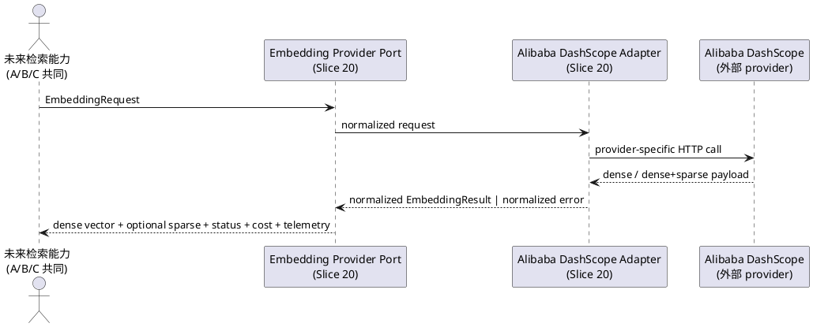

# Slice 20 — Embedding Provider Port / Alibaba DashScope Dense+Sparse Adapter Foundation

> Repository: `pyxm1618/xiaoshuyin`
>
> Slice: 020
>
> Feature: `020-embedding-provider-adapter-foundation`
>
> V1 Phase: Phase 3 — Professional Knowledge & AI
>
> Role boundary: Plan AI 1 — Selection / Specify / Clarify only
>
> Status: SLICE 20 SPEC — REVISION 2 TARGETED CORRECTION / REMOTE RE-FREEZE PENDING
>
> 历史状态：Revision 1（commit `c9b681ec` / spec blob `c4bea6c2`）已 `SUPERSEDED`，原因见第 27 节 Revision History。
>
> Forbidden in this artifact: Plan / Checklist / Tasks / Audit 1 / production implementation / migration / embedding generation / Gold labels / professional truth / retrieval pipeline / Context Builder / AI Task Runtime / Audit 2 / merge
>
> Candidate position: route-neutral. This Slice does not select RAG candidate A, B or C.

本 Spec 冻结的是 Phase 3 Professional Retrieval 链路中**下一个最小、必要且边界清晰**的实现责任：

> 一个 route-neutral 的 Embedding Provider Port，以及一个 Alibaba DashScope dense / dense+sparse Adapter Foundation。
>
> Adapter Foundation 不等于 model selection，不等于 provider availability，不等于 production route activation，不等于 RAG A/B/C 选择。

本 Slice 只冻结**什么是正确责任、它的边界、它的契约、它的失败语义与证据要求**。它不创建任何 Plan、Checklist、Tasks，也不授予开发授权。

---

## 1. Feature Identity

| 项 | 值 |
| --- | --- |
| Feature 目录 | `specs/020-embedding-provider-adapter-foundation/` |
| Slice 编号 | 020 |
| 责任名称 | Embedding Provider Port / Alibaba DashScope Dense+Sparse Adapter Foundation |
| 责任类别 | 外部 provider 契约与适配基础（contract + adapter foundation） |
| 路线定位 | route-neutral（A/B/C 共用输入能力，不选择胜者） |
| 拥有 phase | Phase 3 — Professional Knowledge & AI |
| 上游 Authority 标识 | `Docs/V1技术设计.md` §4.2 / §13.2 / §13.3 / §20；`Docs/总体技术架构.md` §11.2 / §11.3；`V1-C34`、`V1-X14`（真实能力边界） |
| 下游消费者（未来） | Sparsevec Spike、pg_jieba lexical 对照、RAG A/B/C Gold Dataset Eval、retrieval pipeline、Context Builder、AI Task Runtime |

本 Slice 的 Revision 1 曾通过 formal remote freeze（见第 26 节 Remote Freeze Record），但已因**已证实的外部 Provider contract 冲突**被标记为 `SUPERSEDED`（见第 27 节 Revision History）。本文件为 Revision 2（targeted correction）；其 `SPEC: FROZEN` 仅在本轮 Remote Re-Freeze 的 remote read-back 成功后成立。无论哪个 Revision，它都不是 Planning Freeze，不是实现授权。

---

## 2. Authority Baseline

Authority hierarchy（下层不得改写上层）：

1. `Docs/总产品需求.md` — 长期产品 truth；
2. `Docs/V1产品需求.md` — V1 产品 truth；
3. `Docs/总体技术架构.md` — 长期架构 truth；
4. `Docs/V1技术设计.md` — V1 实现契约；
5. Frozen Slice Contracts — 下游有界契约；
6. Plan / Checklist / Tasks — 执行投影；
7. Implementation — 最下层。

本 Slice 的基线：

```text
origin/main:
3fecd0b94325539131e1b23885f5240b5a61c0d8

origin/main tree:
ad2cacd4516251db131f391539d9227ac5abfa29
```

Authority Doc blobs（只读核验所得）：

```text
Docs/总产品需求.md
97c69bb8d9c7c42070f5763fe81a3ab1ae2ecf29

Docs/V1产品需求.md
379cb8cfb377924cd21ccfe55baa5aecdf207f5e

Docs/总体技术架构.md
6b4630803f371faf6d93f27361070223d0f661a0

Docs/V1技术设计.md
afef9fcc4af41b6137e5020717135972a3d515fc
```

上游 Frozen Authority 引用：

```text
specs/016-psychological-behavioral-intervention-contract-authority-reconciliation/spec.md
blob 5bc22645af2008d6f774e39f57bae391fa2543c7

specs/017-professional-knowledge-foundation/spec.md
blob a4603885e5f54365e926a4705262c170a7ee47bd

Slice 18 Frozen Spec（远端 spec 分支，未合并 main）:
origin/spec/018-professional-retrieval-gold-dataset-authority-reconciliation
specs/018-professional-retrieval-gold-dataset/spec.md
blob 1d18fa97a29b3a26d3ff9b0da8dbaf4007649af3

specs/019-professional-retrieval-pgvector-readiness/spec.md
blob 24667d4d8c4e155dcb98dac4fcd3fb2a1f1ad0ef

specs/019-professional-retrieval-pgvector-readiness/plan.md
blob db1db60eaa3617c0549dd4a6a39826666b8bdddf
```

本 Spec 不修改任何 Authority Doc，不修改 Slices 016–019。

### 2.1 Authority 语义锚点

本 Slice 直接依赖以下已冻结的 Authority 语句：

1. `Docs/V1技术设计.md` §13.3「Embedding Adapter」：`qwen3.7-text-embedding` 的 sparse / dense+sparse 使用**独立 Alibaba DashScope Adapter**；Adapter 统一 timeout / retry budget、model/version、output_type、dense dimension、sparse payload parsing、telemetry、provider error normalization、cost record；不能为了统一 SDK 而丢掉 sparse 能力。
2. `Docs/V1技术设计.md` §20：`qwen3.7-text-embedding` 是首要候选；生产 `embedding_route_version` **必须**绑定 Gold Dataset 证据与 pinned model version。
3. `Docs/V1技术设计.md` §4.2 与 Phase 3 顺序：PostgreSQL 18 + pgvector → qwen3.7 dense+sparse → vector + sparsevec Spike → RAG A/B/C Gold Dataset Eval → pg_jieba + 专业词典。
4. `Docs/总体技术架构.md` §11.3：方案 A 进入生产候选前，必须用 **DashScope 实际 sparse payload** 验证 sparsevec 编码、维度、non-zero 限制、insert/read/distance、index/query 行为与 fusion prototype。
5. `Docs/V1技术设计.md` readiness gate：未通过 readiness 的 RAG capability 不得标记 READY。
6. `Docs/V1产品需求.md`：专业问卷、scoring、cutoff、诊断/临床解释、Intervention、Safety professional rule、Gold Dataset 专业标签等，必须绑定真实 APPROVED/PUBLISHED professional content version；`approved: true`、reference 文档、Slice spec、fixture、代码字段均不能产生专业批准。

### 2.2 本 Slice 对 Authority 的合法推导

本 Slice 只做**已被正式设计明确要求、且不依赖 route 选择**的那一部分：

- dense embedding 是 A、B、C 三者的**共同输入**；
- DashScope dense+sparse adapter 是 §13.3 已冻结的正式组件；
- 它也是未来 sparsevec Spike 获取真实 sparse payload 的前置；
- 它不声称任何 embedding 质量优势，不做 route 选择，不注册生产路线。

**Authority Gate: PASS。**

### 2.3 Provider Contract Baseline（可修订技术事实）

本节记录本轮核验的**外部 Provider contract 技术基线**，用于消除 Revision 1 中关于 sparse index、model/version 回显与 usage 粒度的错误假设。

**Authority 定位**：本节是 provider 技术合同基线，**不是产品 Authority**，也不取代 `Docs/**`。它只约束 Adapter 如何理解 provider 请求 / 响应；当官方 Provider contract 变化时，必须重新核验并定向修订本 Spec（新的 Revision），不得静默沿用旧假设。本节不授权任何 provider 能力声明，也不产生 `PROVIDER_VERIFIED`。

#### 官方来源

- 文档：Alibaba Cloud Model Studio — 文本嵌入（同步）API
- URL：`https://help.aliyun.com/zh/model-studio/text-embedding-synchronous-api`
- 核验日期：2026-11-22（本轮由主流程直接读取官方文档核验，下列事实清单与其一致；不以博客、SDK 示例仓库或第三方文章覆盖官方合同）
- 适用能力：DashScope **原生** text-embedding 接口（稀疏输出仅通过原生接口提供；OpenAI 兼容接口不支持 sparse）

#### 请求契约

```text
POST https://{WorkspaceId}.cn-beijing.maas.aliyuncs.com/api/v1/services/embeddings/text-embedding/text-embedding

{
  "model": "<configured model id>",
  "input": { "texts": ["<text>", "..."] },
  "parameters": {
    "dimension": <dense dimension>,
    "output_type": "<provider output_type 字面量>",
    "text_type": "<query | document>",
    "instruct": "<optional instruction>"
  }
}
```

本 Spec 的逻辑取值 `dense` / `dense+sparse` 与 provider 字面量之间的映射由 Adapter 负责，Plan AI 2 必须在 Provider contract 复核后确定，不得把内部逻辑名当作 provider 字面量事实。

#### 成功响应契约

```text
{
  "request_id": "<provider request id>",
  "embeddings": [
    {
      "index": <input item index>,
      "embedding": [<number>, ...],
      "sparse_embedding": [ { "index": <int>, "value": <number>, "token": "<optional>" } ]
    }
  ],
  "usage": { "total_tokens": <int>, "prompt_tokens": <int|absent> }
}
```

#### 错误响应契约

```text
{ "code": "<provider error code>", "message": "<message>", "request_id": "<provider request id>" }
```

#### 冻结的技术事实

1. **sparse index 语义**：官方定义为"词汇或字符在词汇表中的位置索引"（vocabulary position index），**不是** dense vector 的坐标维度。sparse index 与 `dense_dimension` 属于不同坐标空间；**禁止**用 dense dimension 作为 sparse index 的上界或合法性判据。
2. **官方示例索引**：官方示例中的 sparse index 包含 `7149`、`111290`、`246351`、`2490`、`3759`、`1130`、`562`、`1589`，而同例 dense dimension 示例为 `1024`；即真实 sparse index 可以远大于 dense dimension。
3. **sparse index 约束**（可由官方语义机械验证者）：integer、`>= 0`、在单个 sparse payload 经 canonical validation 后唯一。
4. **sparse value**：finite number；非有限值必须拒绝。
5. **sparse token**：provider 提供的可选元数据（`token`），不构成业务权威字段。
6. **sparse 排序**：官方合同**不保证** `sparse_embedding` 数组升序（官方示例中同一 item 先出现 `3759`、后出现 `1130`）。排序是 Adapter normalization 规则，不是 provider guarantee。
7. **model / version 回显**：原生成功响应的顶层字段只有 `request_id`、`embeddings`、`usage`，**不含** `model` 或 `model_version`。Adapter 不得要求 provider 回显其合同未承诺返回的 version。
8. **usage 粒度**：`usage` 是 **request-level aggregate**（`total_tokens`，可选 `prompt_tokens`）；provider 不提供 per-item token 或 per-item cost 分解。
9. **能力不一致**：官方文档自身存在"`sparse_embedding` 仅适用于 v3/v4"与"`qwen3.7` 示例包含 sparse"的不一致。Adapter 必须按**运行时实际响应**判定 sparse 能力；缺失时 `UNSUPPORTED`，不得硬编码模型能力矩阵。

任何与本基线冲突的旧语义（包括 Revision 1 的 `0..dense_dimension-1` 约束、provider version 回显要求、per-item exact cost 要求）均以本节为准被废止。

---

## Upstream Traceability

| 上游标识 / 来源 | 本 Slice 如何消费 | 本 Slice 不做什么 |
| --- | --- | --- |
| `Docs/V1技术设计.md` §4.2 / §13.2 / §13.3 | 冻结 Adapter 的职责清单、dense/sparse 能力要求与 bootstrap readiness 边界 | 不做 route 选择、不做模型质量评估 |
| `Docs/总体技术架构.md` §11.2 / §11.3 | 承认 dense+sparse 专用 DashScope Adapter 与 sparsevec Spike 的先后关系 | 不做 sparsevec 编码或 pgvector 验证 |
| `V1-C34`（后台与人工只使用真实能力） | Adapter 只声明真实契约与真实证据状态，不造假能力 | 不创建 fake provider 成功、不伪造 cost/telemetry |
| `V1-D27` / `V1-D28` / `V1-D29`（A5001/A5002 独立 review scope） | 仅为边界声明：professional approval 由 Slice 17 / Staff authority 拥有 | 不消费、不推导、不产生 review/approval truth |
| `V1-X14`（只验真实存在能力） | `PROVIDER_VERIFIED` 必须来自真实 provider 证据；contract test 最多产生 `CONTRACT_VERIFIED` | 不以 contract test / mock 冒充 availability |
| `Docs/V1技术设计.md` §20 / readiness gate | 承认生产 `embedding_route_version` 必须绑定 Gold Dataset 与 pinned version | 不注册生产 route、不锁生产模型 |
| Slice 16 Frozen Spec | intervention eligibility truth 属 Slice 16 | 不替代、不推导 eligibility |
| Slice 17 Frozen Spec | Knowledge identity / version / review / publication truth 属 Slice 17 | 不创建 knowledge_embeddings、不伪造 reviewer |
| Slice 18 Frozen Spec | Gold Dataset evaluation truth 属 Slice 18 | 不创建 Gold labels、不运行 eval |
| Slice 19 Frozen Spec | PostgreSQL 18 + pgvector dense `vector` readiness 属 Slice 19 | 不做 sparsevec、不做 extension、不做 DB 迁移 |

------

## 3. Remote Truth

以下为 2026-11-22 对远端真实状态的只读核验结果，不作为永久真理；Plan AI 2 与开发 AI 必须重新核验。

### 3.1 当前 main

```text
origin/main:
3fecd0b94325539131e1b23885f5240b5a61c0d8

origin/main tree:
ad2cacd4516251db131f391539d9227ac5abfa29

origin/main latest commit:
Merge pull request #110 from pyxm1618/feat/019-pgvector-readiness-current-main
```

备注：本轮开始时的只读核验得到 `origin/main = 0d7ea2fe`（当时 PR #110 尚未合并）；remote freeze 前重新核验发现 PR #110 已于 2026-11-22T01:48:17Z 合并，因此以 `3fecd0b9` 为最新 Remote Truth，并把本 Spec 分支 merge 到该基线（behind = 0）。

### 3.2 当前 open PR / 最近合并

`gh pr list --state open` 返回空：当前没有 open PR。

最近合并（Slice 19，与本 Slice 的实现不重叠）：

```text
#110  MERGED（2026-11-22T01:48:17Z）
head: feat/019-pgvector-readiness-current-main
head SHA: 0f069bb7bb343071266f97fa3a3772fc4d7d2969
merge commit: 3fecd0b94325539131e1b23885f5240b5a61c0d8
title: feat(s19): implement PostgreSQL 18 pgvector dense vector readiness
```

PR #110 属 Slice 19。本 Slice **不评价、不修改、不审计**其实现；本 Slice 与它没有实现重叠，也不把它的 runtime 作为本 Slice 的运行前置。

### 3.3 当前 specs 现状

`origin/main` 上存在：

```text
specs/016-psychological-behavioral-intervention-contract-authority-reconciliation/
specs/017-professional-knowledge-foundation/
specs/019-professional-retrieval-pgvector-readiness/spec.md
specs/019-professional-retrieval-pgvector-readiness/plan.md
```

（以上仅列与本责任直接相关者；main 上另有 `001`–`013`、`common-core-*`、`foundation-remaining-remediation`、`phase2-*`、`phase5-*` 等历史 Slice。）

`origin/main` 上**不存在**：

```text
specs/018-*
specs/020-*
```

Slice 18 的 Frozen Spec 只存在于远端 spec 分支 `origin/spec/018-professional-retrieval-gold-dataset-authority-reconciliation`，其 spec blob 为 `1d18fa97a29b3a26d3ff9b0da8dbaf4007649af3`，未合并 main。本 Slice 只把它当上游 truth 边界，不把它当已交付 runtime。

### 3.4 当前实现现状（与 embedding 相关）

`origin/main` 上不存在：

- DashScope 依赖或 `dashscope` production 代码；
- embedding adapter、embedding provider port；
- `knowledge_embeddings` / `knowledge_chunks` 表或迁移；
- sparsevec 能力代码、pgvector 检索代码或 retrieval query；
- reranker、fusion、RRF、retrieval pipeline；
- Context Builder、AI Task Runtime、TaskModelRegistry；
- Gold Dataset runtime 或 Gold labels；
- `packages/ai`、`packages/rag`、`packages/memory`（这三个路径仍被 `scripts/guard-static.mjs` 列为 FORBIDDEN_PATHS）。

最新 migration 为 `db/migrations/030_digital_use_assessment_context.sql`。

`origin/main` 上现在存在 Slice 19 的 dense-vector readiness 资产（`db/init/02-pgvector.sh`、`scripts/lib/pgvector-readiness.mjs`、`scripts/pgvector-readiness.mjs` 及其 tests），但它们是 capability probe，不是 retrieval、不是 embedding adapter；本 Slice 不修改、不扩展它们。

Slice 16 与 Slice 17 已有真实 runtime（`intervention_definitions`、`professional_knowledge_*`、`.ts` services / domain）。本 Slice 不读取、不写入这些表，也不依赖其 runtime。

### 3.5 当前实现所有权与静态守卫事实

1. `.specify/implementation-ownership.json` 使用 `resolution: LONGEST_MATCH`，未知 production path **fail closed**；未注册任何 embedding / dashscope / sparsevec / `packages/ai|rag` 路径。
2. `db/init/02-pgvector.sh` 已在 main（PR #110 合并后），并由 Slice 19 的 EXACT ownership 规则持有；本 Slice 不修改它。
3. `scripts/guard-static.mjs` 的 Rule 8 `FORBIDDEN_SAFETY_IMPORTS` 包含 `dashscope`，其执行范围为全仓库被扫描的实现代码，而不只是 safety 路径。因此**任何 DashScope adapter 实现都会先被该规则拦截**。
4. Rule 17 只作用于路径含 `professional-knowledge` 的文件，禁止其引入 RAG/AI runtime、`pgvector`、`sparsevec`、`pg_jieba` 等。本 Slice 不得触碰这些文件。
5. `FORBIDDEN_PATHS` 仍禁止 `packages/ai`、`packages/rag`、`packages/memory`。

### 3.6 Authority drift 与重复实现检查

- 四份 Authority Docs 未发现与本责任冲突的新增语义；
- 未发现任何已存在的等价 Slice 20 Spec、branch、PR 或实现；
- 未发现任何 `embedding` 相关的 production owner 可复用；
- Slice 19 只拥有 PostgreSQL 18 + pgvector dense `vector` readiness，不拥有 sparsevec、embedding adapter、embedding model selection、knowledge embeddings、reranker、retrieval pipeline、fusion、RRF、Gold Dataset execution、RAG A/B/C winner selection、Context Builder、AI Task Runtime；
- Slice 16 / 17 / 18 的 truth 边界未被本 Slice 改写。

**Duplicate / drift: NONE。**

---

## 4. Problem / Why Now

### 4.1 真实缺口

Phase 3 目前已经具备：

- Slice 16：professionally reviewed intervention eligibility truth；
- Slice 17：Professional Knowledge item / version / review / publication truth；
- Slice 18：Professional Retrieval Gold Dataset evaluation truth（Frozen Spec）；
- Slice 19：PostgreSQL 18 + pgvector dense `vector` readiness（治理 PR #109 与实现 PR #110 均已合并到 main）。

目前**不存在**的是：一个能够以统一契约调用真实 embedding provider、并正确处理 DashScope dense 与 sparse payload 的最小适配层。

具体后果：

1. 未来 sparsevec Spike 无法获得**真实 sparse payload**，只能靠合成数据，违反 `Docs/总体技术架构.md` §11.3；
2. A、B、C 三个候选都无法获得共同、可验证的 dense embedding 输入；
3. 任何检索实现都会被迫把 provider 调用、payload 解析、超时/重试、成本、错误归一化散落到检索代码中，形成隐性第二套契约；
4. `embedding_route_version` 的生产绑定（Gold Dataset + pinned model）缺少可绑定的 provider 执行面。

### 4.2 Why Now

选择现在做，理由不是"上一个 Slice 做了 pgvector"，而是：

1. 它是**唯一同时满足**「A/B/C 共用」「§13.3 已冻结」「不依赖任何上游 runtime」「可独立验收」的责任；
2. 它解除了未来 sparsevec Spike 的**事实前置**，但不提前选择 A；
3. 它把 provider 契约从未来的检索代码中隔离出来，避免后续 Slice 各自定义一套 provider 调用；
4. 它的最小闭环足够小：输入文本 → dense 向量 / sparse payload → 归一化结果 + 状态 + 成本 + 遥测；
5. 它可以做到 candidate-neutral，因此不会污染后续 Gold Dataset 比较。

### 4.3 为什么不是现在做更大的事

- 现在做 sparsevec：只有 A 需要，且依赖 Slice 19 runtime 与真实 sparse payload，会提前选 A；
- 现在做 pg_jieba：只有 B 需要，且"专业词典"可能构成 Professional Content Authority，风险高；
- 现在做 retrieval pipeline：把 dense、hard filters、ranking、fusion 揉成大 Slice，过早且不可独立验收；
- 现在做 Gold Dataset runtime：Slice 18 已冻结 evaluation truth，但没有任何候选实现可执行，做出来是空壳；
- 现在做 knowledge_embeddings：需要先有 provider 生产者、再需要 Slice 17 的 lifecycle 消费语义，顺序错误。

**结论：embedding provider port + DashScope adapter foundation 是当前最小且必要的下一步。**

---

## 5. Candidate Responsibilities

候选集来自 Remote Truth，而不是来自提示词预设。H 为兜底类别。

| 编号 | 候选责任 | 独有能力 | 真实缺口 | 可独立验收 | 需要尚不存在的上游 runtime | 是否提前选 A/B/C | 是否侵犯 16/17/18/19 | 是否需伪造 professional truth | 是否当前最小 |
| --- | --- | --- | --- | --- | --- | --- | --- | --- | --- |
| A | sparsevec + DashScope sparse payload readiness | sparsevec 编码/查询 | 是，但仅 A | 否（需真实 payload） | 否（Slice 19 已合并，dense runtime 已具备） | 是（A） | 否（但属 19 未授权扩展） | 否 | 否 |
| B | pg_jieba lexical readiness / 专业词典 | 中文 lexical 分词 | 是，但仅 B | 否（专业词典权威未定） | 是（专业词典 + 可能 17） | 是（B） | 高风险（专业词典 ≈ professional content） | 可能 | 否 |
| C | Embedding Provider Port / DashScope dense+sparse adapter foundation | dense + sparse 共同输入、§13.3 已冻结 | 是，A/B/C 共同缺口 | 是 | 否 | 否（route-neutral） | 否 | 否 | 是 |
| D | knowledge_embeddings persistence / lifecycle | 持久化与失效 | 是，但未来 | 否 | 是（需 17 lifecycle 消费语义 + provider 生产者） | 否 | 中（易与 17 的 version/provenance 重叠） | 否 | 否 |
| E | Gold Dataset runtime / evaluation execution | 执行评测 | 不是 planning 缺口，是候选实现缺口 | 否（无候选实现可评） | 是 | 否 | 否（18 已拥有 truth） | 否 | 否（空壳） |
| F | Professional Retrieval candidate pipeline | dense 检索 + hard filters + ranking | 是，但过早 | 否（依赖 19、Gold Dataset、provider） | 是 | 可能 | 中（hard filter 与 16/17 边界） | 否 | 否（过大） |
| G | Professional reviewer / authority enabling | 真实 staff/professional authority | 需 Remote Truth 证明是当前实际阻塞 | 否 | 是（真实 Staff Authority 未建立） | 否 | 高风险 | 是（易造 fake reviewer） | 否 |
| H | 其他更小必要责任 | 未发现 | — | — | — | — | — | — | 未发现 |

候选 H 未被 Remote Truth 证实存在。任何后续候选必须重新经过本 Selection Gate，不得用 Slice 编号代替 Authority。

---

## 6. Selection Gate

### 6.1 逐项评判

**A — sparsevec readiness：FAIL**

- 它只能被 A 使用，本质是 candidate-specific；
- Slice 19 已合并，dense `vector` runtime 已具备；但 A 仍需要本 Slice 提供的真实 DashScope sparse payload；
- 若现在实施，会提前选择 A；
- 结论：应在 Candidate C 完成之后，作为独立 Spike 责任重新评估（不再需要等待 Slice 19 合并）。

**B — pg_jieba / 专业词典：FAIL**

- 只能被 B 使用，candidate-specific；
- "小树荫专业词典"若进入生产，必须回答它是否构成 Professional Content Authority；当前没有授权；
- 无法在不伪造 professional truth 的前提下完成"专业词典已批准"的验收；
- 结论：推迟到 B 被正式选择、且专业词典的 Authority 归属被明确之后。

**C — Embedding Provider Port / DashScope Adapter Foundation：PASS**

- Authority 明确：§13.3 已冻结 Adapter 职责清单；
- 真实缺口：A/B/C 共同缺少统一的 provider 契约与 dense/sparse 解析；
- 是后续多个能力的 prerequisite：sparsevec Spike、lexical 对照、retrieval、Gold Dataset Eval 都需要它；
- 可独立验收：`CONTRACT_VERIFIED` 层可完全离线机械验证；`PROVIDER_VERIFIED` 层必须在受控环境用真实 Alibaba DashScope 调用验证，缺失时保持 `PROVIDER_NOT_VERIFIED`；
- 不需要任何上游 runtime：不读 16/17/18 的表，不使用 19 的 pgvector；
- 不提前选择 A/B/C：route-neutral；
- 不侵犯任何 Slice 的 Authority：不产出 professional truth、不产出 Gold labels、不做检索；
- 可 fail-closed：配置缺失、维度不匹配、provider 不支持 sparse 都有明确失败状态；
- 是当前最小合理 Slice；
- 是当前唯一可独立推进的 Phase 3 上游：不依赖 Slice 19 runtime（即使其已合并也不需要它），也不选择任何候选；A 还需要真实 sparse payload，B 还需要专业词典 Authority；
- 现在不做会具体阻塞：sparsevec Spike 无真实 payload；任何 retrieval 实现会各自定义 provider 调用；`embedding_route_version` 无可绑定的执行面。

**D — knowledge_embeddings persistence：FAIL**

- 需要先定义"哪些 version 的哪些内容需要 embedding"、"source invalidation 后 derived data 怎么办"、"是否允许永久持久化"；
- 这些问题直接触及 Slice 17 的 version / provenance / lifecycle 语义，属于未来的独立责任；
- 现在做会在没有 producer 的情况下建表，属于"暂时没人消费的基础设施"。

**E — Gold Dataset runtime：FAIL**

- Slice 18 已拥有 evaluation truth，当前 blocker 不是 planning，而是没有候选实现；
- 现在做只能得到空壳，且无法产生有意义的 eval 结果；
- 结论：等 Candidate C 与至少一个候选检索实现之后再评估。

**F — Retrieval candidate pipeline：FAIL**

- 把 dense retrieval、hard filters、provenance、ranking contract 揉成一个 Slice，违反 smallest sufficient responsibility；
- hard filters 必须依赖 Slice 16/17 的 eligibility 与 published/current/valid 语义，边界复杂；
- 依赖 Slice 19 与 Gold Dataset，当前不具备可独立验收条件。

**G — Professional reviewer / professional authority：BLOCKED / DEFER（不选）**

- Remote Truth 证明这是真实缺口：main 只有 `staff_assignments`，尚无已冻结的 professional qualification / professional approval owner，Slice 16/17 的 production readiness 仍受其限制；
- 但它不是本 Slice 的运行前置：embedding adapter 不读取 professional knowledge、不产生 approval、不依赖 reviewer；
- 当前上位 Authority 未冻结专业 reviewer 的 identity / bootstrap / qualification / grant / revoke 具体 owner；在本 Slice 实现只能发明 generic RBAC 或 fake reviewer，直接违反 Authority；
- 结论：保持 BLOCKED / DEFER，由未来获得明确授权的最小窄合同解决；不得把它塞进本 Slice。

**H — 其他：未发现。**

### 6.2 Selection Gate 结论

```text
SELECTION GATE: PASS
SELECTED: Candidate C — Embedding Provider Port / Alibaba DashScope Dense+Sparse Adapter Foundation
MODE: route-neutral
A/B/C WINNER: NOT SELECTED
```

---

## 7. Selected Responsibility

### 7.1 一句话定义

本组件负责把"给定文本、给定模型配置，调用真实 provider 并获得可用 dense 向量与可选 sparse payload，或在明确失败状态下 fail closed"这件事收敛为一个**有界、可验证、route-neutral**的端口与适配器基础。

### 7.2 组件在链路中的位置



图中刻意不包含数据库、pgvector、检索、Gold Dataset、Context Builder、AI Task Runtime：它们都不是本 Slice 的内部结构或依赖。

### 7.3 组件内部责任划分（逻辑层，不是代码结构）

- **Port**：稳定契约、输入校验、输出归一化、状态与证据语义；
- **Adapter**：DashScope 专有协议、payload 解析、错误映射、成本字段；
- **调用方**：只依赖 Port，不感知 provider 专有字段。

具体包路径、模块名、文件划分由 Plan AI 2 决定，但必须满足第 19 节治理约束。

---

## 8. Scope

### 8.1 OWNS（本 Slice 拥有）

1. **Embedding Provider Port 契约**：请求、响应、错误、状态、成本、遥测的统一逻辑契约。
2. **Dense embedding 输出契约**：有限数值向量、声明维度、维度校验、确定性拒绝。
3. **Sparse payload 解析与校验**：把 DashScope sparse 输出归一化为 `{index, value}`（`token` 仅作可选、非权威 metadata）；校验 index 为非负整数、同一 payload 内唯一、value 有限、非零元素上限；**禁止**把 sparse index 与 `dense_dimension` 比较。
4. **output_type 语义**：至少支持 `dense` 与 `dense+sparse`，并显式拒绝不支持组合。
5. **Model / version 配置绑定**：`configured_model_id`、`configured_model_version_or_revision`、`dense_dimension` 必须来自显式配置；provider 若返回 `model` 则校验一致，未返回时记录 `PROVIDER_MODEL_ECHO_NOT_AVAILABLE` 且不得因此失败。
6. **timeout / retry budget**：每次调用有显式上限，重试受分类与预算约束。
7. **Provider error normalization**：稳定错误分类，区分 RETRYABLE / TERMINAL / UNSUPPORTED / BLOCKED。
8. **Cost record**：每次真实 provider 调用产生可关联的成本记录。
9. **Telemetry**：延迟、重试次数、结果状态、错误分类；禁止输入明文与 secret。
10. **Secret 边界**：仅运行时注入，仓库与日志零明文。
11. **证据分层**：`CONTRACT_VERIFIED` / `PROVIDER_NOT_VERIFIED` / `PROVIDER_VERIFIED` 三态机械区分；任何对外可用声明必须同时满足 `CONTRACT_VERIFIED` 与 `PROVIDER_VERIFIED`，不得仅由契约证据推出。
12. **Candidate-neutral 证明**：机械证明本 Slice 未注册生产路线、未选择 A/B/C。

### 8.2 与上游 Slice 的边界

| 上游 | 归它拥有 | 本 Slice 只做 |
| --- | --- | --- |
| Slice 16 | intervention eligibility / professional intervention truth | 承认其为唯一 eligibility truth；不读取、不推导、不替代 |
| Slice 17 | Knowledge item / version / review / publication / provenance truth | 承认其内容身份与版本语义；不创建 embedding 表、不写 knowledge 行 |
| Slice 18 | Gold Dataset evaluation truth | 承认其评测权威；不产生样本、不产生 gold label、不运行 eval |
| Slice 19 | PostgreSQL 18 + pgvector dense `vector` readiness | 承认其 DB capability 边界；不建表、不迁移、不验证 sparsevec |

### 8.3 与未来 Slice 的边界

- **sparsevec Spike**：未来独立责任；本 Slice 只提供真实 sparse payload 的解析能力，不提供 sparsevec 映射或数据库验证。
- **pg_jieba / 专业词典**：未来独立责任；本 Slice 不涉及分词、词典或 lexical 检索。
- **knowledge_embeddings 持久化**：未来独立责任；本 Slice 明确不持久化。
- **retrieval pipeline / hard filters / ranking**：未来独立责任；本 Slice 不检索。
- **rerank / fusion / RRF**：未来独立责任；本 Slice 不排序、不融合。
- **Context Builder / AI Task Runtime / TaskModelRegistry**：未来独立责任；本 Slice 不组装上下文、不执行任务、不做模型注册。
- **Gold Dataset runtime**：未来独立责任；本 Slice 不执行评测。
- **production `embedding_route_version`**：未来独立责任；本 Slice 不注册生产路线。

---

## 9. Explicit Non-Goals

本 Slice 明确**不做**以下事项（与第 17 节 Negative Scope Scenarios 一一对应，但此处为设计层声明）：

1. 不创建 `knowledge_embeddings`、`knowledge_chunks` 或任何 embedding 持久化结构；
2. 不创建 migration、不执行 `CREATE EXTENSION`、不改 DB role / RLS；
3. 不做 sparsevec 编码、映射、索引或距离查询验证；
4. 不安装或配置 pg_jieba，不创建专业词典，不把词典当 professional authority；
5. 不实现 reranker、fusion、RRF、hybrid search、retrieval pipeline、hard filters；
6. 不实现 Context Builder、AI Task Runtime、TaskModelRegistry；
7. 不创建 Gold Dataset runtime，不生成 Gold label，不运行 eval；
8. 不创建或修改 professional knowledge / reviewer / approval / publication 语义；
9. 不注册 production `embedding_route_version` / `rag_route_version`；
10. 不选择 RAG A/B/C 胜者，不声明任何候选优势；
11. 不创建 generic provider registry、generic model registry、generic plugin 系统、generic workflow engine、generic evaluation platform、generic vector/search abstraction；
12. 不创建用户可见 AI 功能；
13. 不引入 V2/V3 能力；
14. 不创建 `packages/ai`、`packages/rag`、`packages/memory`；
15. 不修改四份 Authority Docs，不修改 Slices 016–019。

---

## 10. Upstream Dependencies

| 依赖类型 | 对象 | 是否本 Slice 运行前提 | 说明 |
| --- | --- | --- | --- |
| Authority | 四份 Authority Docs | 是（语义前提） | 只读；不得修改 |
| Contract | Slice 16 Frozen Spec | 否（truth 边界） | eligibility 由其拥有；本 Slice 不消费运行时 |
| Contract | Slice 17 Frozen Spec | 否（truth 边界） | knowledge identity/version/review/publication 由其拥有；本 Slice 不消费运行时 |
| Contract | Slice 18 Frozen Spec | 否（truth 边界） | Gold Dataset truth 由其拥有；本 Slice 不运行 eval |
| Contract | Slice 19 Frozen Spec | 否（future consumer） | pgvector readiness 由其拥有；本 Slice 不依赖其 runtime |
| 外部 | Alibaba DashScope API | 条件性 | 仅 `PROVIDER_VERIFIED` 证据需要；`CONTRACT_VERIFIED` 不需要 |
| 运行时 | secret injection 机制 | 条件性 | 真实调用需要；仓库内无 secret |
| 治理 | `.specify/implementation-ownership.json` | 是（实现前） | 新 production 路径必须注册 |
| 治理 | `scripts/guard-static.mjs` 最小豁免 | 是（实现前） | 当前全仓库禁止 `dashscope` import |

---

## 11. Downstream Consumers

以下都**不是**本 Slice 的前置依赖，而是本 Slice 完成后的潜在消费者：

1. **sparsevec Readiness Spike**：需要真实 DashScope sparse payload 作为输入；
2. **pg_jieba / lexical 对照**：需要同一批文本的 dense 结果做对比（但仍属 B 的独立责任）；
3. **RAG A/B/C Gold Dataset Eval**：需要三路共同的 dense embedding 输入；
4. **Professional Retrieval candidate pipeline**：需要可注入的 embedding port；
5. **Context Builder**：未来需要已检索内容，不直接消费本 Port；
6. **AI Task Runtime / TaskModelRegistry**：未来可能把 embedding 作为一种受管任务，但本 Slice 不实现；
7. **knowledge_embeddings 持久化**：未来需要 provider 输出作为派生数据源。

本 Slice 不得为了这些消费者的"未来方便"而扩大自身范围。

---

## 12. Functional Requirements

每条均为可机械验收的 SHALL 断言。`FR-0xx — SHALL` 是本 Spec 的规范形式。

### 12.1 Port 契约

- **FR-001 — SHALL**：提供 route-neutral 的 Embedding Provider Port，业务调用方只能依赖该 Port，不得直接依赖 provider 专有客户端。（验收：调用方模块的 import 图中不存在 provider SDK 或 DashScope 专有模块。）
- **FR-002 — SHALL**：Port 请求不得接受调用方传入的 provider endpoint、API key、region 凭据；这些只能来自受控运行时配置。（验收：请求类型定义中不存在 endpoint/secret 字段；代码扫描无调用方传入 secret 的路径。）
- **FR-003 — SHALL**：请求必须显式携带 `configured_model_id`、`configured_model_version_or_revision`、`output_type`、`dense_dimension`、输入文本集合与 `request_id`；其中 model identity 属于**配置 provenance**，不是 provider 回显字段。（验收：缺失任一必填字段时返回 `BLOCKED`/`INVALID_REQUEST`，且不发起 provider 调用；请求类型定义中不把配置版本标注为 provider-returned。）
- **FR-004 — SHALL**：响应必须包含 dense 向量、可选 sparse payload、`provider_request_id`、provider `usage`（request-level aggregate）、configured model provenance、provider model echo 状态（`PROVIDER_MODEL_ECHO_VERIFIED` / `PROVIDER_MODEL_ECHO_NOT_AVAILABLE`）与归一化状态；不得把 configured version 描述为 provider 回显事实。（验收：契约测试对每个字段做存在性与类型断言；echo 状态枚举断言。）
- **FR-005 — SHALL**：单条与批量输入使用同一契约，批量输出与输入顺序一一对应且长度相等。（验收：批量 N 条输入得到 N 条输出，顺序可机械比对。）
- **FR-006 — SHALL**：批量请求采用 all-or-nothing；任一条失败时整体失败，禁止返回部分成功集合。（验收：注入第 k 条失败，断言整体状态为失败且输出集合为空/null。）
- **FR-007 — SHALL**：Port 必须允许注入确定性 fake provider，用于离线契约测试。（验收：不配置真实凭据时，全部 Port 契约测试可运行并产生稳定结果。）
- **FR-008 — SHALL**：调用方不得感知 DashScope 专有字段名或响应结构。（验收：Port 对外类型中不出现 provider 专有字段名。）
- **FR-009 — SHALL**：空输入、空白输入、超出声明上限的输入必须显式拒绝，禁止静默截断或补默认值。（验收：三类输入分别返回稳定的输入错误码，且 provider 调用计数为 0。）
- **FR-010 — SHALL**：输入文本只用于本次调用，不得出现在任何日志、错误消息或 telemetry 属性中。（验收：日志/telemetry 抓取断言不包含输入原文。）

### 12.2 Dense 输出

- **FR-011 — SHALL**：dense 输出必须是有限数值数组，长度严格等于请求声明的 `dense_dimension`。（验收：长度或数值合法性任一不满足即失败。）
- **FR-012 — SHALL**：禁止接受 `NaN`、`Infinity`、`-Infinity`、字符串数字或嵌套数组作为 dense 值。（验收：逐类注入非法值，全部产生 TERMINAL 失败。）
- **FR-013 — SHALL**：维度不匹配必须 TERMINAL 拒绝，禁止截断、补零或二次降维。（验收：provider 返回 dimension-1 时失败，且输出中无任何向量被返回。）
- **FR-014 — SHALL**：dense 向量不得被写入任何数据库表。（验收：实现代码不含 INSERT/UPDATE/CREATE 表语句；测试运行后 DB 表数量与内容不变。）
- **FR-015 — SHALL**：dense 结果不得被缓存为跨请求可复用状态。（验收：代码中不存在跨请求缓存结构；相同输入两次调用的 provider 调用计数为 2。）

### 12.3 Sparse 输出

- **FR-016 — SHALL**：sparse payload 必须归一化为 `{index, value}` 列表；`token` 可作为可选、非权威 metadata 保留或丢弃，不得参与权威校验；`value` 必须为有限数；normalized output 必须按 `index` 升序 canonical sort。（验收：非有限 value 被拒绝；输出 index 严格递增且无重复；provider 输入顺序不影响归一化结果。）
- **FR-017 — SHALL**：`index` 必须是非负整数，且在**同一 sparse payload 内唯一**；`index` 是 provider vocabulary namespace 中的位置，**禁止**与 `dense_dimension` 比较（既不得以其为上界，也不得因超过 `dense_dimension-1` 而失败）；若存在权威配置 `sparse_vocabulary_max`，则 `index` 必须小于该 bound。（验收：负值、小数、重复 index 分别被拒绝；`index >= dense_dimension` 的合法样例必须成功。）
- **FR-018 — SHALL**：非零元素数量上限必须可配置；超过该上限时必须拒绝，不得截断保留前 N 个；证据必须记录 `observed_max_sparse_index`，但 observed 值仅是观测结果，**不是**新的 Authority upper bound。（验收：注入 N+1 个元素返回 TERMINAL 失败；证据文件含 observed 值，且不存在将其声明为 bound 的字段。）
- **FR-019 — SHALL**：当 `output_type` 要求 sparse 而 provider 未返回 sparse payload 时，必须返回 `UNSUPPORTED` 或 TERMINAL 失败，禁止伪造空 sparse 或推测生成；当官方文档对 sparse 支持的模型范围存在不一致时，必须以**运行时实际响应**为准，不得硬编码模型能力矩阵。（验收：注入缺失 sparse 的响应，断言失败分类正确且无伪造 payload；实现中不存在 hardcoded sparse 模型白名单。）
- **FR-020 — SHALL**：当 `output_type=dense` 时不得额外产出 sparse payload。（验收：dense-only 请求的响应中 sparse 字段为空且无额外解析副作用。）
- **FR-021 — SHALL**：sparse 语义验证只证明 payload 可解析与可校验，不构成 sparsevec 编码或 pgvector 验证。（验收：证据报告中不出现 sparsevec/pgvector 断言；代码不 import pgvector。）

### 12.4 配置与版本

- **FR-022 — SHALL**：`configured_model_id`、`configured_model_version_or_revision`、`dense_dimension` 必须来自显式配置，不得由代码常量默认隐式决定。（验收：移除配置时调用返回 `BLOCKED`，而非使用硬编码默认值。）
- **FR-023 — SHALL**：配置缺失、不完整或类型非法时必须 fail closed 为 `BLOCKED`。（验收：逐字段缺失测试全部为 `BLOCKED`。）
- **FR-024 — SHALL**：本 Slice 不得设置生产 pinned model；只支持"由配置给定 model/version"的绑定能力。（验收：代码/配置中不存在标记为生产锁定的 model 常量。）
- **FR-025 — SHALL**：不得在任何代码、配置或文档中声明 `qwen3.7-text-embedding` 已被生产锁定。（验收：全仓库检索 `pinned`/`production` 与 model 名的组合，无生产锁定声明。）
- **FR-026 — SHALL**：provider 若返回 `model`，必须与 `configured_model_id` 一致，否则 TERMINAL 失败；provider 未返回 `model` 或 `model_version` 时**不得失败**，必须记录 `PROVIDER_MODEL_ECHO_NOT_AVAILABLE`；`configured_model_version_or_revision` 只作为配置 provenance，禁止描述为 provider 回显事实。（验收：model echo 不一致 → TERMINAL；echo 缺失 → 成功且记录 `PROVIDER_MODEL_ECHO_NOT_AVAILABLE`；报告字段不得把 configured version 标为 provider-returned。）
- **FR-027 — SHALL**：配置变更必须留下可审计记录，不得静默生效。（验收：配置变更路径产生审计事件或结构化日志；无变更时无事件。）

### 12.5 可靠性、超时与重试

- **FR-028 — SHALL**：每次 provider 调用必须受显式 timeout 约束，不得使用无界等待。（验收：超时注入后调用在预算内结束。）
- **FR-029 — SHALL**：重试仅允许发生在 `RETRYABLE` 分类，且必须受最大次数与总时间预算双重约束。（验收：注入连续 429/网络错误，调用次数不超过预算。）
- **FR-030 — SHALL**：`TERMINAL` 错误不得重试。（验收：注入 400/401/403/维度错误，provider 调用计数为 1。）
- **FR-031 — SHALL**：429 必须归一化为 `RETRYABLE`，并尊重 `Retry-After`，但不得超过总预算。（验收：`Retry-After` 超过预算时立即失败，不延长等待。）
- **FR-032 — SHALL**：401/403 必须归一化为 `TERMINAL` 的认证/授权错误，禁止吞掉为 `PROVIDER_NOT_VERIFIED` 之外的成功或可用状态。（验收：两类状态码分别得到稳定错误码与失败状态，能力证据状态保持 `PROVIDER_NOT_VERIFIED`。）
- **FR-033 — SHALL**：网络错误、5xx、malformed JSON、unsupported output_type 必须映射为稳定的内部错误分类。（验收：逐类注入，错误分类码稳定且与文档一致。）
- **FR-034 — SHALL**：归一化错误不得包含 secret、完整原始响应或 provider 内部堆栈。（验收：错误对象与日志断言不含 key/token/原始 body。）
- **FR-035 — SHALL**：重试耗尽或超时耗尽必须返回失败，禁止返回上一次结果、空向量或降级结果冒充成功。（验收：耗尽场景的响应状态为失败，且无向量输出。）
- **FR-036 — SHALL**：并发调用不得共享可变请求状态（如 model 配置、retry 计数、cost 累加）。（验收：并发测试中每个请求的 model/重试/成本互不串扰。）

### 12.6 成本与遥测

- **FR-037 — SHALL**：每次真实 provider 调用必须产生 cost record，至少包含逻辑 `request_id`、provider `request_id`、provider `usage.total_tokens`、适用的其它 provider usage 字段、configured model provenance 与 pricing/config provenance，以及（若计算）总成本；`per_item_usage` 允许为 `NOT_PROVIDED`。（验收：契约测试断言 request-level 字段完整；provider 未提供数据时字段值为 `NOT_PROVIDED`，不得伪造数值。）
- **FR-038 — SHALL**：禁止伪造 per-item 分解；provider 未提供 per-item usage 时，`per_item_usage` 与 `per_item_exact_cost` 必须为 `UNKNOWN` / `NOT_PROVIDED`；禁止平均分摊后称为 exact、禁止按字符数推算、禁止填 0；若未来提供估算，必须显式标记 `ESTIMATED`，且不得等同于 provider-measured cost；cost record 必须能关联到逻辑 `request_id` 与 provider `request_id`。（验收：注入仅含 aggregate usage 的响应，per-item 字段为 `NOT_PROVIDED`；报告中不存在 exact/derived 伪造数值；ESTIMATED 字段不得标记为 exact。）
- **FR-039 — SHALL**：telemetry 必须包含延迟、重试次数、结果状态与错误分类，且不得包含输入明文或 secret。（验收：telemetry 快照字段白名单断言。）
- **FR-040 — SHALL**：telemetry 上报失败不得把调用结果改为成功，也不得吞掉原始失败。（验收：注入 telemetry 故障，调用状态不变。）
- **FR-041 — SHALL**：能力证据状态只能由第 14 节状态模型与第 15 节 provenance 规则推导，并通过受控只读证据产物或诊断面呈现；不得提供调用方写入能力证据状态的入口，不得把 `CONTRACT_VERIFIED` 推导为 `PROVIDER_VERIFIED` 或 `READY`。（验收：代码中无外部可写证据状态的接口；状态与证据产物逐项对应。）

### 12.7 安全

- **FR-042 — SHALL**：API key / secret 只能从运行时注入读取，不得出现在仓库、测试快照、日志、错误、telemetry 或 cost record。（验收：全仓库 secret 扫描与日志断言通过。）
- **FR-043 — SHALL**：`.env.example` 只允许占位符，不得包含可用凭据。（验收：示例文件值为占位符。）
- **FR-044 — SHALL**：Adapter 不得使用特权 DB role，不得访问任何数据库表或执行任何 SQL。（验收：代码依赖图中无 DB client；运行时不建立 DB 连接。）
- **FR-045 — SHALL**：Adapter 不得引入 authorization / RLS bypass 路径，也不得替代任何业务授权判断。（验收：代码中无 authorize/RLS/session role 变更调用。）
- **FR-046 — SHALL**：Adapter 不得读取 Slice 17 的 professional knowledge 生产表，不得创建或推导 professional truth。（验收：无对 `professional_knowledge_*` 的读写；无 reviewer/approval 相关代码。）

### 12.8 负能力与边界

- **FR-047 — SHALL**：不得注册 production `embedding_route_version` / `rag_route_version`，也不得激活任何默认生产 route。（验收：配置中不存在激活的生产 route；运行时拒绝 route 激活请求。）
- **FR-048 — SHALL**：不得创建 `knowledge_embeddings`、`knowledge_chunks`、migration、`CREATE EXTENSION` 或任何 DB schema 变更。（验收：diff 中无 `db/**` 变更；DB 表清单不变。）
- **FR-049 — SHALL**：不得实现 sparsevec 编码/查询、pg_jieba、reranker、fusion/RRF、retrieval pipeline、hard filters、Context Builder、AI Task Runtime、TaskModelRegistry。（验收：静态扫描与依赖图不含上述能力；无新增相关模块。）
- **FR-050 — SHALL**：不得创建 generic provider registry、generic model registry、generic plugin/workflow/evaluation platform 或通用 vector/search abstraction。（验收：模块清单与导出 API 审查通过，无通用注册机制。）
- **FR-051 — SHALL**：仓库静态守卫必须能机械证明本 Slice 未越过边界；任何 guard 改动只能是精确路径的最小豁免，不得删除或全局放宽既有规则。（验收：运行 `scripts/guard-static.mjs` 通过；改动仅涉及精确 path 例外，且对抗性自测仍能检测越界。）
- **FR-052 — SHALL**：本 Slice 必须保持 A/B/C candidate-neutral；任何代码、配置、文档、注释不得声明某一候选胜出或更优。（验收：全仓库检索无 route winner 声明；Port 不包含 route 选择参数。）

### 12.9 证据分层

- **FR-053 — SHALL**：必须把能力证据状态机械区分为 `CONTRACT_VERIFIED`（仅离线契约通过：mock / fixture / synthetic provider response / schema validation）、`PROVIDER_NOT_VERIFIED`（尚无真实 Alibaba DashScope provider evidence，必须 fail closed、禁止表述为 READY）与 `PROVIDER_VERIFIED`（真实 provider evidence 覆盖第 14.3 节全部 10 项适用项）。（验收：证据报告必须逐项标注三态之一，且三态互不替代。）
- **FR-054 — SHALL**：mock / fixture / synthetic provider response / schema validation 永远不能产生 `PROVIDER_VERIFIED`；缺少真实 provider 调用证据时，对外可用性状态只能是 `PROVIDER_NOT_VERIFIED`，capability evidence 最高只能是 `CONTRACT_VERIFIED`。（验收：仅运行 fake provider 时，对外可用性状态为 `PROVIDER_NOT_VERIFIED`，capability evidence 不高于 `CONTRACT_VERIFIED`，且报告中不出现 `PROVIDER_VERIFIED`。）
- **FR-055 — SHALL**：任何对外可用声明（含 `READY` 及等价表述）必须同时满足 `CONTRACT_VERIFIED`、`PROVIDER_VERIFIED` 与配置完整；不得仅由契约证据推出 `READY`。（验收：缺少任一条件时不得出现 `READY` 或等价可用声明。）
- **FR-056 — SHALL**：`PROVIDER_VERIFIED` 证据必须覆盖第 14.3 节 External Provider Verification Coverage 的 10 项适用项（configured model provenance / provider model echo、output_type、dense output、dense dimension、sparse payload shape、sparse vocabulary indices/values、duplicate/malformed/non-finite handling、provider error normalization、timeout behavior、secret non-disclosure）；缺少任一适用项时状态回退为 `PROVIDER_NOT_VERIFIED`。（验收：证据文件逐项列出 10 项对应的真实 provider 观测，缺项即判定不满足。）
- **FR-057 — SHALL**：`PROVIDER_VERIFIED` 证据必须可复现，至少记录命令、输入摘要、输出摘要、时间、configured model identity、provider `request_id`、provider model echo 状态、环境标识、对应覆盖项编号。（验收：证据文件字段完整性断言。）
- **FR-058 — SHALL**：`PROVIDER_VERIFIED` 证据不得使用 production professional content、真实家庭数据或 Gold labels 作为输入，也不得把测试 fixture 提升为 professional authority。（验收：输入摘要为合成/脱敏样本；无 Gold Dataset 引用；证据与 fixture 中无可被业务读取的 approval/reviewer 语义。）
- **FR-059 — SHALL**：在未执行真实 Alibaba DashScope provider 调用时，不得宣称 `READY`、可用、就绪或任何等价结论；对外状态必须为 `PROVIDER_NOT_VERIFIED`。（验收：状态报告字段断言 + 全文检索无 `READY` 类声明。）
- **FR-060 — SHALL**：`PROVIDER_VERIFIED` 只能由真实 Alibaba DashScope provider evidence 产生；任何 mock、fixture、synthetic provider response、schema validation 或离线契约结果都不得被记录、映射或解释为 provider evidence。（验收：证据来源字段必须指向真实 provider 调用记录；伪造来源被拒绝。）
- **FR-061 — SHALL**：不得把 `CONTRACT_VERIFIED` 证据升级、推断、聚合或等价声明为 provider evidence；两级证据必须分别记录、分别引用、不可相互替代。（验收：证据清单中两级条目各自独立，且无跨级引用。）
- **FR-062 — SHALL**：真实 provider evidence 缺少第 14.3 节任一适用覆盖项时，能力证据状态必须保持 `PROVIDER_NOT_VERIFIED`，禁止部分覆盖即宣称 `PROVIDER_VERIFIED`。（验收：逐项删除覆盖证据，状态均回退为 `PROVIDER_NOT_VERIFIED`。）

- **FR-063 — SHALL**：`sparse index` 必须被解释为 provider vocabulary namespace 中的位置索引，**不是** dense vector 坐标；同一 payload 内必须为非负整数且唯一。（验收：实现与契约测试中不存在以 `dense_dimension` 约束 sparse index 的代码或断言。）
- **FR-064 — SHALL**：`sparse_vocabulary_max` 只能来自权威 provider capability 或明确 pinned model capability 配置；`observed_max_sparse_index` 仅作证据记录，**不得**升级为 Authority upper bound；未配置时只验证非负整数、唯一性、有限 value 等 provider-contract-safe 约束。（验收：无配置时，超出现有观测范围的合法 index 必须成功；证据字段语义断言。）
- **FR-065 — SHALL**：Adapter 必须把已验证 sparse payload canonicalize 为按 `index` 升序的确定性顺序后再暴露 normalized response；**不得**假设 provider 返回有序。（验收：无序输入必须得到升序输出；证据中不存在 provider ordering guarantee 声明。）
- **FR-066 — SHALL**：configured model provenance（`configured_model_id`、`configured_model_version_or_revision`）与 provider model echo 必须分离记录；provider 未回显 `model` / `model_version` 时不得失败，必须记录 `PROVIDER_MODEL_ECHO_NOT_AVAILABLE`；provider 回显 `model` 不一致时必须 TERMINAL。（验收：三段 provenance 字段独立断言；echo 缺失成功、echo 冲突失败。）
- **FR-067 — SHALL**：usage 与成本必须以 request-level provider aggregate 为准；provider 未提供 per-item 数据时，`per_item_usage` 与 `per_item_exact_cost` 必须为 `UNKNOWN` / `NOT_PROVIDED`；禁止平均分摊、字符数推算、填 0，或把估算标记为 exact。（验收：仅 aggregate 响应下字段值断言；`ESTIMATED` 标记不得与 exact 共存。）

**Functional Requirements 合计：67 条（FR-001 — FR-067）。**

---

## 13. Security Requirements

| 编号 | 要求 | 机械验收 |
| --- | --- | --- |
| SR-01 | Secret 仅运行时注入，使用最小权限凭据 | 仓库无 secret；运行配置由部署注入 |
| SR-02 | 日志/telemetry/错误/cost 不含输入明文与 secret | 结构化字段白名单 + 抓取断言 |
| SR-03 | Adapter 使用非特权身份，不连接业务 DB | 依赖图无 DB client；无 SQL |
| SR-04 | 不新增 authorization / RLS / role 变更路径 | 无 authorize/session role 调用 |
| SR-05 | 出网域名白名单仅包含批准的 provider 端点 | 配置中端点固定为白名单值 |
| SR-06 | 请求与响应大小、批量大小、重试次数均有硬上限 | 超限输入被拒绝 |
| SR-07 | 成本有单次与累计上限，超限 fail closed | 超限调用返回 `BLOCKED` |
| SR-08 | 不把 provider 返回的原始内容直接透出给用户 | 响应仅含归一化向量与状态 |

---

## 14. Failure Semantics

### 14.1 状态模型（能力证据状态 + 错误分类）

能力证据状态（Capability Evidence State）与对外可用性状态（External Availability Status）是两个机械轴：

- Capability Evidence State：`CONTRACT_VERIFIED` 或 `PROVIDER_VERIFIED`；
- External Availability Status：仅当 `PROVIDER_VERIFIED` 且覆盖全部适用项时才可为 available；`CONTRACT_VERIFIED` 时对外可用性必须是 `PROVIDER_NOT_VERIFIED`。

三态表达（互不替代）：

```text
CONTRACT_VERIFIED       仅离线契约通过（mock / fixture / synthetic provider response / schema validation）
PROVIDER_NOT_VERIFIED   尚无真实 Alibaba DashScope provider evidence → 必须 fail closed，禁止表述为 READY
PROVIDER_VERIFIED       真实 provider evidence 已覆盖第 14.3 节全部 10 项适用项
```

错误分类（Error Class，可与任何能力证据状态同时出现）：

```text
BLOCKED         配置缺失/非法、secret 缺失、成本或权限前置不满足
UNSUPPORTED     provider 不支持请求的 output_type 或能力组合
RETRYABLE       瞬时失败，可重试且未耗尽预算
TERMINAL        确定性失败，禁止重试
```

约束：

1. `CONTRACT_VERIFIED` **只**证明 adapter contract 与离线解析正确，不证明 provider 可用、不证明区域可用、不证明配额可用；
2. mock / fixture / synthetic provider response / schema validation **永远**只能到达 `CONTRACT_VERIFIED`，不得产生 `PROVIDER_VERIFIED`；
3. `PROVIDER_VERIFIED` **只能**来自真实 Alibaba DashScope provider evidence，且必须覆盖第 14.3 节全部适用项；
4. `PROVIDER_NOT_VERIFIED` 不得被调用方当作可用；不得被表述为 READY、可用、就绪、"基本可用"、"临时可用"等任何等价结论；
5. `READY` 不再是可单独宣称的状态：任何对外可用声明必须同时满足 `CONTRACT_VERIFIED` + `PROVIDER_VERIFIED` + 配置完整，且 `READY` 不得仅由契约证据推出；仅有 `CONTRACT_VERIFIED` 时对外状态一律为 `PROVIDER_NOT_VERIFIED`；
6. 禁止"失败后默认继续使用上一次结果"；
7. 禁止把 `UNSUPPORTED` 降级为"返回空 sparse"；
8. 禁止把 `BLOCKED` 降级为"使用代码默认模型"；
9. 能力证据状态必须由证据与配置推导，不得由调用方直接写入。

### 14.2 机械映射规则

| 情形 | 能力证据状态 | 错误分类 | 是否重试 |
| --- | --- | --- | --- |
| mock / fixture / synthetic provider response / schema validation 通过，且契约完整性检查通过 | CONTRACT_VERIFIED（对外同时报告 PROVIDER_NOT_VERIFIED） | — | — |
| 仅 mock / fixture / synthetic / schema 自检，未完成契约完整性检查 | PROVIDER_NOT_VERIFIED | — | — |
| 真实 provider 调用成功且覆盖第 14.3 节全部 10 项适用项 | PROVIDER_VERIFIED | — | — |
| 真实 provider 调用成功但缺少任一适用覆盖项 | PROVIDER_NOT_VERIFIED | — | — |
| 真实 provider 未执行 | PROVIDER_NOT_VERIFIED | — | — |
| 配置缺失/非法 | PROVIDER_NOT_VERIFIED | BLOCKED | 否 |
| secret 缺失 | PROVIDER_NOT_VERIFIED | BLOCKED | 否 |
| 401 / 403 | PROVIDER_NOT_VERIFIED | TERMINAL（auth） | 否 |
| 400 / malformed payload / 维度错误 | PROVIDER_NOT_VERIFIED | TERMINAL | 否 |
| 429 | PROVIDER_NOT_VERIFIED | RETRYABLE | 是（受预算） |
| 网络错误 / 5xx | PROVIDER_NOT_VERIFIED | RETRYABLE | 是（受预算） |
| output_type 不支持 | PROVIDER_NOT_VERIFIED | UNSUPPORTED / TERMINAL | 否 |
| 重试或超时耗尽 | PROVIDER_NOT_VERIFIED | TERMINAL | 否 |

映射表机械规则：

1. 任何未执行真实 provider 的行，能力证据状态**禁止**为 `PROVIDER_VERIFIED`；
2. 任何错误分类（BLOCKED / UNSUPPORTED / RETRYABLE / TERMINAL）都**不得**把能力证据状态提升为 `PROVIDER_VERIFIED`；
3. 表中不出现、也不允许推导任何"仅契约即可 READY"的行。

### 14.3 External Provider Verification Coverage（真实 provider 证据覆盖清单）

以下 10 项中每一项都必须由**真实 Alibaba DashScope provider evidence**覆盖；mock / fixture / synthetic response / schema validation **不得**替代任何一项。缺少任一适用项时，能力证据状态必须为 `PROVIDER_NOT_VERIFIED`。

| 编号 | 覆盖项 | 必须由真实 provider 证据证明的内容 | mock 是否可替代 |
| --- | --- | --- | --- |
| EVC-01 | configured model identity / provider model echo | `configured_model_id` 被 provider 接受；若响应含 `model` 则 echo 必须一致；configured model version 由配置 provenance 记录，不要求 provider 回显 | 否 |
| EVC-02 | output_type | 声明的 `dense` / `dense+sparse` 被 provider 实际支持并返回对应结构 | 否 |
| EVC-03 | dense output | 真实返回可解析的 dense 数值数组 | 否 |
| EVC-04 | dense dimension | 真实返回长度等于声明 `dense_dimension` | 否 |
| EVC-05 | sparse payload shape | 真实 sparse payload 结构可被解析为 `{index, value, token?}`（`token` 为可选、非权威 metadata） | 否 |
| EVC-06 | sparse vocabulary indices / values | 真实 sparse vocabulary index 的非负整数性、同一 payload 内唯一性与 value 有限性可被观测；记录 `observed_max_sparse_index`，**不得**与 `dense_dimension` 比较 | 否 |
| EVC-07 | duplicate / malformed / non-finite handling | 真实或受控构造的重复 index、malformed payload、非有限值触发稳定失败 | 否 |
| EVC-08 | provider error normalization | 真实 provider 错误码被归一化为稳定错误分类且不泄露原始 body | 否 |
| EVC-09 | timeout behavior | 真实调用在 timeout 预算内终止并给出稳定失败状态 | 否 |
| EVC-10 | secret non-disclosure | 真实调用路径中 secret 不出现在日志、错误、telemetry、cost record | 否 |

本轮**不调用真实 provider**，因此本 Spec 当前对该清单的状态为 `PROVIDER_NOT_VERIFIED`（全部 10 项均未取得真实证据）。本轮只冻结合同与证据规则，不产生任何 provider 证据。

---

## 15. Version / Provenance Contract

### 15.1 版本绑定与 provenance

版本语义拆为三个互相独立的事实层，禁止混用：

1. **Configured identity（配置 provenance）**
   1. 每个请求必须显式携带 `configured_model_id` 与 `configured_model_version_or_revision`；
   2. 二者来自 Adapter configuration / deployment configuration，属于**配置事实**，不是 provider 返回事实；
   3. 本 Slice 不定义、不注册 production `embedding_route_version`。
2. **Provider echo（provider 返回事实）**
   1. 若 provider 响应包含 `model`，必须与 `configured_model_id` 一致，否则 TERMINAL；
   2. 若 provider 响应不包含 `model` 或 `model_version`（原生成功的 DashScope dense/sparse 响应即不含该字段），**不得**因此失败，必须记录 `PROVIDER_MODEL_ECHO_NOT_AVAILABLE`；
   3. 禁止要求 provider 回显其合同未承诺返回的 `model_version`。
3. **Runtime provenance（执行 provenance）**
   1. 必须记录本次调用实际使用的 configured model identity、provider 返回的 `request_id`，以及所用 provider endpoint / capability configuration 标识；
   2. runtime provenance 只证明"使用了哪个配置身份、拿到了哪个 provider 请求 id、走了哪个端点配置"，**不得伪造** provider-returned version。

核心原则：**configured provenance ≠ provider echo。** 任何把内部配置字段描述为 provider 回显事实的表述、字段名或文档声明均不合法。

4. 生产 route 未来必须由独立责任绑定 Gold Dataset 证据与 pinned model version，本 Spec 不授权。

### 15.2 Provenance 边界

1. embedding 输出是**派生数据**，不是 knowledge truth；
2. 本 Slice 不持久化派生数据，因此不产生 source-version provenance 绑定；
3. 未来若持久化，必须单独回答：canonical source、source version、生成时的 model/version、source invalidation 后如何处理；
4. 本 Slice 不得声称"embedding 属于某个 Knowledge version"，除非未来独立 Spec 明确授权。

### 15.3 证据 provenance

1. 每条 `PROVIDER_VERIFIED` 证据必须绑定 configured model identity、provider `request_id`、provider model echo 状态、环境、时间、输入摘要与 EVC 覆盖项编号；
2. 证据不得复用其他 Slice 的 provider 调用记录；
3. 证据不得由测试 fixture、mock、synthetic response 或 schema validation 伪造为真实调用；
4. 证据不得包含真实家庭数据或专业内容原文；
5. 证据来源必须可追溯到真实 Alibaba DashScope provider 调用；离线产物必须标记为 `CONTRACT_VERIFIED`。

---

## 16. Acceptance Scenarios

### AS-001 — 离线契约可运行
- Given 未配置任何真实 provider 凭据
- When 运行 Port 契约测试
- Then 全部 Port 契约测试通过，能力证据状态为 `CONTRACT_VERIFIED`，对外状态为 `PROVIDER_NOT_VERIFIED`
- 机械验收：测试命令退出码为 0；状态报告为 `CONTRACT_VERIFIED` + `PROVIDER_NOT_VERIFIED`，且无 `PROVIDER_VERIFIED`

### AS-002 — Dense 正常输出
- Given 合法配置与 fake provider 返回 1024 维有限向量
- When 执行 `output_type=dense` 请求
- Then 返回长度 1024 的 dense 向量，状态为成功
- 机械验收：长度断言 + 每元素 `Number.isFinite` 断言

### AS-003 — 维度不匹配拒绝
- Given 声明 `dense_dimension=1024`
- When provider 返回 1023 维
- Then 返回 TERMINAL 维度错误，且无向量输出
- 机械验收：错误码断言 + 输出为空断言

### AS-004 — 非法数值拒绝
- Given provider 返回含 `NaN` 或 `Infinity` 的向量
- When 执行请求
- Then 返回 TERMINAL 失败
- 机械验收：逐类注入 3 种非法值，均失败

### AS-005 — Provider 无序 sparse 被 Adapter 归一化
- Given `output_type=dense+sparse`，provider 返回无序 sparse（示例 `7149`、`111290`；且同一 item 中 `3759` 出现在 `1130` 之前）
- When 执行请求
- Then Adapter 接受该 payload，返回 dense 向量与按 `index` 升序的 normalized sparse 列表；不因 index 超过 `1023` 而失败
- 机械验收：归一化输出 index 严格递增断言 + value 有限断言 + 无序输入样例必须成功

### AS-006 — Sparse index 不受 dense dimension 约束
- Given `dense_dimension=1024`
- When payload 出现 `index=7149` 与 `111290`（满足 sparse contract）
- Then 请求成功，返回归一化 sparse；**禁止**因为 index 超过 `1023` 而失败
- 机械验收：成功状态断言 + 输出包含上述两个 index 断言 + 无 dimension-bound 错误码断言

### AS-007 — Sparse 重复 index
- Given payload 出现重复 index
- When 解析
- Then 返回 TERMINAL 失败，禁止后者覆盖前者
- 机械验收：错误码断言 + 输出为空

### AS-008 — Sparse 非零上限
- Given 声明上限 N
- When payload 含 N+1 个非零元素
- Then 返回 TERMINAL 失败，禁止截断
- 机械验收：错误码断言

### AS-009 — Sparse 缺失
- Given `output_type=dense+sparse`
- When provider 只返回 dense
- Then 返回 `UNSUPPORTED`/TERMINAL，禁止伪造空 sparse
- 机械验收：状态断言 + sparse 输出为空

### AS-010 — Dense-only 不产出 sparse
- Given `output_type=dense`
- When provider 响应中意外包含 sparse 字段
- Then 响应中 sparse 为空，且不产生解析副作用
- 机械验收：字段断言

### AS-011 — Model echo 缺失与不一致
- Given 请求 `configured_model_id=X`
- When 响应不包含 `model` 字段
- Then 请求成功，并记录 `PROVIDER_MODEL_ECHO_NOT_AVAILABLE`；configured version 仍作为配置 provenance 保留
- 机械验收：成功状态断言 + echo 状态枚举断言 + 报告中 configured version 不含 provider-returned 标记
- 补充：给定响应包含 `model=Y`（Y≠X）时，必须返回 TERMINAL 失败；机械验收：错误码断言

### AS-012 — 配置缺失
- Given 缺少 `dense_dimension`
- When 调用
- Then 返回 `BLOCKED`，且 provider 调用计数为 0
- 机械验收：状态断言 + 调用计数断言

### AS-013 — Timeout
- Given 配置 timeout=T
- When provider 延迟超过 T
- Then 在预算内终止并发起受控重试或返回超时失败
- 机械验收：耗时上限断言 + 状态断言

### AS-014 — Retry 预算
- Given 最大重试 2 次
- When provider 连续返回 429
- Then 总调用次数不超过 3 次，最终失败
- 机械验收：调用计数断言

### AS-015 — TERMINAL 不重试
- Given provider 返回 401
- When 调用
- Then 调用次数为 1，状态为 TERMINAL
- 机械验收：调用计数 + 错误分类断言

### AS-016 — Malformed payload
- Given provider 返回非 JSON 或结构错误
- When 解析
- Then 返回 TERMINAL，错误中无原始 body
- 机械验收：错误对象字段断言

### AS-017 — 批量 all-or-nothing
- Given 批量 3 条，第 2 条失败
- When 调用
- Then 整体失败，无部分结果
- 机械验收：输出集合为空断言

### AS-018 — Aggregate usage 与 per-item 缺省
- Given 一次真实调用只返回 request-level aggregate `usage.total_tokens`
- When 调用完成
- Then request-level cost record 成功记录 `request_id`、`usage.total_tokens`、适用 usage 字段与 pricing/config provenance；`per_item_usage` / `per_item_exact_cost` 为 `NOT_PROVIDED`
- 机械验收：request-level 字段完整性断言 + per-item 字段必须为 `NOT_PROVIDED` + 无平均分摊/字符推算/填 0 断言

### AS-019 — 遥测脱敏
- Given 输入文本包含敏感串
- When 产生日志与 telemetry
- Then 输出中不含该串与 secret
- 机械验收：全文抓取断言

### AS-020 — Secret 缺失
- Given 未注入 API key
- When 调用
- Then 返回 `BLOCKED`，且不发起外网请求
- 机械验收：状态断言 + 出网计数为 0

### AS-021 — 无持久化
- Given 完成 N 次调用
- When 检查 DB
- Then 表清单与行数不变，无 embedding 写入
- 机械验收：前后 DB 快照比对

### AS-022 — 无生产 route
- Given 尝试激活 production route
- When 调用配置接口
- Then 被拒绝，无 route 生效
- 机械验收：错误断言 + 配置快照不变

### AS-023 — Candidate-neutral 复用
- Given 同一 Port 分别被三个候选的假想调用方注入
- When 运行契约测试
- Then 三个调用方均通过，Port 无 route 参数
- 机械验收：Port 类型定义中无 route 字段；三方测试通过

### AS-024 — 证据分层
- Given 只运行离线契约测试
- When 生成证据报告
- Then 报告标记 `contract_evidence=true`、`provider_evidence=false`、能力证据状态 `CONTRACT_VERIFIED` / 对外 `PROVIDER_NOT_VERIFIED`
- 机械验收：报告字段断言 + 无 `PROVIDER_VERIFIED` 字段

### AS-025 — Mock-only 不得升级为 provider verification
- Given 仅运行 mock provider、fixture、synthetic provider response 与 schema validation
- When 生成能力证据报告
- Then 能力证据状态只能是 `CONTRACT_VERIFIED`，对外状态为 `PROVIDER_NOT_VERIFIED`
- 机械验收：状态枚举断言 + 全文检索无 `PROVIDER_VERIFIED` 记录

### AS-026 — 真实 provider 证据覆盖 10 项
- Given 一次真实 Alibaba DashScope 调用，EVC-01 至 EVC-10 全部适用项均有可复现观测记录
- When 生成能力证据报告
- Then 能力证据状态为 `PROVIDER_VERIFIED`
- 机械验收：10 项逐项存在性断言 + provider 调用记录来源断言

### AS-027 — 缺少任一覆盖项不得 PROVIDER_VERIFIED
- Given 真实 provider 调用成功，但 EVC-01 至 EVC-10 中任一适用项缺失证据
- When 生成能力证据报告
- Then 能力证据状态回退为 `PROVIDER_NOT_VERIFIED`
- 机械验收：逐项删除测试，每轮状态断言均为 `PROVIDER_NOT_VERIFIED`

### AS-028 — 不得把 PROVIDER_NOT_VERIFIED 表述成 READY
- Given 能力证据状态为 `PROVIDER_NOT_VERIFIED`
- When 生成任何对外状态、诊断输出或文档声明
- Then 输出中不出现 `READY` 或"可用/就绪/基本可用"等价结论
- 机械验收：状态输出全文检索断言 + 禁用词表匹配为 0

### AS-029 — 非法 sparse index 拒绝
- Given sparse payload 出现负数或非整数 index（如 `-1`、`3.5`）
- When Adapter 执行 canonical validation
- Then 返回 TERMINAL 失败，且不产出 normalized sparse
- 机械验收：逐类注入断言 + 输出为空断言

### AS-030 — Duplicate index 不得被排序或去重掩盖
- Given 无序 payload 中含重复 index（含不同 `token` 的重复 index）
- When Adapter 执行 canonical validation
- Then 返回 TERMINAL 失败；禁止通过排序、去重或"后者覆盖前者"掩盖重复
- 机械验收：错误码断言 + 输出为空断言

### AS-031 — 仅权威 vocabulary bound 可拒绝
- Given 未配置 `sparse_vocabulary_max`，payload index 为 `111290`
- When 校验
- Then 请求通过；仅记录 `observed_max_sparse_index=111290`
- 补充：给定明确配置权威 `sparse_vocabulary_max=N` 且 `index >= N`，必须拒绝
- 机械验收：无配置时成功断言 + 有配置时失败断言 + observed 值不构成 bound 的字段断言

### AS-032 — 无序 sparse 的 canonical ordering
- Given provider 返回 index 顺序为 `7149, 111290, 3759, 1130`
- When Adapter 归一化
- Then 输出顺序必须为 `1130, 3759, 7149, 111290`；该排序是 Adapter normalization rule，不是 provider guarantee
- 机械验收：数组逐项相等断言 + 证据中无 "provider guarantees ordering" 声明

### AS-033 — Model echo 缺失不失败
- Given provider 原生响应仅含 `request_id` / `embeddings` / `usage`
- When 生成 runtime provenance
- Then 请求成功，echo 状态为 `PROVIDER_MODEL_ECHO_NOT_AVAILABLE`，configured model identity 由配置 provenance 记录
- 机械验收：成功断言 + provenance 三段字段分离断言

### AS-034 — Aggregate usage 的 per-item 不得伪造
- Given provider 只提供 `usage.total_tokens`
- When 生成 cost record
- Then request-level cost 可记录，per-item usage / exact cost 必须为 `UNKNOWN` / `NOT_PROVIDED`；不得平摊、不得按字符数推算、不得填 0
- 机械验收：per-item 字段枚举断言 + 伪造值检测为 0

**Acceptance Scenarios 合计：34 条（AS-001 — AS-034）。**

---

## Acceptance Evidence

本 Spec 的验收证据三态区分，不允许互相替代、不允许跨级升级：

| 能力证据状态 | 证据内容 | 何时可产生 | 当前状态 |
| --- | --- | --- | --- |
| `CONTRACT_VERIFIED` | 离线契约测试：请求/响应结构、dense 校验、sparse 解析、超时/重试、错误归一化、成本、遥测脱敏、无持久化、无 route（mock / fixture / synthetic / schema validation 均只能到达此态） | 实现后可产生，无需真实 provider | 未取得（尚无实现） |
| `PROVIDER_NOT_VERIFIED` | 尚无真实 Alibaba DashScope provider evidence 的 fail-closed 状态 | 真实 provider 证据缺失时**始终**成立 | 当前有效状态 |
| `PROVIDER_VERIFIED` | 受控环境真实 DashScope 调用并覆盖 EVC-01 至 EVC-10：configured model provenance 与 provider model echo（若返回则校验一致）、output_type、dense 输出与维度、sparse payload shape 与 vocabulary indices/values、duplicate/malformed/non-finite 处理、错误归一化、timeout 行为、secret 不泄露 | 实现后且具备运行时 secret 与出网许可，并完成受控真实调用 | 未取得（尚无实现与凭据，本轮不调用 provider） |

Evidence Gate 规则：

1. 只有 `CONTRACT_VERIFIED` 时，**不得**声明 `READY` 或任何等价可用结论，对外状态必须是 `PROVIDER_NOT_VERIFIED`；
2. 只有 `PROVIDER_VERIFIED`（缺少 `CONTRACT_VERIFIED`）不得声明契约完整，也不构成可用结论；
3. mock / fixture / synthetic provider response / schema validation 永远不得产生 `PROVIDER_VERIFIED`；
4. `PROVIDER_VERIFIED` 缺少 EVC-01 至 EVC-10 任一适用项时，必须回退为 `PROVIDER_NOT_VERIFIED`；
5. 本 Slice 当前能力证据状态为 `PROVIDER_NOT_VERIFIED`，因为尚无实现、尚无真实 provider 证据；该状态不得被表述成 READY。

---

## 17. Negative-Scope Scenarios

- **NS-001 — 禁止 embedding 持久化**：不得创建或写入 `knowledge_embeddings`；机械验收：diff 与 DB 快照均无该表。
- **NS-002 — 禁止 chunk 持久化**：不得创建 `knowledge_chunks`；机械验收：同 NS-001。
- **NS-003 — 禁止 DB migration**：不得新增/修改 `db/migrations/**`；机械验收：`git diff --name-only` 无 `db/migrations/`。
- **NS-004 — 禁止扩展安装**：不得执行或生成 `CREATE EXTENSION`；机械验收：静态扫描无该语句。
- **NS-005 — 禁止 sparsevec 能力**：不得实现 sparsevec 编码/索引/查询/距离验证；机械验收：代码与依赖图无 `sparsevec` 能力实现。
- **NS-006 — 禁止 pg_jieba**：不得安装、配置或调用 pg_jieba；机械验收：无 `pg_jieba` 依赖或 SQL。
- **NS-007 — 禁止专业词典**：不得创建专业词典或把词典当 authority；机械验收：无词典数据文件与加载路径。
- **NS-008 — 禁止 reranker**：不得实现或调用 qwen3-rerank 或任何 reranker；机械验收：无 rerank 模块与依赖。
- **NS-009 — 禁止 fusion/RRF**：不得实现融合或 RRF；机械验收：代码无 fusion/RRF 逻辑。
- **NS-010 — 禁止 retrieval pipeline**：不得实现检索、hard filters、top-k、ranking；机械验收：无检索模块与查询接口。
- **NS-011 — 禁止 Gold Dataset runtime**：不得创建样本、label、runner 或 eval 执行；机械验收：无 Gold Dataset 结构。
- **NS-012 — 禁止选择 A/B/C 胜者**：不得写 route winner 结论；机械验收：全仓库检索无胜出声明。
- **NS-013 — 禁止生产 route 注册**：不得注册 `embedding_route_version` / `rag_route_version`；机械验收：配置中无生产 route。
- **NS-014 — 禁止 reviewer / approval 伪造**：不得创建 reviewer registry、approval 表或 `approved=true` 语义；机械验收：无相关代码与表。
- **NS-015 — 禁止 professional truth 推导**：不得从文本、fixture 或 provider 输出推导 eligibility/content 批准；机械验收：无 professional knowledge 读写。
- **NS-016 — 禁止修改 Slice 17 文件**：不得修改路径含 `professional-knowledge` 的生产文件；机械验收：diff 为空。
- **NS-017 — 禁止修改 016–019**：不得修改 `specs/016*`–`specs/019*`；机械验收：diff 为空。
- **NS-018 — 禁止修改 Authority Docs**：不得修改 `Docs/**`；机械验收：diff 为空。
- **NS-019 — 禁止 FORBIDDEN_PATHS**：不得创建 `packages/ai`、`packages/rag`、`packages/memory`；机械验收：目录不存在。
- **NS-020 — 禁止 generic registry**：不得创建 provider/model/plugin 通用注册表；机械验收：无注册表模块与动态发现机制。
- **NS-021 — 禁止 generic platform**：不得创建工作流引擎、评测平台、通用向量/搜索抽象；机械验收：模块清单审查。
- **NS-022 — 禁止 Context Builder**：不得组装检索上下文或 prompt；机械验收：无 Context Builder 模块。
- **NS-023 — 禁止 AI Task Runtime**：不得实现任务运行时或 TaskModelRegistry；机械验收：无相关模块。
- **NS-024 — 禁止用户可见 AI 功能**：不得新增 route/页面/推送；机械验收：无 `apps/**` 用户功能变更。
- **NS-025 — 禁止真实凭据入库**：不得提交任何可用 API key/secret；机械验收：secret 扫描通过。
- **NS-026 — 禁止 fixture 当 authority**：测试数据不得被生产代码读取为审批/审核事实；机械验收：生产 import 不指向 fixtures。
- **NS-027 — 禁止全局放宽 guard**：不得删除 `dashscope` 禁入规则或将其放宽到全仓库；机械验收：guard diff 仅含精确 path 例外。
- **NS-028 — 禁止声明 READY**：在无实现、无 `CONTRACT_VERIFIED` 或无 `PROVIDER_VERIFIED` 证据时不得输出 `READY` 或任何等价可用结论；机械验收：状态报告为 `PROVIDER_NOT_VERIFIED`。
- **NS-029 — 禁止 repository-wide DashScope allowance**：不得把 `dashscope` / `@alicloud` 的禁止规则在全仓库范围内放宽；机械验收：guard 规则仍为默认 fail-closed，允许集合仅包含精确授权路径。
- **NS-030 — 禁止删除 Rule 8 全局 Safety protection 而无替代约束**：不得删除 `scripts/guard-static.mjs` Rule 8 的全局 Safety 保护；任何豁免必须是带替代约束的窄路径例外；机械验收：Rule 8 全局条目仍存在，diff 中无规则删除。
- **NS-031 — 禁止 broad `packages/**` exemption**：不得以宽泛前缀（含 `packages/**`、`packages/ai/**`、`packages/rag/**`）作为豁免或所有权范围；机械验收：ownership/guard 匹配器为精确路径或最小窄前缀，无宽泛通配。
- **NS-032 — 禁止 generic AI/provider directory ownership**：不得把所有权授予泛化的 AI/provider 目录（如 generic `ai/`、`provider/`、`providers/`、`embeddings/` 目录级所有权）；机械验收：所有权条目仅指向单一 Adapter seam，无目录级泛化授权。
- **NS-033 — 禁止 mock/fixture/synthetic/schema validation 冒充 PROVIDER_VERIFIED**：不得把离线证据记录、映射或解释为真实 provider evidence；机械验收：证据来源字段必须为真实 provider 调用记录，离线产物标记为 `CONTRACT_VERIFIED`。
- **NS-034 — 禁止在真实 provider evidence 缺失时宣称 READY**：缺少真实 Alibaba DashScope provider evidence 或覆盖项不全时，不得宣称 `READY`；机械验收：状态输出断言 + 禁用词表匹配为 0。

- **NS-035 — 禁止用 dense dimension 约束 sparse index**：不得把 `0..dense_dimension-1` 作为 sparse index 合法范围，也不得用 dense dimension 作为 sparse vocabulary bound；机械验收：全仓库检索无该上界断言，且 `index >= dense_dimension` 样例必须成功。
- **NS-036 — 禁止要求 provider 回显其合同未承诺的 `model_version`**：不得把 version echo 缺失判为失败，不得把 configured version 描述为 provider-returned；机械验收：echo 缺失样例成功 + 报告字段审计。
- **NS-037 — 禁止伪造 per-item usage / exact cost**：不得平均分摊、按字符数推算、填 0，或把估算标记为 exact；机械验收：仅 aggregate usage 场景下 per-item 字段为 `NOT_PROVIDED`。
- **NS-038 — 禁止声明 provider 保证 sparse 排序**：不得在代码、契约、证据或文档中声明 provider 返回的 `sparse_embedding` 有序；机械验收：检索无 ordering guarantee 声明，无序输入样例必须成功。

**Negative-Scope Scenarios 合计：38 条（NS-001 — NS-038）。**

---

## 18. Environment / Deployment Considerations

1. **运行时**：Node.js 26 LTS + ESM；TypeScript strict。具体包管理沿用仓库现状。
2. **Secret**：Early Pilot 使用部署时注入；Growth 使用 Tencent Cloud SSM + KMS + CAM 最小权限。本 Slice 只定义读取边界，不实现密钥管理系统。
3. **出网**：生产/预发只允许访问白名单 provider 端点；CI 默认**不**访问真实 provider。
4. **CI**：全部 `CONTRACT_VERIFIED` 测试在 CI 离线运行；`PROVIDER_VERIFIED` 只能通过受控手动 job 或受保护环境执行；CI 默认不访问真实 provider，因此 CI 结果永远不足以产生 `PROVIDER_VERIFIED`。
5. **成本**：单次与累计成本上限必须可配置；超限 `BLOCKED`。
6. **区域**：provider region 由配置给定，不得硬编码；若 provider 响应返回实际 region，可记录该观测值，否则只记录 configured region provenance，不得把配置值描述为 provider 返回事实。
7. **部署形态**：模块化单体；Adapter 不得成为独立服务，不得引入消息队列、缓存中间件或 worker 拓扑。
8. **可观测性**：telemetry 仅包含第 12.6 节白名单字段；不得把 provider 原始 body 写入。
9. **本地开发**：无真实凭据时可完整运行契约测试与 fake provider。
10. **失败隔离**：Adapter 故障不得影响任何既有业务路径；不得新增启动期强依赖。

---

## 19. Governance Constraints

### 19.1 变更边界

本 Spec 只允许自身存在：

```text
specs/020-embedding-provider-adapter-foundation/spec.md
```

不得修改：

```text
Docs/**
specs/016-*
specs/017-*
specs/018-*
specs/019-*
```

### 19.2 实现前的治理前置（必须独立于产品实现）

**冻结语义：Alibaba DashScope dependency 只能存在于 Slice 20 将来明确授权的最小 Adapter ownership seam；其余 repository paths 必须继续 fail-closed。**

Plan AI 2 **必须**在本节冻结语义下确定以下全部事项，缺一不可：

1. **exact implementation path**：Adapter 的唯一生产路径（单一精确路径，不落在 `FORBIDDEN_PATHS`）；
2. **ownership matcher**：在 `.specify/implementation-ownership.json` 中指向该精确路径的匹配器（EXACT 或最小窄 PREFIX），归属 `020-embedding-provider-adapter-foundation`；
3. **narrow Rule 8 path-aware allowance**：`scripts/guard-static.mjs` Rule 8 只对上述精确路径做路径感知的窄豁免，其余路径继续禁止 `dashscope` / `@alicloud`；
4. **positive fixture**：授权路径内的 import 被允许（正向用例）；
5. **negative fixtures**：授权路径之外的同名 import 必须被拒绝（至少覆盖相邻目录、相似命名路径）；
6. **cross-path rejection**：从其它路径引入 Adapter 或直接引入 provider SDK 必须被拒绝；
7. **unknown-path rejection**：任何未注册路径必须保持 fail-closed 拒绝。

禁止事项：

- 禁止删除全局 Safety protection 而没有替代约束（Rule 8 全局条目必须保留）；
- 禁止 repository-wide DashScope allowance；
- 禁止 broad `packages/**` exemption（含任何 `packages/**` 通配）；
- 禁止 generic AI/provider directory ownership（如目录级 `ai/`、`provider/` 泛化授权）。

流程约束：

1. **治理 prerequisite 必须独立于 Slice 20 product implementation PR**；不得与实现同车，必须先有独立治理 PR 完成独立审计与合并，再由开发 PR 绑定实现；
2. 开发 PR 必须创建自己的 `.specify/change-bindings/*.json`，不得复用本 Spec 或 Slice 19 的 binding；
3. Rule 17 的 professional-knowledge 边界必须保持不变；
4. 不得为"以后方便"预注册 retrieval、embedding 持久化、pgvector、pg_jieba、reranker、Gold Dataset、Context Builder、AI Task Runtime 的路径。

### 19.3 流程约束

1. 本 Spec 之后必须由 Plan AI 2 产出 Plan、Checklist、Tasks，并完成 Audit 1；
2. 开发 AI 不得在本轮或 Plan 之前写生产代码；
3. 开发完成后必须由独立 Audit 2 审计；
4. merge 是独立决定，不由本 Spec 或任何 AI 的"完成"声明替代；
5. 任何 Authority 冲突必须停止实现并回到上游文档，不得用实现便利反向改写产品。

### 19.4 证据与声明约束

1. 不得在没有新鲜证据时声明 PASS、READY、safe、complete；
2. 无法运行的验证必须报告 `BLOCKED` 或 `PROVIDER_NOT_VERIFIED`；
3. 不得修改测试、快照、fixture 以让错误实现通过；
4. 不得以 `CONTRACT_VERIFIED` 证据替代 `PROVIDER_VERIFIED` 声明，也不得把 `PROVIDER_NOT_VERIFIED` 表述为可用。

---

## 20. Clarify Decisions

以下 20 项为本轮 Clarify 的冻结结论，供 Plan AI 2 直接采用。

- **C20-01 — Adapter Foundation 与 Model Selection 分离**：本 Slice 只提供"可由配置绑定 model/version"的适配能力，不做 model 选择、不做模型对比、不做质量评估。model 选择属于未来 Gold Dataset Eval 责任。
- **C20-02 — 不提前锁 pinned production model**：`qwen3.7-text-embedding` 是首要候选，但本 Slice 不得把它写成生产锁定常量；生产 pinned version 必须由未来带 Gold Dataset 证据的责任决定。
- **C20-03 — Contract conformance ≠ provider availability**：`CONTRACT_VERIFIED` 只证明契约实现正确，不证明 provider 可用、不证明区域可用、不证明配额可用；mock / fixture / synthetic / schema validation 只能到达此态。
- **C20-04 — 真实 provider 证据缺失时只能是 PROVIDER_NOT_VERIFIED**：无真实 Alibaba DashScope provider evidence 时，对外状态必须是 `PROVIDER_NOT_VERIFIED`，不得输出 `READY`，也不得输出"基本可用"等模糊结论。
- **C20-05 — Sparse payload 能力存在不选择 A**：解析 DashScope sparse payload 是 §13.3 的正式 Adapter 职责，不等于采用方案 A；A/B/C 选择必须由统一的 Xiaoshuyin Gold Dataset 决定。
- **C20-06 — 不创建 knowledge_embeddings**：embedding 持久化、生命周期、失效与 provenance 是未来独立责任；本 Slice 明确不建表、不写入。
- **C20-07 — 不依赖 Slice 17 runtime**：不读取 `professional_knowledge_*`，不消费其 version/review/publication 运行时；Slice 17 只是 truth 边界与未来消费者。
- **C20-08 — 不依赖 Slice 18 runtime**：不运行 Gold Dataset、不产生 label、不产出 eval 结论；Slice 18 是未来消费者/评测权威。
- **C20-09 — 不依赖 Slice 19 runtime**：不要求 PostgreSQL 18 + pgvector 已就绪；Slice 19 只是未来集成点，不是本 Slice 的运行前置。
- **C20-10 — 治理前置独立**：ownership 注册与 guard 最小豁免必须独立 PR，先于产品实现合并；不得与 Adapter 实现同车。
- **C20-11 — 实现位置不预设**：包路径与模块名由 Plan AI 2 决定，但不得落在 `FORBIDDEN_PATHS`；新路径必须精确注册所有权。
- **C20-12 — Secret 边界**：只允许运行时注入；仓库、日志、错误、telemetry、cost record、测试快照均不得含 secret；`.env.example` 只允许占位符。
- **C20-13 — 重试语义**：仅 `RETRYABLE` 可重试；embedding 调用是只读外部调用，可重试但受次数与总时间预算约束；`TERMINAL` 一律不重试。
- **C20-14 — 最小状态模型**：能力证据状态采用 `CONTRACT_VERIFIED` / `PROVIDER_NOT_VERIFIED` / `PROVIDER_VERIFIED` 三态；错误分类采用 `BLOCKED` / `UNSUPPORTED` / `RETRYABLE` / `TERMINAL`。`READY` 不是可单独宣称的状态，任何对外可用声明必须同时满足 `CONTRACT_VERIFIED` + `PROVIDER_VERIFIED`；禁止"失败后默认继续使用"任何旧结果。
- **C20-15 — 批量 all-or-nothing**：不返回部分成功集合；避免调用方在不知情时使用不完整 embedding 集合。
- **C20-16 — 本轮不产出 Plan/Tasks**：本 Spec 之后的 Plan、Checklist、Tasks、Audit 1 属于 Plan AI 2；本 Slice 不授予开发授权。

- **C20-17 — Sparse index 是 vocabulary namespace**：sparse index 表示 token / vocabulary 位置，与 dense vector dimension 不是同一坐标空间；任何以 `dense_dimension` 作为 sparse index 上界的规则一律废止。
- **C20-18 — Configured provenance ≠ provider echo**：`configured_model_id` / `configured_model_version_or_revision` 是配置事实；provider 未回显 version 不构成失败，不得要求其合同未承诺的回显。
- **C20-19 — Usage 为 request-level**：provider 只提供 request-level aggregate usage；per-item 无 provider 数据时必须为 `UNKNOWN` / `NOT_PROVIDED`，禁止伪造 exact 分解。
- **C20-20 — Adapter canonical ordering 是 normalization rule**：升序输出由 Adapter 保证，不是 provider guarantee；测试必须区分"provider 输入无序允许"与"Adapter 输出升序"。

**Clarify Decisions 合计：20 条（C20-01 — C20-20）。**

---

## 21. Open Questions — Delegated to Plan AI 2 (Not Blocking)

以下 10 项**不是未决的产品/架构语义**，而是本 Spec 明确委托给 Plan AI 2 的实现层决策。它们必须在 `plan.md` 中给出决定，并受本 Spec 全部 FR / AS / NS / C20 约束；不得借用这些决策反向改变本 Spec。

1. Adapter 的具体包路径与模块边界是什么？（必须避开 `FORBIDDEN_PATHS`）
2. 真实 DashScope 凭据与出网许可在目标环境是否可用？若不可用，`PROVIDER_VERIFIED` 证据如何取得，或如何以 `PROVIDER_NOT_VERIFIED` 正式 fail closed？
3. timeout / 重试次数 / 总预算的具体默认值是多少？（必须可配置且有硬上限）
4. 批量大小上限与单次输入长度上限的具体数值是多少？
5. telemetry 的 exporter 接入（Phoenix / OpenTelemetry）在本 Slice 是只定义接口，还是必须实际接入？若必须接入，是否引入新的治理路径？
6. 成本单价来源（配置、provider 响应或账单）以哪一方为准？
7. `output_type` 的取值集合是否需要预留 provider 未来新增类型？若需要，如何保持 fail-closed？
8. Provider region 是否作为请求必填字段，还是由配置固定？
9. 是否需要 contract-level 的 provider capability 探测（如"该配置是否支持 sparse"）？该探测是否会产生额外成本？
10. 未来 `knowledge_embeddings` 持久化由哪个 Slice 拥有、与 Slice 17 的 version/provenance 如何绑定？（本 Spec 明确不回答、不实现）

以上 10 项全部是 Plan AI 2 的实现层决策：`Open Product Decisions = 0`；`Open Architecture Decisions Required for Plan AI 2 = 0`（实现细节委托不构成未决架构语义）；没有需要修改 Authority Docs 才能回答的问题，也没有需要在本轮扩大 Scope 才能回答的问题。

---

## 22. Planning Dependency Gate

```text
Planning Dependency Gate: PASS
```

理由：

1. 上游 Authority 明确：§13.3 已冻结 Adapter 职责；§20 已冻结"首要候选 + Gold Dataset 后锁 pinned version"；Phase 3 顺序已冻结。
2. 责任边界明确：Port + DashScope adapter foundation，route-neutral。
3. 不依赖任何尚未存在的上游 runtime。
4. 不依赖 Gold Dataset 执行结果即可完成本 Slice 的契约验收。
5. 已识别可执行的最小验收闭环（`CONTRACT_VERIFIED`）与条件性验收闭环（`PROVIDER_VERIFIED`，需真实 provider 证据；缺失时保持 `PROVIDER_NOT_VERIFIED`）。

Plan AI 2 可以基于本 Spec 产出 Plan / Checklist / Tasks，但必须保留本 Spec 的全部 FR / AS / NS / C20 语义，不得扩大 Scope。

---

## 23. Runtime Dependency Gate

```text
Runtime Dependency Gate: PASS
```

**本 PASS 仅表示不依赖 Slice 19 runtime、pgvector runtime、Slice 16/17/18 runtime 或 Gold Dataset runtime；不表示 provider 已可用。**

| 上游 | 是否运行前置 | 说明 |
| --- | --- | --- |
| Slice 16 runtime | 否 | 不读取 intervention 表；eligibility 不由本 Slice 使用 |
| Slice 17 runtime | 否 | 不读取 professional knowledge 表；不消费其 lifecycle |
| Slice 18 runtime | 否 | 不运行 Gold Dataset；不消费 eval 结果 |
| Slice 19 runtime | 否 | 不要求 pgvector 已就绪；不做 DB 操作 |
| Gold Dataset runtime | 否 | 不运行 eval、不读取 Gold labels |
| Alibaba DashScope | 条件性（仅证据，不是运行前置） | provider verification 是条件性外部证据，不是 runtime 前置；`CONTRACT_VERIFIED` 不依赖它 |
| DB / RLS / migration | 否 | 本 Slice 完全无 DB 依赖 |

本 Slice 的"运行时"只有一个外部 provider 调用面。即使 provider 不可用，`CONTRACT_VERIFIED` 层仍可完整验收；此时能力证据状态为 `PROVIDER_NOT_VERIFIED`（fail closed），且不表示 provider 已可用。

**因此不存在"必须等 Slice 19 合并才能开始"的 Runtime 阻塞；同时也不存在任何可据此宣称 provider 已可用的 Runtime 结论。**

---

## 24. Implement Gate

```text
Implement Gate: BLOCKED
Development Authorization: NOT GRANTED
```

当前阻塞项（全部为流程/治理前置，不是产品歧义）：

1. **Plan AI 2 尚未产出 Plan / Checklist / Tasks**；
2. **Audit 1 尚未执行**；
3. **Planning Freeze 尚未发生**；
4. **治理前置尚未建立**：
   - `.specify/implementation-ownership.json` 尚未注册 Adapter 生产路径；
   - `scripts/guard-static.mjs` 尚未提供精确路径的 `dashscope` 最小豁免；
   - 二者的评审必须同时交付第 19.2 节要求的 exact implementation path、ownership matcher、narrow Rule 8 path-aware allowance、positive fixture、negative fixtures、cross-path rejection、unknown-path rejection；
   - 治理 prerequisite 必须在独立治理 PR 中完成独立审计与合并，且不得与产品实现同车；
5. **开发 PR 尚未创建自己的 change-binding**。

解除条件（全部满足才可开发）：

```text
[ ] Plan AI 2 完成 Plan / Checklist / Tasks
[ ] Audit 1 PASS 且 Planning Freeze 完成
[ ] 治理前置 PR（ownership 精确注册 + Rule 8 窄路径豁免 + positive/negative fixtures + cross-path/unknown-path rejection）独立审计并合并
[ ] 开发 PR 拥有自己的 change-binding
[ ] Plan 中的实现路径已获 ownership 精确授权
```

在上述条件全部满足前，任何生产代码、migration、测试实现、CI 改动均不得开始。

---

## 25. Final Frozen Decision

```text
SLICE 20 PLAN AI 1: CLOSEOUT PENDING REMOTE RE-FREEZE
REVISION: 2 (targeted provider-contract correction)
SELECTED RESPONSIBILITY: Embedding Provider Port / Alibaba DashScope Dense+Sparse Adapter Foundation
SELECTION MODE: route-neutral (A/B/C winner NOT selected)
SPEC: PENDING RE-READ-BACK (Revision 2)
READY FOR PLAN AI 2: YES — EFFECTIVE ONLY AFTER REMOTE RE-READ-BACK
PLANNING DEPENDENCY GATE: PASS
RUNTIME DEPENDENCY GATE: PASS
IMPLEMENT GATE: BLOCKED
DEVELOPMENT AUTHORIZATION: NOT GRANTED
```

冻结声明：

1. 本 Spec 只冻结责任、边界、契约、失败语义、证据要求与治理约束；
2. 本 Spec 不创建 Plan / Checklist / Tasks；
3. 本 Spec 不写生产代码、migration、测试实现、CI；
4. 本 Spec 不修改四份 Authority Docs，不修改 Slices 016–019；
5. 本 Spec 不选 A/B/C 胜者，不注册生产 route，不锁定生产模型；
6. 本 Spec 当前能力证据状态为 `PROVIDER_NOT_VERIFIED`（尚无实现、尚无真实 provider 证据）；该状态不得被表述成 READY；
7. 上述 `READY FOR PLAN AI 2: YES` 仅在 Revision 2 的 Remote Re-Freeze remote read-back 成功后生效；在此之前 `SPEC` 状态为 `PENDING RE-READ-BACK (Revision 2)`，不得作为 Plan AI 2 的 Spec Authority。
8. 任何后续变更必须重新经过 Selection Gate 与 Authority 校验，不得以本 Spec 为名扩大 Scope。
9. Revision 1（commit `c9b681ec` / spec blob `c4bea6c2`）已 `SUPERSEDED`，原因是经官方 Provider contract 证实的三类语义冲突；其历史记录保留在第 26、27 节，但不再具备 Authority。

---

## 26. Remote Freeze Record

本节记录 formal remote freeze 的真实结果。Revision 1 的 freeze candidate 曾被 push，并由远端正向读回验证；该记录作为历史保留，但已因外部 Provider contract 冲突被标记为 `SUPERSEDED`。Revision 2（targeted correction）的 Remote Re-Freeze 尚未执行，状态为 `PENDING`。本节不夹带任何实现。

**Revision 1 freeze record（历史记录，已 `SUPERSEDED`；不得作为当前 Authority）**

| 字段 | 值 |
| --- | --- |
| Branch | `spec/020-embedding-provider-adapter-foundation` |
| Base（origin/main SHA） | `3fecd0b94325539131e1b23885f5240b5a61c0d8` |
| Freeze candidate commit SHA | `1c8142cfa17e07fac4ab03d04d1cabee99cf4b77` |
| Freeze candidate spec.md blob SHA | `9d74c0b12e3ed98df3c51aae21fb32c29ed6d68c` |
| Freeze record commit SHA | 本记录提交（branch head；SHA 由 Plan AI 1 closeout 报告给出） |
| Frozen artifact spec.md blob SHA | branch head 的 spec.md（SHA 由 remote read-back 报告给出） |
| Changed files | `specs/020-embedding-provider-adapter-foundation/spec.md` |
| Ahead / Behind main | ahead 3 / behind 0（freeze candidate + merge commit + freeze record） |
| Remote read-back status | VERIFIED（freeze candidate commit `1c8142cf` / blob `9d74c0b1` 已从远端读回并与本地一致） |

冻结状态规则：

1. `SPEC: FROZEN` 只在对应 Revision 的 remote read-back 成功后才成立；Revision 1 曾通过（现为 `SUPERSEDED`），Revision 2 当前为 `PENDING RE-READ-BACK (Revision 2)`，尚未生效；
2. Remote Freeze 只允许提交本次允许的 spec / governance-registration 最小文档 delta，不得夹带任何 implementation；
3. remote read-back 必须重新从远端读取本文件，并确认远端内容与本地 FINAL candidate 一致；
4. 只有 remote read-back 成功后才允许宣布 `SLICE 20 PLAN AI 1: FINAL PASS`、`SELECTION: PASS`、`SPEC: FROZEN`、`REMOTE FROZEN COMMIT`、`REMOTE SPEC BLOB`、`READY FOR PLAN AI 2: YES`；
5. Remote Freeze Record 必须绑定 base、freeze candidate commit、spec.md blob、changed files、ahead/behind main，并由远端 read-back 逐项证明；
6. 对已通过 remote read-back 的 Revision，branch head 的 spec.md 即 authoritative frozen artifact；Revision 2 尚未通过 read-back，因此当前不得被当作 frozen artifact。任何后续语义变更必须重新经过 Spec/Clarify，不得在 Plan/Implement 中静默改写；
7. 无论 remote freeze 是否完成，`IMPLEMENT GATE: BLOCKED` 与 `DEVELOPMENT AUTHORIZATION: NO` 保持不变。

#### Revision 1 status（SUPERSEDED）

| 字段 | 值 |
| --- | --- |
| Revision | 1 |
| Frozen Spec commit | `c9b681ecccbb00a22c4191cb906de8938cc4705b` |
| Frozen spec.md blob | `c4bea6c2f9699011b78b968cf682eac614414b70` |
| Status | **SUPERSEDED** |
| Superseded reason | verified external Provider contract contradiction（sparse index 与 dense dimension 混淆；provider model/version echo 要求超出官方合同；per-item exact usage / cost 要求超出官方合同） |
| Authority for Plan AI 2 | **NO** — 不得继续作为 Plan AI 2 的 Spec Authority |

历史记录保留：上方主表 `1c8142cf` / `9d74c0b1` 为 Revision 1 的 freeze candidate 与更早 blob 记录，同样属于 Revision 1 历史，不得作为当前 Authority。

#### Revision 2（PENDING，尚未 Remote Re-Freeze）

| 字段 | 值 |
| --- | --- |
| Revision | 2（targeted provider-contract correction） |
| Branch | `spec/020-embedding-provider-adapter-foundation` |
| Base（origin/main SHA） | `3fecd0b94325539131e1b23885f5240b5a61c0d8` |
| Revision 2 commit SHA | PENDING |
| Revision 2 spec.md blob SHA | PENDING |
| Changed files | `specs/020-embedding-provider-adapter-foundation/spec.md` |
| Ahead / Behind main | PENDING（Remote Re-Freeze 前实测） |
| Remote read-back status | PENDING |

---

## 27. Revision History

| Revision | 载体 | 状态 | 依据 |
| --- | --- | --- | --- |
| 1 | branch `spec/020-embedding-provider-adapter-foundation`，commit `c9b681ecccbb00a22c4191cb906de8938cc4705b`，spec.md blob `c4bea6c2f9699011b78b968cf682eac614414b70` | **SUPERSEDED** | verified external Provider contract contradiction（sparse index vs dense dimension；provider model/version echo；per-item usage / exact cost） |
| 2 | 本文件（targeted correction） | **CURRENT CANDIDATE — REMOTE RE-FREEZE PENDING** | 依据第 2.3 节 Provider Contract Baseline 的官方合同事实定向修正 |

Revision 2 的变更范围（只做定向修正，不扩大 Scope）：

1. 废止"sparse index 必须落在 `0..dense_dimension-1`"的错误约束，改为 provider vocabulary namespace 语义；
2. 拆分 configured model provenance 与 provider model echo，废止"必须回显 version"的要求；
3. 把 usage / cost 修正为 request-level aggregate 语义，废止 per-item exact 伪造要求；
4. 把 sparse 升序明确为 Adapter canonical normalization rule，而非 provider guarantee；
5. 全文 contradiction sweep：FR / AS / NS / C20 / EVC / §8 / §15 同步修订，不留两套相互矛盾的规则。

Selection、Scope、route-neutral、治理边界与证据分层均未改变；本轮不创建 Plan / Checklist / Tasks，不授予开发授权。Revision 2 的 `SPEC: FROZEN` 必须等待 Remote Re-Freeze 的 remote read-back 成功后才能成立。